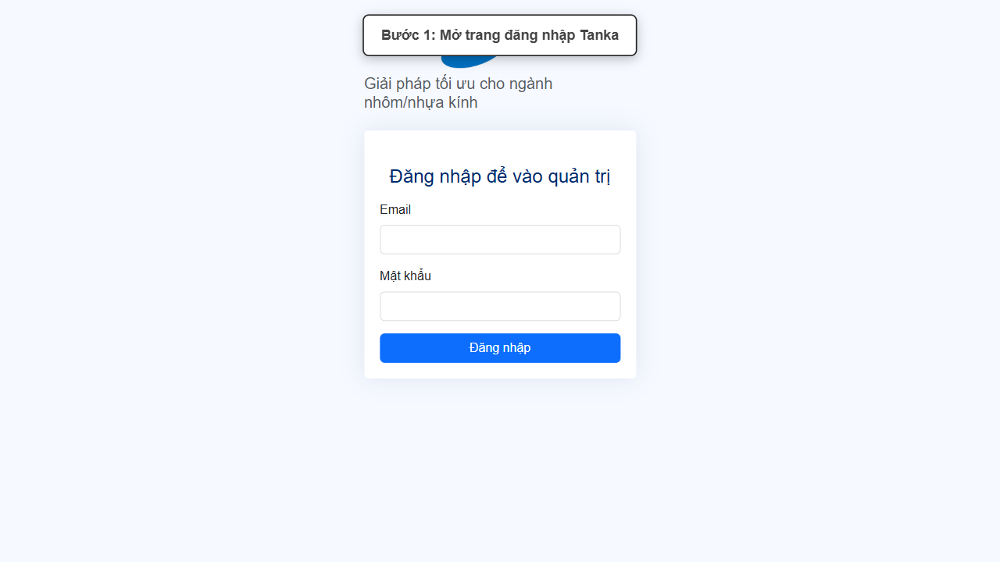
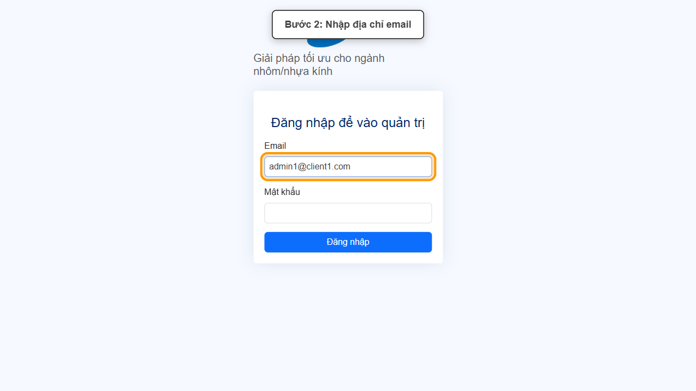
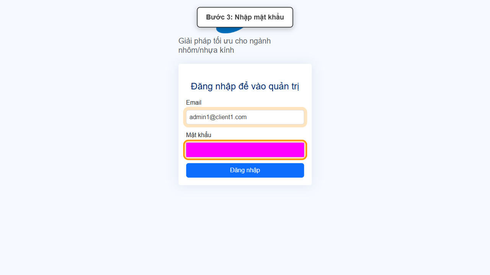
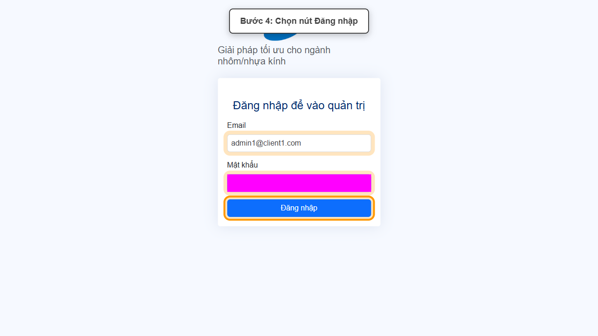
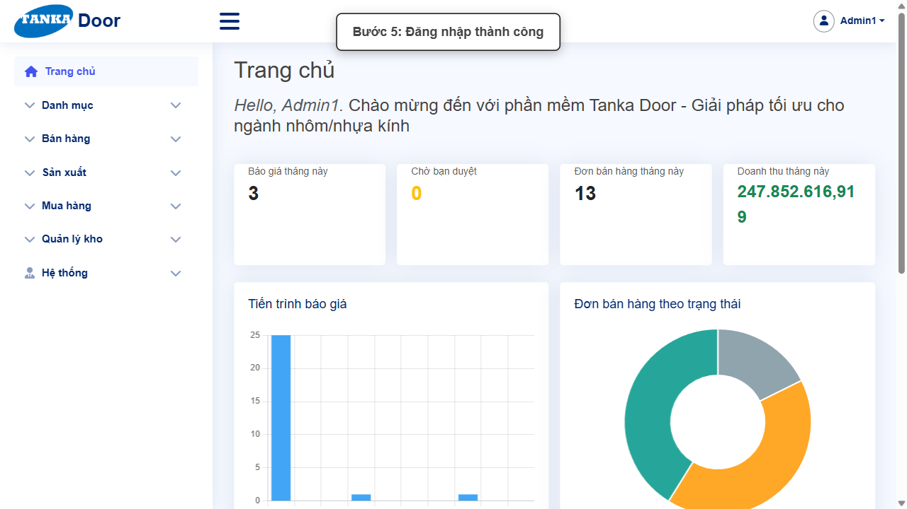

# HƯỚNG DẪN SỬ DỤNG — ĐĂNG NHẬP HỆ THỐNG

**Đường dẫn:** Trang đăng nhập TANKA Door (door-v1.test.tankasoft.com)  
**Mục tiêu:** Đăng nhập đúng cách bằng tài khoản được cấp và xác nhận đã vào được Trang chủ.  
**Dành cho:** Người mới sử dụng TANKA Door

## Trước khi bắt đầu

**Cần có sẵn:**

- Địa chỉ hệ thống, Email và mật khẩu do quản trị viên cấp (UG-060).
- Máy tính có trình duyệt Chrome/Edge mới, kết nối Internet.

**Quyền cần có:** Tài khoản chưa bị khoá. Nếu không thấy menu hoặc nút như trong ảnh, liên hệ quản trị hệ thống.

> Ảnh minh họa được chụp bằng tài khoản quản trị trên hệ thống thử nghiệm. Thuật ngữ viết tắt (HTK, NVL, BH, SX, YCMH...) và thứ tự các nghiệp vụ: xem **UG-000 Tổng quan**.

## 1. Ví dụ dữ liệu nhập

Ví dụ dưới đây giúp bạn hình dung cách nhập. Hãy nhập dữ liệu thật của công ty bạn; tên/mã có hậu tố số trong ảnh là dữ liệu thử nghiệm, mã chứng từ (BG_, BH_, SX_, MH_...) do hệ thống tự sinh nên của bạn sẽ khác.

| Trường | Giá trị |
| --- | --- |
| Địa chỉ hệ thống | Do công ty cung cấp (ảnh chụp dùng https://door-v1.test.tankasoft.com/) |
| Email | Email công ty cấp cho bạn (ảnh chụp dùng admin1@client1.com) |
| Mật khẩu | Mật khẩu được quản trị viên cấp cho tài khoản của bạn |

## 2. Sơ đồ quy trình tóm tắt

BẮT ĐẦU → Mở trang đăng nhập → Nhập Email và Mật khẩu → Bấm Đăng nhập → Xác nhận đã vào Trang chủ

## 3. Quy trình thao tác từng bước

### Bước 1. Mở trang đăng nhập Tanka

Mở trình duyệt, truy cập địa chỉ hệ thống do công ty cung cấp (trong ảnh: `https://door-v1.test.tankasoft.com/`). Màn hình hiện khung "Đăng nhập để vào quản trị" với hai ô Email, Mật khẩu và nút Đăng nhập.

*Hình 1: Màn hình đăng nhập.*

<video src="videos/UG-001-dang-nhap/01.webm" controls muted width="100%"></video>

### Bước 2. Nhập địa chỉ Email

Bấm vào ô Email và nhập đúng email được cấp, ví dụ `admin1@client1.com`.

*Hình 2: Nhập Email.*

<video src="videos/UG-001-dang-nhap/02.webm" controls muted width="100%"></video>

### Bước 3. Nhập Mật khẩu

Bấm vào ô Mật khẩu và nhập đúng mật khẩu được cấp. Kiểm tra phím Caps Lock nếu nghi ngờ gõ sai ký tự.

*Hình 3: Nhập Mật khẩu (ảnh được che để bảo mật).*

<video src="videos/UG-001-dang-nhap/03.webm" controls muted width="100%"></video>

### Bước 4. Bấm nút Đăng nhập

Kiểm tra lại Email/Mật khẩu rồi bấm nút **Đăng nhập** đúng một lần, chờ hệ thống xử lý.

*Hình 4: Bấm Đăng nhập.*

<video src="videos/UG-001-dang-nhap/04.webm" controls muted width="100%"></video>

### Bước 5. Xác nhận đăng nhập thành công

Hệ thống chuyển sang **Trang chủ** với menu bên trái (Danh mục, Bán hàng, Sản xuất, Mua hàng, Hệ thống...) và tên tài khoản ở góc phải trên — đây là dấu hiệu đăng nhập thành công.

*Hình 5: Trang chủ sau khi đăng nhập.*

<video src="videos/UG-001-dang-nhap/05.webm" controls muted width="100%"></video>

## 4. Khi không thao tác được

| Hiện tượng | Cách xử lý ngay |
| --- | --- |
| Bấm Đăng nhập nhưng vẫn ở trang đăng nhập | Kiểm tra lại Email/Mật khẩu, chú ý phím Caps Lock và khoảng trắng thừa. |
| Không nhớ mật khẩu | Liên hệ quản trị viên hệ thống của công ty để được cấp lại, không tự đoán thử nhiều lần liên tiếp. |
| Trang tải rất lâu hoặc trắng trang | Kiểm tra kết nối mạng, tải lại trang; nếu vẫn lỗi, thử trình duyệt khác. |

## 5. Dấu hiệu hoàn thành

- Không còn ở trang đăng nhập; URL đã chuyển sang trang nội bộ hệ thống.
- Thấy menu bên trái và tên tài khoản (ví dụ Admin111) ở góc phải trên.
- Trang chủ hiển thị các số liệu tổng quan (Báo giá tháng này, Đơn bán hàng tháng này...).

## 6. Checklist dành cho người mới

- [ ] Đã mở đúng URL hệ thống.
- [ ] Đã nhập đúng Email và Mật khẩu được cấp.
- [ ] Chỉ bấm Đăng nhập một lần và chờ xử lý.
- [ ] Đã xác nhận thấy Trang chủ với menu bên trái.

---

_Tài liệu này được biên soạn dựa trên thao tác thực tế trên hệ thống door-v1.test.tankasoft.com. Ảnh minh họa có thể thay đổi theo phiên bản giao diện._
