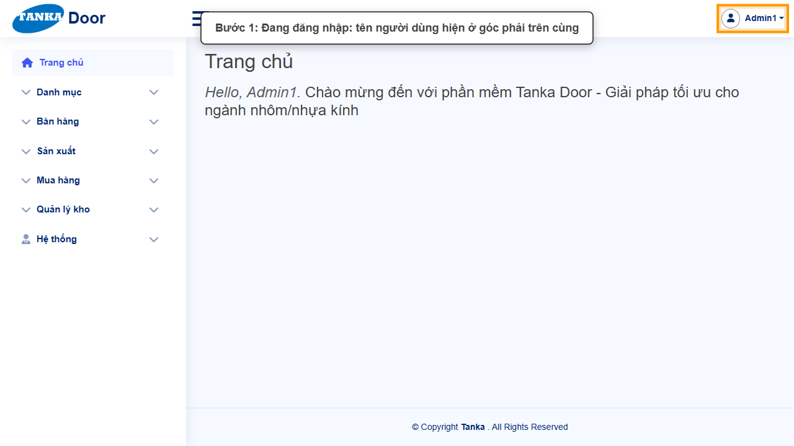
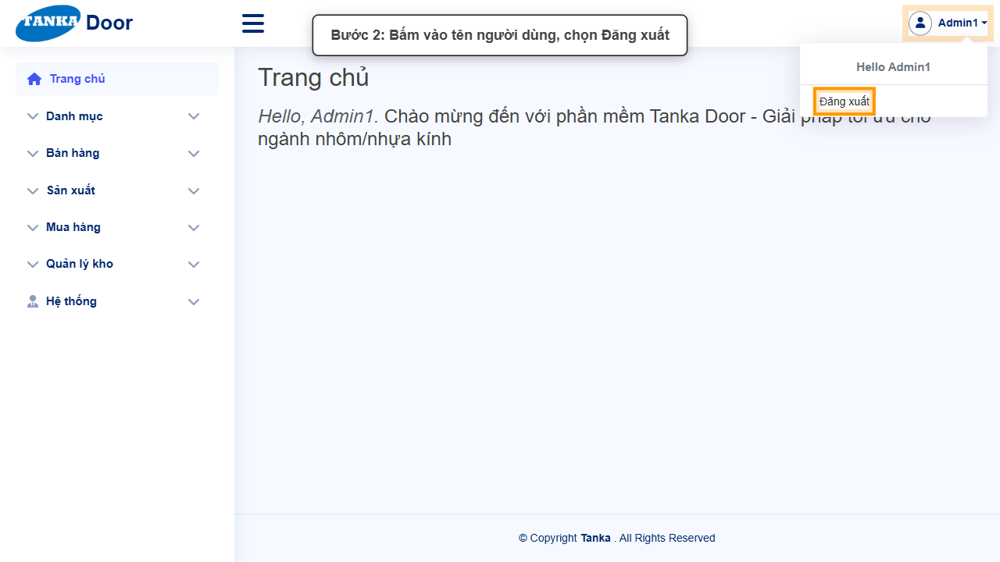
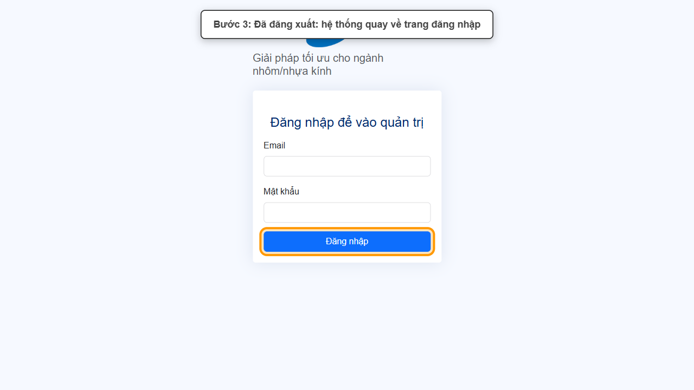

# HƯỚNG DẪN SỬ DỤNG — ĐĂNG XUẤT

**Đường dẫn:** Menu tên người dùng (góc phải trên) > Đăng xuất  
**Mục tiêu:** Thoát khỏi tài khoản khi kết thúc phiên làm việc hoặc dùng máy chung.  
**Dành cho:** Người mới sử dụng TANKA Door

## Trước khi bắt đầu

**Cần có sẵn:**

- Đang đăng nhập hệ thống.
- Đã lưu các chứng từ đang sửa dở.

**Nên đọc trước:** UG-001.

**Quyền cần có:** Mọi tài khoản. Nếu không thấy menu hoặc nút như trong ảnh, liên hệ quản trị hệ thống.

> Ảnh minh họa được chụp bằng tài khoản quản trị trên hệ thống thử nghiệm. Thuật ngữ viết tắt (HTK, NVL, BH, SX, YCMH...) và thứ tự các nghiệp vụ: xem **UG-000 Tổng quan**.

## 1. Khái niệm

Tên người dùng đang đăng nhập hiển thị ở **góc phải trên cùng** của mọi màn hình. Bấm vào tên để mở menu, trong đó có lời chào và mục **Đăng xuất**. Sau khi đăng xuất, hệ thống quay về trang đăng nhập; muốn làm việc tiếp phải đăng nhập lại (UG-001).

## 2. Quy trình thao tác từng bước

### Bước 1. Xác định tài khoản đang đăng nhập

Nhìn góc phải trên: biểu tượng người dùng và tên (ví dụ **Admin1**).

*Hình 1: Xác định tài khoản đang đăng nhập.*

<video src="videos/UG-002-dang-xuat/01.webm" controls muted width="100%"></video>

### Bước 2. Mở menu người dùng, chọn Đăng xuất

Bấm vào tên người dùng → menu hiện **Hello <tên>** và **Đăng xuất** → bấm **Đăng xuất**.

*Hình 2: Mở menu người dùng, chọn Đăng xuất.*

<video src="videos/UG-002-dang-xuat/02.webm" controls muted width="100%"></video>

### Bước 3. Kiểm tra đã đăng xuất

Màn hình quay về trang đăng nhập (ô Email, Mật khẩu, nút Đăng nhập).

*Hình 3: Kiểm tra đã đăng xuất.*

<video src="videos/UG-002-dang-xuat/03.webm" controls muted width="100%"></video>

## 3. Khi không thao tác được

| Hiện tượng | Cách xử lý ngay |
| --- | --- |
| Đóng trình duyệt mà chưa đăng xuất | Phiên có thể vẫn còn hiệu lực trên máy đó — mở lại và bấm Đăng xuất, nhất là trên máy dùng chung. |
| Bị đưa về trang đăng nhập dù chưa bấm Đăng xuất | Phiên hết hạn hoặc tài khoản bị khoá (UG-060) — đăng nhập lại hoặc liên hệ quản trị. |

## 4. Checklist dành cho người mới

- [ ] Đã lưu các chứng từ đang sửa trước khi đăng xuất.
- [ ] Đã thấy trang đăng nhập sau khi bấm Đăng xuất.

---

_Tài liệu này được biên soạn dựa trên thao tác thực tế trên hệ thống door-v1.test.tankasoft.com. Ảnh minh họa có thể thay đổi theo phiên bản giao diện._
