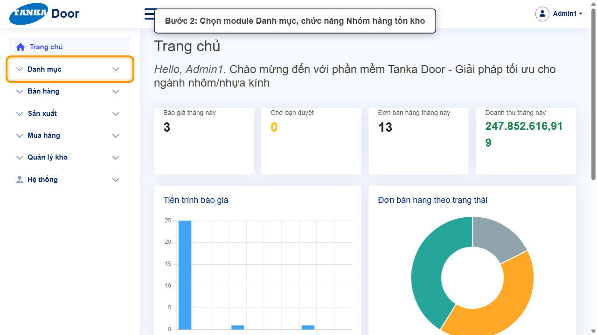
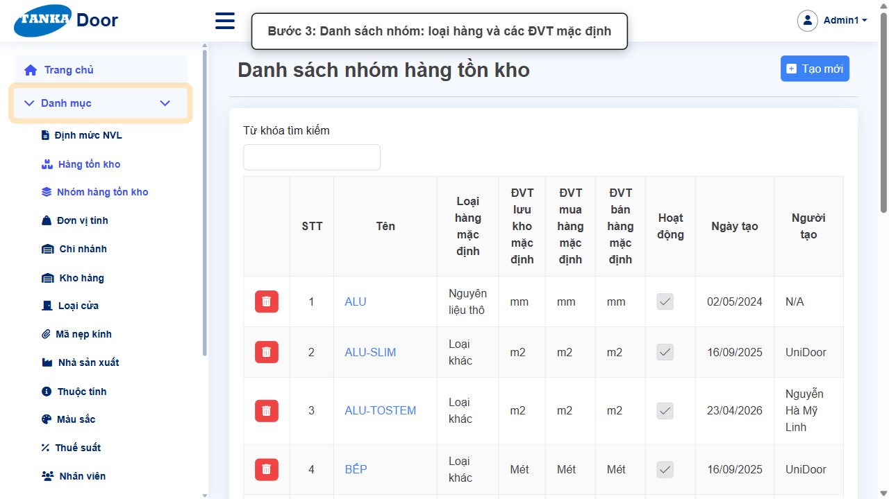
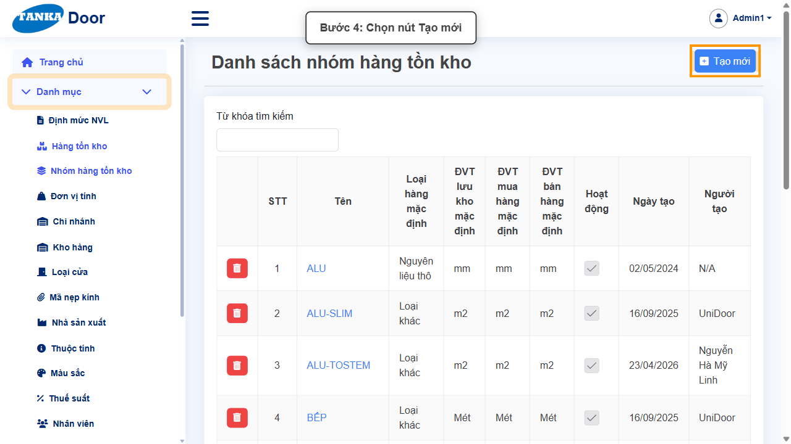
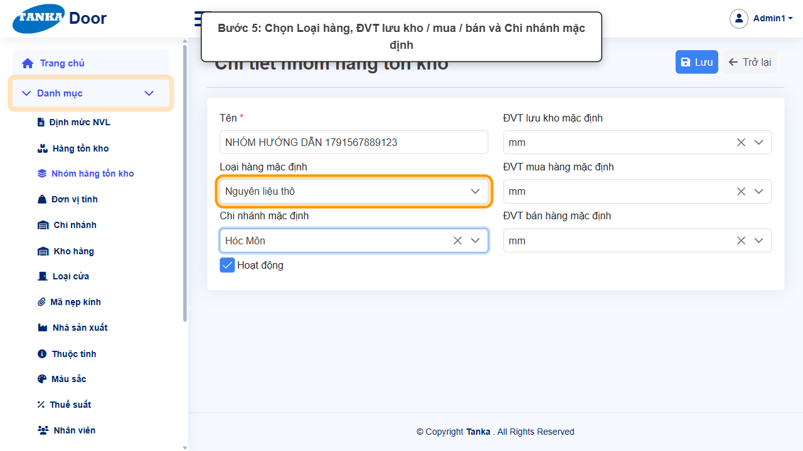
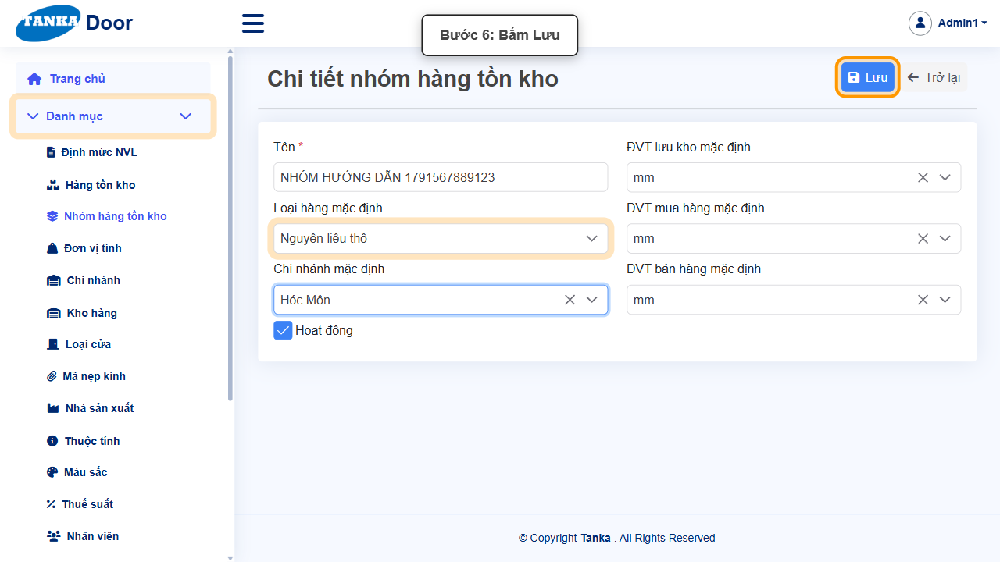
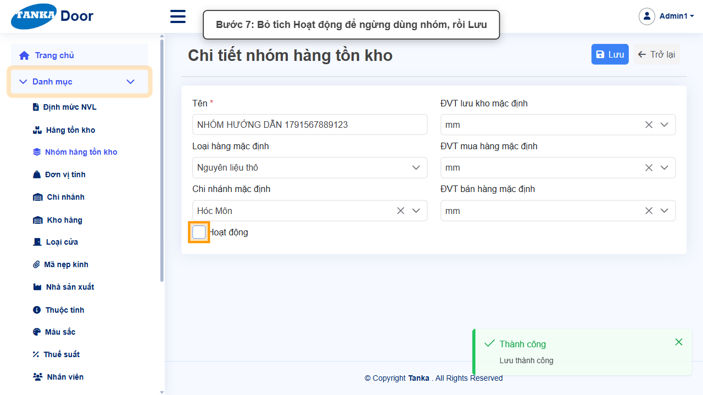
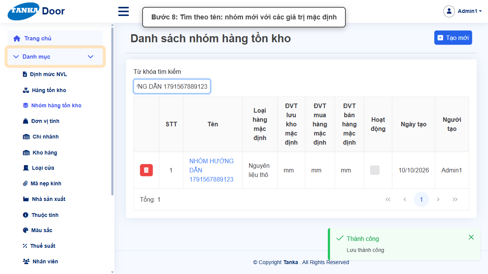

# HƯỚNG DẪN SỬ DỤNG — NHÓM HÀNG TỒN KHO

**Đường dẫn:** Danh mục > Nhóm hàng tồn kho  
**Mục tiêu:** Tạo nhóm hàng tồn kho với các giá trị mặc định (loại hàng, ĐVT, chi nhánh) để khai báo mặt hàng nhanh và thống nhất.  
**Dành cho:** Người mới sử dụng TANKA Door

## Trước khi bắt đầu

**Cần có sẵn:**

- Đã có các Đơn vị tính sẽ đặt làm mặc định (UG-015) và Chi nhánh (UG-016).

**Nên đọc trước:** UG-015.

**Quyền cần có:** Tài khoản thuộc nhóm có quyền Xem/Tạo/Sửa module **Danh mục** (UG-063). Nếu không thấy menu hoặc nút như trong ảnh, liên hệ quản trị hệ thống.

> Ảnh minh họa được chụp bằng tài khoản quản trị trên hệ thống thử nghiệm. Thuật ngữ viết tắt (HTK, NVL, BH, SX, YCMH...) và thứ tự các nghiệp vụ: xem **UG-000 Tổng quan**.

## 1. Khái niệm

Nhóm HTK (ví dụ ALU, ALU-SLIM, BẾP) gom các mặt hàng cùng tính chất. Khi tạo mặt hàng mới và chọn nhóm, các **giá trị mặc định** của nhóm được dùng làm gợi ý: Loại hàng (Hoàn thiện, Bán thành phẩm, Bộ phận cấu thành, Nguyên liệu thô, Nhân công, Chi phí máy, Chi phí trực tiếp khác, Loại khác), ĐVT lưu kho / mua hàng / bán hàng, Chi nhánh mặc định. Nhóm HTK cũng là điều kiện lọc của các nút cập nhật hàng loạt (UG-084).

## 2. Ví dụ dữ liệu nhập

Ví dụ dưới đây giúp bạn hình dung cách nhập. Hãy nhập dữ liệu thật của công ty bạn; tên/mã có hậu tố số trong ảnh là dữ liệu thử nghiệm, mã chứng từ (BG_, BH_, SX_, MH_...) do hệ thống tự sinh nên của bạn sẽ khác.

| Trường | Giá trị |
| --- | --- |
| Tên | NHÔM HỆ 55 |
| Loại hàng mặc định | Nguyên liệu thô |
| ĐVT lưu kho / mua / bán mặc định | mm / mm / mm |
| Chi nhánh mặc định | Hóc Môn |

> **Không xoá danh mục đã dùng.** Khi không dùng nữa, bỏ tích **Hoạt động** rồi **Lưu**: bản ghi không còn hiện trong ô chọn khi lập chứng từ mới nhưng vẫn giữ nguyên trên chứng từ cũ. Ảnh minh họa có bước bỏ tích này ở cuối — bạn chỉ làm bước đó khi thật sự ngừng sử dụng.

## 3. Quy trình thao tác từng bước

### Bước 1. Mở trang chủ Tanka Door

Đăng nhập, màn hình **Trang chủ** hiện ra.

*Hình 1: Mở trang chủ Tanka Door.*

<video src="videos/UG-014-nhom-hang-ton-kho/01.webm" controls muted width="100%"></video>

### Bước 2. Mở Danh mục > Nhóm hàng tồn kho

Ở menu bên trái bấm **Danh mục**, chọn **Nhóm hàng tồn kho**.

*Hình 2: Mở Danh mục > Nhóm hàng tồn kho.*

<video src="videos/UG-014-nhom-hang-ton-kho/02.webm" controls muted width="100%"></video>

### Bước 3. Xem danh sách nhóm

Danh sách hiển thị Tên, Loại hàng mặc định, ĐVT lưu kho / mua / bán mặc định, Hoạt động.

*Hình 3: Xem danh sách nhóm.*

<video src="videos/UG-014-nhom-hang-ton-kho/03.webm" controls muted width="100%"></video>

### Bước 4. Bấm Tạo mới

**Kết quả mong đợi:** form nhập mới mở ra; các ô có dấu * là bắt buộc.

*Hình 4: Bấm Tạo mới.*

<video src="videos/UG-014-nhom-hang-ton-kho/04.webm" controls muted width="100%"></video>

### Bước 5. Nhập tên và các giá trị mặc định

Nhập **Tên ***, chọn **Loại hàng mặc định**, **ĐVT lưu kho / mua hàng / bán hàng mặc định** và **Chi nhánh mặc định**. Nên chọn 3 ĐVT giống nhau hoặc đã khai báo quy đổi (UG-015) để tránh lỗi khi lưu mặt hàng.

*Hình 5: Nhập tên và các giá trị mặc định.*

<video src="videos/UG-014-nhom-hang-ton-kho/05.webm" controls muted width="100%"></video>

### Bước 6. Bấm Lưu

Thông báo **"Lưu thành công"**.

*Hình 6: Bấm Lưu.*

<video src="videos/UG-014-nhom-hang-ton-kho/06.webm" controls muted width="100%"></video>

### Bước 7. Ngừng sử dụng nhóm (khi cần)

Bỏ tích **Hoạt động** rồi bấm **Lưu**: nhóm không còn hiện khi chọn Nhóm HTK cho mặt hàng mới.

*Hình 7: Ngừng sử dụng nhóm (khi cần).*

<video src="videos/UG-014-nhom-hang-ton-kho/07.webm" controls muted width="100%"></video>

### Bước 8. Trở lại danh sách và tìm kiếm

Bấm **Trở lại**, nhập tên vào **Từ khóa tìm kiếm**, nhấn Enter.

*Hình 8: Trở lại danh sách và tìm kiếm.*

<video src="videos/UG-014-nhom-hang-ton-kho/08.webm" controls muted width="100%"></video>

## 4. Khi không thao tác được

| Hiện tượng | Cách xử lý ngay |
| --- | --- |
| Lưu mặt hàng báo "chưa có quy đổi" | ĐVT mặc định của nhóm khác nhau mà chưa khai báo quy đổi — xem UG-015. |
| Nút Lưu đang mờ | Còn ô có dấu * chưa nhập/chọn, hoặc form chưa có thay đổi nào. |
| Bấm Lưu nhưng không thấy phản hồi | Không bấm thêm; chờ thông báo rồi tìm lại bản ghi trong danh sách. |
| Muốn bỏ một danh mục không dùng nữa | Bỏ tích **Hoạt động** rồi Lưu (khuyến nghị) thay vì xoá — bản ghi cũ vẫn giữ trên các chứng từ đã lập, nhưng không còn được chọn khi lập chứng từ mới. |

## 5. Checklist dành cho người mới

- [ ] Đã nhập đủ các ô có dấu *.
- [ ] Đã bấm Lưu và thấy thông báo "Lưu thành công".
- [ ] Đã tìm lại được bản ghi trong danh sách.
- [ ] Dùng bỏ tích Hoạt động thay vì xoá khi không dùng nữa.

---

_Tài liệu này được biên soạn dựa trên thao tác thực tế trên hệ thống door-v1.test.tankasoft.com. Ảnh minh họa có thể thay đổi theo phiên bản giao diện._
