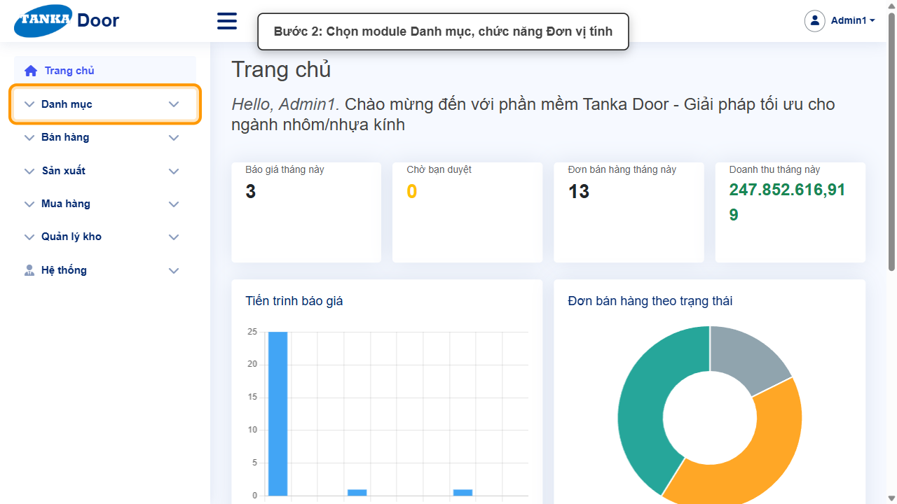
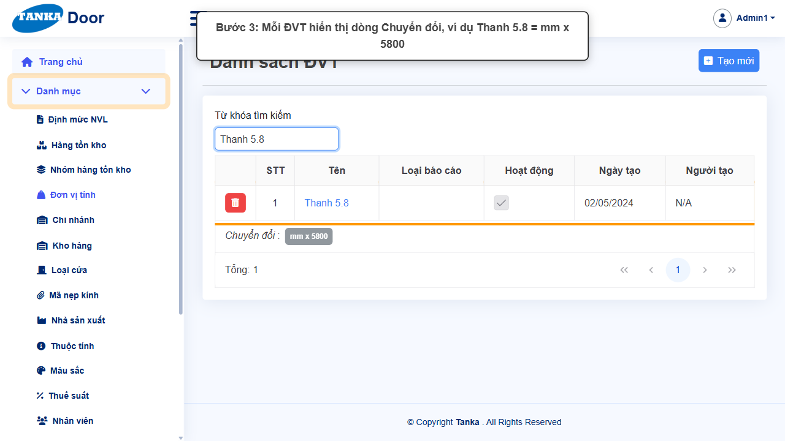
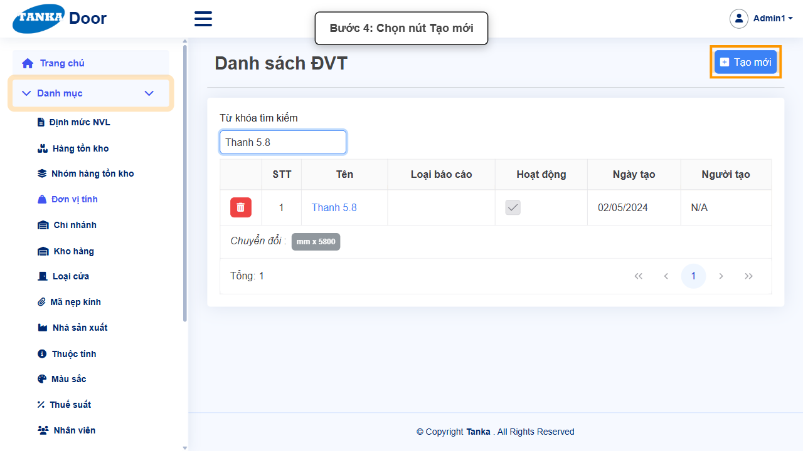
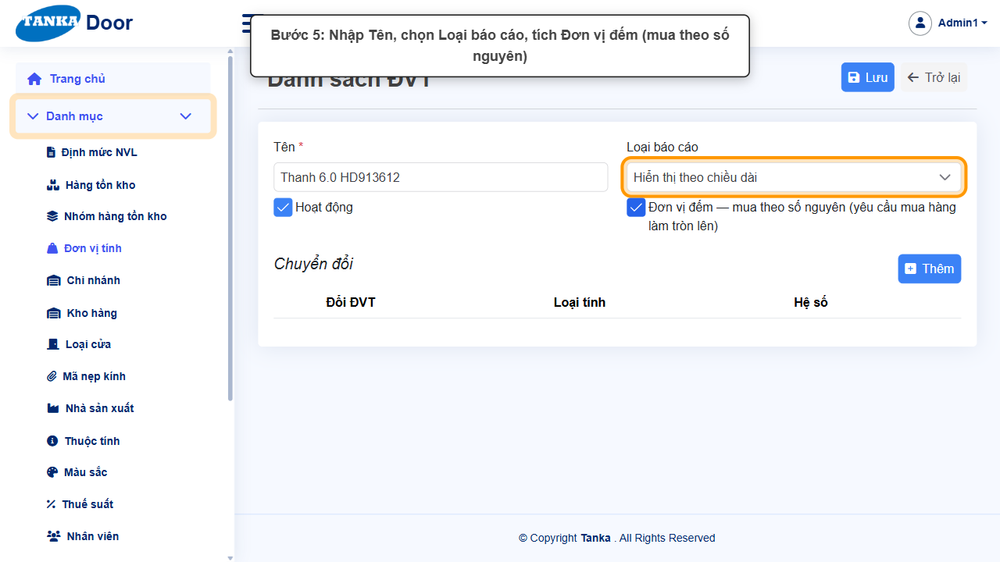
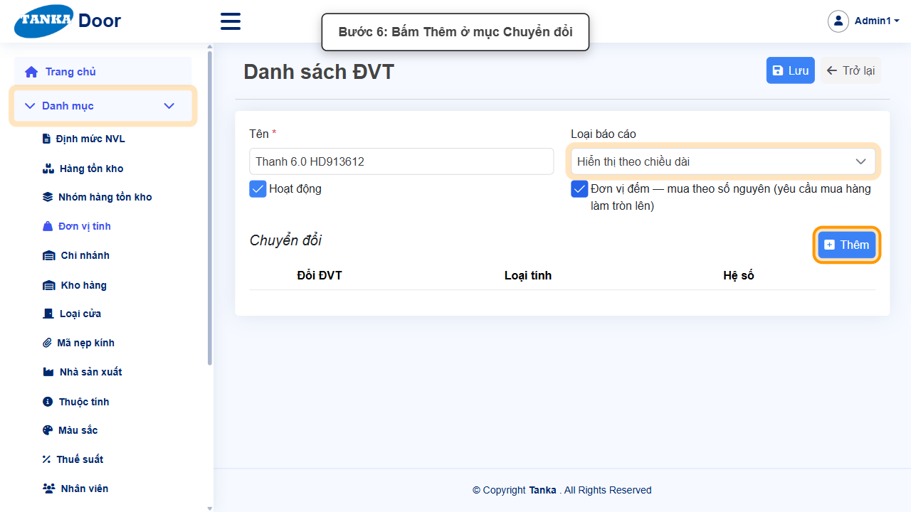
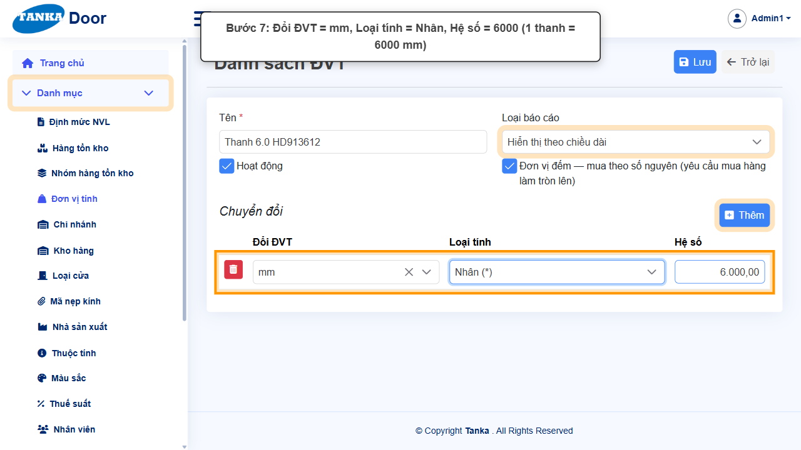
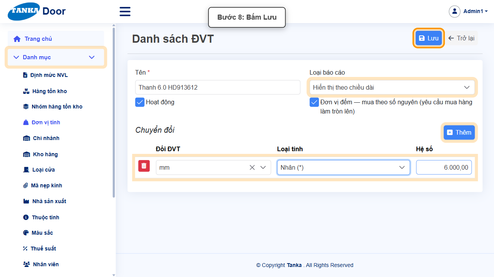
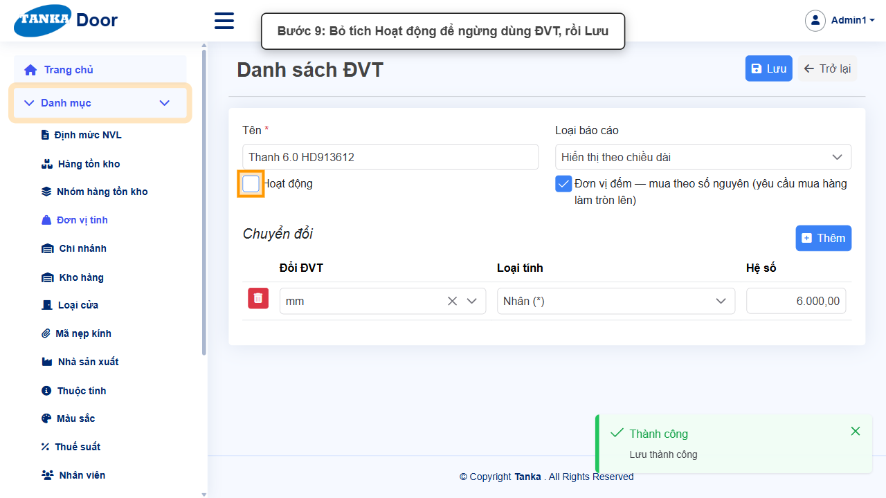
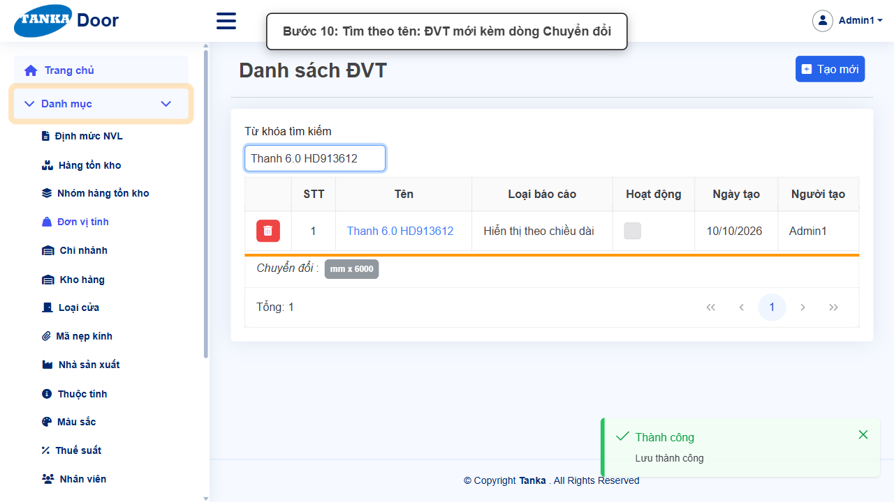

# HƯỚNG DẪN SỬ DỤNG — ĐƠN VỊ TÍNH VÀ QUY ĐỔI

**Đường dẫn:** Danh mục > Đơn vị tính  
**Mục tiêu:** Tạo đơn vị tính (ĐVT) mới và khai báo quy đổi sang ĐVT khác để mua, bán, lưu kho bằng các đơn vị khác nhau.  
**Dành cho:** Người mới sử dụng TANKA Door

## Trước khi bắt đầu

**Cần có sẵn:**

- Biết hệ số quy đổi giữa ĐVT mới và ĐVT lưu kho (ví dụ 1 thanh = 6000 mm).

**Quyền cần có:** Tài khoản thuộc nhóm có quyền Xem/Tạo/Sửa module **Danh mục** (UG-063). Nếu không thấy menu hoặc nút như trong ảnh, liên hệ quản trị hệ thống.

> Ảnh minh họa được chụp bằng tài khoản quản trị trên hệ thống thử nghiệm. Thuật ngữ viết tắt (HTK, NVL, BH, SX, YCMH...) và thứ tự các nghiệp vụ: xem **UG-000 Tổng quan**.

## 1. Khái niệm

Mỗi mặt hàng có 3 ĐVT: **lưu kho**, **mua hàng**, **bán hàng**. Nếu khác nhau, hệ thống cần **quy đổi** — ví dụ **Thanh 5.8 = mm × 5800**, **mm = Mét × 0.001**. Thiếu quy đổi thì lưu mặt hàng báo _"ĐVT ... chưa có quy đổi sang ĐVT lưu kho ..."_.

- **Loại báo cáo**: Hiển thị theo bộ / theo chiều dài / theo diện tích (cách hiển thị số lượng trên báo cáo).
- **Đơn vị đếm — mua theo số nguyên**: yêu cầu mua hàng sẽ làm tròn lên (ví dụ thanh, bộ, cái).

## 2. Ví dụ dữ liệu nhập

Ví dụ dưới đây giúp bạn hình dung cách nhập. Hãy nhập dữ liệu thật của công ty bạn; tên/mã có hậu tố số trong ảnh là dữ liệu thử nghiệm, mã chứng từ (BG_, BH_, SX_, MH_...) do hệ thống tự sinh nên của bạn sẽ khác.

| Trường | Giá trị |
| --- | --- |
| Tên | Cây 6m |
| Loại báo cáo | Hiển thị theo chiều dài |
| Đơn vị đếm | Có (mua theo số nguyên) |
| Chuyển đổi | mm × 6000 (1 thanh = 6000 mm) |

> **Không xoá danh mục đã dùng.** Khi không dùng nữa, bỏ tích **Hoạt động** rồi **Lưu**: bản ghi không còn hiện trong ô chọn khi lập chứng từ mới nhưng vẫn giữ nguyên trên chứng từ cũ. Ảnh minh họa có bước bỏ tích này ở cuối — bạn chỉ làm bước đó khi thật sự ngừng sử dụng.

## 3. Quy trình thao tác từng bước

### Bước 1. Mở trang chủ Tanka Door

**Kết quả mong đợi:** menu chức năng hiện ở bên trái màn hình.

*Hình 1: Mở trang chủ Tanka Door.*

<video src="videos/UG-015-don-vi-tinh/01.webm" controls muted width="100%"></video>

### Bước 2. Mở Danh mục > Đơn vị tính

**Kết quả mong đợi:** màn hình **Đơn vị tính** hiện ra với danh sách dữ liệu và các ô lọc.

*Hình 2: Mở Danh mục > Đơn vị tính.*

<video src="videos/UG-015-don-vi-tinh/02.webm" controls muted width="100%"></video>

### Bước 3. Xem quy đổi của ĐVT có sẵn

Tìm một ĐVT (ví dụ Thanh 5.8): dưới mỗi dòng có **Chuyển đổi : mm x 5800**.

*Hình 3: Xem quy đổi của ĐVT có sẵn.*

<video src="videos/UG-015-don-vi-tinh/03.webm" controls muted width="100%"></video>

### Bước 4. Bấm Tạo mới

**Kết quả mong đợi:** form nhập mới mở ra; các ô có dấu * là bắt buộc.

*Hình 4: Bấm Tạo mới.*

<video src="videos/UG-015-don-vi-tinh/04.webm" controls muted width="100%"></video>

### Bước 5. Nhập tên, loại báo cáo, đơn vị đếm

Nhập **Tên ***, chọn **Loại báo cáo**, tích **Đơn vị đếm** nếu chỉ mua theo số nguyên.

*Hình 5: Nhập tên, loại báo cáo, đơn vị đếm.*

<video src="videos/UG-015-don-vi-tinh/05.webm" controls muted width="100%"></video>

### Bước 6. Thêm dòng chuyển đổi

Ở mục **Chuyển đổi**, bấm **Thêm**.

*Hình 6: Thêm dòng chuyển đổi.*

<video src="videos/UG-015-don-vi-tinh/06.webm" controls muted width="100%"></video>

### Bước 7. Khai báo quy đổi

Chọn **Đổi ĐVT** (gõ để tìm, ví dụ mm), **Loại tính** (Nhân (*) hoặc Chia (/)), nhập **Hệ số** (6000). Nghĩa là 1 ĐVT mới = 6000 mm.

*Hình 7: Khai báo quy đổi.*

<video src="videos/UG-015-don-vi-tinh/07.webm" controls muted width="100%"></video>

### Bước 8. Bấm Lưu

**Kết quả mong đợi:** thông báo xanh **"Lưu thành công"** hiện ở góc phải, nút **Lưu** mờ lại.

*Hình 8: Bấm Lưu.*

<video src="videos/UG-015-don-vi-tinh/08.webm" controls muted width="100%"></video>

### Bước 9. Ngừng sử dụng ĐVT (khi cần)

Bỏ tích **Hoạt động** rồi **Lưu**.

*Hình 9: Ngừng sử dụng ĐVT (khi cần).*

<video src="videos/UG-015-don-vi-tinh/09.webm" controls muted width="100%"></video>

### Bước 10. Kiểm tra trong danh sách

Tìm theo tên: dòng ĐVT mới kèm **Chuyển đổi : mm x 6000**.

*Hình 10: Kiểm tra trong danh sách.*

<video src="videos/UG-015-don-vi-tinh/10.webm" controls muted width="100%"></video>

### Video tổng hợp toàn bộ thao tác

Video dưới đây ghép liền toàn bộ các bước ở trên, từ lúc mở chức năng đến khi hoàn thành — xem lại một lượt trước khi tự thao tác.

<video src="videos/UG-015-don-vi-tinh/full.webm" controls muted width="100%"></video>

## 4. Khi không thao tác được

| Hiện tượng | Cách xử lý ngay |
| --- | --- |
| Không tìm thấy ĐVT trong ô Đổi ĐVT | Danh sách dài — gõ tên ĐVT để lọc. |
| Nút Lưu đang mờ | Còn ô có dấu * chưa nhập/chọn, hoặc form chưa có thay đổi nào. |
| Bấm Lưu nhưng không thấy phản hồi | Không bấm thêm; chờ thông báo rồi tìm lại bản ghi trong danh sách. |
| Muốn bỏ một danh mục không dùng nữa | Bỏ tích **Hoạt động** rồi Lưu (khuyến nghị) thay vì xoá — bản ghi cũ vẫn giữ trên các chứng từ đã lập, nhưng không còn được chọn khi lập chứng từ mới. |

## 5. Checklist dành cho người mới

- [ ] Đã nhập đủ các ô có dấu *.
- [ ] Đã bấm Lưu và thấy thông báo "Lưu thành công".
- [ ] Đã tìm lại được bản ghi trong danh sách.
- [ ] Dùng bỏ tích Hoạt động thay vì xoá khi không dùng nữa.

---

_Tài liệu này được biên soạn dựa trên thao tác thực tế trên hệ thống door-v1.test.tankasoft.com. Ảnh minh họa có thể thay đổi theo phiên bản giao diện._
