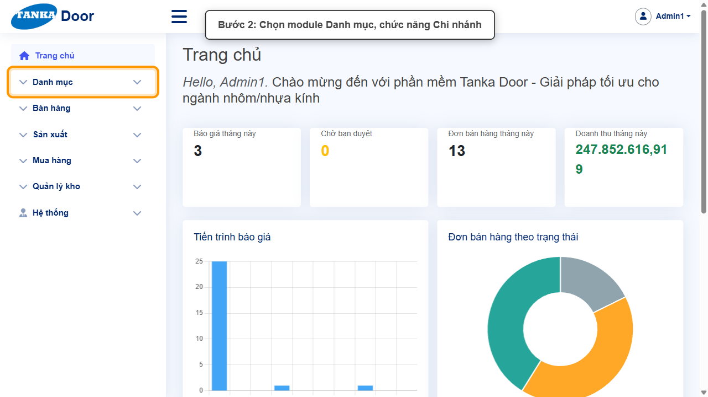
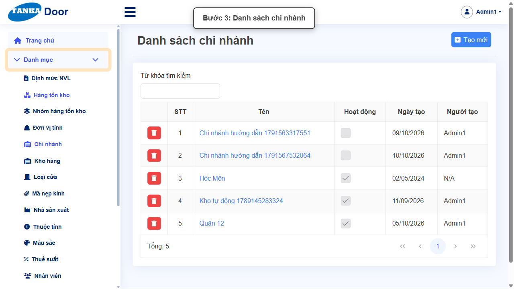
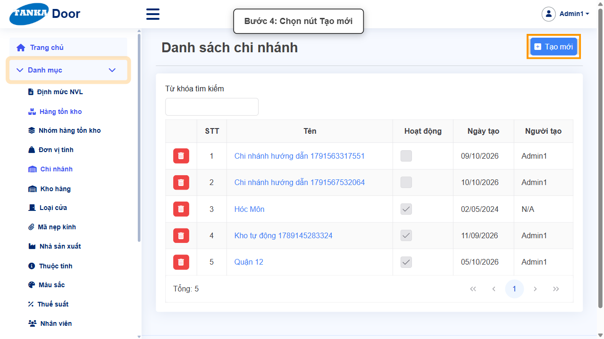
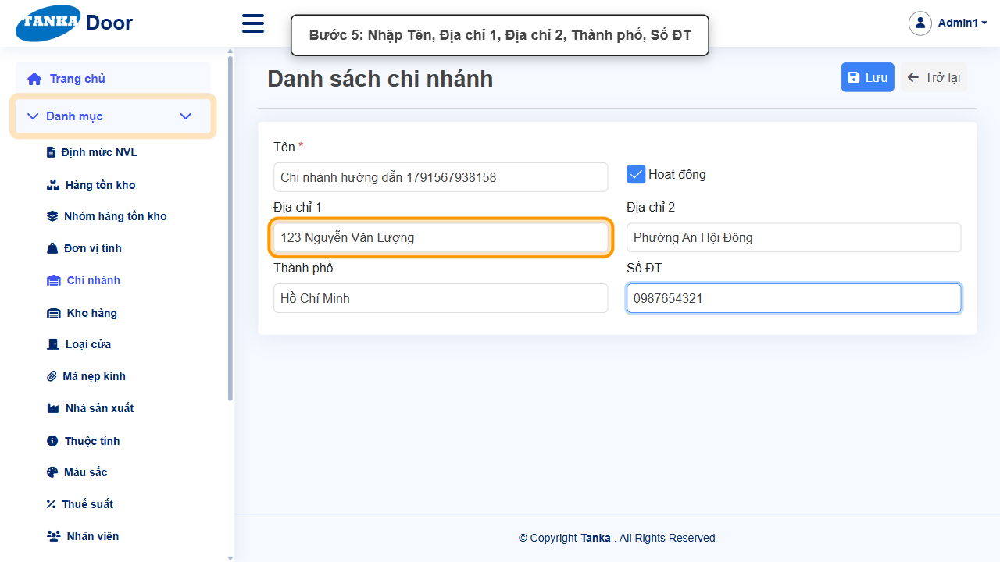
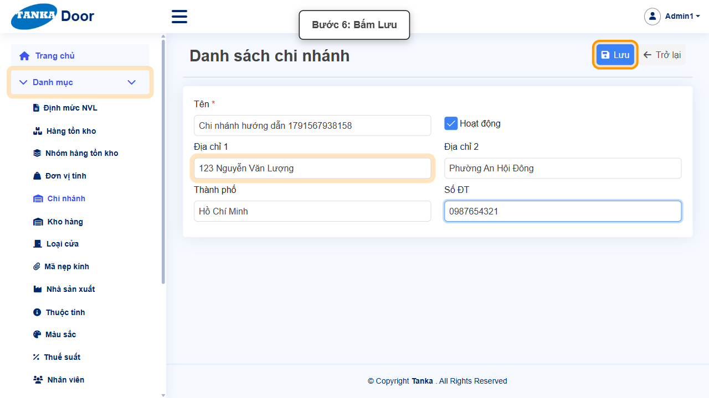
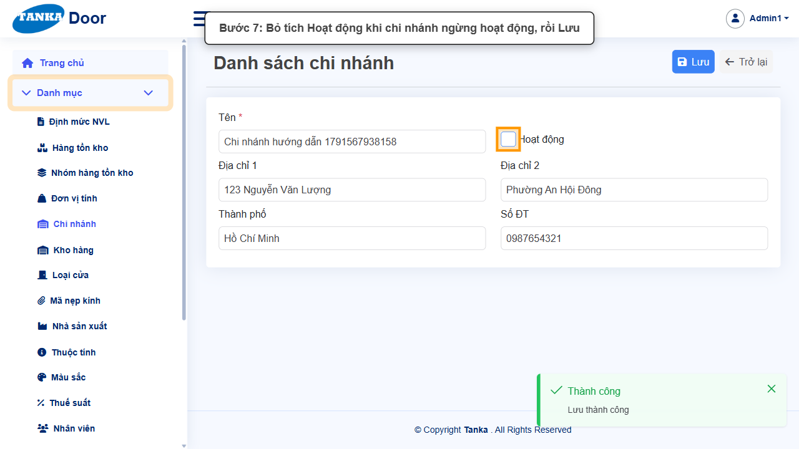
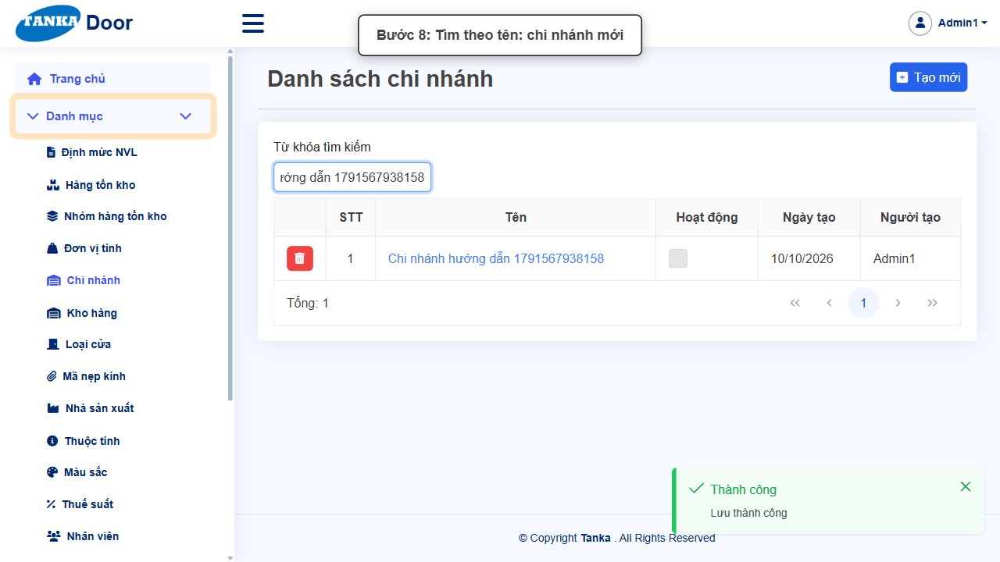

# HƯỚNG DẪN SỬ DỤNG — CHI NHÁNH

**Đường dẫn:** Danh mục > Chi nhánh  
**Mục tiêu:** Tạo chi nhánh với địa chỉ, số điện thoại — đơn vị mà báo giá, đơn bán hàng, lệnh sản xuất, kho và định mức NVL đều gắn vào.  
**Dành cho:** Người mới sử dụng TANKA Door

## Trước khi bắt đầu

**Cần có sẵn:**

- Thông tin địa chỉ, số điện thoại của chi nhánh.

**Quyền cần có:** Tài khoản thuộc nhóm có quyền Xem/Tạo/Sửa module **Danh mục** (UG-063). Nếu không thấy menu hoặc nút như trong ảnh, liên hệ quản trị hệ thống.

> Ảnh minh họa được chụp bằng tài khoản quản trị trên hệ thống thử nghiệm. Thuật ngữ viết tắt (HTK, NVL, BH, SX, YCMH...) và thứ tự các nghiệp vụ: xem **UG-000 Tổng quan**.

## 1. Khái niệm

**Chi nhánh** là đơn vị kinh doanh: mỗi kho thuộc một chi nhánh (UG-011); báo giá, đơn BH, lệnh SX chọn chi nhánh; **giá bán khai báo theo chi nhánh** và **mỗi HTK chỉ có một định mức NVL cho mỗi chi nhánh** (UG-013). Thông tin địa chỉ, số ĐT dùng khi in chứng từ.

## 2. Ví dụ dữ liệu nhập

Ví dụ dưới đây giúp bạn hình dung cách nhập. Hãy nhập dữ liệu thật của công ty bạn; tên/mã có hậu tố số trong ảnh là dữ liệu thử nghiệm, mã chứng từ (BG_, BH_, SX_, MH_...) do hệ thống tự sinh nên của bạn sẽ khác.

| Trường | Giá trị |
| --- | --- |
| Tên | Chi nhánh Thủ Đức |
| Địa chỉ 1 / Địa chỉ 2 | 123 Nguyễn Văn Lượng / Phường An Hội Đông |
| Thành phố | Hồ Chí Minh |
| Số ĐT | 0987654321 |

> **Không xoá danh mục đã dùng.** Khi không dùng nữa, bỏ tích **Hoạt động** rồi **Lưu**: bản ghi không còn hiện trong ô chọn khi lập chứng từ mới nhưng vẫn giữ nguyên trên chứng từ cũ. Ảnh minh họa có bước bỏ tích này ở cuối — bạn chỉ làm bước đó khi thật sự ngừng sử dụng.

## 3. Quy trình thao tác từng bước

### Bước 1. Mở trang chủ Tanka Door

**Kết quả mong đợi:** menu chức năng hiện ở bên trái màn hình.

*Hình 1: Mở trang chủ Tanka Door.*

<video src="videos/UG-016-chi-nhanh/01.webm" controls muted width="100%"></video>

### Bước 2. Mở Danh mục > Chi nhánh

**Kết quả mong đợi:** màn hình **Chi nhánh** hiện ra với danh sách dữ liệu và các ô lọc.

*Hình 2: Mở Danh mục > Chi nhánh.*

<video src="videos/UG-016-chi-nhanh/02.webm" controls muted width="100%"></video>

### Bước 3. Xem danh sách chi nhánh

Danh sách hiển thị các chi nhánh đang có cùng trạng thái Hoạt động. Kiểm tra chi nhánh định tạo chưa tồn tại để tránh trùng.

*Hình 3: Xem danh sách chi nhánh.*

<video src="videos/UG-016-chi-nhanh/03.webm" controls muted width="100%"></video>

### Bước 4. Bấm Tạo mới

**Kết quả mong đợi:** form nhập mới mở ra; các ô có dấu * là bắt buộc.

*Hình 4: Bấm Tạo mới.*

<video src="videos/UG-016-chi-nhanh/04.webm" controls muted width="100%"></video>

### Bước 5. Nhập thông tin chi nhánh

Nhập **Tên ***, **Địa chỉ 1**, **Địa chỉ 2**, **Thành phố**, **Số ĐT**.

*Hình 5: Nhập thông tin chi nhánh.*

<video src="videos/UG-016-chi-nhanh/05.webm" controls muted width="100%"></video>

### Bước 6. Bấm Lưu

**Kết quả mong đợi:** thông báo xanh **"Lưu thành công"** hiện ở góc phải, nút **Lưu** mờ lại.

*Hình 6: Bấm Lưu.*

<video src="videos/UG-016-chi-nhanh/06.webm" controls muted width="100%"></video>

### Bước 7. Ngừng hoạt động chi nhánh (khi cần)

Bỏ tích **Hoạt động** rồi **Lưu** khi chi nhánh đóng cửa — chi nhánh không còn được chọn trên chứng từ mới.

*Hình 7: Ngừng hoạt động chi nhánh (khi cần).*

<video src="videos/UG-016-chi-nhanh/07.webm" controls muted width="100%"></video>

### Bước 8. Kiểm tra trong danh sách

**Kết quả mong đợi:** bản ghi vừa tạo/sửa hiện trong danh sách.

*Hình 8: Kiểm tra trong danh sách.*

<video src="videos/UG-016-chi-nhanh/08.webm" controls muted width="100%"></video>

### Video tổng hợp toàn bộ thao tác

Video dưới đây ghép liền toàn bộ các bước ở trên, từ lúc mở chức năng đến khi hoàn thành — xem lại một lượt trước khi tự thao tác.

<video src="videos/UG-016-chi-nhanh/full.webm" controls muted width="100%"></video>

## 4. Khi không thao tác được

| Hiện tượng | Cách xử lý ngay |
| --- | --- |
| Chi nhánh mới chưa có giá bán | Giá bán khai báo theo chi nhánh (Bán hàng > Giá bán) — cần nhập giá trước khi báo giá ở chi nhánh mới. |
| Báo giá ở chi nhánh mới báo "Chưa có giá" | Như trên; đồng thời kiểm tra định mức NVL cho chi nhánh đó (UG-013). |
| Nút Lưu đang mờ | Còn ô có dấu * chưa nhập/chọn, hoặc form chưa có thay đổi nào. |
| Bấm Lưu nhưng không thấy phản hồi | Không bấm thêm; chờ thông báo rồi tìm lại bản ghi trong danh sách. |
| Muốn bỏ một danh mục không dùng nữa | Bỏ tích **Hoạt động** rồi Lưu (khuyến nghị) thay vì xoá — bản ghi cũ vẫn giữ trên các chứng từ đã lập, nhưng không còn được chọn khi lập chứng từ mới. |

## 5. Checklist dành cho người mới

- [ ] Đã nhập đủ các ô có dấu *.
- [ ] Đã bấm Lưu và thấy thông báo "Lưu thành công".
- [ ] Đã tìm lại được bản ghi trong danh sách.
- [ ] Dùng bỏ tích Hoạt động thay vì xoá khi không dùng nữa.

---

_Tài liệu này được biên soạn dựa trên thao tác thực tế trên hệ thống door-v1.test.tankasoft.com. Ảnh minh họa có thể thay đổi theo phiên bản giao diện._
