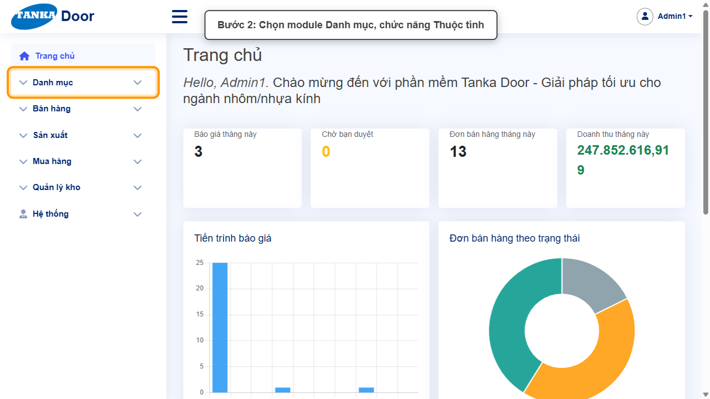
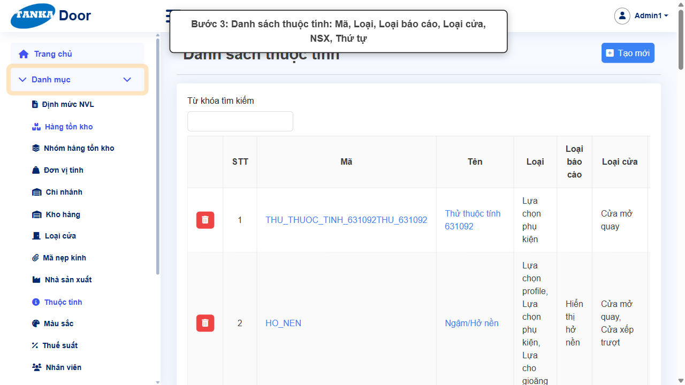
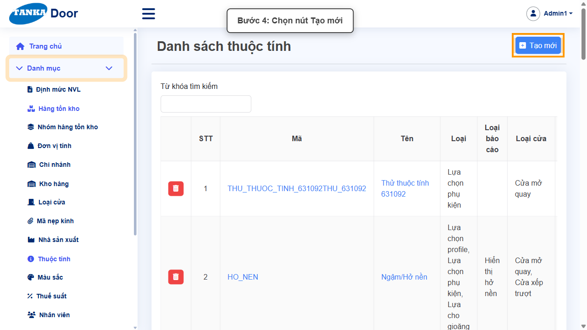
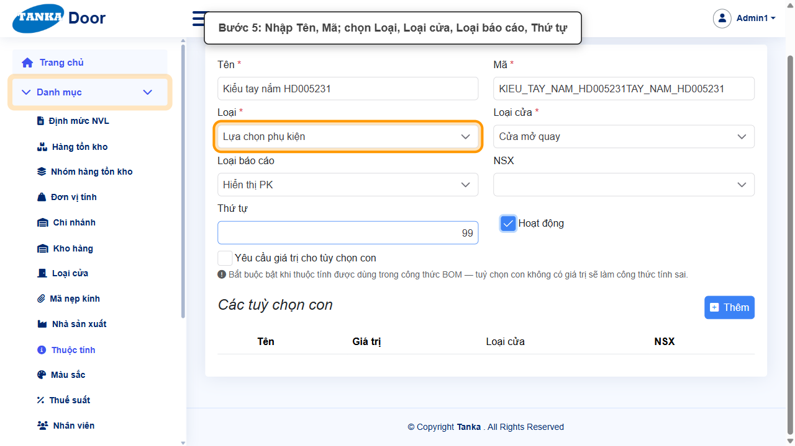
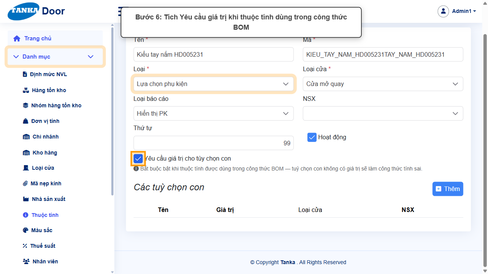
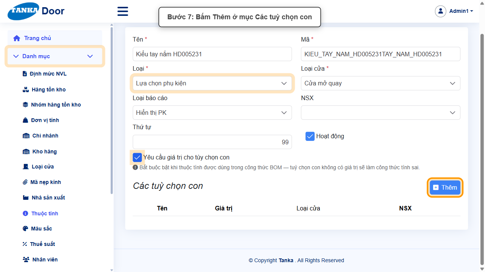
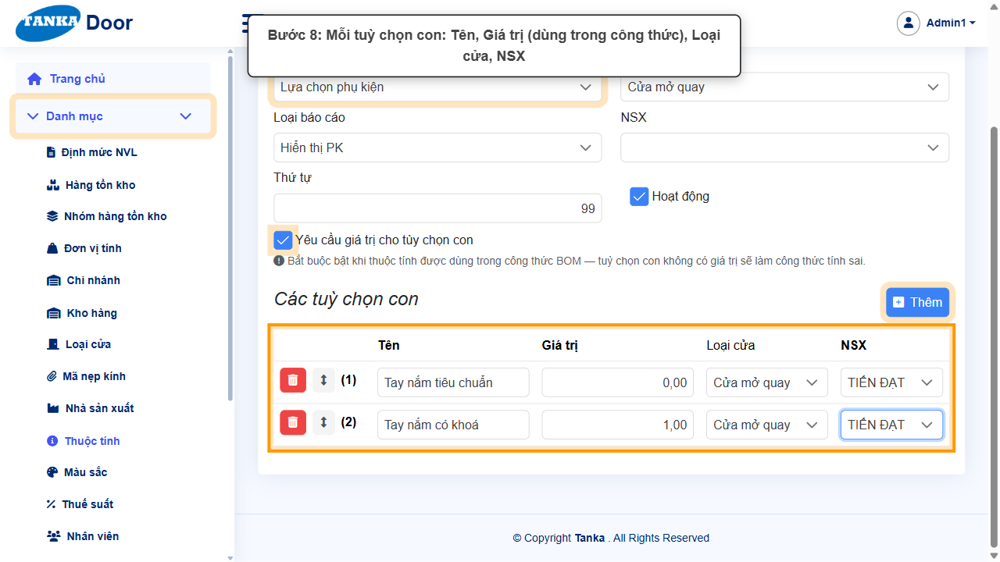
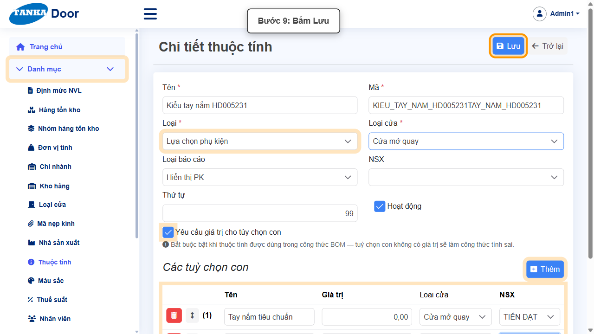
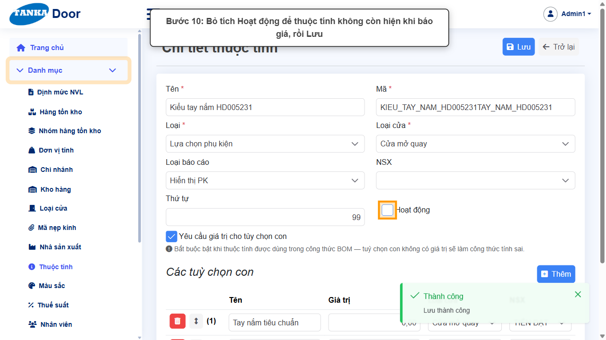
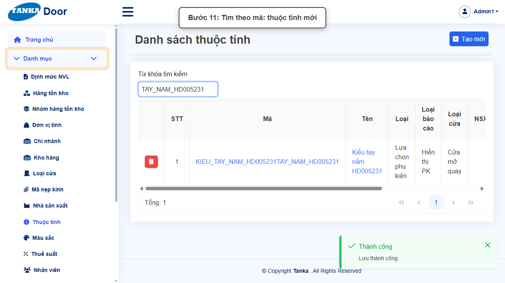

# HƯỚNG DẪN SỬ DỤNG — THUỘC TÍNH VÀ TUỲ CHỌN CON

**Đường dẫn:** Danh mục > Thuộc tính  
**Mục tiêu:** Tạo thuộc tính cấu hình cửa (ví dụ kiểu tay nắm, chiều mở, hở nền) với các tuỳ chọn con có giá trị dùng trong công thức định mức NVL.  
**Dành cho:** Người mới sử dụng TANKA Door

## Trước khi bắt đầu

**Cần có sẵn:**

- Đã có Loại cửa (UG-012) và Nhà sản xuất (UG-018) — mỗi tuỳ chọn con bắt buộc chọn cả hai.

**Nên đọc trước:** UG-012, UG-018.

**Quyền cần có:** Tài khoản thuộc nhóm có quyền Xem/Tạo/Sửa module **Danh mục** (UG-063). Nếu không thấy menu hoặc nút như trong ảnh, liên hệ quản trị hệ thống.

> Ảnh minh họa được chụp bằng tài khoản quản trị trên hệ thống thử nghiệm. Thuật ngữ viết tắt (HTK, NVL, BH, SX, YCMH...) và thứ tự các nghiệp vụ: xem **UG-000 Tổng quan**.

## 1. Khái niệm

Thuộc tính là các **lựa chọn khi cấu hình một bộ cửa** trên báo giá / đơn BH (tab "Các lựa chọn thuộc tính"). Mỗi thuộc tính có:

- **Mã** (vd. `HO_NEN`, `CHIEU_MO`) — dùng làm biến trong công thức BOM (xem nút **Biến tham chiếu** ở Định mức NVL). Mã **tự sinh từ Tên**, có thể sửa.
- **Loại** — phần chịu tác động: Lựa chọn profile / đố / nẹp ghép / phụ kiện / VTP / gioăng / kính / chi phí / độ phức tạp / vị trí.
- **Loại cửa**, **NSX** — thuộc tính chỉ hiện cho các loại cửa / NSX này; **Loại báo cáo**; **Thứ tự** hiển thị.
- **Các tuỳ chọn con** — mỗi tuỳ chọn có **Giá trị** số (vd. "Hở nền ốp đáy" = −8) được đưa vào công thức. Bật **Yêu cầu giá trị cho tùy chọn con** khi thuộc tính dùng trong công thức BOM.

## 2. Ví dụ dữ liệu nhập

Ví dụ dưới đây giúp bạn hình dung cách nhập. Hãy nhập dữ liệu thật của công ty bạn; tên/mã có hậu tố số trong ảnh là dữ liệu thử nghiệm, mã chứng từ (BG_, BH_, SX_, MH_...) do hệ thống tự sinh nên của bạn sẽ khác.

| Trường | Giá trị |
| --- | --- |
| Tên / Mã | Kiểu tay nắm / TAY_NAM |
| Loại / Loại cửa / Loại báo cáo | Lựa chọn phụ kiện / Cửa mở quay / Hiển thị PK |
| Tuỳ chọn con | Tay nắm tiêu chuẩn = 0; Tay nắm có khoá = 1 (Loại cửa Cửa mở quay, NSX TIẾN ĐẠT) |

> **Không xoá danh mục đã dùng.** Khi không dùng nữa, bỏ tích **Hoạt động** rồi **Lưu**: bản ghi không còn hiện trong ô chọn khi lập chứng từ mới nhưng vẫn giữ nguyên trên chứng từ cũ. Ảnh minh họa có bước bỏ tích này ở cuối — bạn chỉ làm bước đó khi thật sự ngừng sử dụng.

## 3. Quy trình thao tác từng bước

### Bước 1. Mở trang chủ Tanka Door

**Kết quả mong đợi:** menu chức năng hiện ở bên trái màn hình.

*Hình 1: Mở trang chủ Tanka Door.*

<video src="videos/UG-019-thuoc-tinh/01.webm" controls muted width="100%"></video>

### Bước 2. Mở Danh mục > Thuộc tính

**Kết quả mong đợi:** màn hình **Thuộc tính** hiện ra với danh sách dữ liệu và các ô lọc.

*Hình 2: Mở Danh mục > Thuộc tính.*

<video src="videos/UG-019-thuoc-tinh/02.webm" controls muted width="100%"></video>

### Bước 3. Xem danh sách

Danh sách hiển thị Tên, Mã, Loại và các tuỳ chọn của từng thuộc tính. Kiểm tra thuộc tính định tạo chưa tồn tại để tránh trùng.

*Hình 3: Xem danh sách.*

<video src="videos/UG-019-thuoc-tinh/03.webm" controls muted width="100%"></video>

### Bước 4. Bấm Tạo mới

**Kết quả mong đợi:** form nhập mới mở ra; các ô có dấu * là bắt buộc.

*Hình 4: Bấm Tạo mới.*

<video src="videos/UG-019-thuoc-tinh/04.webm" controls muted width="100%"></video>

### Bước 5. Nhập tên, mã, loại và loại cửa

Nhập **Tên *** (Mã tự sinh, sửa nếu muốn theo quy ước), chọn **Loại ***, **Loại cửa *** (chọn nhiều), **Loại báo cáo**, **NSX** (nếu chỉ áp cho NSX nhất định), **Thứ tự**.

*Hình 5: Nhập tên, mã, loại và loại cửa.*

<video src="videos/UG-019-thuoc-tinh/05.webm" controls muted width="100%"></video>

### Bước 6. Bật yêu cầu giá trị

Tích **Yêu cầu giá trị cho tùy chọn con** — bắt buộc khi thuộc tính dùng trong công thức BOM, tuỳ chọn con không có giá trị sẽ làm công thức tính sai.

*Hình 6: Bật yêu cầu giá trị.*

<video src="videos/UG-019-thuoc-tinh/06.webm" controls muted width="100%"></video>

### Bước 7. Thêm tuỳ chọn con

Ở mục **Các tuỳ chọn con**, bấm **Thêm** cho mỗi tuỳ chọn. Có thể kéo (biểu tượng ↕) để đổi thứ tự.

*Hình 7: Thêm tuỳ chọn con.*

<video src="videos/UG-019-thuoc-tinh/07.webm" controls muted width="100%"></video>

### Bước 8. Nhập từng tuỳ chọn con

Mỗi dòng: **Tên**, **Giá trị**, **Loại cửa**, **NSX**.

> **Lưu ý (lỗi hiện tại của hệ thống):** phải chọn cả **Loại cửa** và **NSX** cho mọi dòng tuỳ chọn con. Để trống thì bấm Lưu **không có phản hồi** (không lưu, không báo lỗi).

*Hình 8: Nhập từng tuỳ chọn con.*

<video src="videos/UG-019-thuoc-tinh/08.webm" controls muted width="100%"></video>

### Bước 9. Bấm Lưu

**Kết quả mong đợi:** thông báo xanh **"Lưu thành công"** hiện ở góc phải, nút **Lưu** mờ lại.

*Hình 9: Bấm Lưu.*

<video src="videos/UG-019-thuoc-tinh/09.webm" controls muted width="100%"></video>

### Bước 10. Ngừng sử dụng (khi cần)

Bỏ tích **Hoạt động** rồi **Lưu** — thuộc tính không còn hiện khi cấu hình cửa trên báo giá.

*Hình 10: Ngừng sử dụng (khi cần).*

<video src="videos/UG-019-thuoc-tinh/10.webm" controls muted width="100%"></video>

### Bước 11. Kiểm tra trong danh sách

Tìm theo mã thuộc tính.

*Hình 11: Kiểm tra trong danh sách.*

<video src="videos/UG-019-thuoc-tinh/11.webm" controls muted width="100%"></video>

### Video tổng hợp toàn bộ thao tác

Video dưới đây ghép liền toàn bộ các bước ở trên, từ lúc mở chức năng đến khi hoàn thành — xem lại một lượt trước khi tự thao tác.

<video src="videos/UG-019-thuoc-tinh/full.webm" controls muted width="100%"></video>

## 4. Khi không thao tác được

| Hiện tượng | Cách xử lý ngay |
| --- | --- |
| Bấm Lưu không có phản hồi | Chọn Loại cửa và NSX cho tất cả tuỳ chọn con (xem lưu ý bước 8). |
| Thuộc tính không hiện khi báo giá | Kiểm tra Hoạt động, Loại cửa và NSX của thuộc tính khớp với HTK đang cấu hình. |
| Nút Lưu đang mờ | Còn ô có dấu * chưa nhập/chọn, hoặc form chưa có thay đổi nào. |
| Bấm Lưu nhưng không thấy phản hồi | Không bấm thêm; chờ thông báo rồi tìm lại bản ghi trong danh sách. |
| Muốn bỏ một danh mục không dùng nữa | Bỏ tích **Hoạt động** rồi Lưu (khuyến nghị) thay vì xoá — bản ghi cũ vẫn giữ trên các chứng từ đã lập, nhưng không còn được chọn khi lập chứng từ mới. |

## 5. Checklist dành cho người mới

- [ ] Đã nhập đủ các ô có dấu *.
- [ ] Đã bấm Lưu và thấy thông báo "Lưu thành công".
- [ ] Đã tìm lại được bản ghi trong danh sách.
- [ ] Dùng bỏ tích Hoạt động thay vì xoá khi không dùng nữa.

---

_Tài liệu này được biên soạn dựa trên thao tác thực tế trên hệ thống door-v1.test.tankasoft.com. Ảnh minh họa có thể thay đổi theo phiên bản giao diện._
