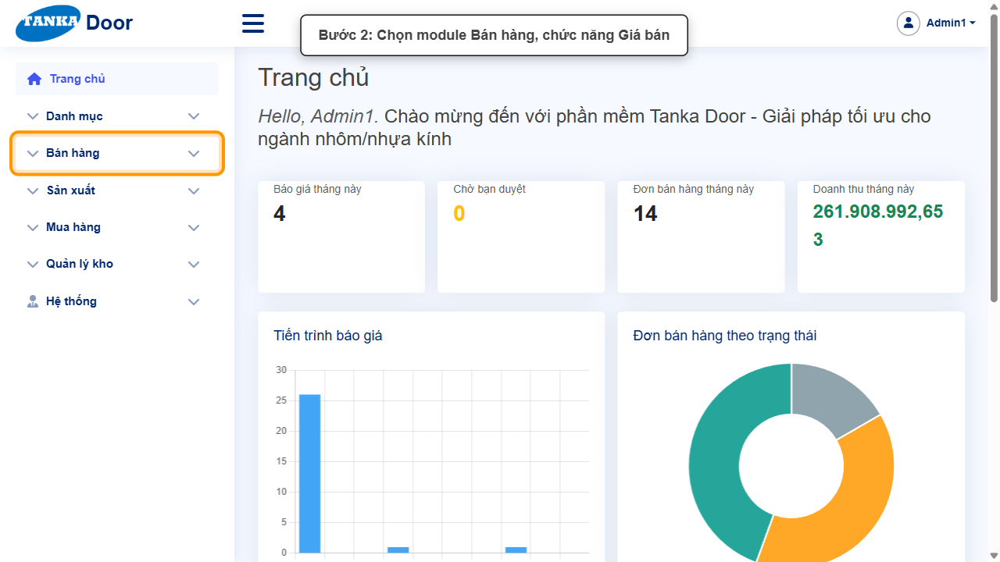
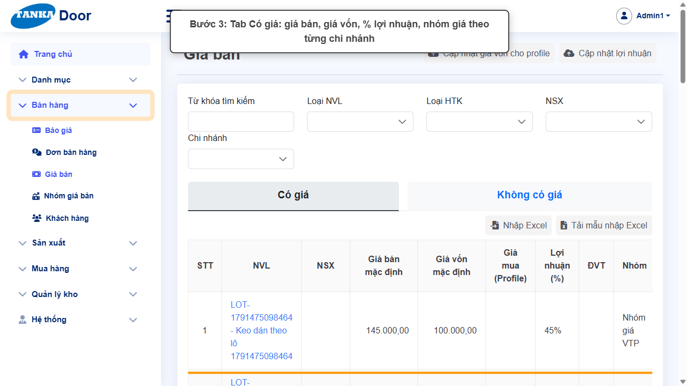
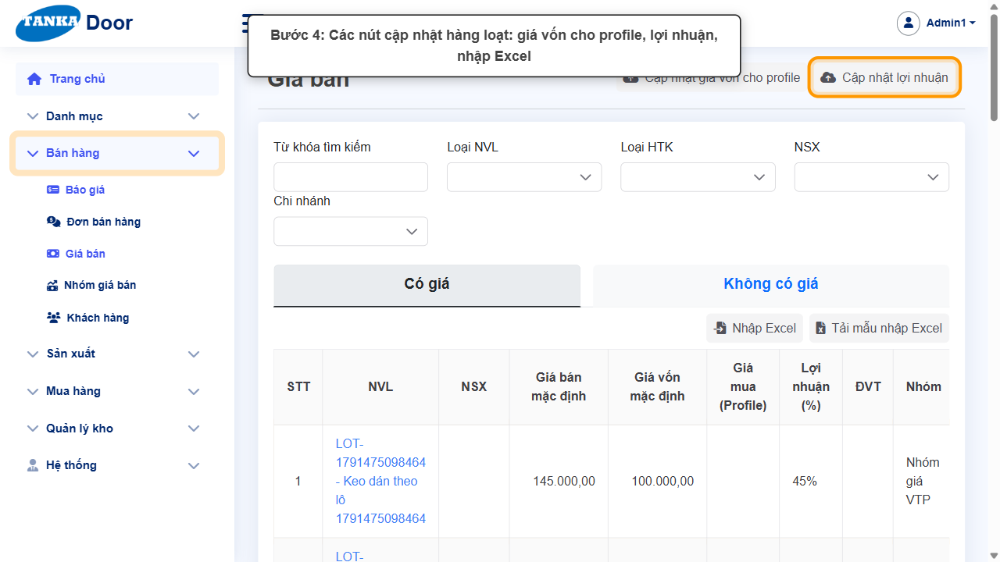
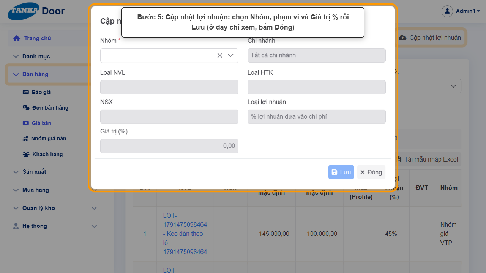
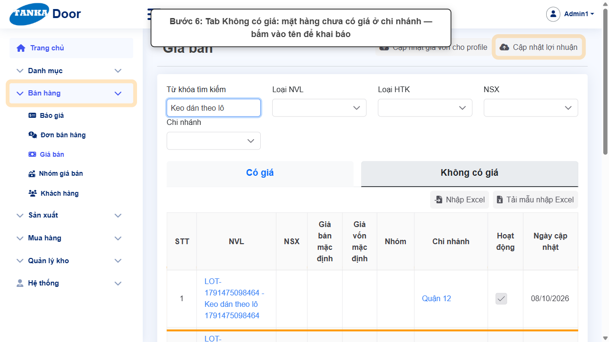
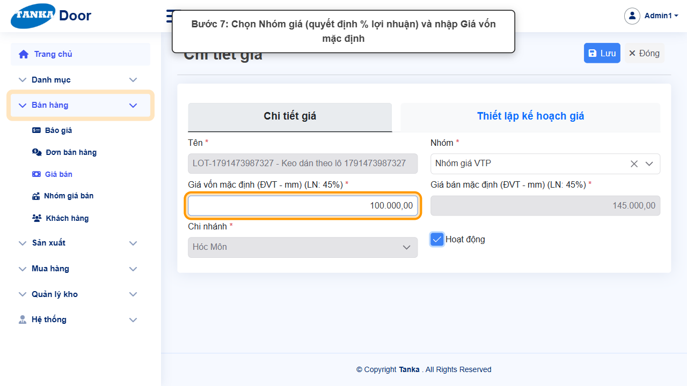
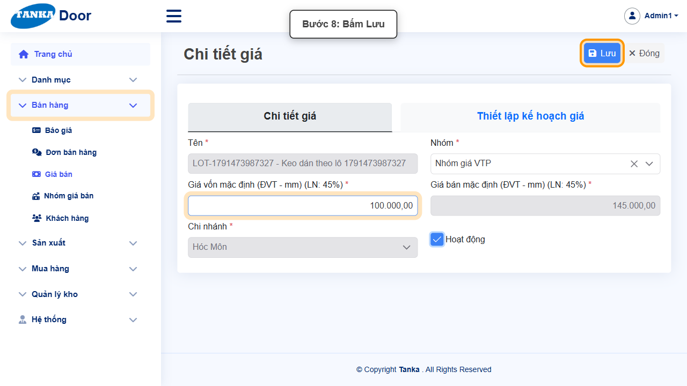
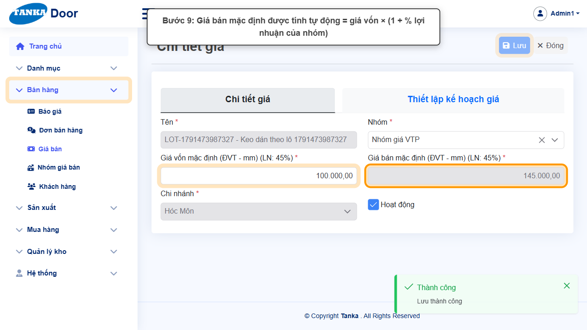
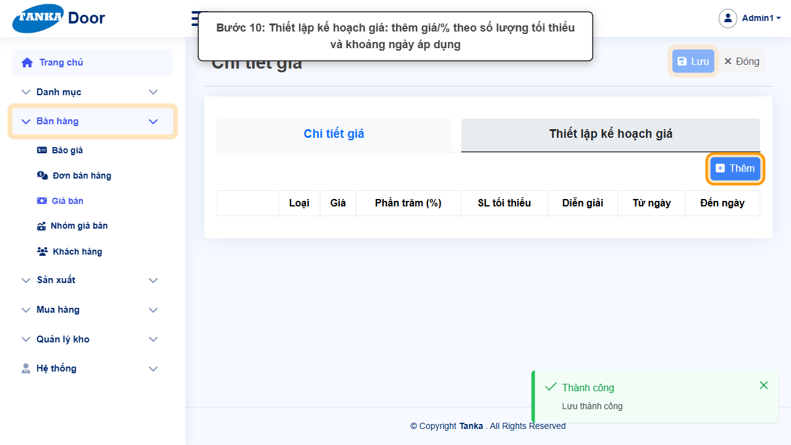
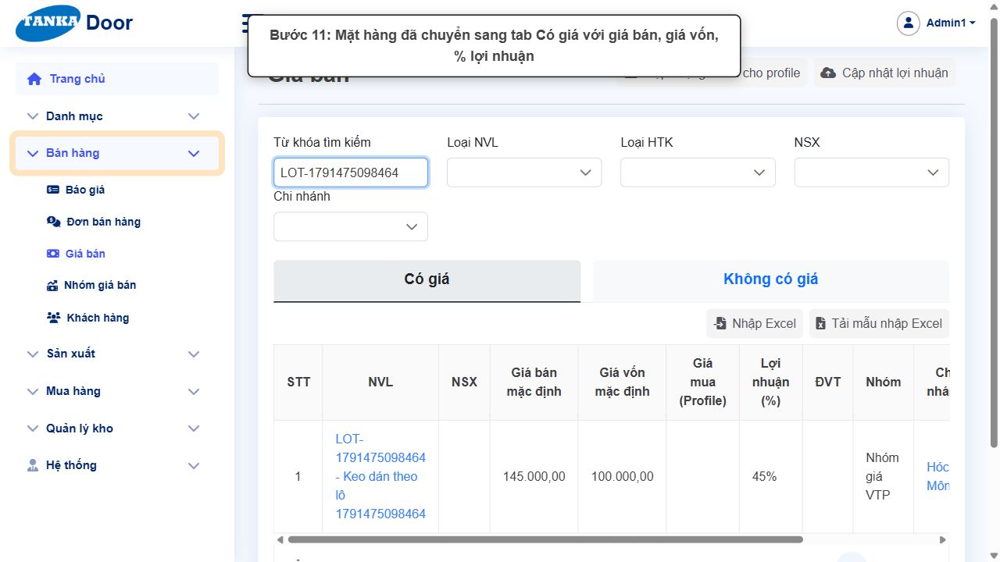

# HƯỚNG DẪN SỬ DỤNG — GIÁ BÁN

**Đường dẫn:** Bán hàng > Giá bán  
**Mục tiêu:** Xem bảng giá bán theo chi nhánh và khai báo giá cho mặt hàng chưa có giá để báo giá tính được tiền.  
**Dành cho:** Người mới sử dụng TANKA Door

## Trước khi bắt đầu

**Cần có sẵn:**

- Đã có Nhóm giá bán với % lợi nhuận (UG-024).
- Biết giá vốn của mặt hàng theo đúng ĐVT hiển thị.

**Nên đọc trước:** UG-024.

**Quyền cần có:** Tài khoản thuộc nhóm có quyền Xem/Tạo/Sửa module **Bán hàng** (UG-063). Nếu không thấy menu hoặc nút như trong ảnh, liên hệ quản trị hệ thống.

> Ảnh minh họa được chụp bằng tài khoản quản trị trên hệ thống thử nghiệm. Thuật ngữ viết tắt (HTK, NVL, BH, SX, YCMH...) và thứ tự các nghiệp vụ: xem **UG-000 Tổng quan**.

## 1. Khái niệm

Mỗi mặt hàng tồn kho có **một dòng giá cho mỗi chi nhánh**. Màn hình có 2 tab:

- **Có giá**: NVL, NSX, Giá bán mặc định, Giá vốn mặc định, Giá mua (Profile), Lợi nhuận (%), ĐVT, Nhóm, Chi nhánh.
- **Không có giá**: các dòng chưa khai báo — báo giá dùng mặt hàng này ở chi nhánh đó sẽ báo thiếu giá.

**Giá bán mặc định = Giá vốn mặc định × (1 + % lợi nhuận của Nhóm giá)** — ô Giá bán bị khoá, hệ thống tự tính. % lợi nhuận lấy từ **Nhóm giá bán** (UG-024).

Các nút cập nhật hàng loạt trên đầu trang:

- **Cập nhật giá vốn cho profile**: chọn NSX *, Màu, Giá tiền/1kg, Chi nhánh * — tính lại giá vốn các thanh profile theo trọng lượng.
- **Cập nhật lợi nhuận**: chọn Nhóm *, phạm vi (Chi nhánh, Loại NVL, Loại HTK, NSX), Loại lợi nhuận, Giá trị %.
- **Nhập Excel / Tải mẫu nhập Excel**: nhập giá hàng loạt từ file.

## 2. Ví dụ dữ liệu nhập

Ví dụ dưới đây giúp bạn hình dung cách nhập. Hãy nhập dữ liệu thật của công ty bạn; tên/mã có hậu tố số trong ảnh là dữ liệu thử nghiệm, mã chứng từ (BG_, BH_, SX_, MH_...) do hệ thống tự sinh nên của bạn sẽ khác.

| Trường | Giá trị |
| --- | --- |
| Mặt hàng | Keo dán (mặt hàng chưa có giá ở chi nhánh) |
| Chi nhánh | Hóc Môn |
| Nhóm | Nhóm giá VTP (LN 45%) |
| Giá vốn mặc định | 100.000 → Giá bán tự tính 145.000 |

> **Cẩn thận với các nút cập nhật hàng loạt** (Cập nhật giá vốn cho profile, Cập nhật lợi nhuận, Nhập Excel): chúng thay đổi giá của rất nhiều mặt hàng cùng lúc. Chỉ dùng khi đã chắc phạm vi; nếu chỉ muốn xem thì bấm **Đóng**.

## 3. Quy trình thao tác từng bước

### Bước 1. Mở trang chủ Tanka Door

Đăng nhập (UG-001), màn hình **Trang chủ** hiện ra.

*Hình 1: Mở trang chủ Tanka Door.*

<video src="videos/UG-023-gia-ban/01.webm" controls muted width="100%"></video>

### Bước 2. Mở Bán hàng > Giá bán

Ở menu bên trái bấm **Bán hàng**, chọn **Giá bán**.

*Hình 2: Mở Bán hàng > Giá bán.*

<video src="videos/UG-023-gia-ban/02.webm" controls muted width="100%"></video>

### Bước 3. Xem tab Có giá

Lọc theo Từ khóa, Loại NVL, Loại HTK, NSX, Chi nhánh.

*Hình 3: Xem tab Có giá.*

<video src="videos/UG-023-gia-ban/03.webm" controls muted width="100%"></video>

### Bước 4. Các nút cập nhật hàng loạt

Góc trên: **Cập nhật giá vốn cho profile**, **Cập nhật lợi nhuận**; trên bảng: **Nhập Excel**, **Tải mẫu nhập Excel**.

*Hình 4: Các nút cập nhật hàng loạt.*

<video src="videos/UG-023-gia-ban/04.webm" controls muted width="100%"></video>

### Bước 5. Hộp thoại Cập nhật lợi nhuận

Chọn **Nhóm ***, phạm vi áp dụng và **Giá trị (%)** rồi Lưu. Chỉ xem thì bấm **Đóng**.

*Hình 5: Hộp thoại Cập nhật lợi nhuận.*

<video src="videos/UG-023-gia-ban/05.webm" controls muted width="100%"></video>

### Bước 6. Tìm mặt hàng ở tab Không có giá

Chọn tab **Không có giá**, gõ tên/mã vào **Từ khóa tìm kiếm**, Enter. Mỗi chi nhánh là một dòng — bấm vào tên ở dòng của chi nhánh cần khai báo.

*Hình 6: Tìm mặt hàng ở tab Không có giá.*

<video src="videos/UG-023-gia-ban/06.webm" controls muted width="100%"></video>

### Bước 7. Chọn Nhóm và nhập Giá vốn

Chọn **Nhóm *** (nhãn ô giá hiện % lợi nhuận, ví dụ "LN: 45%"), nhập **Giá vốn mặc định *** theo ĐVT hiển thị.

*Hình 7: Chọn Nhóm và nhập Giá vốn.*

<video src="videos/UG-023-gia-ban/07.webm" controls muted width="100%"></video>

### Bước 8. Bấm Lưu

**Kết quả mong đợi:** thông báo xanh **"Lưu thành công"** hiện ở góc phải, nút **Lưu** mờ lại.

*Hình 8: Bấm Lưu.*

<video src="videos/UG-023-gia-ban/08.webm" controls muted width="100%"></video>

### Bước 9. Xem Giá bán được tính

Thông báo **"Lưu thành công"**, ô **Giá bán mặc định** tự tính (100.000 × 1,45 = 145.000).

*Hình 9: Xem Giá bán được tính.*

<video src="videos/UG-023-gia-ban/09.webm" controls muted width="100%"></video>

### Bước 10. Thiết lập kế hoạch giá (khi cần)

Tab **Thiết lập kế hoạch giá** → **Thêm**: giá hoặc % riêng theo **SL tối thiểu** và khoảng **Từ ngày – Đến ngày** (giá khuyến mãi, giá sỉ).

*Hình 10: Thiết lập kế hoạch giá (khi cần).*

<video src="videos/UG-023-gia-ban/10.webm" controls muted width="100%"></video>

### Bước 11. Kiểm tra ở tab Có giá

Bấm **Đóng**, chọn tab **Có giá**, tìm lại mặt hàng: dòng hiển thị giá bán, giá vốn, % lợi nhuận, nhóm.

*Hình 11: Kiểm tra ở tab Có giá.*

<video src="videos/UG-023-gia-ban/11.webm" controls muted width="100%"></video>

## 4. Khi không thao tác được

| Hiện tượng | Cách xử lý ngay |
| --- | --- |
| Báo giá báo mặt hàng chưa có giá | Mặt hàng nằm ở tab Không có giá của chi nhánh đó — khai báo như bước 6–9. |
| Không sửa được ô Giá bán | Ô này tự tính từ Giá vốn và % của Nhóm — đổi Giá vốn hoặc Nhóm. |
| Sau khi lưu vẫn thấy ở tab Không có giá | Danh sách nhớ tab đang chọn — bấm tab Có giá và tìm lại. |

## 5. Checklist dành cho người mới

- [ ] Đã chọn đúng dòng của chi nhánh cần bán.
- [ ] Đã chọn Nhóm giá và nhập Giá vốn theo đúng ĐVT hiển thị.
- [ ] Đã thấy Giá bán tự tính và thông báo "Lưu thành công".

---

_Tài liệu này được biên soạn dựa trên thao tác thực tế trên hệ thống door-v1.test.tankasoft.com. Ảnh minh họa có thể thay đổi theo phiên bản giao diện._
