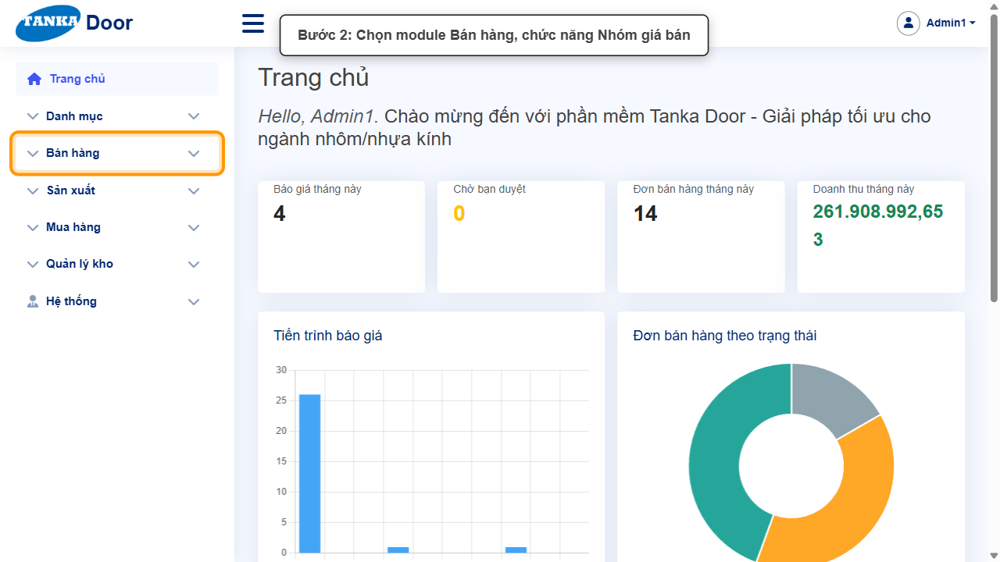
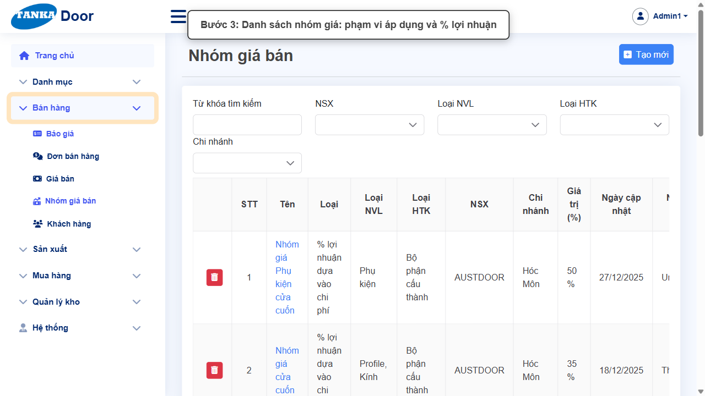
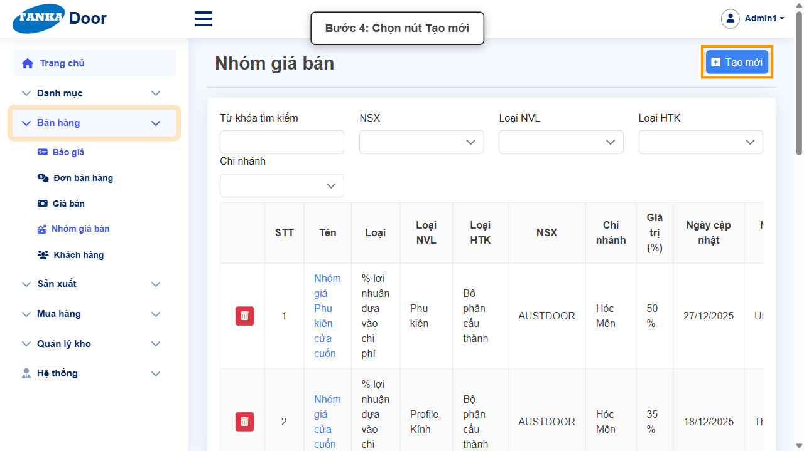
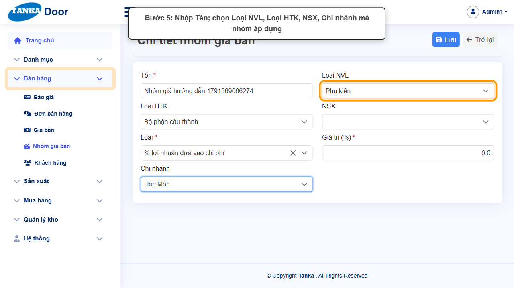
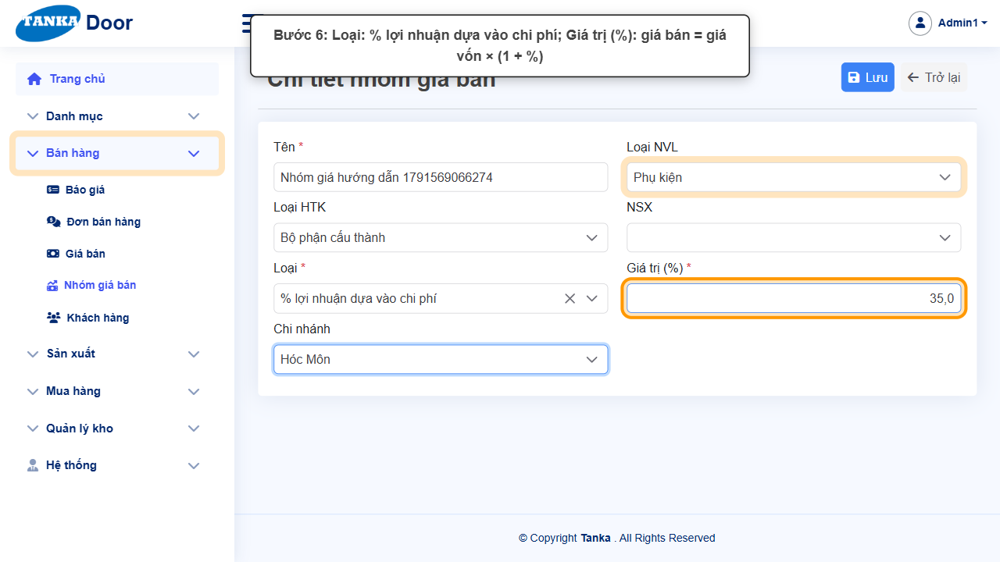
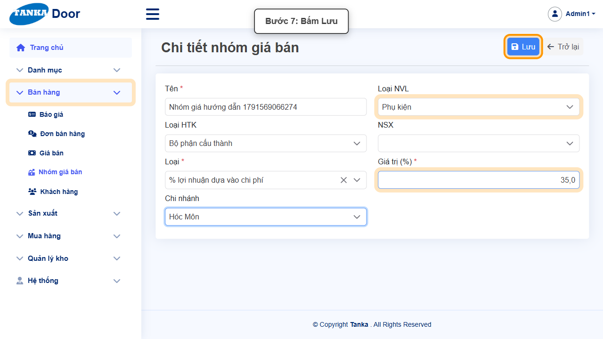
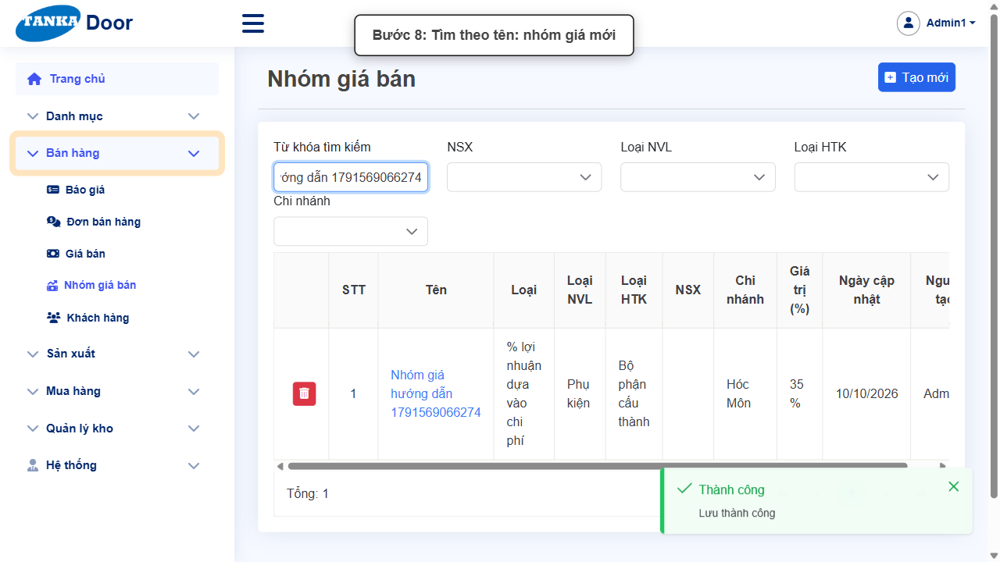
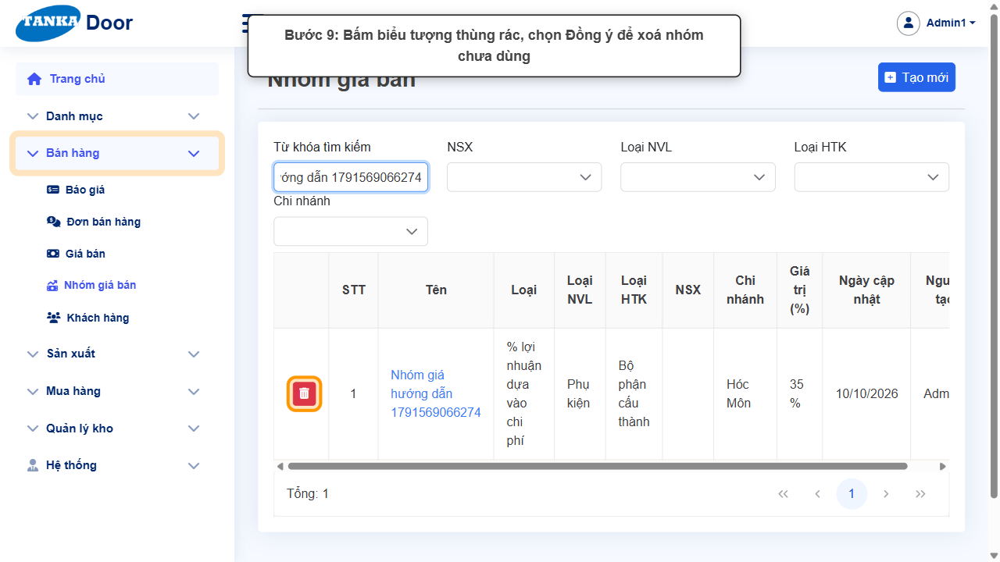

# HƯỚNG DẪN SỬ DỤNG — NHÓM GIÁ BÁN

**Đường dẫn:** Bán hàng > Nhóm giá bán  
**Mục tiêu:** Tạo nhóm giá với % lợi nhuận để tính giá bán từ giá vốn cho cả nhóm mặt hàng.  
**Dành cho:** Người mới sử dụng TANKA Door

## Trước khi bắt đầu

**Cần có sẵn:**

- Biết % lợi nhuận công ty áp dụng cho nhóm hàng.

**Quyền cần có:** Tài khoản thuộc nhóm có quyền Xem/Tạo/Sửa module **Bán hàng** (UG-063). Nếu không thấy menu hoặc nút như trong ảnh, liên hệ quản trị hệ thống.

> Ảnh minh họa được chụp bằng tài khoản quản trị trên hệ thống thử nghiệm. Thuật ngữ viết tắt (HTK, NVL, BH, SX, YCMH...) và thứ tự các nghiệp vụ: xem **UG-000 Tổng quan**.

## 1. Khái niệm

Nhóm giá bán quy định **% lợi nhuận** áp lên giá vốn: **Giá bán = Giá vốn × (1 + %)**. Mỗi dòng giá (UG-023) chọn một Nhóm. Phạm vi của nhóm (**Loại NVL, Loại HTK, NSX, Chi nhánh** — chọn nhiều) giúp nút **Cập nhật lợi nhuận** ở màn hình Giá bán áp % cho đúng các mặt hàng. Loại hiện có: **% lợi nhuận dựa vào chi phí**.

## 2. Ví dụ dữ liệu nhập

Ví dụ dưới đây giúp bạn hình dung cách nhập. Hãy nhập dữ liệu thật của công ty bạn; tên/mã có hậu tố số trong ảnh là dữ liệu thử nghiệm, mã chứng từ (BG_, BH_, SX_, MH_...) do hệ thống tự sinh nên của bạn sẽ khác.

| Trường | Giá trị |
| --- | --- |
| Tên | Nhóm giá Phụ kiện Hóc Môn |
| Loại NVL / Loại HTK | Phụ kiện / Bộ phận cấu thành |
| Chi nhánh | Hóc Môn |
| Loại / Giá trị (%) | % lợi nhuận dựa vào chi phí / 35 |

> Chỉ xoá nhóm giá **chưa gán cho mặt hàng nào** (ví dụ tạo nhầm). Nhóm đang dùng ở bảng giá thì sửa % thay vì xoá.

## 3. Quy trình thao tác từng bước

### Bước 1. Mở trang chủ Tanka Door

Đăng nhập (UG-001), màn hình **Trang chủ** hiện ra.

*Hình 1: Mở trang chủ Tanka Door.*

<video src="videos/UG-024-nhom-gia-ban/01.webm" controls muted width="100%"></video>

### Bước 2. Mở Bán hàng > Nhóm giá bán

**Kết quả mong đợi:** màn hình **Nhóm giá bán** hiện ra với danh sách dữ liệu và các ô lọc.

*Hình 2: Mở Bán hàng > Nhóm giá bán.*

<video src="videos/UG-024-nhom-gia-ban/02.webm" controls muted width="100%"></video>

### Bước 3. Xem danh sách nhóm

Cột Tên, Loại, Loại NVL, Loại HTK, NSX, Chi nhánh, Giá trị (%).

*Hình 3: Xem danh sách nhóm.*

<video src="videos/UG-024-nhom-gia-ban/03.webm" controls muted width="100%"></video>

### Bước 4. Bấm Tạo mới

**Kết quả mong đợi:** form nhập mới mở ra; các ô có dấu * là bắt buộc.

*Hình 4: Bấm Tạo mới.*

<video src="videos/UG-024-nhom-gia-ban/04.webm" controls muted width="100%"></video>

### Bước 5. Nhập tên và phạm vi áp dụng

Nhập **Tên ***, chọn **Loại NVL**, **Loại HTK**, **NSX**, **Chi nhánh** (mỗi ô chọn được nhiều giá trị, bỏ trống = không giới hạn).

*Hình 5: Nhập tên và phạm vi áp dụng.*

<video src="videos/UG-024-nhom-gia-ban/05.webm" controls muted width="100%"></video>

### Bước 6. Chọn Loại và Giá trị %

Chọn **Loại *** = % lợi nhuận dựa vào chi phí, nhập **Giá trị (%) *** (35 nghĩa là giá bán = giá vốn × 1,35).

*Hình 6: Chọn Loại và Giá trị %.*

<video src="videos/UG-024-nhom-gia-ban/06.webm" controls muted width="100%"></video>

### Bước 7. Bấm Lưu

Thông báo **"Lưu thành công"**.

*Hình 7: Bấm Lưu.*

<video src="videos/UG-024-nhom-gia-ban/07.webm" controls muted width="100%"></video>

### Bước 8. Tìm lại nhóm trong danh sách

Bấm **Trở lại**, nhập tên vào **Từ khóa tìm kiếm**, Enter.

*Hình 8: Tìm lại nhóm trong danh sách.*

<video src="videos/UG-024-nhom-gia-ban/08.webm" controls muted width="100%"></video>

### Bước 9. Xoá nhóm không dùng (khi cần)

Bấm biểu tượng **thùng rác** trên dòng → hộp **Xác nhận** → **Đồng ý**. Thao tác không hoàn tác được.

*Hình 9: Xoá nhóm không dùng (khi cần).*

<video src="videos/UG-024-nhom-gia-ban/09.webm" controls muted width="100%"></video>

### Video tổng hợp toàn bộ thao tác

Video dưới đây ghép liền toàn bộ các bước ở trên, từ lúc mở chức năng đến khi hoàn thành — xem lại một lượt trước khi tự thao tác.

<video src="videos/UG-024-nhom-gia-ban/full.webm" controls muted width="100%"></video>

## 4. Khi không thao tác được

| Hiện tượng | Cách xử lý ngay |
| --- | --- |
| Đổi % nhưng giá bán chưa đổi | Dùng nút Cập nhật lợi nhuận ở màn hình Giá bán (UG-023) hoặc mở từng dòng giá và Lưu lại. |
| Không thấy NSX trong ô chọn | Danh sách NSX tải chậm — đóng/mở lại ô hoặc gõ để tìm. |

## 5. Checklist dành cho người mới

- [ ] Đã nhập Tên, Loại, Giá trị (%).
- [ ] Đã chọn phạm vi Loại NVL/HTK/NSX/Chi nhánh đúng nhóm hàng.
- [ ] Đã thấy nhóm trong danh sách.

---

_Tài liệu này được biên soạn dựa trên thao tác thực tế trên hệ thống door-v1.test.tankasoft.com. Ảnh minh họa có thể thay đổi theo phiên bản giao diện._
