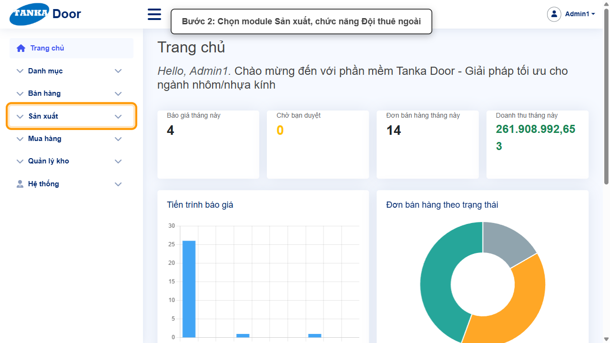
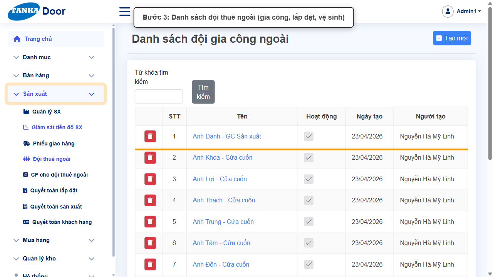
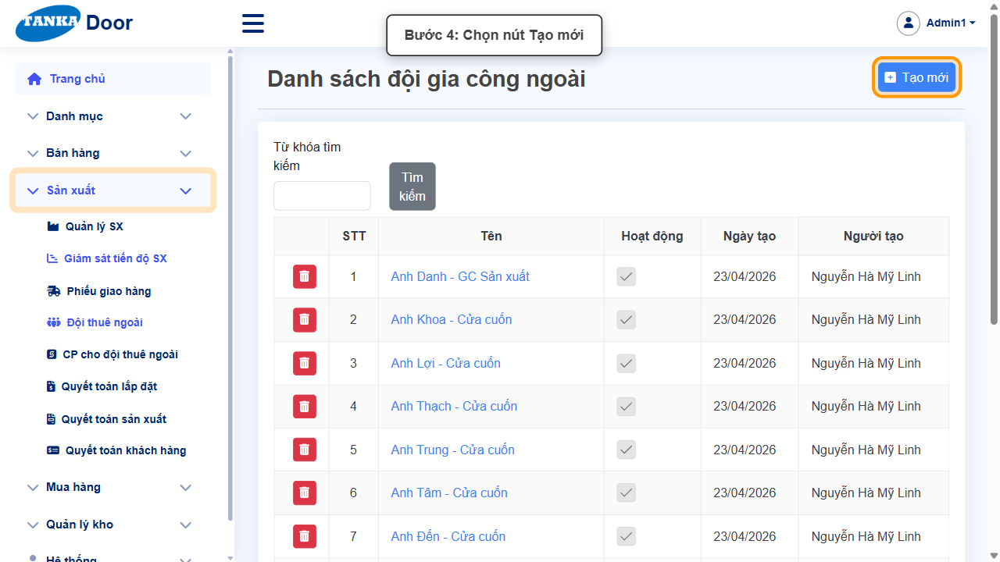
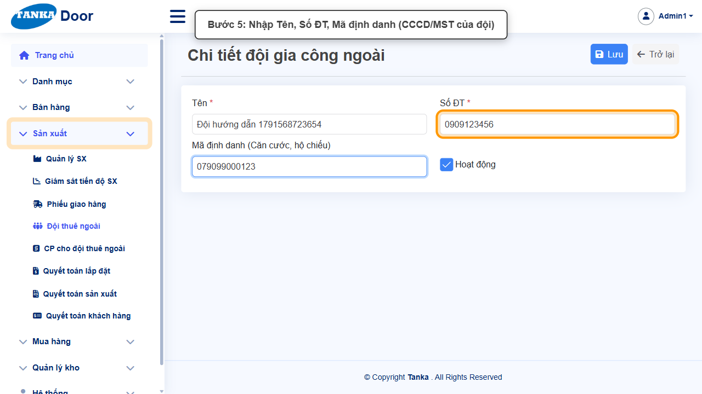
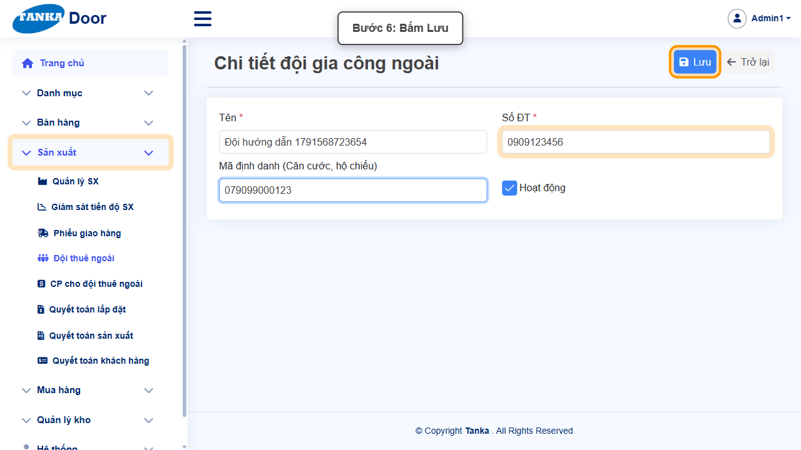
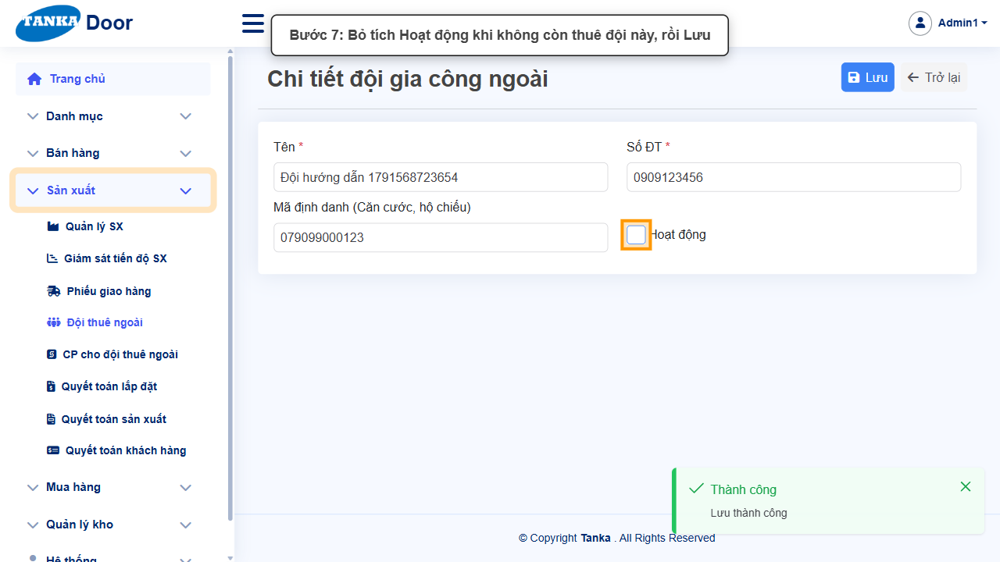
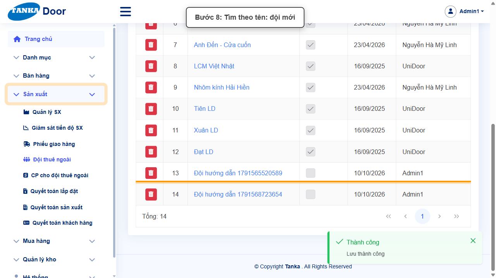

# HƯỚNG DẪN SỬ DỤNG — ĐỘI THUÊ NGOÀI

**Đường dẫn:** Sản xuất > Đội thuê ngoài  
**Mục tiêu:** Khai báo đội gia công / lắp đặt / vệ sinh thuê ngoài để giao việc trên Giám sát tiến độ SX và quyết toán.  
**Dành cho:** Người mới sử dụng TANKA Door

## Trước khi bắt đầu

**Cần có sẵn:**

- Thông tin đội: tên, số điện thoại, CCCD/mã số thuế.

**Quyền cần có:** Tài khoản thuộc nhóm có quyền Xem/Tạo/Sửa module **Sản xuất** (UG-063). Nếu không thấy menu hoặc nút như trong ảnh, liên hệ quản trị hệ thống.

> Ảnh minh họa được chụp bằng tài khoản quản trị trên hệ thống thử nghiệm. Thuật ngữ viết tắt (HTK, NVL, BH, SX, YCMH...) và thứ tự các nghiệp vụ: xem **UG-000 Tổng quan**.

## 1. Khái niệm

Đội thuê ngoài (ví dụ "Anh Danh - GC Sản xuất", "Đạt LD", "Xuân LD") được chọn ở các cột **Đội SX / Đội LĐ / Đội VS** trên màn hình **Giám sát tiến độ SX** (UG-033, UG-039). Đơn giá trả cho từng đội khai báo ở **CP cho đội thuê ngoài** (UG-038) và được dùng khi **quyết toán sản xuất / lắp đặt** (UG-036, UG-037).

## 2. Ví dụ dữ liệu nhập

Ví dụ dưới đây giúp bạn hình dung cách nhập. Hãy nhập dữ liệu thật của công ty bạn; tên/mã có hậu tố số trong ảnh là dữ liệu thử nghiệm, mã chứng từ (BG_, BH_, SX_, MH_...) do hệ thống tự sinh nên của bạn sẽ khác.

| Trường | Giá trị |
| --- | --- |
| Tên | Đội lắp đặt Minh Tâm |
| Số ĐT | 0909123456 |
| Mã định danh | 079099000123 (CCCD/MST) |

> Khi không còn thuê đội, **bỏ tích Hoạt động** thay vì xoá — đội không còn hiện khi giao việc, dữ liệu cũ và quyết toán vẫn giữ. Ảnh minh họa có bước này ở cuối; bạn chỉ làm khi thật sự ngừng thuê.

## 3. Quy trình thao tác từng bước

### Bước 1. Mở trang chủ Tanka Door

Đăng nhập (UG-001), màn hình **Trang chủ** hiện ra.

*Hình 1: Mở trang chủ Tanka Door.*

<video src="videos/UG-034-doi-thue-ngoai/01.webm" controls muted width="100%"></video>

### Bước 2. Mở Sản xuất > Đội thuê ngoài

**Kết quả mong đợi:** màn hình **Đội thuê ngoài** hiện ra với danh sách dữ liệu và các ô lọc.

*Hình 2: Mở Sản xuất > Đội thuê ngoài.*

<video src="videos/UG-034-doi-thue-ngoai/02.webm" controls muted width="100%"></video>

### Bước 3. Xem danh sách đội

Cột Tên, Hoạt động, Ngày tạo, Người tạo.

*Hình 3: Xem danh sách đội.*

<video src="videos/UG-034-doi-thue-ngoai/03.webm" controls muted width="100%"></video>

### Bước 4. Bấm Tạo mới

**Kết quả mong đợi:** form nhập mới mở ra; các ô có dấu * là bắt buộc.

*Hình 4: Bấm Tạo mới.*

<video src="videos/UG-034-doi-thue-ngoai/04.webm" controls muted width="100%"></video>

### Bước 5. Nhập thông tin đội

Nhập **Tên ***, **Số ĐT ***, **Mã định danh** (CCCD hoặc mã số thuế của đội).

*Hình 5: Nhập thông tin đội.*

<video src="videos/UG-034-doi-thue-ngoai/05.webm" controls muted width="100%"></video>

### Bước 6. Bấm Lưu

Thông báo **"Lưu thành công"**.

*Hình 6: Bấm Lưu.*

<video src="videos/UG-034-doi-thue-ngoai/06.webm" controls muted width="100%"></video>

### Bước 7. Ngừng thuê đội (khi cần)

Bỏ tích **Hoạt động** rồi **Lưu** — đội không còn được chọn khi giao việc, dữ liệu cũ vẫn giữ.

*Hình 7: Ngừng thuê đội (khi cần).*

<video src="videos/UG-034-doi-thue-ngoai/07.webm" controls muted width="100%"></video>

### Bước 8. Kiểm tra trong danh sách

Bấm **Trở lại**, tìm theo tên.

*Hình 8: Kiểm tra trong danh sách.*

<video src="videos/UG-034-doi-thue-ngoai/08.webm" controls muted width="100%"></video>

### Video tổng hợp toàn bộ thao tác

Video dưới đây ghép liền toàn bộ các bước ở trên, từ lúc mở chức năng đến khi hoàn thành — xem lại một lượt trước khi tự thao tác.

<video src="videos/UG-034-doi-thue-ngoai/full.webm" controls muted width="100%"></video>

## 4. Khi không thao tác được

| Hiện tượng | Cách xử lý ngay |
| --- | --- |
| Không thấy đội ở Giám sát tiến độ SX | Đội đã bỏ Hoạt động, hoặc chưa tải lại trang. |
| Quyết toán không ra tiền cho đội | Chưa khai báo đơn giá cho đội ở CP cho đội thuê ngoài (UG-038). |

## 5. Checklist dành cho người mới

- [ ] Đã nhập Tên và Số ĐT.
- [ ] Đã thấy "Lưu thành công".
- [ ] Đã khai báo đơn giá cho đội (UG-038).

---

_Tài liệu này được biên soạn dựa trên thao tác thực tế trên hệ thống door-v1.test.tankasoft.com. Ảnh minh họa có thể thay đổi theo phiên bản giao diện._
