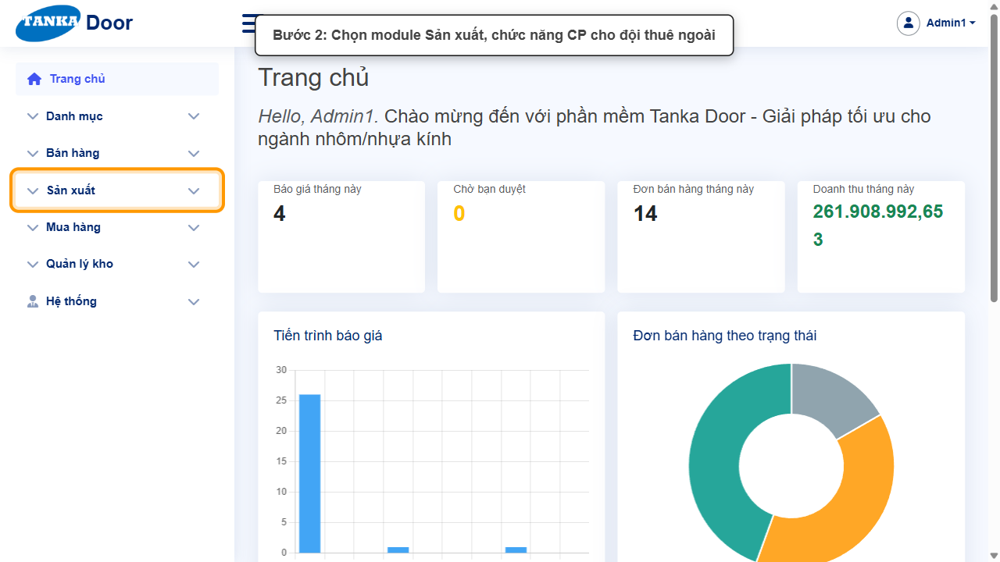
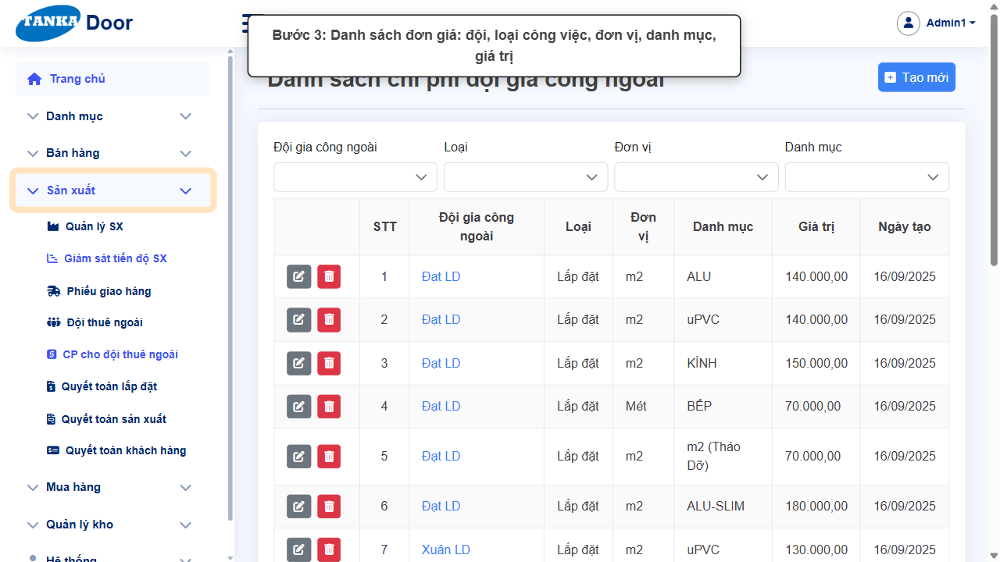
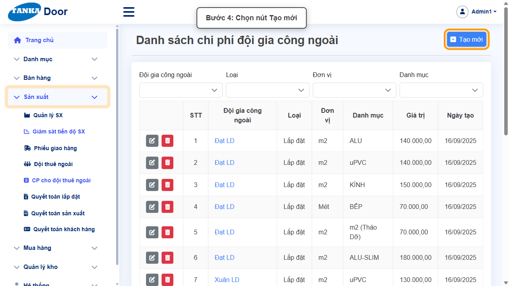
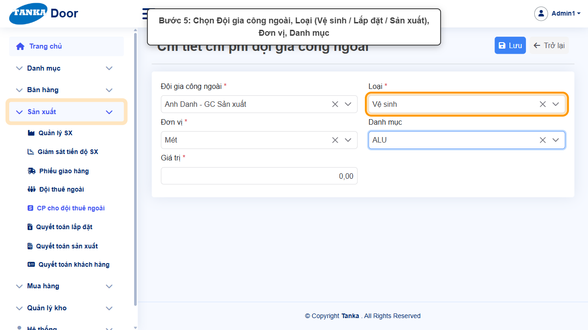
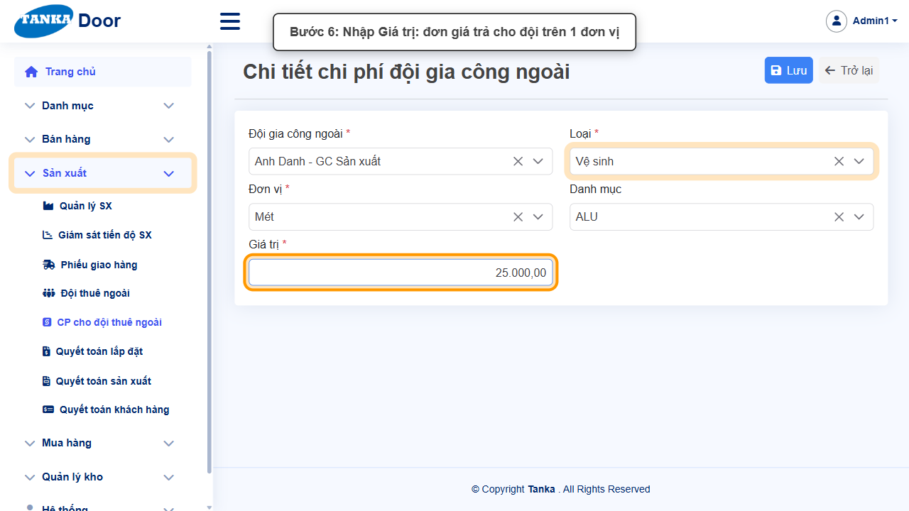
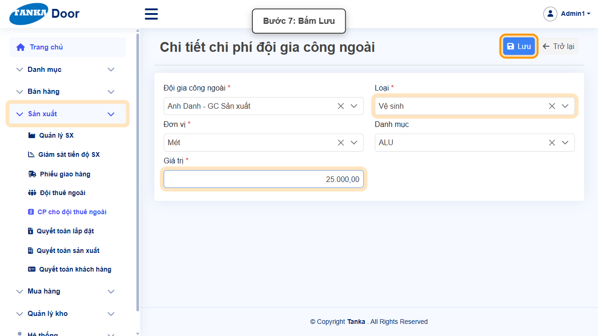
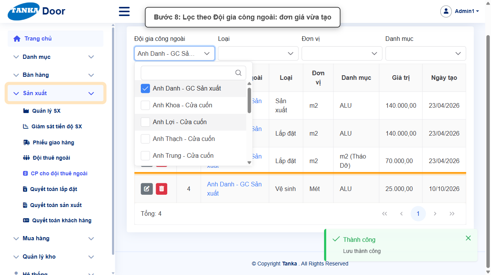
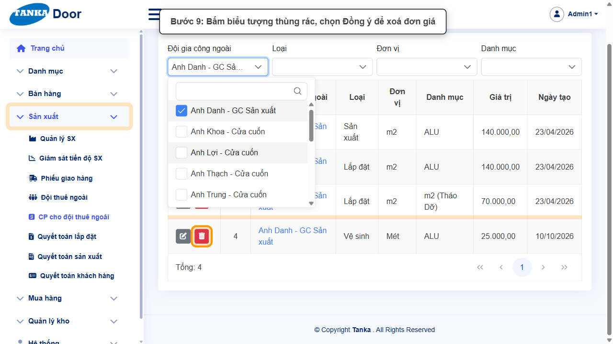

# HƯỚNG DẪN SỬ DỤNG — CHI PHÍ CHO ĐỘI THUÊ NGOÀI

**Đường dẫn:** Sản xuất > CP cho đội thuê ngoài  
**Mục tiêu:** Khai báo đơn giá trả cho đội thuê ngoài theo loại công việc, đơn vị tính và danh mục hàng.  
**Dành cho:** Người mới sử dụng TANKA Door

## Trước khi bắt đầu

**Cần có sẵn:**

- Đã có Đội thuê ngoài (UG-034), Đơn vị tính (UG-015) và Nhóm hàng tồn kho (UG-014).

**Nên đọc trước:** UG-034.

**Quyền cần có:** Tài khoản thuộc nhóm có quyền Xem/Tạo/Sửa module **Sản xuất** (UG-063). Nếu không thấy menu hoặc nút như trong ảnh, liên hệ quản trị hệ thống.

> Ảnh minh họa được chụp bằng tài khoản quản trị trên hệ thống thử nghiệm. Thuật ngữ viết tắt (HTK, NVL, BH, SX, YCMH...) và thứ tự các nghiệp vụ: xem **UG-000 Tổng quan**.

## 1. Khái niệm

Mỗi dòng là một đơn giá: **Đội gia công ngoài** × **Loại** (Vệ sinh / Lắp đặt / Sản xuất) × **Đơn vị** (m2, Mét, Bộ…) × **Danh mục** (nhóm HTK: ALU, uPVC, KÍNH…) → **Giá trị**. Ví dụ có sẵn: _Đạt LD — Lắp đặt — m2 — ALU — 140.000_. Khi lập **Quyết toán lắp đặt / sản xuất** (UG-036, UG-037) hệ thống lấy đơn giá này nhân với khối lượng của đội.

## 2. Ví dụ dữ liệu nhập

Ví dụ dưới đây giúp bạn hình dung cách nhập. Hãy nhập dữ liệu thật của công ty bạn; tên/mã có hậu tố số trong ảnh là dữ liệu thử nghiệm, mã chứng từ (BG_, BH_, SX_, MH_...) do hệ thống tự sinh nên của bạn sẽ khác.

| Trường | Giá trị |
| --- | --- |
| Đội gia công ngoài | Anh Danh - GC Sản xuất |
| Loại / Đơn vị / Danh mục | Vệ sinh / Mét / ALU |
| Giá trị | 25.000 |

> Đơn giá đang dùng thì **sửa giá trị** (biểu tượng bút) thay vì xoá. Chỉ xoá đơn giá tạo nhầm — ảnh minh họa có bước xoá ở cuối.

## 3. Quy trình thao tác từng bước

### Bước 1. Mở trang chủ Tanka Door

Đăng nhập (UG-001), màn hình **Trang chủ** hiện ra.

*Hình 1: Mở trang chủ Tanka Door.*

<video src="videos/UG-038-chi-phi-doi-thue-ngoai/01.webm" controls muted width="100%"></video>

### Bước 2. Mở Sản xuất > CP cho đội thuê ngoài

**Kết quả mong đợi:** màn hình **CP cho đội thuê ngoài** hiện ra với danh sách dữ liệu và các ô lọc.

*Hình 2: Mở Sản xuất > CP cho đội thuê ngoài.*

<video src="videos/UG-038-chi-phi-doi-thue-ngoai/02.webm" controls muted width="100%"></video>

### Bước 3. Xem danh sách đơn giá

Lọc theo Đội gia công ngoài, Loại, Đơn vị, Danh mục. Mỗi dòng có nút **sửa** (bút) và **xoá** (thùng rác).

*Hình 3: Xem danh sách đơn giá.*

<video src="videos/UG-038-chi-phi-doi-thue-ngoai/03.webm" controls muted width="100%"></video>

### Bước 4. Bấm Tạo mới

**Kết quả mong đợi:** form nhập mới mở ra; các ô có dấu * là bắt buộc.

*Hình 4: Bấm Tạo mới.*

<video src="videos/UG-038-chi-phi-doi-thue-ngoai/04.webm" controls muted width="100%"></video>

### Bước 5. Chọn đội, loại, đơn vị, danh mục

Chọn **Đội gia công ngoài ***, **Loại *** (Vệ sinh / Lắp đặt / Sản xuất), **Đơn vị ***, **Danh mục** (nhóm HTK).

*Hình 5: Chọn đội, loại, đơn vị, danh mục.*

<video src="videos/UG-038-chi-phi-doi-thue-ngoai/05.webm" controls muted width="100%"></video>

### Bước 6. Nhập Giá trị

Nhập **Giá trị *** = số tiền trả cho đội trên 1 đơn vị.

*Hình 6: Nhập Giá trị.*

<video src="videos/UG-038-chi-phi-doi-thue-ngoai/06.webm" controls muted width="100%"></video>

### Bước 7. Bấm Lưu

Thông báo **"Lưu thành công"**.

*Hình 7: Bấm Lưu.*

<video src="videos/UG-038-chi-phi-doi-thue-ngoai/07.webm" controls muted width="100%"></video>

### Bước 8. Kiểm tra trong danh sách

Bấm **Trở lại**, lọc **Đội gia công ngoài** để thấy các đơn giá của đội.

*Hình 8: Kiểm tra trong danh sách.*

<video src="videos/UG-038-chi-phi-doi-thue-ngoai/08.webm" controls muted width="100%"></video>

### Bước 9. Xoá đơn giá không dùng (khi cần)

Bấm **thùng rác** → **Đồng ý**. Thao tác không hoàn tác được.

*Hình 9: Xoá đơn giá không dùng (khi cần).*

<video src="videos/UG-038-chi-phi-doi-thue-ngoai/09.webm" controls muted width="100%"></video>

### Video tổng hợp toàn bộ thao tác

Video dưới đây ghép liền toàn bộ các bước ở trên, từ lúc mở chức năng đến khi hoàn thành — xem lại một lượt trước khi tự thao tác.

<video src="videos/UG-038-chi-phi-doi-thue-ngoai/full.webm" controls muted width="100%"></video>

## 4. Khi không thao tác được

| Hiện tượng | Cách xử lý ngay |
| --- | --- |
| Không thấy đội trong ô chọn | Đội chưa tạo hoặc đã bỏ Hoạt động (UG-034). |
| Quyết toán ra 0 đồng | Thiếu đơn giá đúng tổ hợp Đội × Loại × Đơn vị × Danh mục của cửa đó. |

## 5. Checklist dành cho người mới

- [ ] Đã chọn đủ Đội, Loại, Đơn vị.
- [ ] Danh mục khớp nhóm HTK của sản phẩm.
- [ ] Đã thấy đơn giá khi lọc theo đội.

---

_Tài liệu này được biên soạn dựa trên thao tác thực tế trên hệ thống door-v1.test.tankasoft.com. Ảnh minh họa có thể thay đổi theo phiên bản giao diện._
