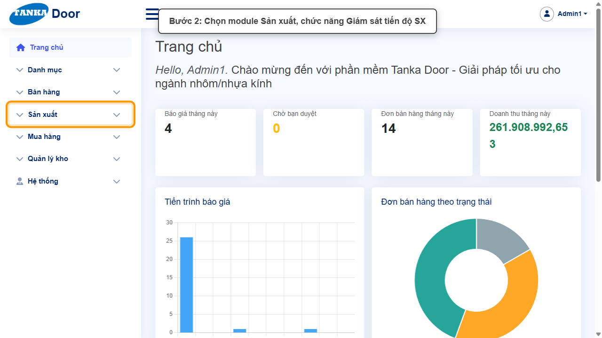
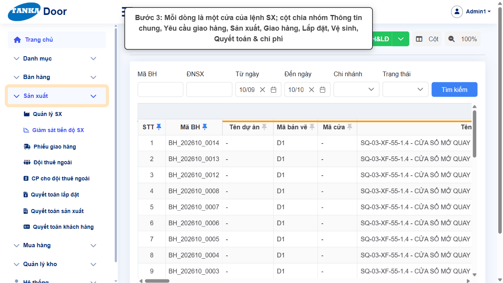
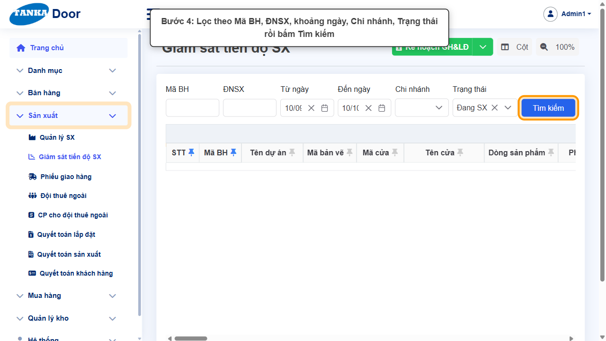
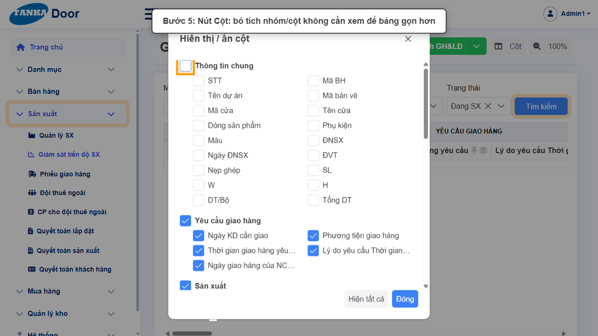
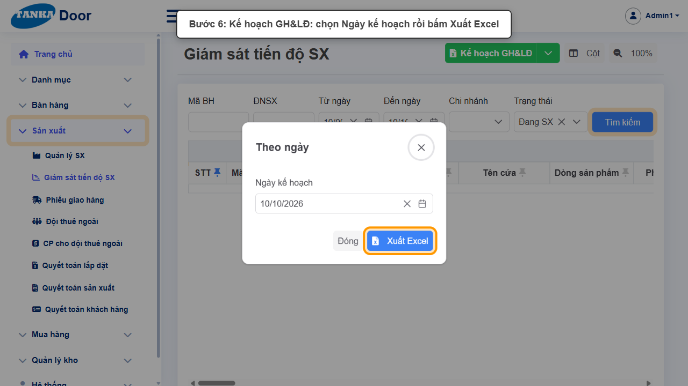
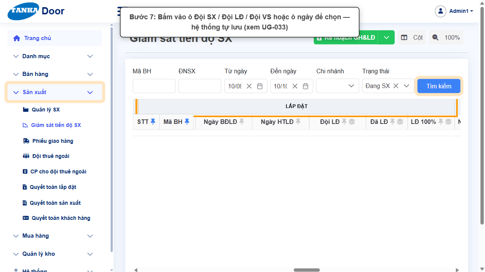

# HƯỚNG DẪN SỬ DỤNG — GIÁM SÁT TIẾN ĐỘ SẢN XUẤT

**Đường dẫn:** Sản xuất > Giám sát tiến độ SX  
**Mục tiêu:** Theo dõi tiến độ từng cửa từ sản xuất đến giao hàng, lắp đặt, vệ sinh; lọc, ẩn/hiện cột và xuất kế hoạch giao hàng & lắp đặt theo ngày.  
**Dành cho:** Người mới sử dụng TANKA Door

## Trước khi bắt đầu

**Cần có sẵn:**

- Có lệnh sản xuất đã duyệt trở đi (UG-032).
- Đã có Đội thuê ngoài nếu cần giao việc (UG-034).

**Nên đọc trước:** UG-033.

**Quyền cần có:** Tài khoản thuộc nhóm có quyền Xem/Tạo/Sửa module **Sản xuất** (UG-063). Nếu không thấy menu hoặc nút như trong ảnh, liên hệ quản trị hệ thống.

> Ảnh minh họa được chụp bằng tài khoản quản trị trên hệ thống thử nghiệm. Thuật ngữ viết tắt (HTK, NVL, BH, SX, YCMH...) và thứ tự các nghiệp vụ: xem **UG-000 Tổng quan**.

## 1. Khái niệm

Mỗi dòng là **một cửa** của lệnh sản xuất. Các cột chia nhóm: **Thông tin chung** (Mã BH, Tên dự án, Mã bản vẽ, Mã cửa, ĐNSX, kích thước…), **Yêu cầu giao hàng**, **Sản xuất**, **Giao hàng**, **Lắp đặt**, **Lắp đặt (tiếp)**, **Vệ sinh**, **Quyết toán & chi phí**.

Các ô đội (Đội SX / Đội LĐ / Đội VS) và ngày (Ngày BĐVS, HTVS…) **sửa trực tiếp trên bảng và tự lưu** — không có nút Lưu (xem UG-033).

Thanh công cụ: **Kế hoạch GH&LĐ** (xuất Excel kế hoạch giao hàng & lắp đặt theo ngày), **Cột** (ẩn/hiện cột), **100%** (thu phóng bảng).

> Mọi ô sửa trên bảng **tự lưu ngay** khi chọn, không có nút Lưu — kiểm tra kỹ dòng (Mã BH, Mã cửa) trước khi bấm vào ô.

## 2. Quy trình thao tác từng bước

### Bước 1. Mở trang chủ Tanka Door

Đăng nhập (UG-001), màn hình **Trang chủ** hiện ra.

*Hình 1: Mở trang chủ Tanka Door.*

<video src="videos/UG-039-giam-sat-tien-do-sx/01.webm" controls muted width="100%"></video>

### Bước 2. Mở Sản xuất > Giám sát tiến độ SX

**Kết quả mong đợi:** màn hình **Giám sát tiến độ SX** hiện ra với danh sách dữ liệu và các ô lọc.

*Hình 2: Mở Sản xuất > Giám sát tiến độ SX.*

<video src="videos/UG-039-giam-sat-tien-do-sx/02.webm" controls muted width="100%"></video>

### Bước 3. Đọc bảng giám sát

Dòng tiêu đề trên cùng là các **nhóm cột**; mỗi dòng dữ liệu là một cửa.

*Hình 3: Đọc bảng giám sát.*

<video src="videos/UG-039-giam-sat-tien-do-sx/03.webm" controls muted width="100%"></video>

### Bước 4. Lọc dữ liệu

Nhập **Mã BH**, **ĐNSX**, chọn **Từ ngày / Đến ngày**, **Chi nhánh**, **Trạng thái** (Nháp, Đã duyệt, Đã mua hàng, Đang SX, Đã SX, Đang giao hàng, Đã giao hàng, Đang lắp đặt, Đã lắp đặt, Đã quyết toán, Đã hủy, Đã hoàn tất) rồi bấm **Tìm kiếm**.

*Hình 4: Lọc dữ liệu.*

<video src="videos/UG-039-giam-sat-tien-do-sx/04.webm" controls muted width="100%"></video>

### Bước 5. Ẩn/hiện cột

Bấm **Cột** → bỏ tích nhóm hoặc từng cột không cần xem. **Hiện tất cả** để khôi phục, **Đóng** để áp dụng.

*Hình 5: Ẩn/hiện cột.*

<video src="videos/UG-039-giam-sat-tien-do-sx/05.webm" controls muted width="100%"></video>

### Bước 6. Xuất kế hoạch giao hàng & lắp đặt

Bấm **Kế hoạch GH&LĐ** → hộp **Theo ngày**: chọn **Ngày kế hoạch** → **Xuất Excel**. File Excel tải về máy.

*Hình 6: Xuất kế hoạch giao hàng & lắp đặt.*

<video src="videos/UG-039-giam-sat-tien-do-sx/06.webm" controls muted width="100%"></video>

### Bước 7. Cập nhật đội và ngày trên bảng

Kéo sang nhóm cột **Sản xuất / Lắp đặt / Vệ sinh**, bấm vào ô để chọn đội hoặc ngày — hệ thống tự lưu (chi tiết UG-033).

*Hình 7: Cập nhật đội và ngày trên bảng.*

<video src="videos/UG-039-giam-sat-tien-do-sx/07.webm" controls muted width="100%"></video>

### Video tổng hợp toàn bộ thao tác

Video dưới đây ghép liền toàn bộ các bước ở trên, từ lúc mở chức năng đến khi hoàn thành — xem lại một lượt trước khi tự thao tác.

<video src="videos/UG-039-giam-sat-tien-do-sx/full.webm" controls muted width="100%"></video>

## 3. Khi không thao tác được

| Hiện tượng | Cách xử lý ngay |
| --- | --- |
| Bảng trống sau khi lọc | Khoảng Từ ngày – Đến ngày mặc định 1 tháng gần nhất — mở rộng khoảng ngày hoặc bỏ lọc Trạng thái. |
| Bảng quá rộng, khó xem | Dùng nút Cột để ẩn bớt, hoặc nút 100% để thu nhỏ. |
| Chọn đội xong không thấy lưu | Ô tự lưu khi chọn; tải lại trang để kiểm tra. Đội không có trong danh sách → kiểm tra UG-034. |

## 4. Checklist dành cho người mới

- [ ] Đã đặt khoảng ngày phù hợp trước khi tìm.
- [ ] Đã biết cách ẩn/hiện cột và khôi phục bằng Hiện tất cả.
- [ ] Đã xuất được file Kế hoạch GH&LĐ.

---

_Tài liệu này được biên soạn dựa trên thao tác thực tế trên hệ thống door-v1.test.tankasoft.com. Ảnh minh họa có thể thay đổi theo phiên bản giao diện._
