# HƯỚNG DẪN SỬ DỤNG — PHIẾU NHẬN HÀNG: NHẬN NGOÀI ĐƠN, TRẢ HÀNG NCC VÀ ĐẢO PHIẾU

**Đường dẫn:** Mua hàng > Phiếu nhận hàng; Sản xuất > Quản lý SX > tab Đơn mua hàng; Mua hàng > Đơn mua hàng  
**Mục tiêu:** Ghi nhận hàng về **không theo đơn mua hàng**, **trả lại hàng lỗi cho nhà cung cấp**, và **đảo** một phiếu đã ghi sổ nhầm.  
**Dành cho:** Người mới sử dụng TANKA Door

> Phiếu nhận hàng thông thường (theo đơn mua hàng) được hệ thống **tự tạo khi duyệt đơn mua hàng** — xem **UG-040**. Hướng dẫn này dành cho 3 tình huống còn lại.

## Trước khi bắt đầu

**Cần có sẵn:**

- Đã có Nhà cung cấp (UG-042) và Kho nhận (UG-011).
- Trả hàng NCC: đơn mua hàng đã nhận hàng (UG-040).

**Nên đọc trước:** UG-040.

**Quyền cần có:** Tài khoản thuộc nhóm có quyền Xem/Tạo/Sửa module **Mua hàng** (UG-063). Nếu không thấy menu hoặc nút như trong ảnh, liên hệ quản trị hệ thống.

> Ảnh minh họa được chụp bằng tài khoản quản trị trên hệ thống thử nghiệm. Thuật ngữ viết tắt (HTK, NVL, BH, SX, YCMH...) và thứ tự các nghiệp vụ: xem **UG-000 Tổng quan**.

## 1. Tổng quan về Phiếu nhận hàng

| Loại phiếu | Mã | Tạo từ đâu | Nút ghi sổ | Ảnh hưởng tồn kho |
| --- | --- | --- | --- | --- |
| Nhận hàng | NH_YYYYMM_xxxx | Tự động khi duyệt đơn MH, hoặc **Tạo mới** ở danh sách Phiếu nhận hàng | **Ghi sổ** | Tăng (sinh phiếu kho NK_...) |
| Trả hàng NCC | TH_YYYYMM_xxxx | Nút **Trả hàng NCC** trên đơn mua hàng đã nhận | **Xuất trả** | Giảm (sinh phiếu kho XT_...) |

Trạng thái của phiếu:

- **Nháp** — còn sửa được; có các nút Lưu, Ghi sổ / Xuất trả, Hủy phiếu.
- **Đã ghi sổ** — đã tác động tồn kho; chỉ còn nút **Đảo phiếu**.
- **Đã hủy** — phiếu nháp bị hủy, không tác động tồn kho.
- **Đã đảo** — phiếu đã ghi sổ được đảo ngược bằng một phiếu kho đảo.

## 2. Ví dụ dữ liệu nhập

Ví dụ dưới đây giúp bạn hình dung cách nhập. Hãy nhập dữ liệu thật của công ty bạn; tên/mã có hậu tố số trong ảnh là dữ liệu thử nghiệm, mã chứng từ (BG_, BH_, SX_, MH_...) do hệ thống tự sinh nên của bạn sẽ khác.

| Trường | Giá trị |
| --- | --- |
| Nhà cung cấp / Kho nhận | Green Future / 01-PR |
| Phiếu nhận ngoài đơn | NH_202610_0054 — 1 Thanh 5.8 C3295-X-1.0 (Nẹp kính vuông hệ 55 - Xingfa - Xám - 1.0mm), thành tiền 250.000 |
| Lệnh SX / Đơn MH dùng để trả hàng | SX_202610_0013 / MH_202610_0036 (Green Future, đã nhận đủ) |
| Phiếu trả hàng NCC | TH_202610_0006 — trả 1 Thanh 5.8 C3295-X-1.0, lý do **Hư hỏng**, có **Cần giao bù** |

## 3. Sơ đồ quy trình tóm tắt

**A. Nhận hàng ngoài đơn:** Mua hàng > Phiếu nhận hàng → Tạo mới → Chọn NCC, Kho nhận → Thêm mặt hàng khác → Lưu → Ghi sổ

**B. Trả hàng NCC:** Mở đơn mua hàng đã nhận → Trả hàng NCC → Giữ dòng cần trả, nhập số lượng, giá trị, lý do → Lưu → Xuất trả

**C. Đảo phiếu:** Mở phiếu đã ghi sổ → Đảo phiếu → Đồng ý → Phiếu chuyển "Đã đảo"

## 4. Quy trình thao tác từng bước

### Phần A — Nhận hàng ngoài đơn

Dùng khi NCC giao hàng **không có trong đơn mua hàng** (hàng thay thế, giao bù, hàng tặng...).

#### Bước 1. Mở trang chủ Tanka Door

Đăng nhập vào hệ thống, màn hình **Trang chủ** hiện ra.

*Hình 1: Trang chủ sau khi đăng nhập.*

<video src="videos/UG-041-nhan-ngoai-don-tra-hang-ncc/01.webm" controls muted width="100%"></video>

#### Bước 2. Mở danh sách Phiếu nhận hàng

Ở menu bên trái, mở **Mua hàng > Phiếu nhận hàng**. Danh sách có bộ lọc **Loại phiếu** (Nhận hàng / Trả hàng NCC), **Trạng thái**, **Nhà cung cấp**, **Kho nhận**.

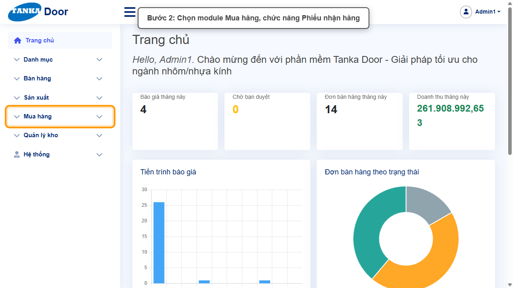

*Hình 2: Mở Mua hàng > Phiếu nhận hàng.*

<video src="videos/UG-041-nhan-ngoai-don-tra-hang-ncc/02.webm" controls muted width="100%"></video>

#### Bước 3. Bấm Tạo mới

Bấm **Tạo mới** ở góc phải phía trên. Form **Phiếu nhận hàng** mở ra ở trạng thái **Nháp**, Ngày nhận mặc định là hôm nay.

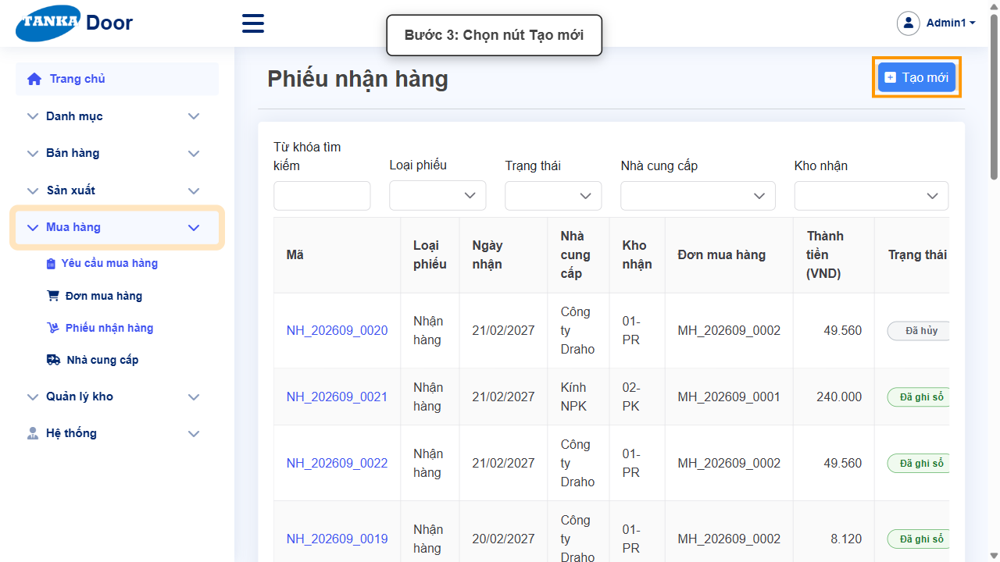

*Hình 3: Bấm Tạo mới.*

<video src="videos/UG-041-nhan-ngoai-don-tra-hang-ncc/03.webm" controls muted width="100%"></video>

#### Bước 4. Chọn Nhà cung cấp, Kho nhận và nhập Ghi chú

- **Nhà cung cấp *** — NCC đã giao hàng (ví dụ **Green Future**).
- **Kho nhận *** — kho nhập hàng (ví dụ **01-PR** — kho profile).
- **Ghi chú** — ghi rõ lý do nhận ngoài đơn để dễ đối chiếu sau này.

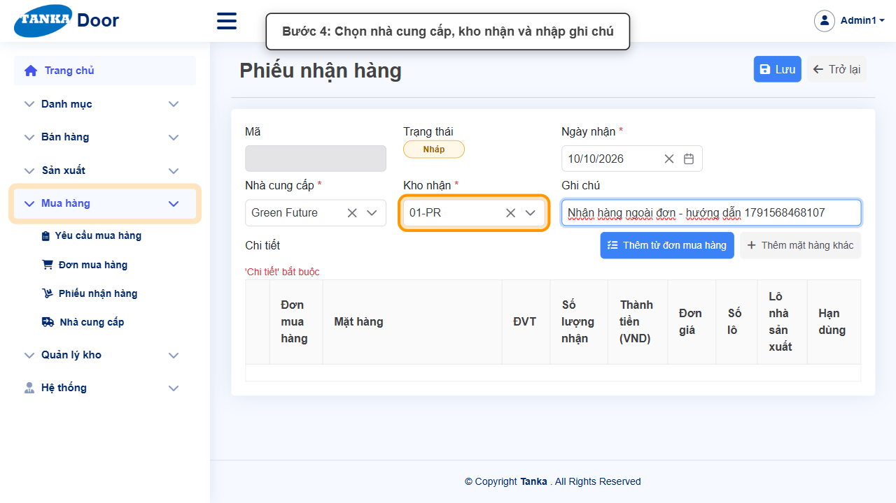

*Hình 4: Chọn nhà cung cấp, kho nhận và nhập ghi chú.*

<video src="videos/UG-041-nhan-ngoai-don-tra-hang-ncc/04.webm" controls muted width="100%"></video>

> Nút **Thêm từ đơn mua hàng** dùng khi muốn nhận các dòng còn chờ nhận của đơn MH **đã duyệt** thuộc đúng NCC và kho đã chọn. Nếu không còn dòng nào, popup báo _"Nhà cung cấp này không còn dòng đặt hàng nào chờ nhận tại kho này."_

#### Bước 5. Bấm Thêm mặt hàng khác

Bấm **+ Thêm mặt hàng khác**. Bảng **Chi tiết** có thêm một dòng **"Ngoài đơn"**.

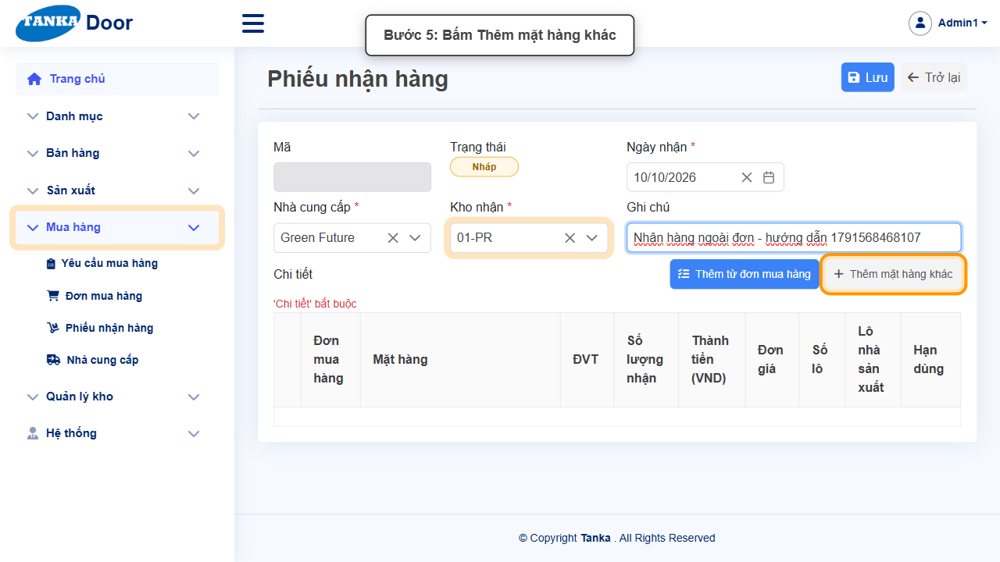

*Hình 5: Bấm Thêm mặt hàng khác.*

<video src="videos/UG-041-nhan-ngoai-don-tra-hang-ncc/05.webm" controls muted width="100%"></video>

#### Bước 6. Nhập dòng hàng rồi bấm Lưu

Trên dòng "Ngoài đơn":

- **Mặt hàng** — gõ mã để tìm (ví dụ `C3295-X-1.0`) và chọn.
- **ĐVT** — chọn đơn vị nhận thực tế (mặc định có thể là **mm**; với thanh profile chọn **Thanh 5.8**).
- **Số lượng nhận** và **Thành tiền (VND)** — cột **Đơn giá** tự tính = Thành tiền / Số lượng.
- **Số lô / Lô nhà sản xuất / Hạn dùng** — chỉ điền với hàng quản lý theo lô.

Kiểm tra lại rồi bấm **Lưu**. Hệ thống sinh mã **NH_YYYYMM_xxxx**, phiếu vẫn ở trạng thái **Nháp**.

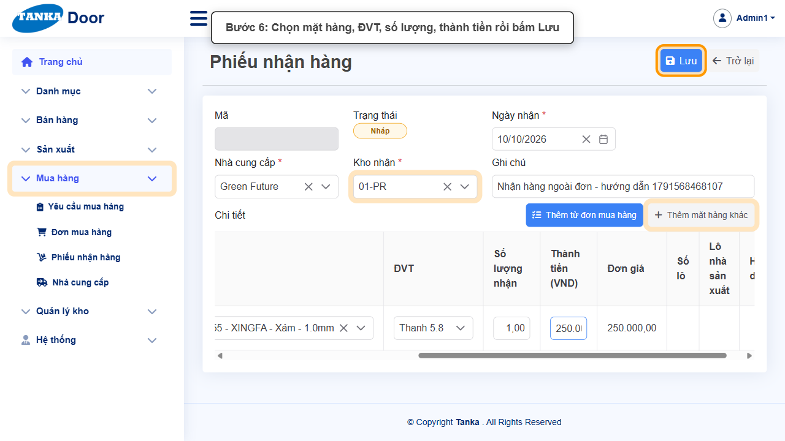

*Hình 6: Nhập mặt hàng, ĐVT, số lượng, thành tiền rồi bấm Lưu.*

<video src="videos/UG-041-nhan-ngoai-don-tra-hang-ncc/06.webm" controls muted width="100%"></video>

#### Bước 7. Bấm Ghi sổ để nhập kho

Bấm **Ghi sổ**, rồi bấm **Đồng ý** ở popup _"Ghi sổ phiếu này? Hàng sẽ được nhập kho và đơn mua hàng được cập nhật."_

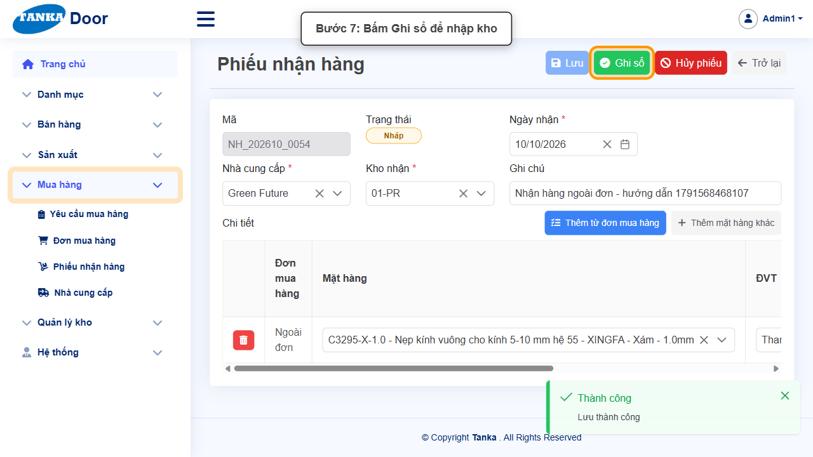

*Hình 7: Bấm Ghi sổ.*

<video src="videos/UG-041-nhan-ngoai-don-tra-hang-ncc/07.webm" controls muted width="100%"></video>

#### Bước 8. Phiếu nhận hàng đã ghi sổ

Thông báo **"Đã ghi sổ: NK_..."** hiện ra, trạng thái chuyển **Đã ghi sổ**, phía trên phiếu có link **mở phiếu kho** (phiếu nhập kho NK_...). Hàng đã được cộng vào tồn kho của kho nhận.

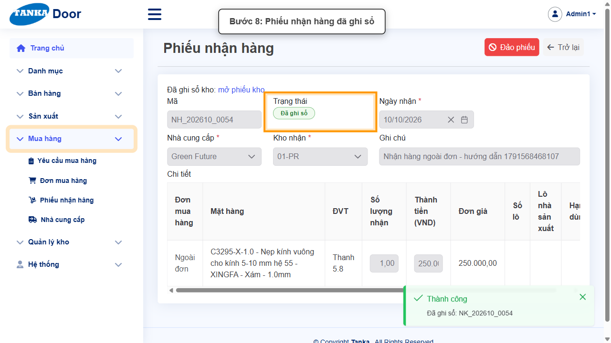

*Hình 8: Phiếu nhận hàng đã ghi sổ.*

<video src="videos/UG-041-nhan-ngoai-don-tra-hang-ncc/08.webm" controls muted width="100%"></video>

### Phần B — Trả hàng cho nhà cung cấp

Dùng khi hàng đã nhập kho bị **hư hỏng, sai mặt hàng, sai màu, lỗi chất lượng hoặc giao thừa**. Phiếu trả hàng phải tạo **từ đơn mua hàng** đã nhận hàng.

#### Bước 9. Mở lệnh SX, chọn tab Đơn mua hàng

Cách nhanh để tìm đúng đơn mua hàng là đi từ lệnh sản xuất: mở **Sản xuất > Quản lý SX**, bấm vào lệnh SX (ví dụ `SX_202610_0013`), chọn tab **Đơn mua hàng**. Tab liệt kê các đơn MH của lệnh kèm **Nhà cung cấp** và **Trạng thái**.

> Cũng có thể mở trực tiếp **Mua hàng > Đơn mua hàng** và tìm theo **mã đơn** (ô Tìm kiếm chỉ tìm theo mã).

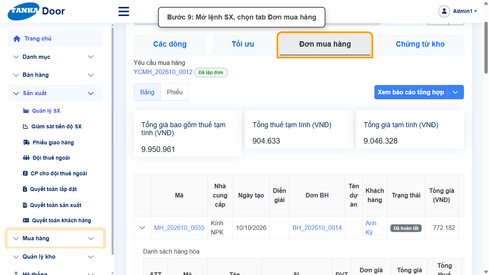

*Hình 9: Mở lệnh SX, chọn tab Đơn mua hàng.*

<video src="videos/UG-041-nhan-ngoai-don-tra-hang-ncc/09.webm" controls muted width="100%"></video>

#### Bước 10. Mở đơn mua hàng cần trả hàng

Bấm vào mã đơn của nhà cung cấp cần trả (ví dụ `MH_202610_0036` của **Green Future**, trạng thái Đã hoàn tất).

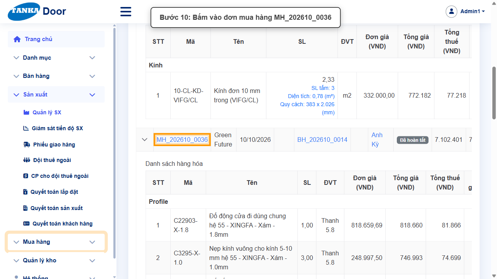

*Hình 10: Bấm vào đơn mua hàng.*

<video src="videos/UG-041-nhan-ngoai-don-tra-hang-ncc/10.webm" controls muted width="100%"></video>

#### Bước 11. Bấm Trả hàng NCC

Cuộn tới mục **Nhận hàng** của đơn, bấm **Trả hàng NCC**. Form **Phiếu trả hàng NCC** mở ra (chưa lưu) với Nhà cung cấp, Kho nhận và **tất cả các dòng** của đơn mua hàng.

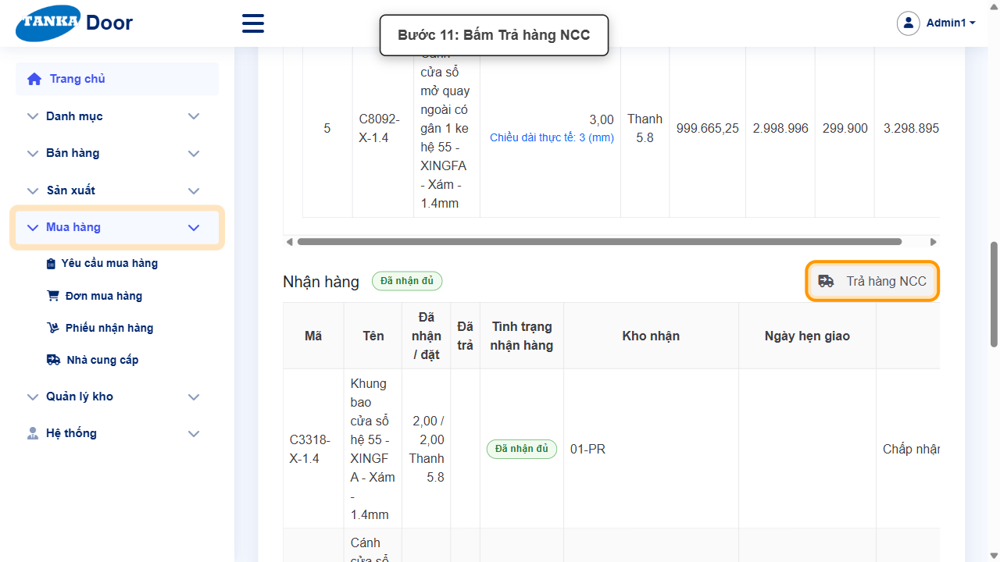

*Hình 11: Bấm Trả hàng NCC.*

<video src="videos/UG-041-nhan-ngoai-don-tra-hang-ncc/11.webm" controls muted width="100%"></video>

#### Bước 12. Giữ dòng cần trả, nhập số lượng, giá trị và lý do

1. Bấm biểu tượng **thùng rác** ở đầu các dòng **không** trả để xóa khỏi phiếu.
2. Ở dòng cần trả, nhập **Số lượng nhận** = số lượng trả (ví dụ **1**).
3. Nhập lại **Giá trị trả** = Đơn giá × số lượng trả (ví dụ 248.997,5 cho 1 thanh).
4. Chọn **Lý do trả**: Hư hỏng / Sai mặt hàng / Sai màu / Lỗi chất lượng / Giao thừa / Khác.
5. Tích **Cần giao bù** nếu yêu cầu NCC giao lại hàng thay thế.
6. Ghi chú mô tả tình trạng hàng trả.

> **Lưu ý:** khi sửa Số lượng, ô **Giá trị trả không tự tính lại** — phải nhập lại theo số lượng trả, nếu không sẽ trả với giá trị của toàn bộ số lượng ban đầu.

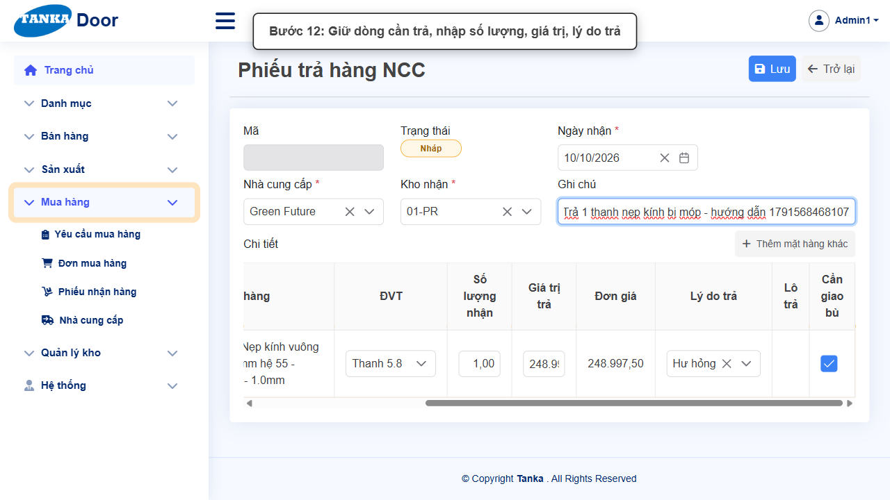

*Hình 12: Giữ dòng cần trả, nhập số lượng, giá trị, lý do trả.*

<video src="videos/UG-041-nhan-ngoai-don-tra-hang-ncc/12.webm" controls muted width="100%"></video>

#### Bước 13. Lưu phiếu trả hàng

Bấm **Lưu**. Hệ thống sinh mã **TH_YYYYMM_xxxx**, trạng thái **Nháp**.

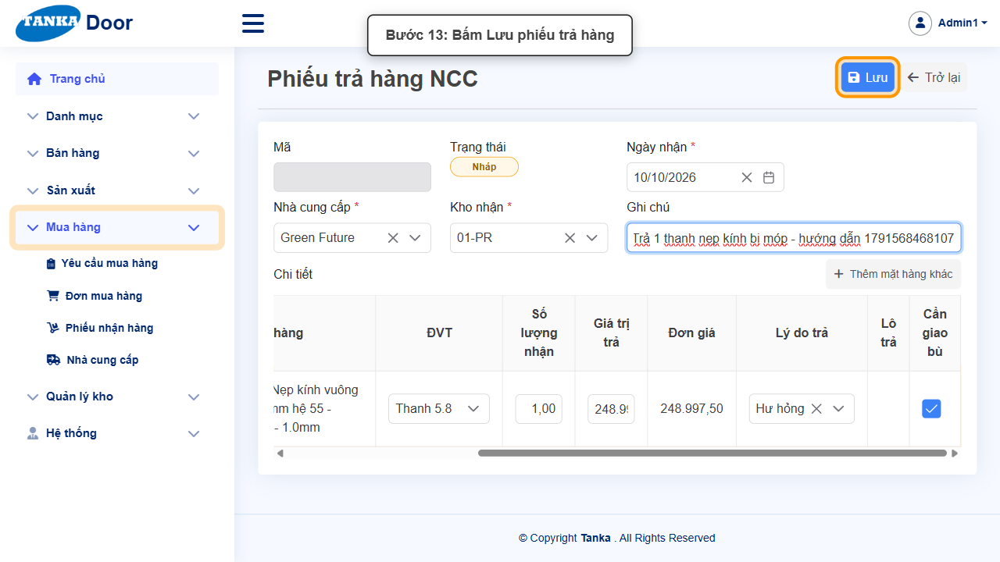

*Hình 13: Bấm Lưu phiếu trả hàng.*

<video src="videos/UG-041-nhan-ngoai-don-tra-hang-ncc/13.webm" controls muted width="100%"></video>

#### Bước 14. Bấm Xuất trả

Với phiếu trả hàng, nút ghi sổ có tên **Xuất trả**. Bấm **Xuất trả**, rồi **Đồng ý** ở popup _"Xuất trả hàng cho nhà cung cấp? Tồn kho giảm theo giá trị trả và đơn mua được cập nhật."_

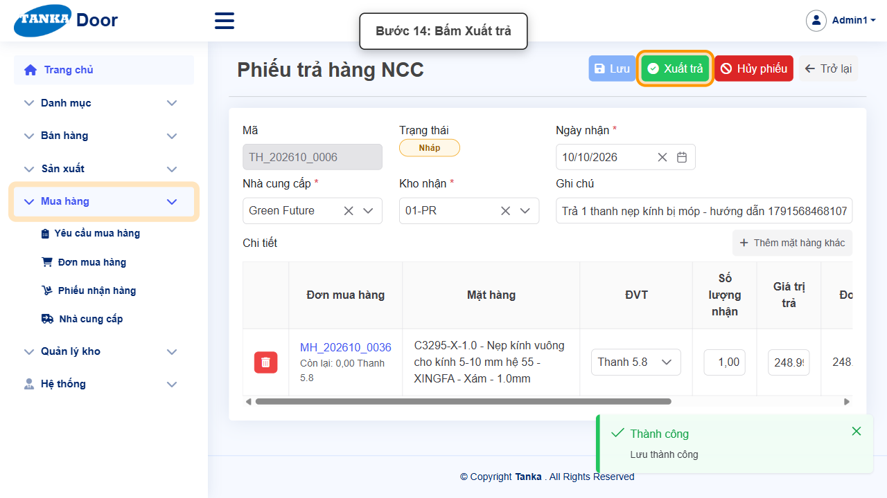

*Hình 14: Bấm Xuất trả.*

<video src="videos/UG-041-nhan-ngoai-don-tra-hang-ncc/14.webm" controls muted width="100%"></video>

#### Bước 15. Phiếu trả hàng đã ghi sổ

Thông báo **"Đã ghi sổ: XT_..."** hiện ra, trạng thái chuyển **Đã ghi sổ**. Tồn kho của mặt hàng giảm theo số lượng trả; số lượng đã nhận trên đơn mua hàng được cập nhật.

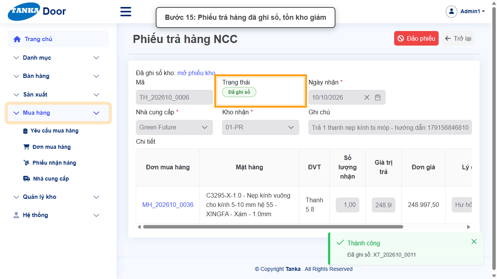

*Hình 15: Phiếu trả hàng đã ghi sổ, tồn kho giảm.*

<video src="videos/UG-041-nhan-ngoai-don-tra-hang-ncc/15.webm" controls muted width="100%"></video>

### Phần C — Đảo phiếu đã ghi sổ

Dùng khi một phiếu (nhận hàng hoặc trả hàng) **đã ghi sổ nhầm** — phiếu đã ghi sổ không sửa hay hủy được, chỉ có thể **đảo**.

#### Bước 16. Bấm Đảo phiếu

Trên phiếu đã ghi sổ, bấm **Đảo phiếu**, rồi **Đồng ý** ở popup xác nhận. Hệ thống tạo một **phiếu kho đảo** có tác động ngược lại với phiếu gốc: đảo phiếu nhận hàng thì hàng được xuất khỏi kho; đảo phiếu trả hàng thì hàng được nhập lại kho. Đơn mua hàng được mở lại tương ứng.

> Câu chữ trong popup hiện là _"Hàng sẽ được xuất khỏi kho và đơn mua hàng được mở lại"_ cho mọi loại phiếu — với phiếu trả hàng, việc đảo thực tế là nhập lại hàng vào kho.

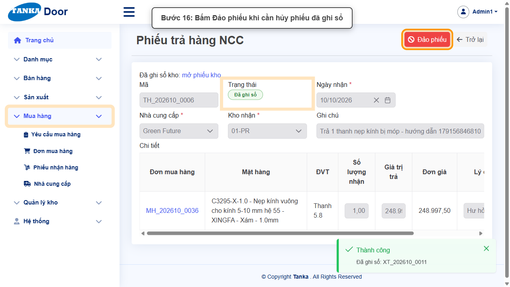

*Hình 16: Bấm Đảo phiếu.*

<video src="videos/UG-041-nhan-ngoai-don-tra-hang-ncc/16.webm" controls muted width="100%"></video>

#### Bước 17. Phiếu chuyển sang Đã đảo

Thông báo **"Đã đảo bằng XT_..."** (hoặc NK_... tùy loại phiếu) hiện ra. Trạng thái chuyển **Đã đảo**; phía trên phiếu có 2 link: **mở phiếu kho** (phiếu gốc) và **mở phiếu đảo**.

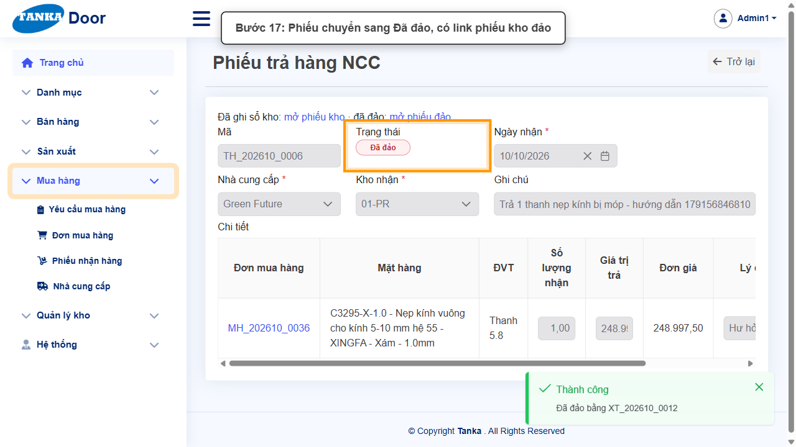

*Hình 17: Phiếu chuyển sang Đã đảo, có link phiếu kho đảo.*

<video src="videos/UG-041-nhan-ngoai-don-tra-hang-ncc/17.webm" controls muted width="100%"></video>

## 5. Khi không thao tác được

| Hiện tượng | Cách xử lý ngay |
| --- | --- |
| "Thêm từ đơn mua hàng" báo không còn dòng chờ nhận | Đơn MH chưa được duyệt, đã nhận đủ, hoặc khác NCC/kho đã chọn. Kiểm tra lại NCC, Kho nhận và trạng thái đơn MH. |
| Dòng "Ngoài đơn" không chọn được ĐVT mong muốn | Danh sách ĐVT lấy theo khai báo quy đổi của mặt hàng ở Danh mục > Hàng tồn kho; khai báo thêm quy đổi nếu thiếu. |
| Không thấy nút "Trả hàng NCC" trên đơn mua hàng | Đơn chưa nhận hàng nào. Chỉ trả được hàng đã nhập kho. |
| Phiếu trả hàng có giá trị trả quá lớn | Ô Giá trị trả không tự tính lại khi đổi Số lượng — nhập lại = Đơn giá × số lượng trả trước khi Xuất trả. |
| Xuất trả báo không đủ tồn kho | Hàng trong kho đã bị xuất cho sản xuất hoặc đang giữ cho lệnh SX khác — kiểm tra **Quản lý kho > Tồn kho**. |
| Phiếu đã ghi sổ không có nút Lưu / Hủy phiếu | Đúng thiết kế — phiếu đã ghi sổ chỉ có thể **Đảo phiếu**. |
| Muốn bỏ một phiếu còn Nháp | Bấm **Hủy phiếu** (không cần đảo vì chưa tác động tồn kho). |

## 6. Dấu hiệu hoàn thành

- Phiếu nhận ngoài đơn ở trạng thái "Đã ghi sổ", có link phiếu kho NK_..., dòng hàng ghi "Ngoài đơn".
- Phiếu trả hàng NCC (TH_...) ở trạng thái "Đã ghi sổ" (hoặc "Đã đảo" nếu đã đảo), có lý do trả.
- Phiếu đã đảo có cả link "mở phiếu kho" và "mở phiếu đảo".
- Danh sách Phiếu nhận hàng lọc theo Loại phiếu / Trạng thái hiển thị đúng các phiếu vừa tạo.

## 7. Checklist dành cho người mới

- [ ] Phân biệt được nhận theo đơn (tự động, UG-040) và nhận ngoài đơn (Tạo mới + Thêm mặt hàng khác).
- [ ] Khi nhận ngoài đơn: chọn đúng NCC, kho, ĐVT và ghi chú lý do.
- [ ] Khi trả hàng: chỉ giữ dòng cần trả, nhập lại Giá trị trả, chọn Lý do trả.
- [ ] Phân biệt Hủy phiếu (phiếu Nháp) và Đảo phiếu (phiếu đã ghi sổ).

---

_Tài liệu này được biên soạn dựa trên thao tác thực tế trên hệ thống door-v1.test.tankasoft.com. Ảnh minh họa có thể thay đổi theo phiên bản giao diện._
