# HƯỚNG DẪN SỬ DỤNG — NHÀ CUNG CẤP

**Đường dẫn:** Mua hàng > Nhà cung cấp  
**Mục tiêu:** Tạo nhà cung cấp (NCC) với loại NVL cung cấp, quy tắc dung sai nhận hàng, địa chỉ; và gán NCC mặc định cho từng hàng tồn kho.  
**Dành cho:** Người mới sử dụng TANKA Door

## Trước khi bắt đầu

**Cần có sẵn:**

- Thông tin NCC: tên, liên hệ, mã số thuế, loại NVL cung cấp, quy tắc dung sai khi nhận hàng.

**Quyền cần có:** Tài khoản thuộc nhóm có quyền Xem/Tạo/Sửa module **Mua hàng** (UG-063). Nếu không thấy menu hoặc nút như trong ảnh, liên hệ quản trị hệ thống.

> Ảnh minh họa được chụp bằng tài khoản quản trị trên hệ thống thử nghiệm. Thuật ngữ viết tắt (HTK, NVL, BH, SX, YCMH...) và thứ tự các nghiệp vụ: xem **UG-000 Tổng quan**.

## 1. Khái niệm

NCC được chọn khi **chuyển yêu cầu mua hàng thành đơn mua** (UG-032) và trên **phiếu nhận hàng** (UG-040, UG-041).

- **Loại NVL**: Profile, Phụ kiện, Vật tư phụ, Gioăng, Kính.
- **Xử lý khi ngoài dung sai**: _Từ chối phiếu nhận_ / _Chấp nhận và cảnh báo_ / _Chấp nhận, không cảnh báo_ — áp dụng khi số lượng nhận lệch so với đơn mua vượt **Nhận tối thiểu / Nhận tối đa** (%).
- Tab **Địa chỉ**: một hoặc nhiều địa chỉ (Tên, Số ĐT, Địa chỉ *, Loại địa chỉ, Thành phố).
- **Thiết lập HTK và NCC**: bảng mỗi hàng tồn kho chọn NCC thường mua — dùng để gợi ý NCC khi lập đơn mua.

## 2. Ví dụ dữ liệu nhập

Ví dụ dưới đây giúp bạn hình dung cách nhập. Hãy nhập dữ liệu thật của công ty bạn; tên/mã có hậu tố số trong ảnh là dữ liệu thử nghiệm, mã chứng từ (BG_, BH_, SX_, MH_...) do hệ thống tự sinh nên của bạn sẽ khác.

| Trường | Giá trị |
| --- | --- |
| Tên | Công ty TNHH Phụ kiện Kim Long |
| Số ĐT / Email / MST | 0281234567 / kinhdoanh@kimlong.vn / 0312345678 |
| Loại NVL | Phụ kiện, Vật tư phụ |
| Xử lý khi ngoài dung sai | Chấp nhận và cảnh báo (95% – 105%) |
| Địa chỉ | Kho NCC — 45 Quốc lộ 22, Hóc Môn |

> Khi ngừng giao dịch với NCC, **bỏ tích Hoạt động** thay vì xoá. Ảnh minh họa có bước này (bước 11) — bạn chỉ làm khi thật sự ngừng giao dịch.

## 3. Quy trình thao tác từng bước

### Bước 1. Mở trang chủ Tanka Door

Đăng nhập (UG-001), màn hình **Trang chủ** hiện ra.

*Hình 1: Mở trang chủ Tanka Door.*

<video src="videos/UG-042-nha-cung-cap/01.webm" controls muted width="100%"></video>

### Bước 2. Mở Mua hàng > Nhà cung cấp

**Kết quả mong đợi:** màn hình **Nhà cung cấp** hiện ra với danh sách dữ liệu và các ô lọc.

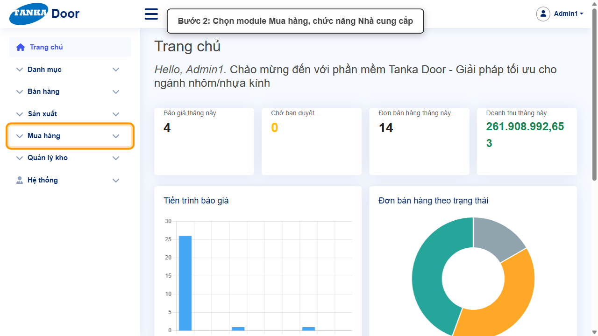

*Hình 2: Mở Mua hàng > Nhà cung cấp.*

<video src="videos/UG-042-nha-cung-cap/02.webm" controls muted width="100%"></video>

### Bước 3. Xem danh sách NCC

Cột Tên, Email, Loại NVL, Hoạt động.

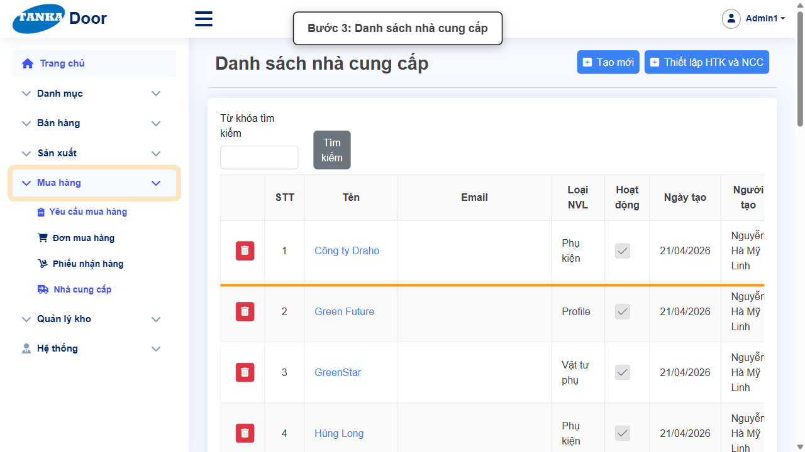

*Hình 3: Xem danh sách NCC.*

<video src="videos/UG-042-nha-cung-cap/03.webm" controls muted width="100%"></video>

### Bước 4. Bấm Tạo mới

**Kết quả mong đợi:** form nhập mới mở ra; các ô có dấu * là bắt buộc.

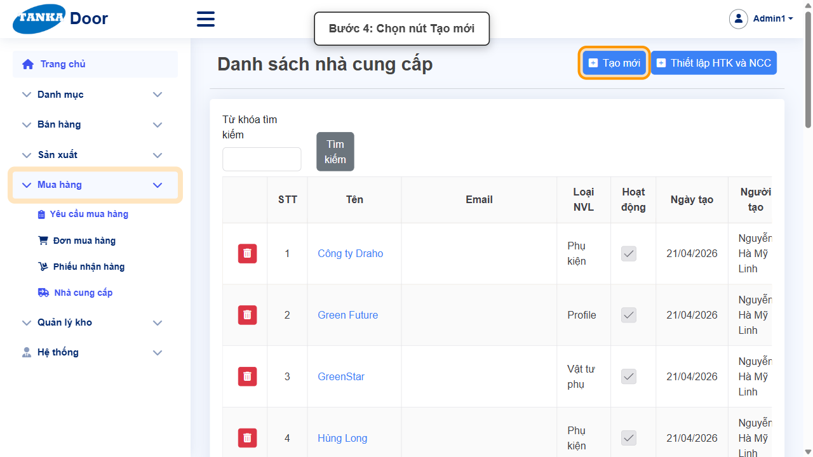

*Hình 4: Bấm Tạo mới.*

<video src="videos/UG-042-nha-cung-cap/04.webm" controls muted width="100%"></video>

### Bước 5. Nhập thông tin chung

Tab **Thông tin chung**: **Tên ***, **Số ĐT**, **Email**, **Mã số thuế**, **Diễn giải**.

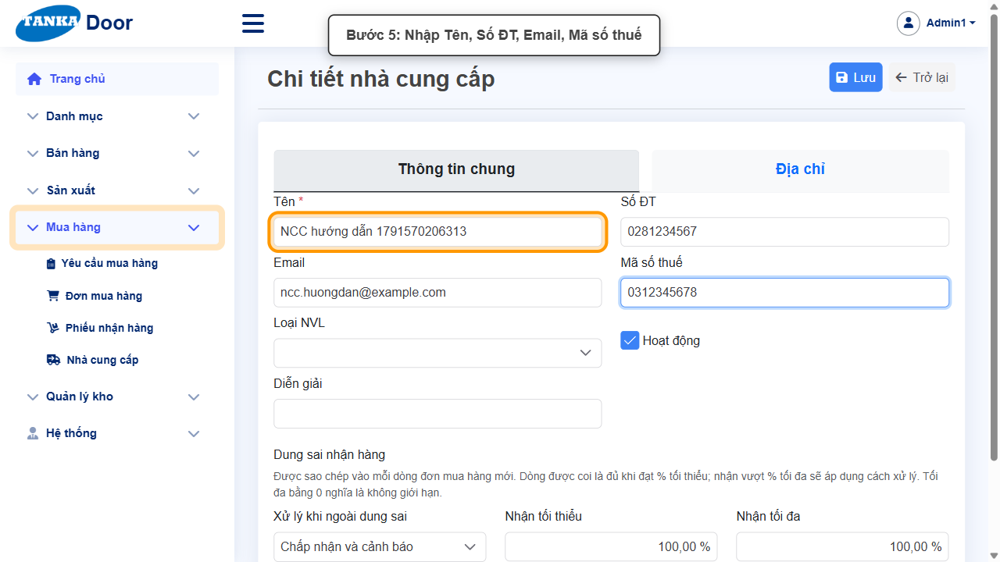

*Hình 5: Nhập thông tin chung.*

<video src="videos/UG-042-nha-cung-cap/05.webm" controls muted width="100%"></video>

### Bước 6. Chọn Loại NVL và dung sai nhận hàng

Chọn **Loại NVL** (nhiều), **Xử lý khi ngoài dung sai**, nhập **Nhận tối thiểu** / **Nhận tối đa** (%).

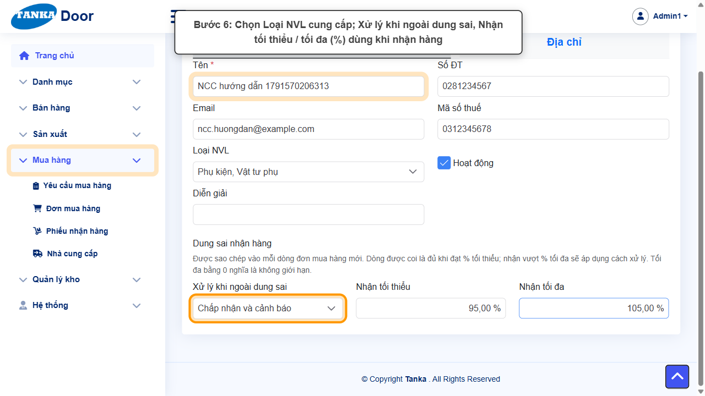

*Hình 6: Chọn Loại NVL và dung sai nhận hàng.*

<video src="videos/UG-042-nha-cung-cap/06.webm" controls muted width="100%"></video>

### Bước 7. Bấm Lưu

Thông báo **"Lưu thành công"** — phải lưu NCC trước khi thêm địa chỉ.

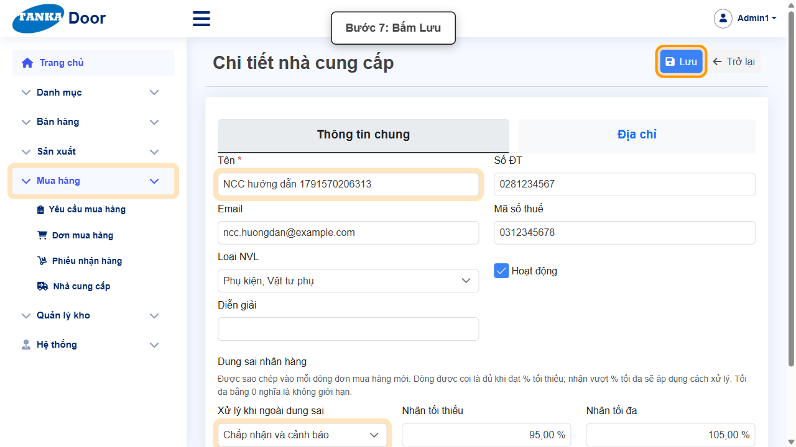

*Hình 7: Bấm Lưu.*

<video src="videos/UG-042-nha-cung-cap/07.webm" controls muted width="100%"></video>

### Bước 8. Mở tab Địa chỉ, bấm Thêm

Sau khi đã lưu NCC, chọn tab **Địa chỉ** rồi bấm **Thêm**.

**Kết quả mong đợi:** hộp **Chi tiết nhà cung cấp** mở ra để nhập địa chỉ.

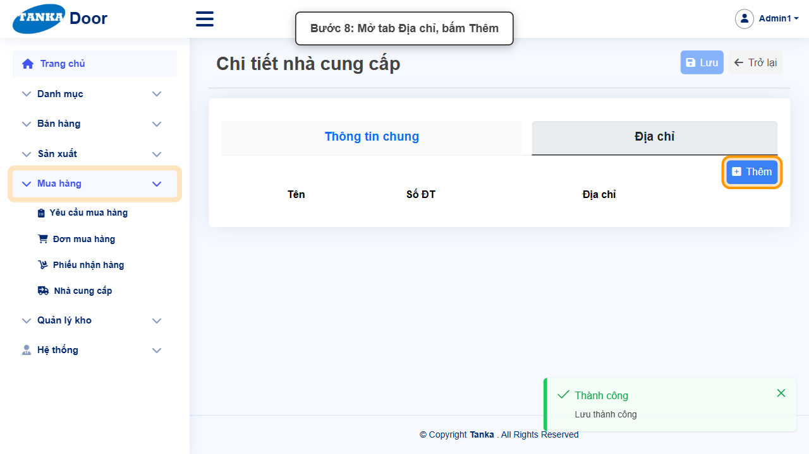

*Hình 8: Mở tab Địa chỉ, bấm Thêm.*

<video src="videos/UG-042-nha-cung-cap/08.webm" controls muted width="100%"></video>

### Bước 9. Nhập địa chỉ

Hộp **Chi tiết nhà cung cấp**: **Tên ***, Số ĐT, **Địa chỉ ***, Địa chỉ 2, Loại địa chỉ (Mặc định), Thành phố → **Lưu**. Hộp thoại đóng, địa chỉ hiện trong bảng nhưng **chưa được ghi** cho tới khi bấm Lưu của nhà cung cấp (bước 10).

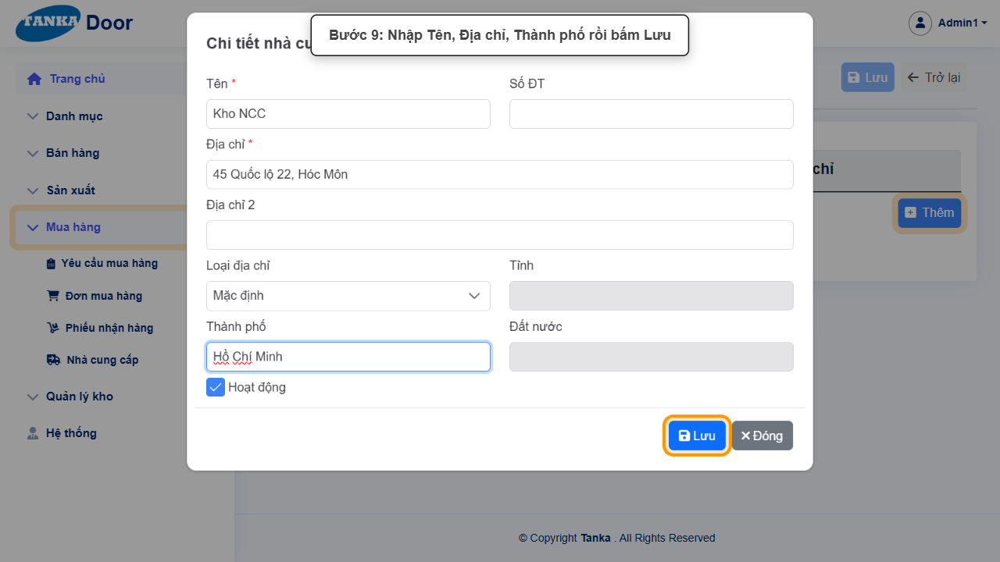

*Hình 9: Nhập địa chỉ.*

<video src="videos/UG-042-nha-cung-cap/09.webm" controls muted width="100%"></video>

### Bước 10. Lưu nhà cung cấp để ghi địa chỉ

Bấm nút **Lưu** ở góc trên của trang nhà cung cấp.

**Kết quả mong đợi:** thông báo xanh **"Lưu thành công"** hiện ở góc phải, nút **Lưu** mờ lại — địa chỉ đã được ghi.

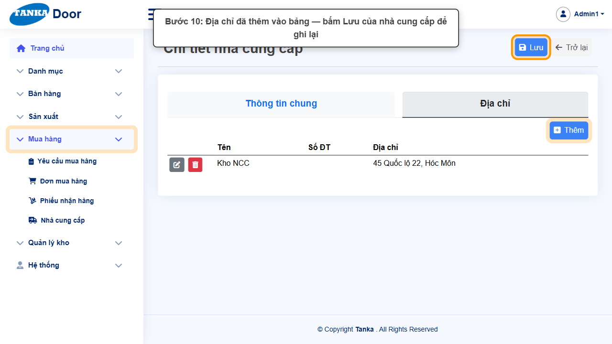

*Hình 10: Lưu nhà cung cấp để ghi địa chỉ.*

<video src="videos/UG-042-nha-cung-cap/10.webm" controls muted width="100%"></video>

### Bước 11. Ngừng giao dịch với NCC (khi cần)

Về tab Thông tin chung, bỏ tích **Hoạt động** rồi **Lưu**.

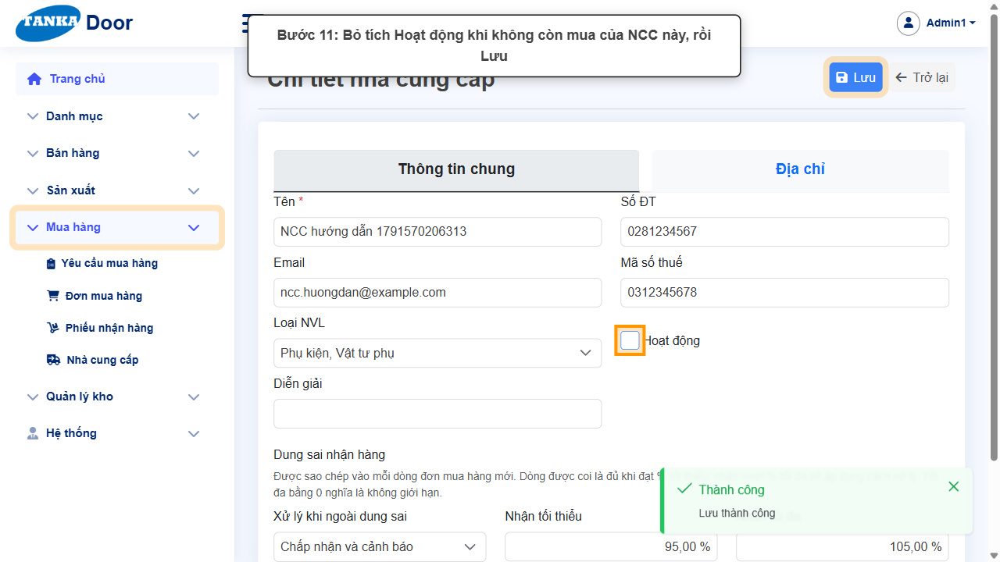

*Hình 11: Ngừng giao dịch với NCC (khi cần).*

<video src="videos/UG-042-nha-cung-cap/11.webm" controls muted width="100%"></video>

### Bước 12. Kiểm tra trong danh sách

Bấm **Trở lại**, tìm theo tên.

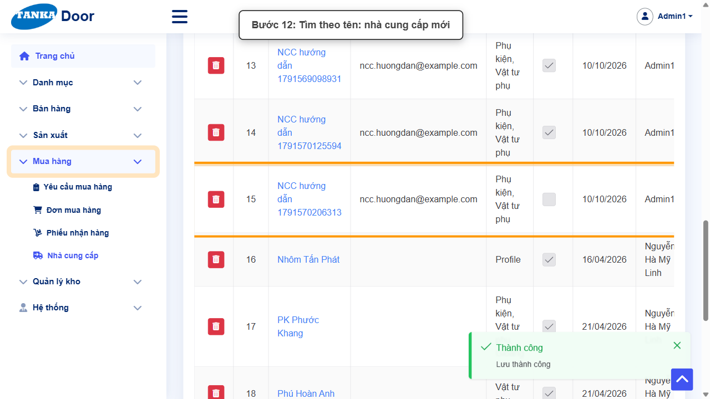

*Hình 12: Kiểm tra trong danh sách.*

<video src="videos/UG-042-nha-cung-cap/12.webm" controls muted width="100%"></video>

### Bước 13. Mở Thiết lập HTK và NCC

Trên danh sách NCC bấm **Thiết lập HTK và NCC**.

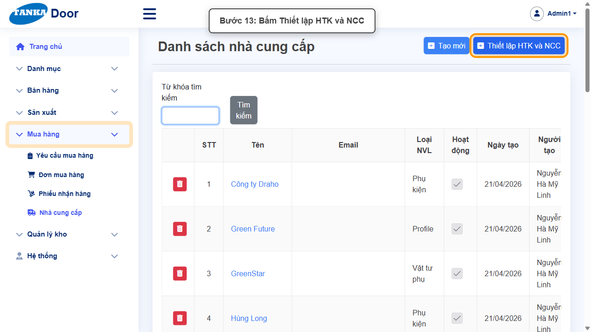

*Hình 13: Mở Thiết lập HTK và NCC.*

<video src="videos/UG-042-nha-cung-cap/13.webm" controls muted width="100%"></video>

### Bước 14. Gán NCC cho hàng tồn kho

Lọc theo NSX, Loại NVL, Loại HTK; ở cột **Nhà cung cấp** bấm "Click để thêm nhà cung cấp" và chọn NCC thường mua cho mặt hàng.

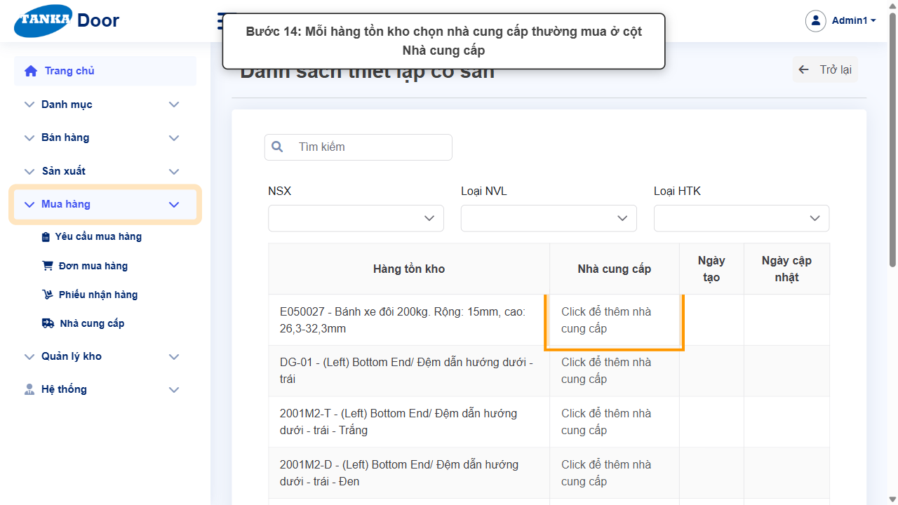

*Hình 14: Gán NCC cho hàng tồn kho.*

<video src="videos/UG-042-nha-cung-cap/14.webm" controls muted width="100%"></video>

## 4. Khi không thao tác được

| Hiện tượng | Cách xử lý ngay |
| --- | --- |
| Phiếu nhận hàng bị từ chối | NCC đặt "Từ chối phiếu nhận" và số lượng nhận vượt Nhận tối thiểu/tối đa — kiểm tra lại số lượng hoặc quy tắc dung sai. |
| Không thấy NCC khi lập đơn mua | NCC đã bỏ Hoạt động. |
| Thêm địa chỉ xong, mở lại NCC không thấy | Chưa bấm **Lưu** của nhà cung cấp sau khi thêm địa chỉ — Lưu trong hộp thoại chỉ thêm dòng vào bảng. |
| Nút Thêm địa chỉ không phản hồi | Lưu NCC trước rồi mới thêm địa chỉ. |

## 5. Checklist dành cho người mới

- [ ] Đã nhập Tên và chọn Loại NVL.
- [ ] Đã đặt quy tắc dung sai nhận hàng.
- [ ] Đã thêm ít nhất một địa chỉ.
- [ ] Đã gán NCC cho các mặt hàng thường mua (Thiết lập HTK và NCC).

---

_Tài liệu này được biên soạn dựa trên thao tác thực tế trên hệ thống door-v1.test.tankasoft.com. Ảnh minh họa có thể thay đổi theo phiên bản giao diện._
