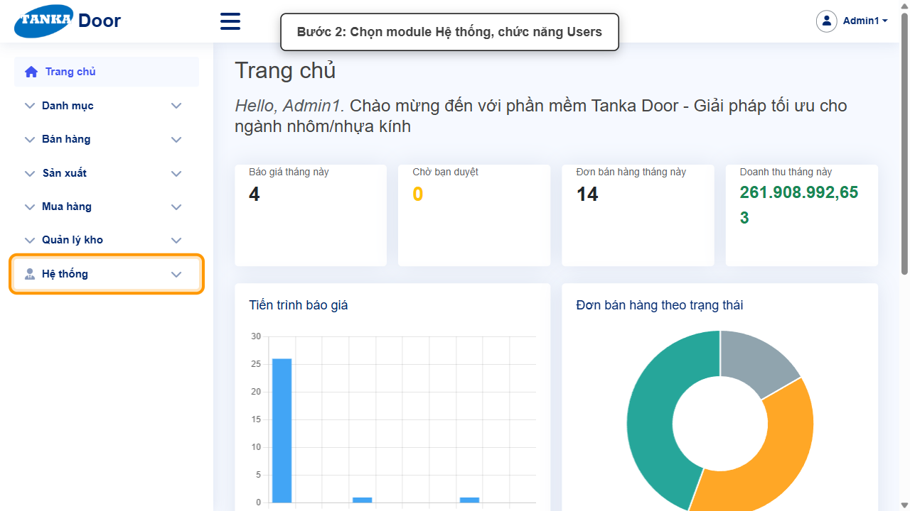
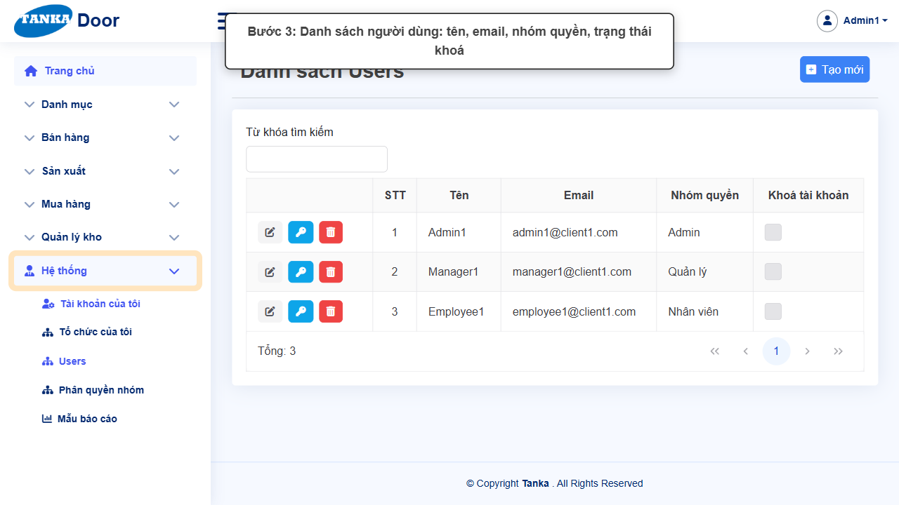
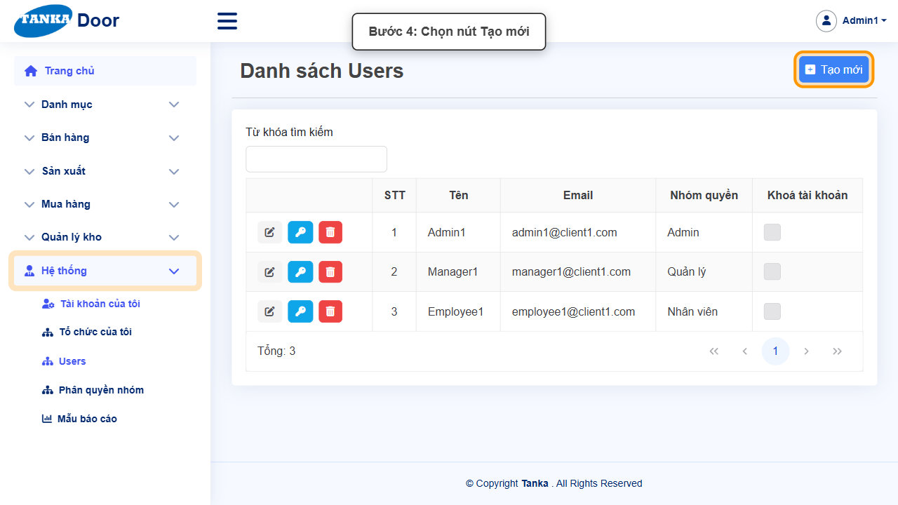
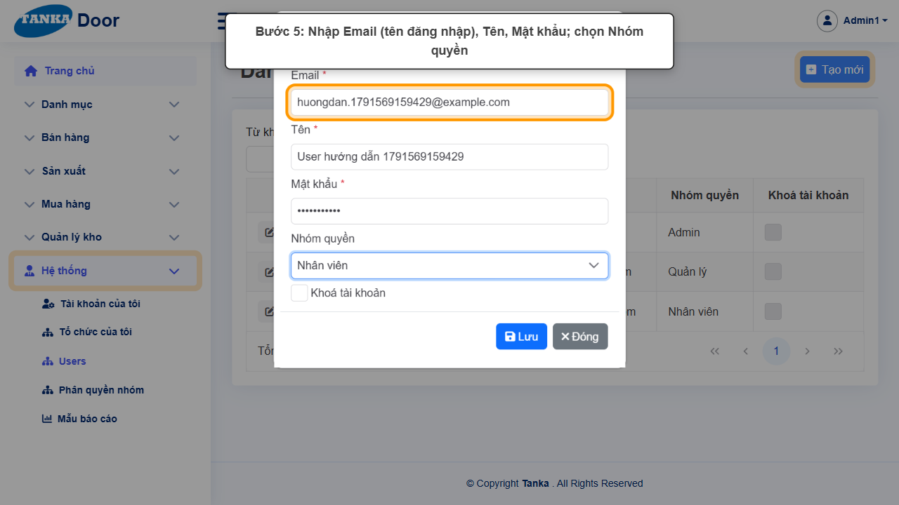
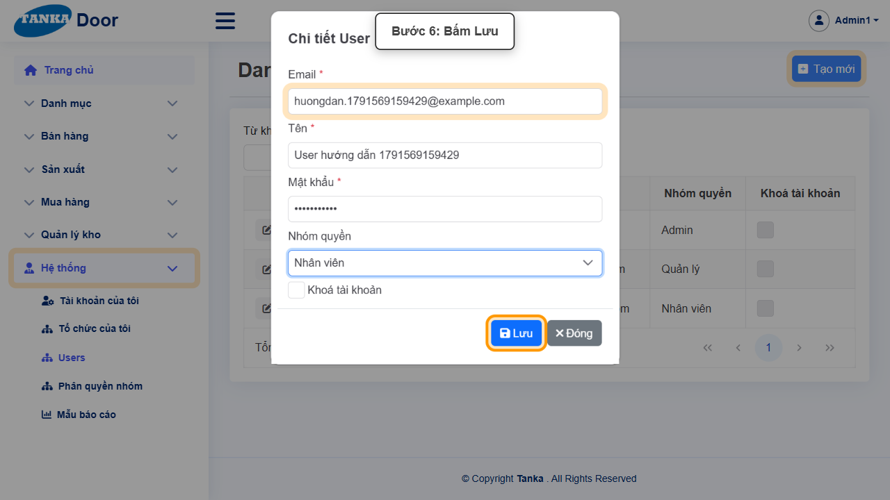
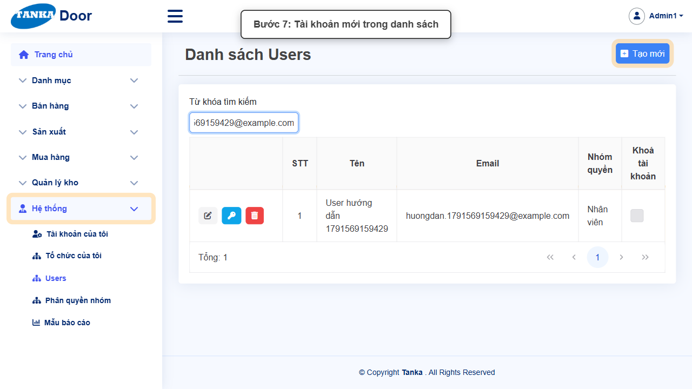
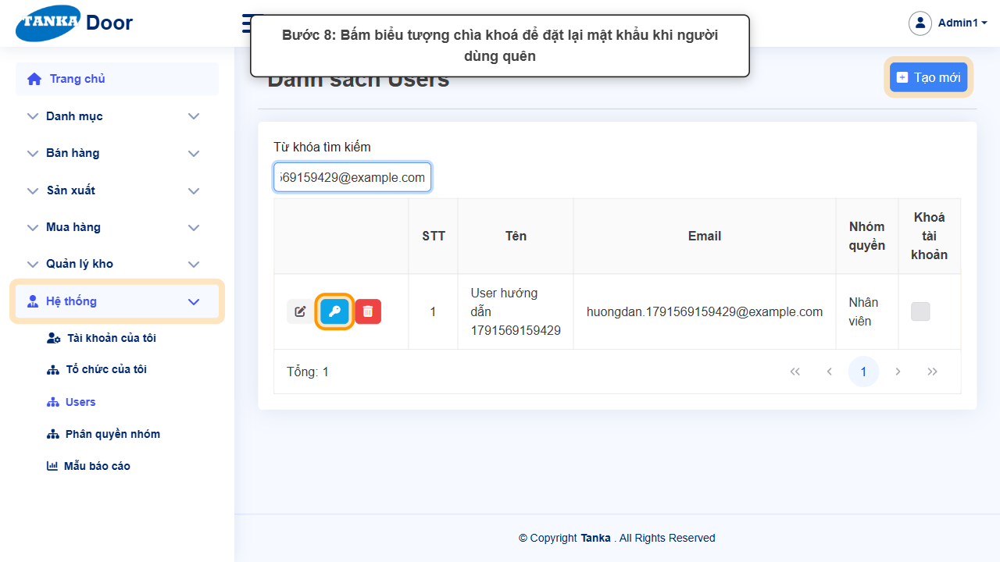
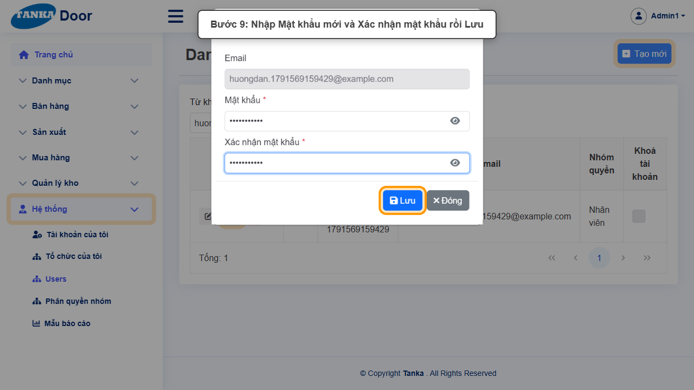
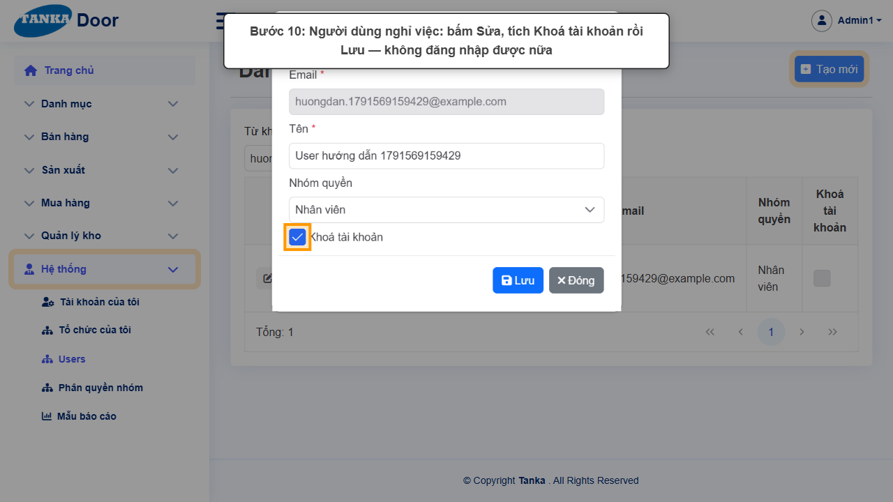
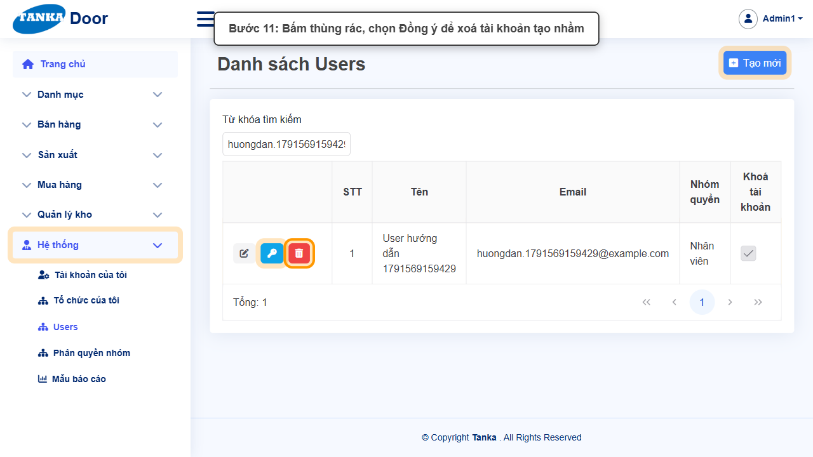

# HƯỚNG DẪN SỬ DỤNG — NGƯỜI DÙNG (USERS)

**Đường dẫn:** Hệ thống > Users  
**Mục tiêu:** Tạo tài khoản đăng nhập cho nhân viên, gán nhóm quyền, đặt lại mật khẩu, khoá và xoá tài khoản.  
**Dành cho:** Người mới sử dụng TANKA Door

## Trước khi bắt đầu

**Cần có sẵn:**

- Email của người dùng mới (dùng làm tên đăng nhập).
- Đã có Nhóm quyền phù hợp với vai trò (UG-063).

**Nên đọc trước:** UG-063.

**Quyền cần có:** Quản trị hệ thống (quyền quản lý Users). Nếu không thấy menu hoặc nút như trong ảnh, liên hệ quản trị hệ thống.

> Ảnh minh họa được chụp bằng tài khoản quản trị trên hệ thống thử nghiệm. Thuật ngữ viết tắt (HTK, NVL, BH, SX, YCMH...) và thứ tự các nghiệp vụ: xem **UG-000 Tổng quan**.

## 1. Khái niệm

Mỗi người dùng đăng nhập bằng **Email** và **Mật khẩu**. **Nhóm quyền** (chọn nhiều — Admin, Nhân viên, Quản lý… xem UG-063) quyết định chức năng được dùng. Trên mỗi dòng có 3 nút: **Sửa** (bút), **Mật khẩu** (chìa khoá), **Xoá** (thùng rác). Tích **Khoá tài khoản** để chặn đăng nhập mà vẫn giữ lịch sử.

_Users khác với Danh mục > Nhân viên (UG-082): Nhân viên là danh sách người phụ trách trên chứng từ; Users là tài khoản đăng nhập._

## 2. Ví dụ dữ liệu nhập

Ví dụ dưới đây giúp bạn hình dung cách nhập. Hãy nhập dữ liệu thật của công ty bạn; tên/mã có hậu tố số trong ảnh là dữ liệu thử nghiệm, mã chứng từ (BG_, BH_, SX_, MH_...) do hệ thống tự sinh nên của bạn sẽ khác.

| Trường | Giá trị |
| --- | --- |
| Email | nguyenvana@congty.vn |
| Tên | Nguyễn Văn A |
| Nhóm quyền | Nhân viên |
| Mật khẩu | Mật khẩu tạm, sau đó đặt lại |

> Nhân viên nghỉ việc: **khoá** tài khoản thay vì xoá (giữ lịch sử người lập chứng từ). Chỉ xoá tài khoản tạo nhầm. Không sửa/xoá tài khoản Admin đang dùng.

## 3. Quy trình thao tác từng bước

### Bước 1. Mở trang chủ Tanka Door

Đăng nhập (UG-001), màn hình **Trang chủ** hiện ra.

*Hình 1: Mở trang chủ Tanka Door.*

<video src="videos/UG-060-nguoi-dung/01.webm" controls muted width="100%"></video>

### Bước 2. Mở Hệ thống > Users

**Kết quả mong đợi:** màn hình **Users** hiện ra với danh sách dữ liệu và các ô lọc.

*Hình 2: Mở Hệ thống > Users.*

<video src="videos/UG-060-nguoi-dung/02.webm" controls muted width="100%"></video>

### Bước 3. Xem danh sách người dùng

Cột Tên, Email, Nhóm quyền, Khoá tài khoản.

*Hình 3: Xem danh sách người dùng.*

<video src="videos/UG-060-nguoi-dung/03.webm" controls muted width="100%"></video>

### Bước 4. Bấm Tạo mới

**Kết quả mong đợi:** form nhập mới mở ra; các ô có dấu * là bắt buộc.

*Hình 4: Bấm Tạo mới.*

<video src="videos/UG-060-nguoi-dung/04.webm" controls muted width="100%"></video>

### Bước 5. Nhập thông tin tài khoản

Hộp **Chi tiết User**: **Email *** (tên đăng nhập), **Tên ***, **Mật khẩu ***, chọn **Nhóm quyền**.

*Hình 5: Nhập thông tin tài khoản.*

<video src="videos/UG-060-nguoi-dung/05.webm" controls muted width="100%"></video>

### Bước 6. Bấm Lưu

Thông báo thành công, hộp thoại đóng.

*Hình 6: Bấm Lưu.*

<video src="videos/UG-060-nguoi-dung/06.webm" controls muted width="100%"></video>

### Bước 7. Tài khoản mới trong danh sách

Tìm theo **Từ khóa tìm kiếm**.

*Hình 7: Tài khoản mới trong danh sách.*

<video src="videos/UG-060-nguoi-dung/07.webm" controls muted width="100%"></video>

### Bước 8. Đặt lại mật khẩu

Khi người dùng quên mật khẩu: bấm biểu tượng **chìa khoá** trên dòng.

*Hình 8: Đặt lại mật khẩu.*

<video src="videos/UG-060-nguoi-dung/08.webm" controls muted width="100%"></video>

### Bước 9. Nhập mật khẩu mới

Nhập **Mật khẩu *** và **Xác nhận mật khẩu *** giống nhau → **Lưu**. Báo mật khẩu mới cho người dùng và nhắc đổi lại (UG-061).

*Hình 9: Nhập mật khẩu mới.*

<video src="videos/UG-060-nguoi-dung/09.webm" controls muted width="100%"></video>

### Bước 10. Khoá tài khoản

Bấm **Sửa** (bút) → tích **Khoá tài khoản** → **Lưu**. Cột Khoá tài khoản được tích, người dùng không đăng nhập được nữa. Email không sửa được sau khi tạo.

*Hình 10: Khoá tài khoản.*

<video src="videos/UG-060-nguoi-dung/10.webm" controls muted width="100%"></video>

### Bước 11. Xoá tài khoản (khi tạo nhầm)

Bấm **thùng rác** → **Đồng ý**. Thao tác không hoàn tác được.

*Hình 11: Xoá tài khoản (khi tạo nhầm).*

<video src="videos/UG-060-nguoi-dung/11.webm" controls muted width="100%"></video>

## 4. Khi không thao tác được

| Hiện tượng | Cách xử lý ngay |
| --- | --- |
| Người dùng báo không thấy menu/chức năng | Nhóm quyền chưa cho phép quyền tương ứng (UG-063) — kiểm tra nhóm của người dùng. |
| Người dùng không đăng nhập được | Kiểm tra cột Khoá tài khoản; đặt lại mật khẩu bằng nút chìa khoá. |
| Nhập sai email | Email không sửa được — xoá tài khoản tạo nhầm và tạo lại. |

## 5. Checklist dành cho người mới

- [ ] Email đúng, chưa dùng cho tài khoản khác.
- [ ] Đã chọn Nhóm quyền phù hợp.
- [ ] Đã báo mật khẩu tạm và nhắc người dùng đổi mật khẩu.
- [ ] Nhân viên nghỉ việc: khoá tài khoản.

---

_Tài liệu này được biên soạn dựa trên thao tác thực tế trên hệ thống door-v1.test.tankasoft.com. Ảnh minh họa có thể thay đổi theo phiên bản giao diện._
