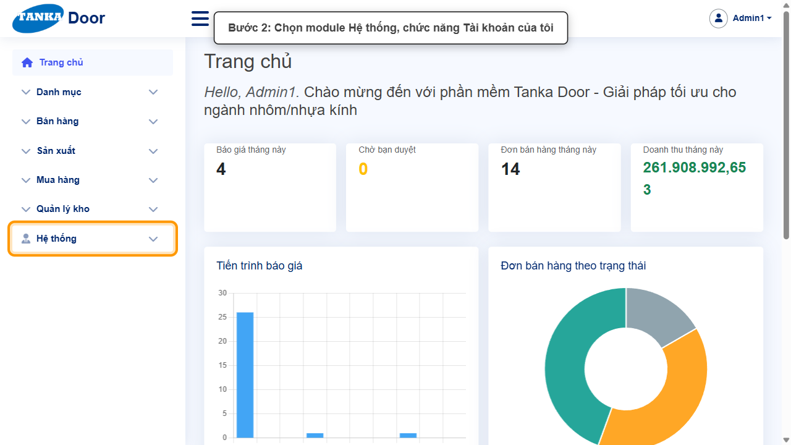
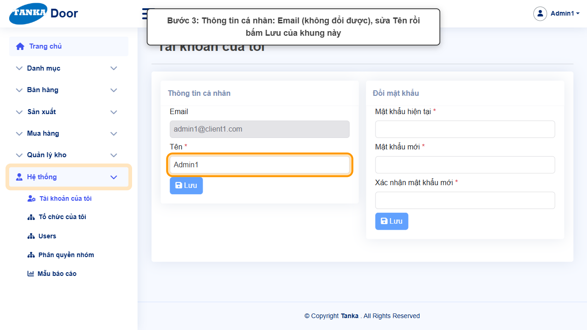
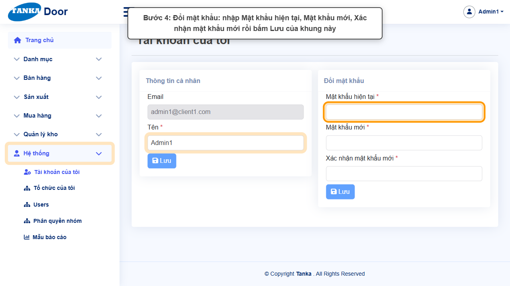

# HƯỚNG DẪN SỬ DỤNG — TÀI KHOẢN CỦA TÔI

**Đường dẫn:** Hệ thống > Tài khoản của tôi  
**Mục tiêu:** Xem thông tin cá nhân, sửa tên hiển thị và tự đổi mật khẩu.  
**Dành cho:** Người mới sử dụng TANKA Door

## Trước khi bắt đầu

**Cần có sẵn:**

- Đang đăng nhập; biết mật khẩu hiện tại nếu muốn đổi mật khẩu.

**Nên đọc trước:** UG-001.

**Quyền cần có:** Mọi tài khoản. Nếu không thấy menu hoặc nút như trong ảnh, liên hệ quản trị hệ thống.

> Ảnh minh họa được chụp bằng tài khoản quản trị trên hệ thống thử nghiệm. Thuật ngữ viết tắt (HTK, NVL, BH, SX, YCMH...) và thứ tự các nghiệp vụ: xem **UG-000 Tổng quan**.

## 1. Khái niệm

Màn hình có 2 khung, mỗi khung có nút **Lưu** riêng:

- **Thông tin cá nhân**: Email (không đổi được), **Tên *** (tên hiển thị góc phải và trên chứng từ).
- **Đổi mật khẩu**: **Mật khẩu hiện tại ***, **Mật khẩu mới ***, **Xác nhận mật khẩu mới ***.

> Mỗi khung có nút **Lưu** riêng — sửa khung nào thì bấm Lưu của khung đó. Ghi nhớ mật khẩu mới trước khi đăng xuất.

## 2. Quy trình thao tác từng bước

### Bước 1. Mở trang chủ Tanka Door

Đăng nhập (UG-001), màn hình **Trang chủ** hiện ra.

*Hình 1: Mở trang chủ Tanka Door.*

<video src="videos/UG-061-tai-khoan-cua-toi/01.webm" controls muted width="100%"></video>

### Bước 2. Mở Hệ thống > Tài khoản của tôi

**Kết quả mong đợi:** màn hình **Tài khoản của tôi** hiện ra với danh sách dữ liệu và các ô lọc.

*Hình 2: Mở Hệ thống > Tài khoản của tôi.*

<video src="videos/UG-061-tai-khoan-cua-toi/02.webm" controls muted width="100%"></video>

### Bước 3. Sửa thông tin cá nhân

Sửa **Tên** rồi bấm **Lưu** của khung **Thông tin cá nhân**. Email là tên đăng nhập, không sửa được.

*Hình 3: Sửa thông tin cá nhân.*

<video src="videos/UG-061-tai-khoan-cua-toi/03.webm" controls muted width="100%"></video>

### Bước 4. Đổi mật khẩu

Nhập **Mật khẩu hiện tại**, **Mật khẩu mới**, **Xác nhận mật khẩu mới** (giống Mật khẩu mới) rồi bấm **Lưu** của khung **Đổi mật khẩu**. Lần đăng nhập sau dùng mật khẩu mới.

*Hình 4: Đổi mật khẩu.*

<video src="videos/UG-061-tai-khoan-cua-toi/04.webm" controls muted width="100%"></video>

## 3. Khi không thao tác được

| Hiện tượng | Cách xử lý ngay |
| --- | --- |
| Nút Lưu mờ | Chưa thay đổi gì, hoặc còn ô * trống trong khung đó. |
| Báo sai mật khẩu hiện tại | Nhập lại; nếu quên, nhờ quản trị đặt lại mật khẩu (UG-060). |
| Mật khẩu mới không khớp | Ô Xác nhận phải giống hệt Mật khẩu mới. |

## 4. Checklist dành cho người mới

- [ ] Bấm đúng nút Lưu của khung vừa sửa.
- [ ] Đã ghi nhớ mật khẩu mới trước khi đăng xuất.

---

_Tài liệu này được biên soạn dựa trên thao tác thực tế trên hệ thống door-v1.test.tankasoft.com. Ảnh minh họa có thể thay đổi theo phiên bản giao diện._
