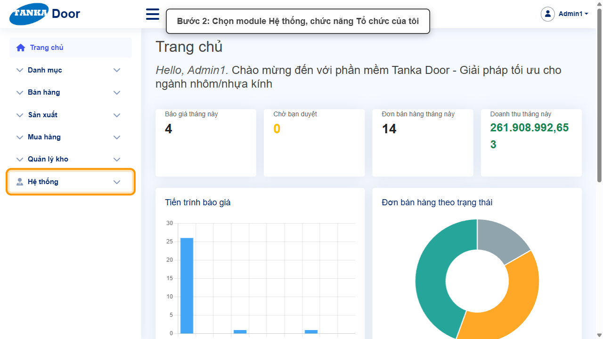
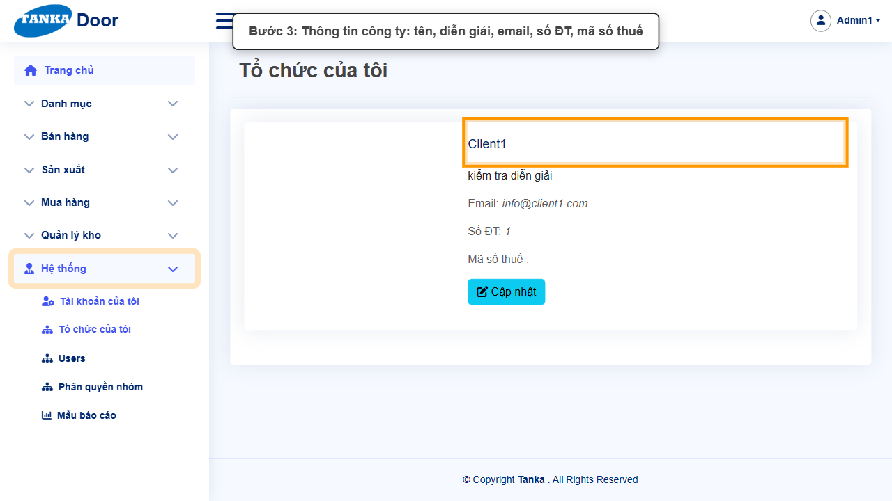
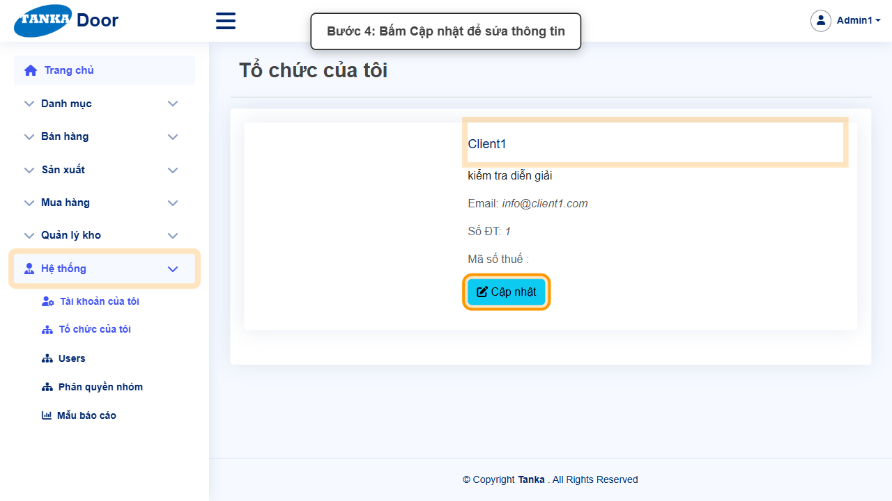
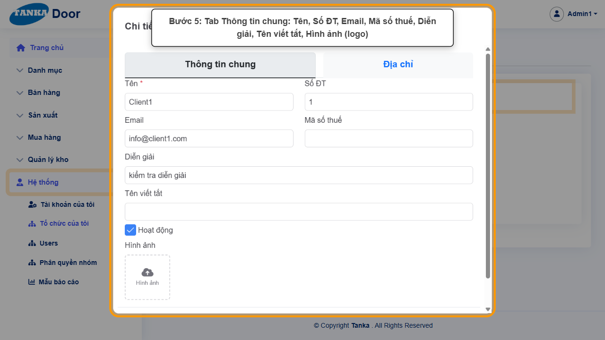
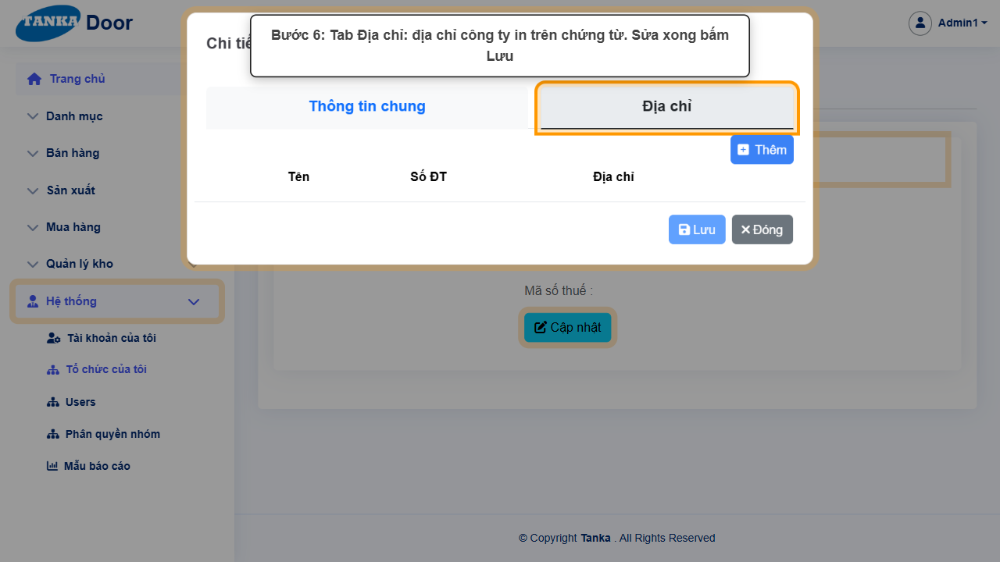

# HƯỚNG DẪN SỬ DỤNG — TỔ CHỨC CỦA TÔI

**Đường dẫn:** Hệ thống > Tổ chức của tôi  
**Mục tiêu:** Xem và cập nhật thông tin công ty (tên, liên hệ, mã số thuế, logo, địa chỉ) dùng trên chứng từ in.  
**Dành cho:** Người mới sử dụng TANKA Door

## Trước khi bắt đầu

**Cần có sẵn:**

- Thông tin pháp lý của công ty (tên, mã số thuế, địa chỉ, logo).

**Quyền cần có:** Quản trị hệ thống. Nếu không thấy menu hoặc nút như trong ảnh, liên hệ quản trị hệ thống.

> Ảnh minh họa được chụp bằng tài khoản quản trị trên hệ thống thử nghiệm. Thuật ngữ viết tắt (HTK, NVL, BH, SX, YCMH...) và thứ tự các nghiệp vụ: xem **UG-000 Tổng quan**.

## 1. Khái niệm

Thông tin tổ chức hiện trên báo giá, hợp đồng, phiếu in. Bấm **Cập nhật** để mở hộp **Chi tiết tổ chức** gồm 2 tab:

- **Thông tin chung**: Tên *, Số ĐT, Email, Mã số thuế, Diễn giải, Tên viết tắt, Hoạt động, Hình ảnh (logo).
- **Địa chỉ**: địa chỉ công ty.

> Thông tin này in trên báo giá, hợp đồng — chỉ người phụ trách mới nên sửa. Muốn xem mà không sửa thì bấm **Đóng**.

## 2. Quy trình thao tác từng bước

### Bước 1. Mở trang chủ Tanka Door

Đăng nhập (UG-001), màn hình **Trang chủ** hiện ra.

*Hình 1: Mở trang chủ Tanka Door.*

<video src="videos/UG-062-to-chuc-cua-toi/01.webm" controls muted width="100%"></video>

### Bước 2. Mở Hệ thống > Tổ chức của tôi

**Kết quả mong đợi:** màn hình **Tổ chức của tôi** hiện ra với danh sách dữ liệu và các ô lọc.

*Hình 2: Mở Hệ thống > Tổ chức của tôi.*

<video src="videos/UG-062-to-chuc-cua-toi/02.webm" controls muted width="100%"></video>

### Bước 3. Xem thông tin công ty

Tên, diễn giải, Email, Số ĐT, Mã số thuế.

*Hình 3: Xem thông tin công ty.*

<video src="videos/UG-062-to-chuc-cua-toi/03.webm" controls muted width="100%"></video>

### Bước 4. Bấm Cập nhật

Bấm nút **Cập nhật** dưới thông tin công ty.

**Kết quả mong đợi:** hộp **Chi tiết tổ chức** mở ra với 2 tab Thông tin chung và Địa chỉ.

*Hình 4: Bấm Cập nhật.*

<video src="videos/UG-062-to-chuc-cua-toi/04.webm" controls muted width="100%"></video>

### Bước 5. Tab Thông tin chung

Sửa **Tên ***, Số ĐT, Email, Mã số thuế, Diễn giải, Tên viết tắt; tải **Hình ảnh** (logo).

*Hình 5: Tab Thông tin chung.*

<video src="videos/UG-062-to-chuc-cua-toi/05.webm" controls muted width="100%"></video>

### Bước 6. Tab Địa chỉ và lưu

Sửa địa chỉ công ty. Xong bấm **Lưu**; chỉ xem thì bấm **Đóng**.

*Hình 6: Tab Địa chỉ và lưu.*

<video src="videos/UG-062-to-chuc-cua-toi/06.webm" controls muted width="100%"></video>

## 3. Khi không thao tác được

| Hiện tượng | Cách xử lý ngay |
| --- | --- |
| Chứng từ in vẫn hiện thông tin cũ | Mở lại chứng từ sau khi Lưu; mẫu in có thể ghi cứng thông tin — kiểm tra Mẫu báo cáo (UG-064). |
| Nút Lưu mờ | Chưa thay đổi gì hoặc Tên trống. |

## 4. Checklist dành cho người mới

- [ ] Tên, mã số thuế, địa chỉ đúng với giấy phép kinh doanh.
- [ ] Đã kiểm tra lại một chứng từ in sau khi cập nhật.

---

_Tài liệu này được biên soạn dựa trên thao tác thực tế trên hệ thống door-v1.test.tankasoft.com. Ảnh minh họa có thể thay đổi theo phiên bản giao diện._
