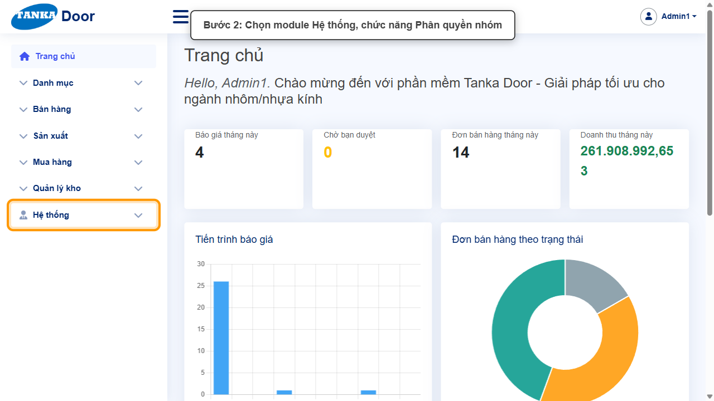
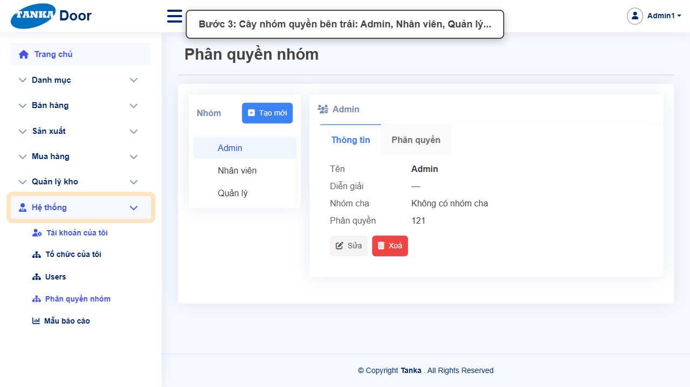
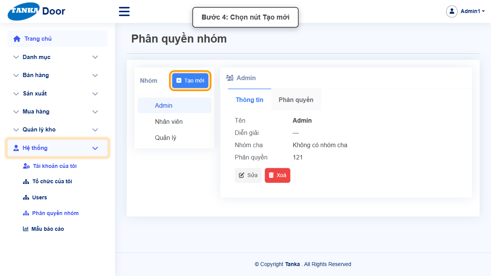
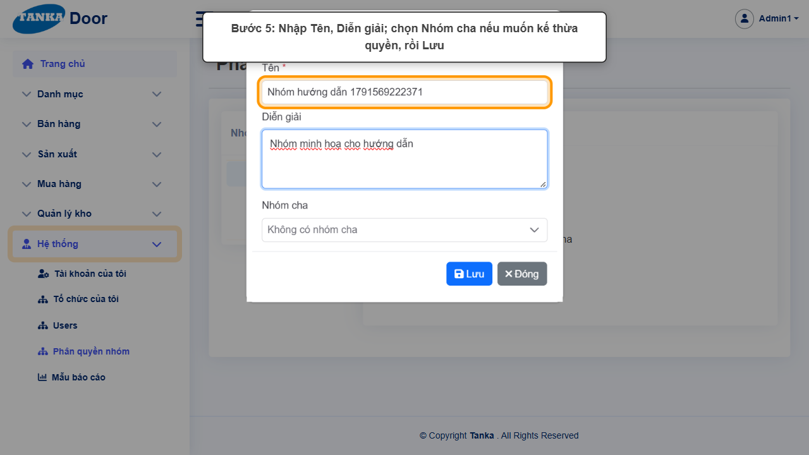
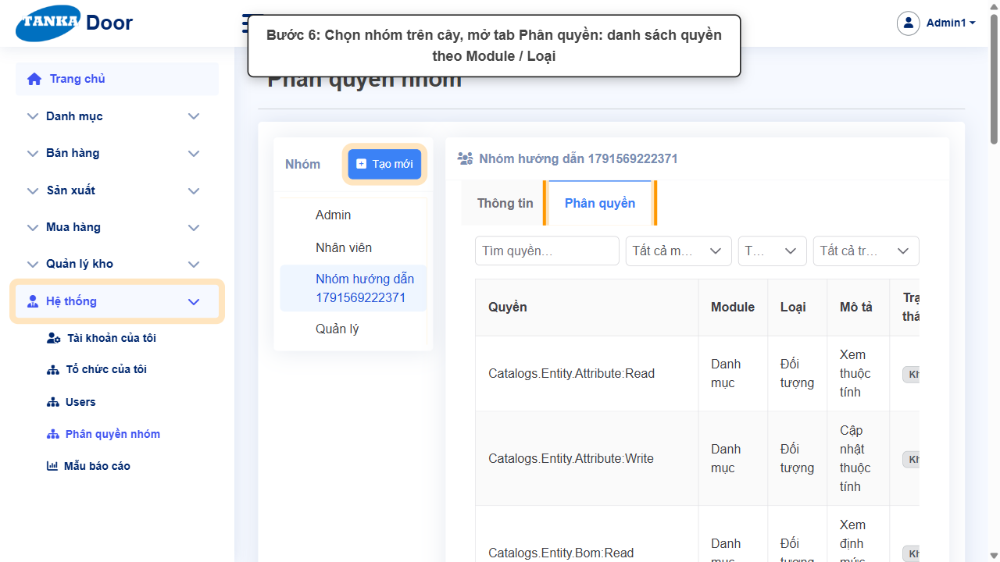
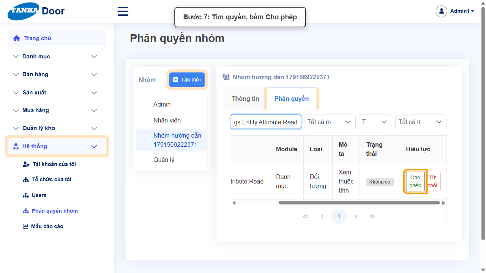
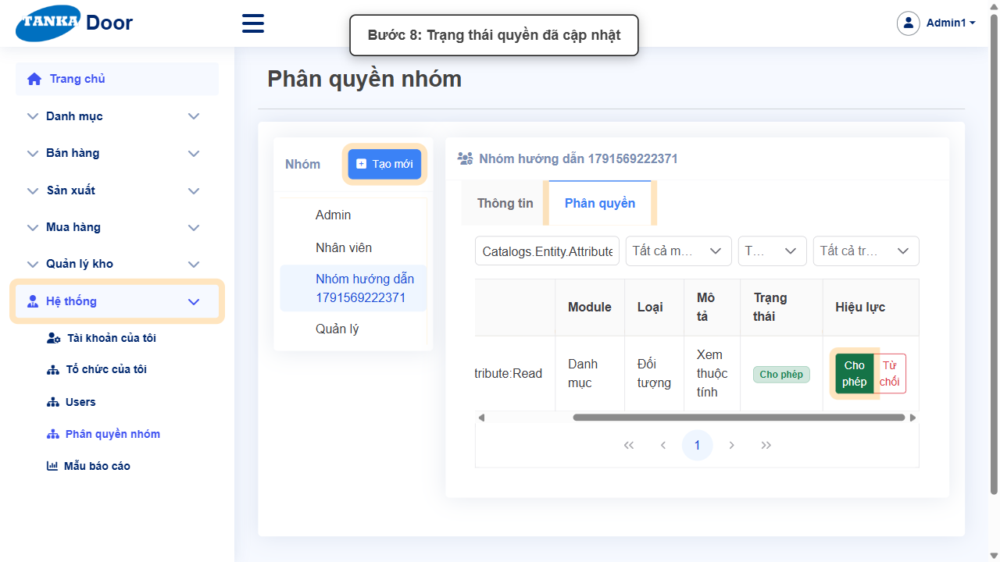
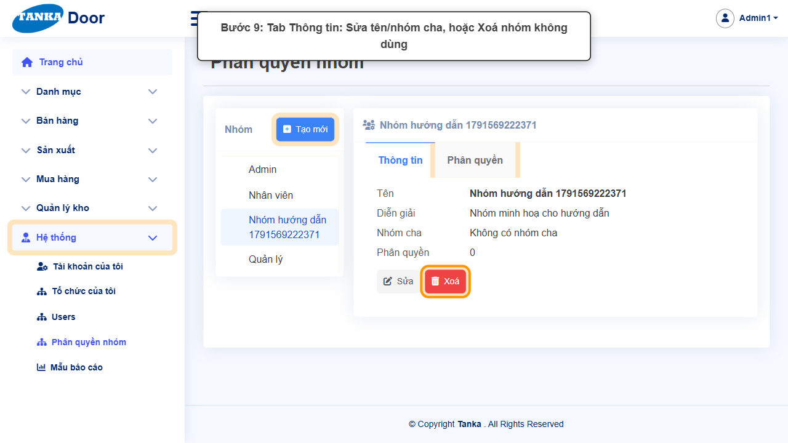

# HƯỚNG DẪN SỬ DỤNG — PHÂN QUYỀN NHÓM

**Đường dẫn:** Hệ thống > Phân quyền nhóm  
**Mục tiêu:** Tạo nhóm quyền, cho phép hoặc từ chối từng quyền, và xoá nhóm không dùng.  
**Dành cho:** Người mới sử dụng TANKA Door

## Trước khi bắt đầu

**Cần có sẵn:**

- Đã xác định vai trò và các chức năng mỗi vai trò được dùng.

**Quyền cần có:** Quản trị hệ thống (quyền phân quyền nhóm). Nếu không thấy menu hoặc nút như trong ảnh, liên hệ quản trị hệ thống.

> Ảnh minh họa được chụp bằng tài khoản quản trị trên hệ thống thử nghiệm. Thuật ngữ viết tắt (HTK, NVL, BH, SX, YCMH...) và thứ tự các nghiệp vụ: xem **UG-000 Tổng quan**.

## 1. Khái niệm

Quyền được gán theo **nhóm**; người dùng thuộc nhóm nào (UG-060) thì có quyền của nhóm đó. Màn hình gồm:

- Bên trái: **cây nhóm** (Admin, Nhân viên, Quản lý…) và nút **Tạo mới**. Nhóm có thể có **Nhóm cha**.
- Bên phải, tab **Thông tin**: Tên, Diễn giải, Nhóm cha, số quyền; nút **Sửa**, **Xoá**.
- Tab **Phân quyền**: danh sách quyền (ví dụ _Catalogs.Entity.Attribute:Read_ — Danh mục / Đối tượng / Xem thuộc tính). Lọc bằng ô **Tìm quyền…**, module, loại, trạng thái. Mỗi quyền có nút **Cho phép** / **Từ chối**; cột **Trạng thái** hiện kết quả.

## 2. Ví dụ dữ liệu nhập

Ví dụ dưới đây giúp bạn hình dung cách nhập. Hãy nhập dữ liệu thật của công ty bạn; tên/mã có hậu tố số trong ảnh là dữ liệu thử nghiệm, mã chứng từ (BG_, BH_, SX_, MH_...) do hệ thống tự sinh nên của bạn sẽ khác.

| Trường | Giá trị |
| --- | --- |
| Tên nhóm | Kế toán kho |
| Diễn giải | Nhân viên kế toán kho: xem danh mục, xử lý phiếu kho |
| Ví dụ quyền | Catalogs.Entity.Attribute:Read → Cho phép |

> **Không** sửa quyền của nhóm Admin — có thể khoá chính mình khỏi hệ thống. Nên tạo nhóm theo vai trò (Kế toán kho, Kinh doanh...) rồi gán người dùng. Chỉ xoá nhóm chưa có người dùng.

## 3. Quy trình thao tác từng bước

### Bước 1. Mở trang chủ Tanka Door

Đăng nhập (UG-001), màn hình **Trang chủ** hiện ra.

*Hình 1: Mở trang chủ Tanka Door.*

<video src="videos/UG-063-phan-quyen-nhom/01.webm" controls muted width="100%"></video>

### Bước 2. Mở Hệ thống > Phân quyền nhóm

**Kết quả mong đợi:** màn hình **Phân quyền nhóm** hiện ra với danh sách dữ liệu và các ô lọc.

*Hình 2: Mở Hệ thống > Phân quyền nhóm.*

<video src="videos/UG-063-phan-quyen-nhom/02.webm" controls muted width="100%"></video>

### Bước 3. Xem cây nhóm

Các nhóm hiện có ở khung bên trái.

*Hình 3: Xem cây nhóm.*

<video src="videos/UG-063-phan-quyen-nhom/03.webm" controls muted width="100%"></video>

### Bước 4. Bấm Tạo mới

**Kết quả mong đợi:** form nhập mới mở ra; các ô có dấu * là bắt buộc.

*Hình 4: Bấm Tạo mới.*

<video src="videos/UG-063-phan-quyen-nhom/04.webm" controls muted width="100%"></video>

### Bước 5. Nhập thông tin nhóm

Hộp **Tạo mới**: **Tên ***, **Diễn giải**, **Nhóm cha** (để trống nếu nhóm độc lập) → **Lưu**. Nhóm mới hiện trên cây.

*Hình 5: Nhập thông tin nhóm.*

<video src="videos/UG-063-phan-quyen-nhom/05.webm" controls muted width="100%"></video>

### Bước 6. Chọn nhóm, mở tab Phân quyền

Bấm tên nhóm trên cây → tab **Phân quyền**.

*Hình 6: Chọn nhóm, mở tab Phân quyền.*

<video src="videos/UG-063-phan-quyen-nhom/06.webm" controls muted width="100%"></video>

### Bước 7. Tìm quyền và bấm Cho phép

Gõ mã/tên quyền vào **Tìm quyền…**, Enter. Bấm **Cho phép** (hoặc **Từ chối**) ở cột Hiệu lực.

*Hình 7: Tìm quyền và bấm Cho phép.*

<video src="videos/UG-063-phan-quyen-nhom/07.webm" controls muted width="100%"></video>

### Bước 8. Kiểm tra trạng thái

Cột **Trạng thái** chuyển thành **Cho phép**; nút đang áp dụng được tô đậm. Thay đổi có hiệu lực ngay.

*Hình 8: Kiểm tra trạng thái.*

<video src="videos/UG-063-phan-quyen-nhom/08.webm" controls muted width="100%"></video>

### Bước 9. Sửa / Xoá nhóm

Tab **Thông tin**: **Sửa** tên/nhóm cha, hoặc **Xoá** nhóm không dùng (xác nhận nếu được hỏi).

*Hình 9: Sửa / Xoá nhóm.*

<video src="videos/UG-063-phan-quyen-nhom/09.webm" controls muted width="100%"></video>

### Video tổng hợp toàn bộ thao tác

Video dưới đây ghép liền toàn bộ các bước ở trên, từ lúc mở chức năng đến khi hoàn thành — xem lại một lượt trước khi tự thao tác.

<video src="videos/UG-063-phan-quyen-nhom/full.webm" controls muted width="100%"></video>

## 4. Khi không thao tác được

| Hiện tượng | Cách xử lý ngay |
| --- | --- |
| Người dùng vẫn không thấy chức năng | Kiểm tra người dùng thuộc nhóm nào (UG-060) và quyền "Xem" của module đó; yêu cầu người dùng đăng xuất/đăng nhập lại. |
| Không tìm thấy quyền | Lọc theo module (Danh mục, Bán hàng…) hoặc gõ một phần mã quyền. |
| Lỡ từ chối quyền quan trọng | Bấm Cho phép lại ngay cho quyền đó. |

## 5. Checklist dành cho người mới

- [ ] Đã đặt tên nhóm rõ ràng theo vai trò.
- [ ] Đã cho phép đủ quyền Xem/Tạo/Sửa cần thiết.
- [ ] Không sửa nhóm Admin.
- [ ] Đã gán người dùng vào nhóm (UG-060).

---

_Tài liệu này được biên soạn dựa trên thao tác thực tế trên hệ thống door-v1.test.tankasoft.com. Ảnh minh họa có thể thay đổi theo phiên bản giao diện._
