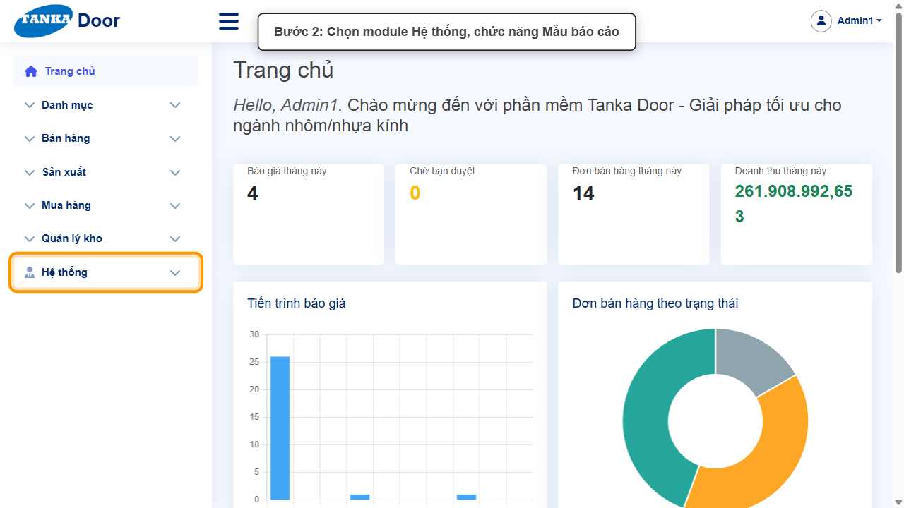
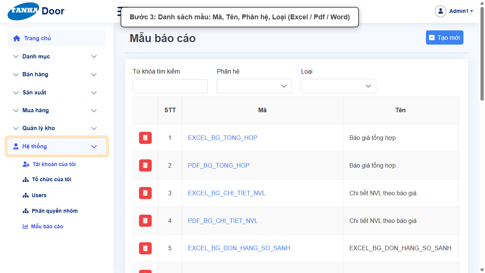
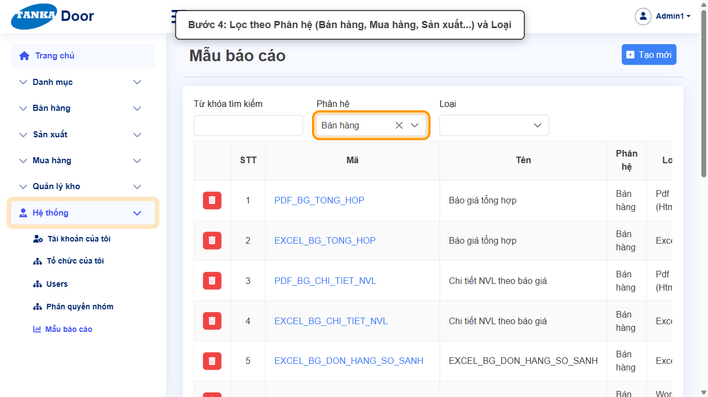
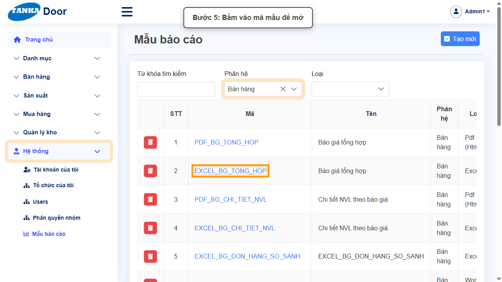
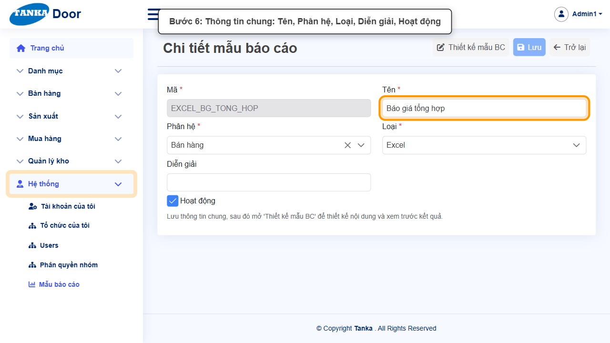
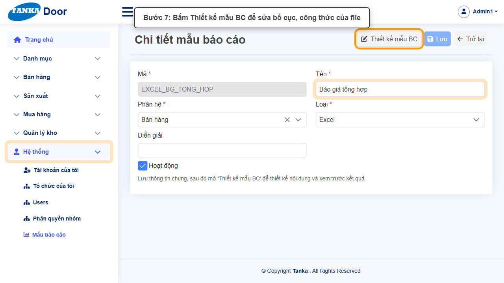
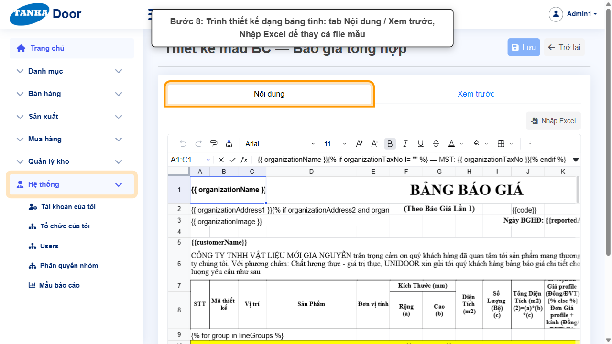
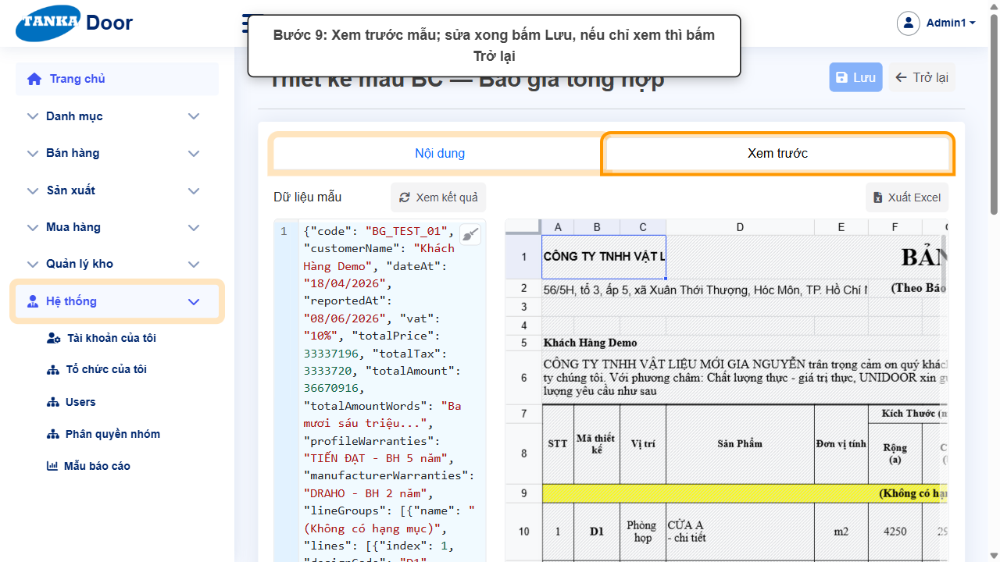

# HƯỚNG DẪN SỬ DỤNG — MẪU BÁO CÁO

**Đường dẫn:** Hệ thống > Mẫu báo cáo  
**Mục tiêu:** Xem các mẫu in/xuất file (báo giá, hợp đồng, phiếu xuất kho, quyết toán…) và mở trình thiết kế mẫu.  
**Dành cho:** Người mới sử dụng TANKA Door

## Trước khi bắt đầu

**Cần có sẵn:**

- Hiểu cấu trúc file Excel/Word của mẫu in; có bản dự phòng trước khi sửa.

**Quyền cần có:** Quản trị hệ thống. Nếu không thấy menu hoặc nút như trong ảnh, liên hệ quản trị hệ thống.

> Ảnh minh họa được chụp bằng tài khoản quản trị trên hệ thống thử nghiệm. Thuật ngữ viết tắt (HTK, NVL, BH, SX, YCMH...) và thứ tự các nghiệp vụ: xem **UG-000 Tổng quan**.

## 1. Khái niệm

Mẫu báo cáo quyết định bố cục file khi bấm in/xuất trên chứng từ. Mỗi mẫu có **Mã** (ví dụ EXCEL_BG_TONG_HOP), **Tên**, **Phân hệ** (Bán hàng, Mua hàng, Sản xuất, Danh mục, Hệ thống, Báo cáo) và **Loại** (Excel, Pdf (Html), Word (DOCX)).

Trong chi tiết: sửa thông tin chung rồi **Lưu**, sau đó mở **Thiết kế mẫu BC** — trình thiết kế dạng bảng tính có tab **Nội dung** (sửa ô, định dạng, công thức), **Xem trước** (dữ liệu mẫu JSON + kết quả) và **Nhập Excel** (thay cả file mẫu).

> Mẫu đang dùng để in chứng từ thật. Trước khi sửa, bấm **Xuất Excel** ở tab Xem trước để lưu bản dự phòng; chỉ xem thì bấm **Trở lại**, không bấm Lưu.

## 2. Quy trình thao tác từng bước

### Bước 1. Mở trang chủ Tanka Door

Đăng nhập (UG-001), màn hình **Trang chủ** hiện ra.

*Hình 1: Mở trang chủ Tanka Door.*

<video src="videos/UG-064-mau-bao-cao/01.webm" controls muted width="100%"></video>

### Bước 2. Mở Hệ thống > Mẫu báo cáo

**Kết quả mong đợi:** màn hình **Mẫu báo cáo** hiện ra với danh sách dữ liệu và các ô lọc.

*Hình 2: Mở Hệ thống > Mẫu báo cáo.*

<video src="videos/UG-064-mau-bao-cao/02.webm" controls muted width="100%"></video>

### Bước 3. Xem danh sách mẫu

Cột Mã, Tên, Phân hệ, Loại, Hoạt động.

*Hình 3: Xem danh sách mẫu.*

<video src="videos/UG-064-mau-bao-cao/03.webm" controls muted width="100%"></video>

### Bước 4. Lọc theo Phân hệ

Chọn **Phân hệ** (ví dụ Bán hàng) và/hoặc **Loại**.

*Hình 4: Lọc theo Phân hệ.*

<video src="videos/UG-064-mau-bao-cao/04.webm" controls muted width="100%"></video>

### Bước 5. Mở mẫu

Bấm vào mã mẫu.

*Hình 5: Mở mẫu.*

<video src="videos/UG-064-mau-bao-cao/05.webm" controls muted width="100%"></video>

### Bước 6. Thông tin chung

Mã (không sửa), **Tên**, **Phân hệ ***, **Loại ***, Diễn giải, Hoạt động. Lưu thông tin chung trước khi thiết kế.

*Hình 6: Thông tin chung.*

<video src="videos/UG-064-mau-bao-cao/06.webm" controls muted width="100%"></video>

### Bước 7. Bấm Thiết kế mẫu BC

Lưu thông tin chung trước (nếu có sửa), rồi bấm **Thiết kế mẫu BC** ở góc trên.

**Kết quả mong đợi:** màn hình **Thiết kế mẫu BC — <tên mẫu>** mở ra với nội dung mẫu dạng bảng tính.

*Hình 7: Bấm Thiết kế mẫu BC.*

<video src="videos/UG-064-mau-bao-cao/07.webm" controls muted width="100%"></video>

### Bước 8. Trình thiết kế

Tab **Nội dung**: sửa ô, font, định dạng như Excel. **Nhập Excel** để thay bằng file mẫu soạn sẵn.

*Hình 8: Trình thiết kế.*

<video src="videos/UG-064-mau-bao-cao/08.webm" controls muted width="100%"></video>

### Bước 9. Xem trước và trở lại

Tab **Xem trước**: dữ liệu mẫu bên trái, kết quả bên phải (**Xem kết quả**, **Xuất Excel**). Sửa xong bấm **Lưu**; chỉ xem thì bấm **Trở lại**.

*Hình 9: Xem trước và trở lại.*

<video src="videos/UG-064-mau-bao-cao/09.webm" controls muted width="100%"></video>

### Video tổng hợp toàn bộ thao tác

Video dưới đây ghép liền toàn bộ các bước ở trên, từ lúc mở chức năng đến khi hoàn thành — xem lại một lượt trước khi tự thao tác.

<video src="videos/UG-064-mau-bao-cao/full.webm" controls muted width="100%"></video>

## 3. Khi không thao tác được

| Hiện tượng | Cách xử lý ngay |
| --- | --- |
| In chứng từ ra sai bố cục sau khi sửa | Mở lại mẫu, Nhập Excel bản dự phòng rồi Lưu. |
| Bỏ tích Hoạt động làm mất nút in | Mẫu ngừng hoạt động không còn được chọn khi in — tích lại Hoạt động. |

## 4. Checklist dành cho người mới

- [ ] Đã lưu bản dự phòng trước khi sửa mẫu.
- [ ] Đã Xem trước với dữ liệu mẫu.
- [ ] Đã in thử một chứng từ thật sau khi Lưu.

---

_Tài liệu này được biên soạn dựa trên thao tác thực tế trên hệ thống door-v1.test.tankasoft.com. Ảnh minh họa có thể thay đổi theo phiên bản giao diện._
