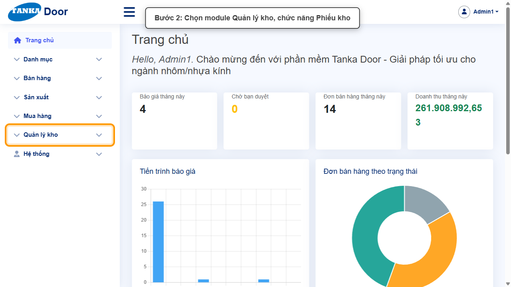
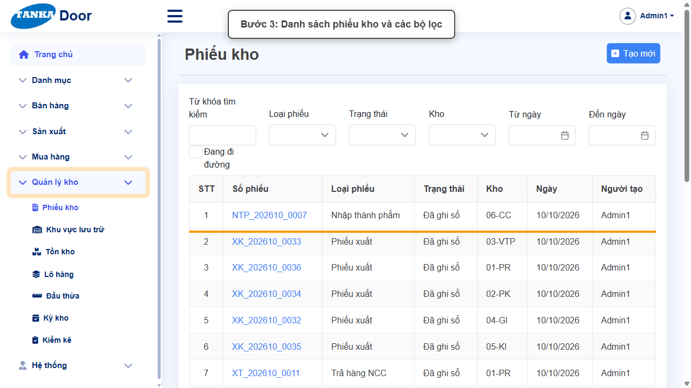
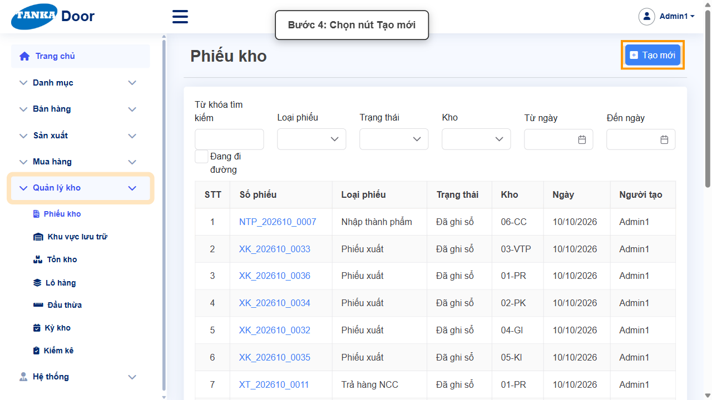
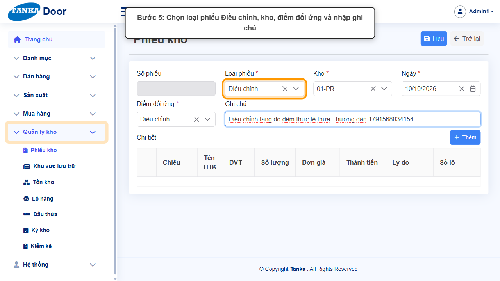
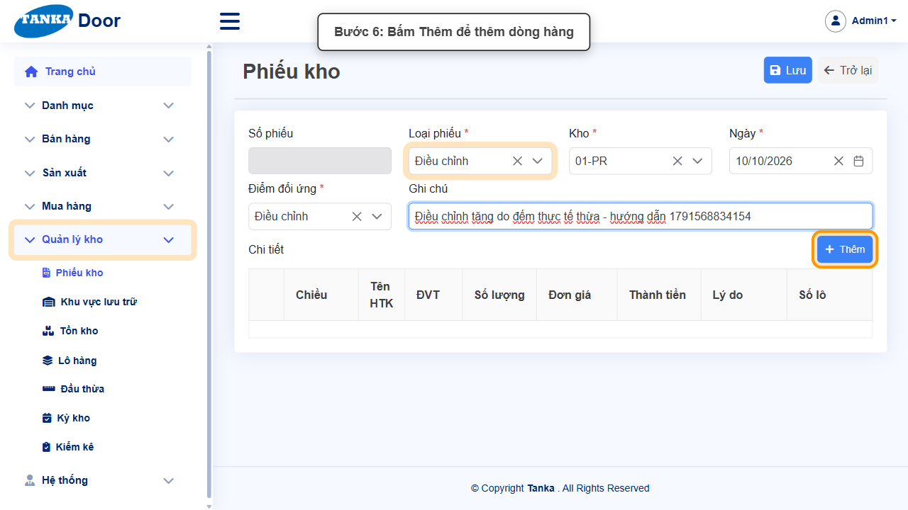
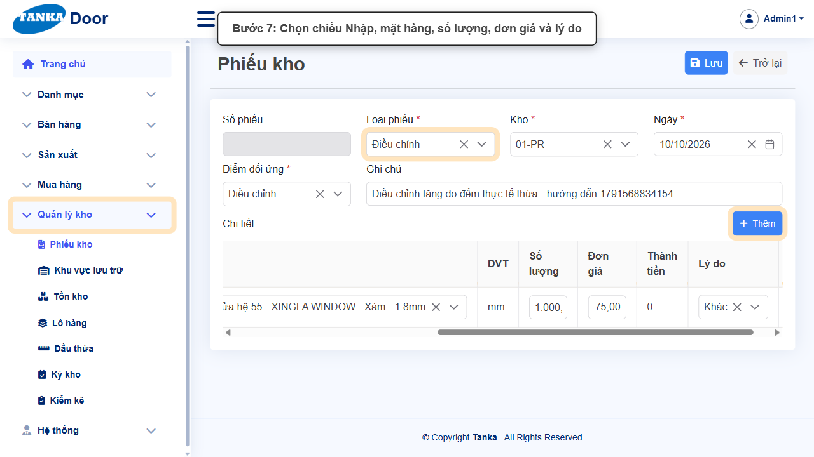
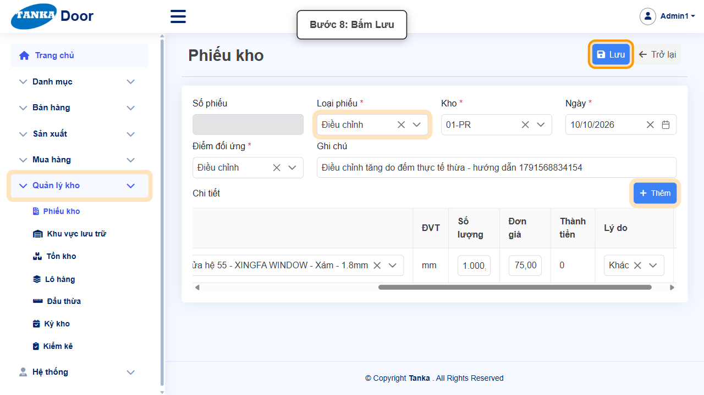
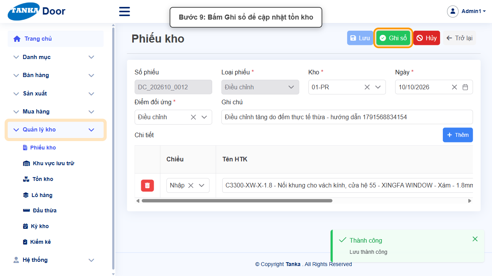
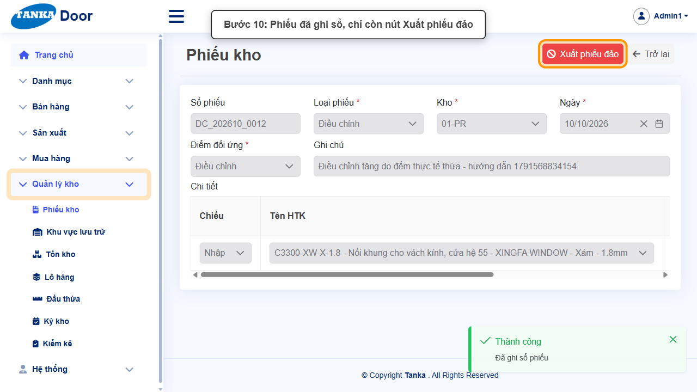
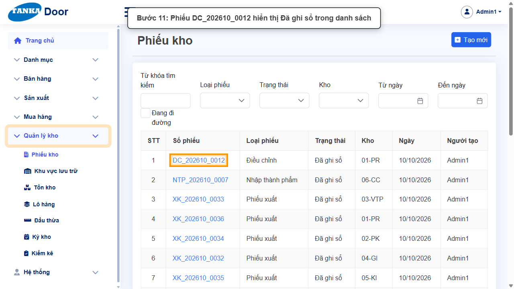

# HƯỚNG DẪN SỬ DỤNG — PHIẾU KHO: TẠO PHIẾU ĐIỀU CHỈNH TỒN KHO

**Đường dẫn:** Quản lý kho > Phiếu kho  
**Mục tiêu:** Hiểu danh sách phiếu kho (sổ nhật ký mọi biến động kho) và tạo tay một phiếu **Điều chỉnh** để cân lại số tồn khi phát hiện thừa/thiếu.  
**Dành cho:** Người mới sử dụng TANKA Door

## Trước khi bắt đầu

**Cần có sẵn:**

- Đã có Kho (UG-011) và mặt hàng (UG-010).
- Biết lý do điều chỉnh và đơn giá bình quân hiện tại.

**Nên đọc trước:** UG-073.

**Quyền cần có:** Tài khoản thuộc nhóm có quyền Xem/Tạo/Sửa module **Quản lý kho** (UG-063). Nếu không thấy menu hoặc nút như trong ảnh, liên hệ quản trị hệ thống.

> Ảnh minh họa được chụp bằng tài khoản quản trị trên hệ thống thử nghiệm. Thuật ngữ viết tắt (HTK, NVL, BH, SX, YCMH...) và thứ tự các nghiệp vụ: xem **UG-000 Tổng quan**.

## 1. Phiếu kho là gì

Mọi lần hàng vào/ra kho đều được ghi thành một **phiếu kho**. Phần lớn phiếu được **hệ thống tự sinh** từ các nghiệp vụ khác; người dùng chỉ tạo tay 4 loại.

| Loại phiếu | Mã | Sinh ra từ |
| --- | --- | --- |
| Phiếu nhập | NK_ | Ghi sổ phiếu nhận hàng (Mua hàng) |
| Trả hàng NCC | XT_ | Xuất trả phiếu trả hàng NCC |
| Phiếu xuất | XK_ | Lệnh SX chuyển "Đang SX" (xuất vật tư), hoặc tạo tay |
| Nhập thành phẩm | NTP_ | Lệnh SX chuyển "Đã SX" |
| Giao hàng | XBH_ | Phiếu giao hàng "Hoàn thành" |
| Điều chỉnh | DC_ | Đối chiếu kiểm kê, hoặc **tạo tay** |
| Chuyển kho | CK_ | **Tạo tay** — xem UG-071 |
| Đánh giá lại | — | **Tạo tay** (điều chỉnh giá trị tồn) |
| Nhập lại vật tư | — | Trả vật tư thừa từ sản xuất về kho |

Phiếu do nghiệp vụ khác sinh ra hiện dòng _"Chứng từ này do phiếu ... tạo ra và chỉ được thay đổi tại đó"_ kèm link **Mở chứng từ gốc**.

## 2. Ví dụ dữ liệu nhập

Ví dụ dưới đây giúp bạn hình dung cách nhập. Hãy nhập dữ liệu thật của công ty bạn; tên/mã có hậu tố số trong ảnh là dữ liệu thử nghiệm, mã chứng từ (BG_, BH_, SX_, MH_...) do hệ thống tự sinh nên của bạn sẽ khác.

| Trường | Giá trị |
| --- | --- |
| Loại phiếu / Kho / Điểm đối ứng | Điều chỉnh / 01-PR / Điều chỉnh |
| Dòng hàng | Chiều **Nhập** — C3300-XW-X-1.8 (Nối khung vách kính hệ 55 - Xám), 1.000 mm, đơn giá 75, lý do **Khác** |
| Phiếu sinh ra | DC_202610_0012 |

## 3. Sơ đồ quy trình tóm tắt

BẮT ĐẦU → Quản lý kho > Phiếu kho → Tạo mới → Chọn Loại phiếu Điều chỉnh, Kho, Điểm đối ứng → Thêm dòng (Chiều, Mặt hàng, SL, Đơn giá, Lý do) → Lưu → Ghi sổ

## 4. Quy trình thao tác từng bước

### Bước 1. Mở trang chủ Tanka Door

**Kết quả mong đợi:** menu chức năng hiện ở bên trái màn hình.

*Hình 1: Trang chủ sau khi đăng nhập.*

<video src="videos/UG-070-phieu-kho-dieu-chinh/01.webm" controls muted width="100%"></video>

### Bước 2. Mở Quản lý kho > Phiếu kho

Ở menu bên trái, bấm **Quản lý kho**, chọn **Phiếu kho**.

*Hình 2: Mở Quản lý kho > Phiếu kho.*

<video src="videos/UG-070-phieu-kho-dieu-chinh/02.webm" controls muted width="100%"></video>

### Bước 3. Xem danh sách phiếu kho

Danh sách hiển thị Số phiếu, Loại phiếu, Trạng thái (Nháp / Đã ghi sổ / Đã hủy), Kho, Ngày. Bộ lọc: Từ khóa, Loại phiếu, Trạng thái, Kho, Từ ngày – Đến ngày, và ô **Đang đi đường** (hàng chuyển kho chưa nhận).

*Hình 3: Danh sách phiếu kho và các bộ lọc.*

<video src="videos/UG-070-phieu-kho-dieu-chinh/03.webm" controls muted width="100%"></video>

### Bước 4. Bấm Tạo mới

**Kết quả mong đợi:** form nhập mới mở ra; các ô có dấu * là bắt buộc.

*Hình 4: Bấm Tạo mới.*

<video src="videos/UG-070-phieu-kho-dieu-chinh/04.webm" controls muted width="100%"></video>

### Bước 5. Chọn Loại phiếu, Kho, Điểm đối ứng

- **Loại phiếu *** — chọn **Điều chỉnh** (tạo tay được: Phiếu xuất, Chuyển kho, Điều chỉnh, Đánh giá lại).
- **Kho *** — kho cần điều chỉnh (ví dụ 01-PR).
- **Điểm đối ứng *** — nơi hàng đi tới / đến từ; với phiếu Điều chỉnh là **Điều chỉnh**.
- **Ghi chú** — ghi rõ lý do để kiểm tra lại sau này.

*Hình 5: Chọn loại phiếu Điều chỉnh, kho, điểm đối ứng và nhập ghi chú.*

<video src="videos/UG-070-phieu-kho-dieu-chinh/05.webm" controls muted width="100%"></video>

### Bước 6. Thêm dòng điều chỉnh

Bấm **+ Thêm**, rồi trên dòng mới:

- **Chiều** — **Nhập** (tăng tồn, khi đếm thấy thừa) hoặc **Xuất** (giảm tồn, khi thiếu/hư hỏng).
- **Tên HTK** — bấm ô, **gõ mã** mặt hàng để tìm (hệ thống tìm khi gõ từng ký tự) và chọn.
- **Số lượng**, **Đơn giá** — đơn giá nên lấy theo giá bình quân hiện tại để không làm lệch giá trị tồn.
- **Lý do** — Tồn đầu kỳ / Điều chỉnh kiểm kê / Hao hụt / Phế liệu / Nhập sai / Khác.

*Hình 6: Bấm Thêm để thêm dòng hàng.*

<video src="videos/UG-070-phieu-kho-dieu-chinh/06.webm" controls muted width="100%"></video>

*Hình 7: Chọn chiều Nhập, mặt hàng, số lượng, đơn giá và lý do.*

<video src="videos/UG-070-phieu-kho-dieu-chinh/07.webm" controls muted width="100%"></video>

### Bước 7. Bấm Lưu

Phiếu được lưu ở trạng thái **Nháp** với mã **DC_YYYYMM_xxxx**; có các nút Lưu, **Ghi sổ**, Hủy.

**Kết quả mong đợi:** thông báo xanh **"Lưu thành công"** hiện ở góc phải, nút **Lưu** mờ lại.

*Hình 8: Bấm Lưu.*

<video src="videos/UG-070-phieu-kho-dieu-chinh/08.webm" controls muted width="100%"></video>

### Bước 8. Ghi sổ phiếu

Bấm **Ghi sổ** → **Đồng ý** ở popup _"Ghi sổ sẽ thay đổi tồn kho, và phiếu đã ghi sổ chỉ có thể sửa bằng phiếu đảo."_ Thông báo **"Đã ghi sổ phiếu"** hiện ra; phiếu chỉ còn nút **Xuất phiếu đảo** (dùng khi ghi sổ nhầm).

*Hình 9: Bấm Ghi sổ.*

<video src="videos/UG-070-phieu-kho-dieu-chinh/09.webm" controls muted width="100%"></video>

*Hình 10: Phiếu đã ghi sổ, chỉ còn nút Xuất phiếu đảo.*

<video src="videos/UG-070-phieu-kho-dieu-chinh/10.webm" controls muted width="100%"></video>

### Bước 9. Kiểm tra trong danh sách

Bấm **Trở lại**: phiếu mới nằm đầu danh sách với trạng thái **Đã ghi sổ**. Số tồn ở **Quản lý kho > Tồn kho** đã thay đổi theo số lượng điều chỉnh.

*Hình 11: Phiếu hiển thị Đã ghi sổ trong danh sách.*

<video src="videos/UG-070-phieu-kho-dieu-chinh/11.webm" controls muted width="100%"></video>

## 5. Khi không thao tác được

| Hiện tượng | Cách xử lý ngay |
| --- | --- |
| Ô Tên HTK không tìm ra mặt hàng | Gõ từng ký tự của mã (không dán cả chuỗi) và chờ danh sách tải. |
| Lưu báo thiếu Điểm đối ứng | Ô Điểm đối ứng là bắt buộc — chọn giá trị phù hợp với loại phiếu. |
| Ghi sổ bị từ chối với mặt hàng đang kiểm kê | Mặt hàng đang bị khoá sổ bởi phiếu kiểm kê chưa đối chiếu (UG-077). |
| Ghi sổ nhầm | Không sửa được phiếu đã ghi sổ — bấm **Xuất phiếu đảo** để tạo phiếu ngược lại. |
| Phiếu tự sinh không sửa được | Đúng thiết kế — bấm **Mở chứng từ gốc** để thao tác tại nghiệp vụ gốc. |

## 6. Dấu hiệu hoàn thành

- Phiếu DC_... ở trạng thái "Đã ghi sổ", có nút Xuất phiếu đảo.
- Tồn kho của mặt hàng tại kho tăng/giảm đúng số lượng điều chỉnh.

## 7. Checklist dành cho người mới

- [ ] Chọn đúng Loại phiếu, Kho, Điểm đối ứng.
- [ ] Chọn đúng Chiều (Nhập = tăng, Xuất = giảm) và Lý do.
- [ ] Nhập đơn giá hợp lý (theo giá bình quân).
- [ ] Ghi sổ và kiểm tra lại số tồn.

---

_Tài liệu này được biên soạn dựa trên thao tác thực tế trên hệ thống door-v1.test.tankasoft.com. Ảnh minh họa có thể thay đổi theo phiên bản giao diện._
