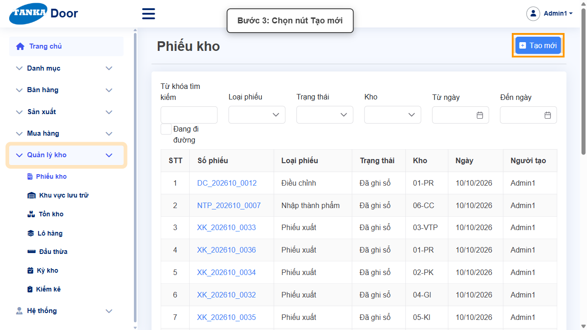
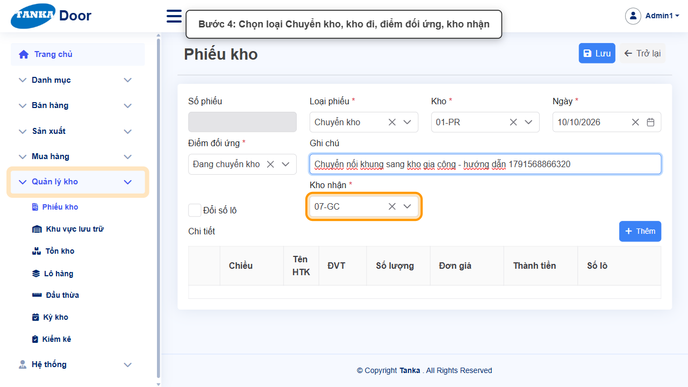
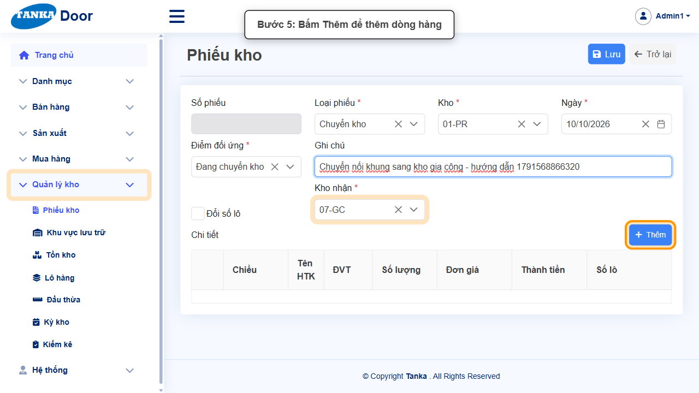
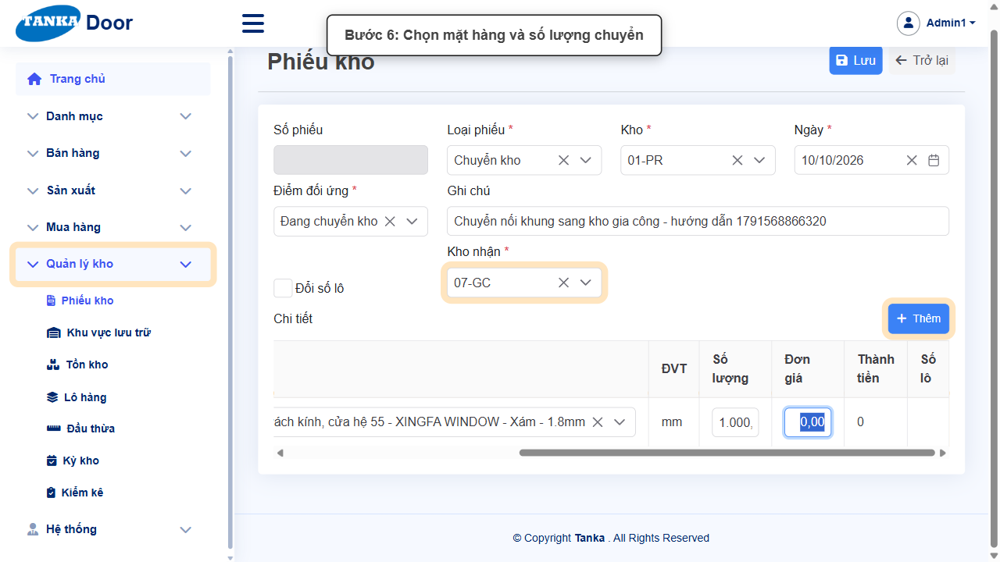
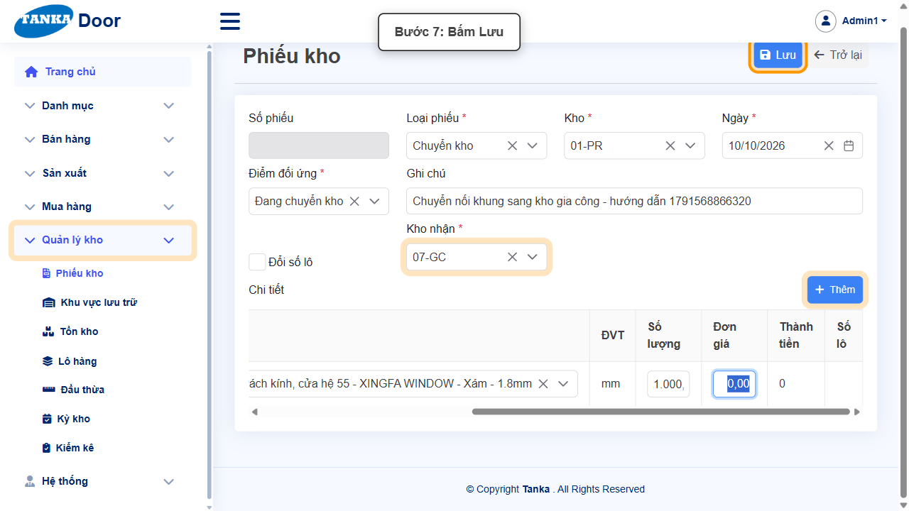
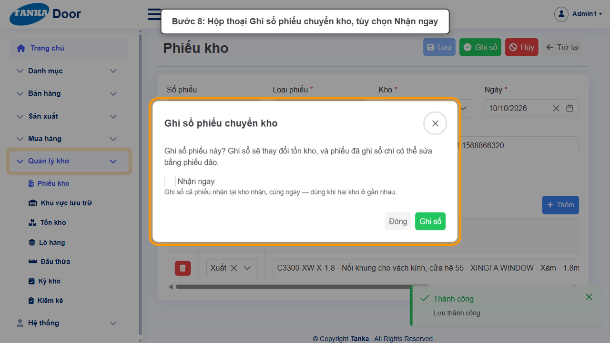
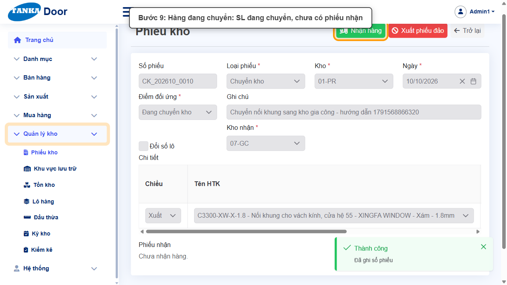
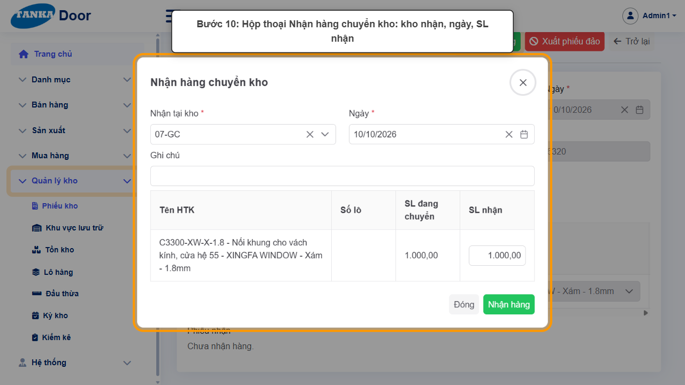
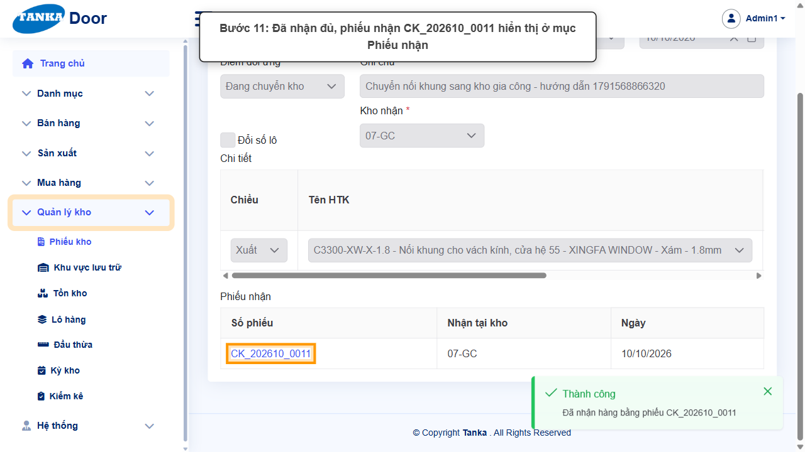

# HƯỚNG DẪN SỬ DỤNG — CHUYỂN KHO

**Đường dẫn:** Quản lý kho > Phiếu kho > Tạo mới (Loại phiếu: Chuyển kho)  
**Mục tiêu:** Chuyển hàng từ kho này sang kho khác theo 2 chặng: **xuất khỏi kho đi** (hàng đang trên đường) và **nhận tại kho nhận**.  
**Dành cho:** Người mới sử dụng TANKA Door

## Trước khi bắt đầu

**Cần có sẵn:**

- Có ít nhất 2 kho (UG-011); kho đi đang có tồn mặt hàng cần chuyển (UG-073).

**Nên đọc trước:** UG-073.

**Quyền cần có:** Tài khoản thuộc nhóm có quyền Xem/Tạo/Sửa module **Quản lý kho** (UG-063). Nếu không thấy menu hoặc nút như trong ảnh, liên hệ quản trị hệ thống.

> Ảnh minh họa được chụp bằng tài khoản quản trị trên hệ thống thử nghiệm. Thuật ngữ viết tắt (HTK, NVL, BH, SX, YCMH...) và thứ tự các nghiệp vụ: xem **UG-000 Tổng quan**.

## 1. Ví dụ dữ liệu nhập

Ví dụ dưới đây giúp bạn hình dung cách nhập. Hãy nhập dữ liệu thật của công ty bạn; tên/mã có hậu tố số trong ảnh là dữ liệu thử nghiệm, mã chứng từ (BG_, BH_, SX_, MH_...) do hệ thống tự sinh nên của bạn sẽ khác.

| Trường | Giá trị |
| --- | --- |
| Kho đi → Kho nhận | 01-PR → 07-GC |
| Điểm đối ứng | Đang chuyển kho |
| Hàng chuyển | C3300-XW-X-1.8 (Nối khung vách kính hệ 55 - Xám), 1.000 mm |
| Phiếu chuyển kho / Phiếu nhận | CK_202610_0010 / CK_202610_0011 |

## 2. Sơ đồ quy trình tóm tắt

BẮT ĐẦU → Phiếu kho > Tạo mới → Loại **Chuyển kho**, Kho đi, Điểm đối ứng **Đang chuyển kho**, **Kho nhận** → Thêm hàng, số lượng → Lưu → **Ghi sổ** (hàng rời kho đi, đang đi đường) → **Nhận hàng** tại kho nhận (sinh phiếu nhận CK_...)

> Khi hai kho ở gần nhau, có thể tích **Nhận ngay** lúc Ghi sổ để hệ thống ghi sổ luôn phiếu nhận, bỏ qua chặng "đang đi đường".

## 3. Quy trình thao tác từng bước

### Bước 1. Mở trang chủ Tanka Door

**Kết quả mong đợi:** menu chức năng hiện ở bên trái màn hình.

*Hình 1: Trang chủ sau khi đăng nhập.*

<video src="videos/UG-071-chuyen-kho/01.webm" controls muted width="100%"></video>

### Bước 2. Mở Quản lý kho > Phiếu kho

**Kết quả mong đợi:** màn hình **Phiếu kho** hiện ra với danh sách dữ liệu và các ô lọc.

*Hình 2: Mở Quản lý kho > Phiếu kho.*

<video src="videos/UG-071-chuyen-kho/02.webm" controls muted width="100%"></video>

### Bước 3. Bấm Tạo mới

**Kết quả mong đợi:** form nhập mới mở ra; các ô có dấu * là bắt buộc.

*Hình 3: Bấm Tạo mới.*

<video src="videos/UG-071-chuyen-kho/03.webm" controls muted width="100%"></video>

### Bước 4. Chọn loại Chuyển kho, kho đi, điểm đối ứng và kho nhận

- **Loại phiếu *** — **Chuyển kho**. Form có thêm ô **Kho nhận *** và **Đổi số lô**.
- **Kho *** — kho xuất hàng đi (ví dụ 01-PR).
- **Điểm đối ứng *** — **Đang chuyển kho** (khu vực "hàng đang chuyển").
- **Kho nhận *** — kho đích (ví dụ 07-GC).
- **Ghi chú** — lý do chuyển.

*Hình 4: Chọn loại Chuyển kho, kho đi, điểm đối ứng, kho nhận.*

<video src="videos/UG-071-chuyen-kho/04.webm" controls muted width="100%"></video>

### Bước 5. Thêm hàng cần chuyển

Bấm **+ Thêm**. Cột **Chiều** cố định là **Xuất**. Ở **Tên HTK** gõ mã để tìm và chọn, nhập **Số lượng**. Đơn giá để trống — hệ thống tự lấy **giá bình quân** khi ghi sổ.

*Hình 5: Bấm Thêm.*

<video src="videos/UG-071-chuyen-kho/05.webm" controls muted width="100%"></video>

*Hình 6: Chọn mặt hàng và số lượng chuyển.*

<video src="videos/UG-071-chuyen-kho/06.webm" controls muted width="100%"></video>

### Bước 6. Bấm Lưu

Phiếu được lưu ở trạng thái Nháp với mã **CK_YYYYMM_xxxx**.

**Kết quả mong đợi:** thông báo xanh **"Lưu thành công"** hiện ở góc phải, nút **Lưu** mờ lại.

*Hình 7: Bấm Lưu.*

<video src="videos/UG-071-chuyen-kho/07.webm" controls muted width="100%"></video>

### Bước 7. Ghi sổ phiếu chuyển kho

Bấm **Ghi sổ**. Hộp thoại **"Ghi sổ phiếu chuyển kho"** hiện ra với tùy chọn **Nhận ngay** — _"Ghi sổ cả phiếu nhận tại kho nhận, cùng ngày — dùng khi hai kho ở gần nhau."_ Để theo dõi hàng đang đi đường, **không tích** Nhận ngay, bấm **Ghi sổ**.

*Hình 8: Hộp thoại Ghi sổ phiếu chuyển kho, tùy chọn Nhận ngay.*

<video src="videos/UG-071-chuyen-kho/08.webm" controls muted width="100%"></video>

### Bước 8. Hàng đang đi đường

Sau khi ghi sổ, hàng đã rời kho đi: bảng chi tiết có cột **SL đã nhận** = 0 và **SL đang chuyển** = số lượng chuyển; mục **Phiếu nhận** ghi _"Chưa nhận hàng."_ Trên đầu phiếu có nút **Nhận hàng** và **Xuất phiếu đảo**. Ở danh sách Phiếu kho, lọc **Đang đi đường** để thấy các phiếu chưa nhận; ở Tồn kho, cột **Đang chuyển đến** dùng để theo dõi hàng đang trên đường tới kho.

*Hình 9: Hàng đang chuyển, chưa có phiếu nhận.*

<video src="videos/UG-071-chuyen-kho/09.webm" controls muted width="100%"></video>

### Bước 9. Nhận hàng tại kho nhận

Khi hàng tới nơi, bấm **Nhận hàng**. Hộp thoại **"Nhận hàng chuyển kho"**: Nhận tại kho, Ngày, Ghi chú và bảng **SL đang chuyển / SL nhận** — có thể sửa SL nhận để **nhận một phần**. Bấm **Nhận hàng**.

*Hình 10: Hộp thoại Nhận hàng chuyển kho.*

<video src="videos/UG-071-chuyen-kho/10.webm" controls muted width="100%"></video>

### Bước 10. Kiểm tra kết quả

Thông báo **"Đã nhận hàng bằng phiếu CK_..."**; mục **Phiếu nhận** hiển thị link phiếu nhận, SL đang chuyển về 0. Phiếu nhận là chứng từ tự sinh (chỉ sửa tại phiếu chuyển kho gốc), có nút **Xuất phiếu đảo** nếu cần hủy việc nhận.

*Hình 11: Đã nhận đủ, phiếu nhận hiển thị ở mục Phiếu nhận.*

<video src="videos/UG-071-chuyen-kho/11.webm" controls muted width="100%"></video>

### Video tổng hợp toàn bộ thao tác

Video dưới đây ghép liền toàn bộ các bước ở trên, từ lúc mở chức năng đến khi hoàn thành — xem lại một lượt trước khi tự thao tác.

<video src="videos/UG-071-chuyen-kho/full.webm" controls muted width="100%"></video>

## 4. Khi không thao tác được

| Hiện tượng | Cách xử lý ngay |
| --- | --- |
| Lưu báo "Điểm đối ứng bắt buộc" | Chọn **Đang chuyển kho** ở ô Điểm đối ứng. |
| Không thấy nút Nhận hàng | Phiếu chưa ghi sổ, đã nhận đủ, hoặc đã ghi sổ kèm Nhận ngay. |
| Ghi sổ báo không đủ tồn ở kho đi | Kiểm tra cột Khả dụng ở Tồn kho; hàng đang giữ cho lệnh SX không chuyển được. |
| Chỉ nhận được một phần | Sửa SL nhận trong hộp thoại; phần còn lại vẫn "đang chuyển" và nhận tiếp lần sau. |

## 5. Dấu hiệu hoàn thành

- Phiếu chuyển kho "Đã ghi sổ", SL đang chuyển = 0, mục Phiếu nhận có mã CK_... .
- Tồn kho kho đi giảm, kho nhận tăng đúng số lượng.

## 6. Checklist dành cho người mới

- [ ] Chọn đúng Kho đi, Kho nhận, Điểm đối ứng "Đang chuyển kho".
- [ ] Quyết định có tích "Nhận ngay" hay theo dõi hàng đang đi đường.
- [ ] Nhận hàng tại kho nhận khi hàng tới và kiểm tra SL nhận.

---

_Tài liệu này được biên soạn dựa trên thao tác thực tế trên hệ thống door-v1.test.tankasoft.com. Ảnh minh họa có thể thay đổi theo phiên bản giao diện._
