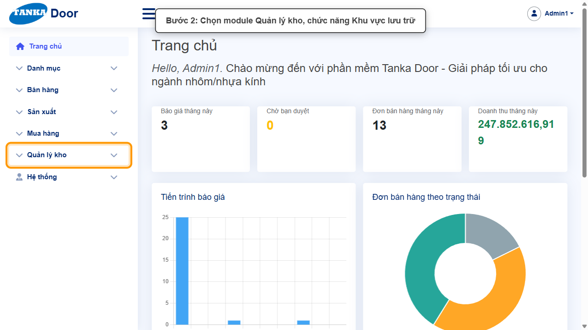
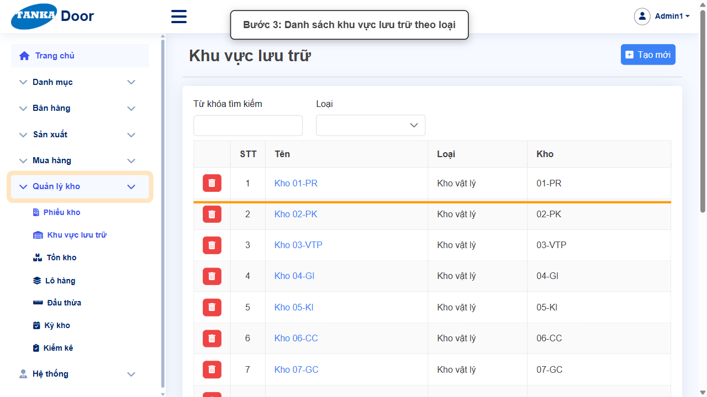
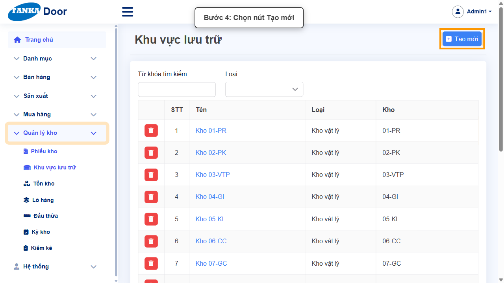
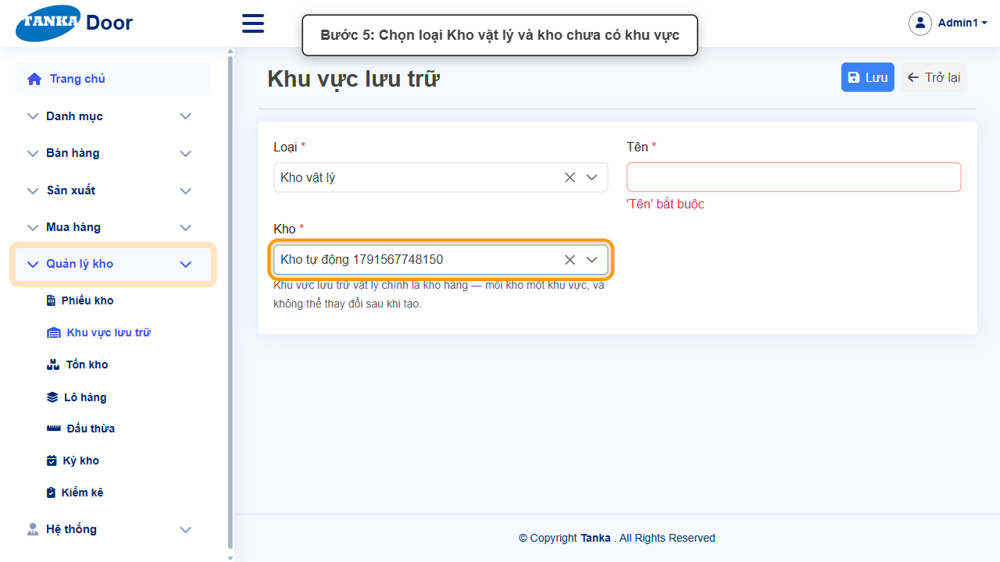
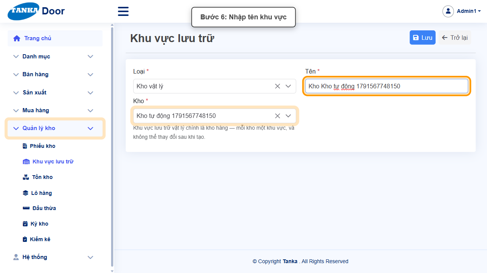
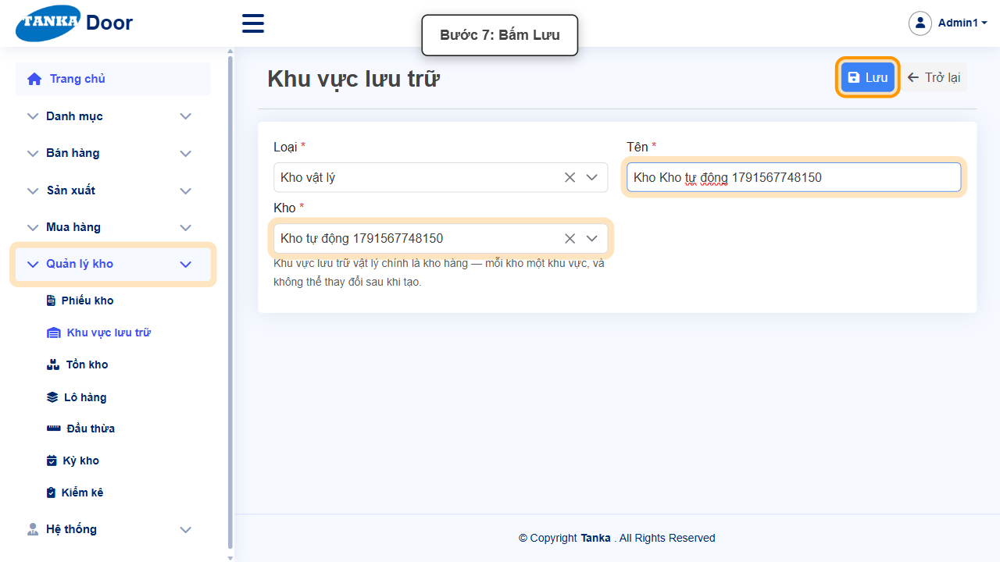
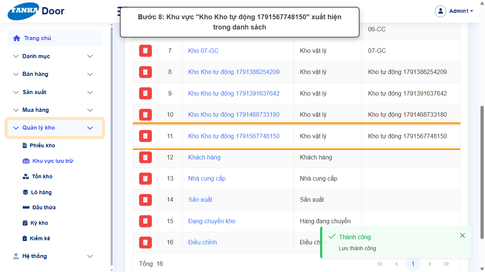

# HƯỚNG DẪN SỬ DỤNG — KHU VỰC LƯU TRỮ

**Đường dẫn:** Quản lý kho > Khu vực lưu trữ  
**Mục tiêu:** Hiểu các loại khu vực lưu trữ và tạo khu vực **Kho vật lý** cho một kho hàng mới để kho đó tham gia các phiếu kho.  
**Dành cho:** Người mới sử dụng TANKA Door

## Trước khi bắt đầu

**Cần có sẵn:**

- Có kho chưa được khai báo khu vực Kho vật lý (UG-011).

**Nên đọc trước:** UG-011.

**Quyền cần có:** Tài khoản thuộc nhóm có quyền Xem/Tạo/Sửa module **Quản lý kho** (UG-063). Nếu không thấy menu hoặc nút như trong ảnh, liên hệ quản trị hệ thống.

> Ảnh minh họa được chụp bằng tài khoản quản trị trên hệ thống thử nghiệm. Thuật ngữ viết tắt (HTK, NVL, BH, SX, YCMH...) và thứ tự các nghiệp vụ: xem **UG-000 Tổng quan**.

## 1. Khu vực lưu trữ là gì

Mỗi phiếu kho thực chất là chuyển hàng **từ một khu vực sang một khu vực khác** — đó là ô **Điểm đối ứng** trên phiếu kho (UG-070). Có 7 loại khu vực:

| Loại | Ý nghĩa | Ví dụ |
| --- | --- | --- |
| Kho vật lý | Kho hàng thật, **mỗi kho một khu vực** | Kho 01-PR, Kho 02-PK... |
| Nhà cung cấp | Nguồn hàng mua vào | Nhà cung cấp |
| Sản xuất | Nơi nhận vật tư xuất cho sản xuất | Sản xuất |
| Phế liệu | Hàng thải bỏ | — |
| Điều chỉnh | Đối ứng của phiếu điều chỉnh/kiểm kê | Điều chỉnh |
| Khách hàng | Nơi nhận hàng giao | Khách hàng |
| Hàng đang chuyển | Hàng chuyển kho chưa nhận | Đang chuyển kho |

Kho tạo ở **Danh mục > Kho hàng** (UG-011) cần có khu vực **Kho vật lý** tương ứng.

## 2. Ví dụ dữ liệu nhập

Ví dụ dưới đây giúp bạn hình dung cách nhập. Hãy nhập dữ liệu thật của công ty bạn; tên/mã có hậu tố số trong ảnh là dữ liệu thử nghiệm, mã chứng từ (BG_, BH_, SX_, MH_...) do hệ thống tự sinh nên của bạn sẽ khác.

| Trường | Giá trị |
| --- | --- |
| Loại | Kho vật lý |
| Kho | Kho thành phẩm Hóc Môn (kho chưa có khu vực Kho vật lý) |
| Tên khu vực | Kho thành phẩm Hóc Môn - Kho chính |

## 3. Sơ đồ quy trình tóm tắt

BẮT ĐẦU → Quản lý kho > Khu vực lưu trữ → Tạo mới → Loại **Kho vật lý** → Chọn Kho chưa có khu vực → Nhập Tên → Lưu

## 4. Quy trình thao tác từng bước

### Bước 1. Mở trang chủ Tanka Door

**Kết quả mong đợi:** menu chức năng hiện ở bên trái màn hình.

*Hình 1: Trang chủ sau khi đăng nhập.*

<video src="videos/UG-072-khu-vuc-luu-tru/01.webm" controls muted width="100%"></video>

### Bước 2. Mở Quản lý kho > Khu vực lưu trữ

**Kết quả mong đợi:** màn hình **Khu vực lưu trữ** hiện ra với danh sách dữ liệu và các ô lọc.

*Hình 2: Mở Quản lý kho > Khu vực lưu trữ.*

<video src="videos/UG-072-khu-vuc-luu-tru/02.webm" controls muted width="100%"></video>

### Bước 3. Xem danh sách khu vực

Danh sách gồm Tên, Loại, Kho; lọc theo Từ khóa và Loại. Kiểm tra cột **Kho** để biết kho nào **đã có** khu vực.

*Hình 3: Danh sách khu vực lưu trữ theo loại.*

<video src="videos/UG-072-khu-vuc-luu-tru/03.webm" controls muted width="100%"></video>

### Bước 4. Bấm Tạo mới

**Kết quả mong đợi:** form nhập mới mở ra; các ô có dấu * là bắt buộc.

*Hình 4: Bấm Tạo mới.*

<video src="videos/UG-072-khu-vuc-luu-tru/04.webm" controls muted width="100%"></video>

### Bước 5. Chọn Loại Kho vật lý và Kho

Chọn **Loại *** = **Kho vật lý** — form có thêm ô **Kho ***. Chọn kho **chưa có khu vực** (danh sách Kho vẫn hiện cả kho đã có khu vực, nên đối chiếu với cột Kho ở bước 3). Màn hình ghi chú: _"Khu vực lưu trữ vật lý chính là kho hàng — mỗi kho một khu vực, và không thể thay đổi sau khi tạo."_

*Hình 5: Chọn loại Kho vật lý và kho chưa có khu vực.*

<video src="videos/UG-072-khu-vuc-luu-tru/05.webm" controls muted width="100%"></video>

### Bước 6. Nhập Tên khu vực

Đặt tên dễ nhận biết, ví dụ "Kho " + tên kho.

*Hình 6: Nhập tên khu vực.*

<video src="videos/UG-072-khu-vuc-luu-tru/06.webm" controls muted width="100%"></video>

### Bước 7. Bấm Lưu

**Kết quả mong đợi:** thông báo xanh **"Lưu thành công"** hiện ở góc phải, nút **Lưu** mờ lại.

*Hình 7: Bấm Lưu.*

<video src="videos/UG-072-khu-vuc-luu-tru/07.webm" controls muted width="100%"></video>

### Bước 8. Kiểm tra trong danh sách

Bấm **Trở lại**: khu vực mới xuất hiện với Loại "Kho vật lý" và đúng Kho.

*Hình 8: Khu vực mới xuất hiện trong danh sách.*

<video src="videos/UG-072-khu-vuc-luu-tru/08.webm" controls muted width="100%"></video>

### Video tổng hợp toàn bộ thao tác

Video dưới đây ghép liền toàn bộ các bước ở trên, từ lúc mở chức năng đến khi hoàn thành — xem lại một lượt trước khi tự thao tác.

<video src="videos/UG-072-khu-vuc-luu-tru/full.webm" controls muted width="100%"></video>

## 5. Khi không thao tác được

| Hiện tượng | Cách xử lý ngay |
| --- | --- |
| Lưu báo kho đã có khu vực | Mỗi kho chỉ một khu vực Kho vật lý — chọn kho khác. |
| Không đổi được Loại/Kho sau khi lưu | Đúng thiết kế — khu vực Kho vật lý không thay đổi được sau khi tạo. |
| Danh sách Kho trống lúc mới mở | Chờ vài giây cho danh sách tải xong rồi mở lại. |

## 6. Dấu hiệu hoàn thành

- Khu vực mới có trong danh sách với đúng Loại và Kho.

## 7. Checklist dành cho người mới

- [ ] Kiểm tra kho đã có khu vực chưa trước khi tạo.
- [ ] Chọn đúng Loại và Kho (không sửa được sau khi lưu).

---

_Tài liệu này được biên soạn dựa trên thao tác thực tế trên hệ thống door-v1.test.tankasoft.com. Ảnh minh họa có thể thay đổi theo phiên bản giao diện._
