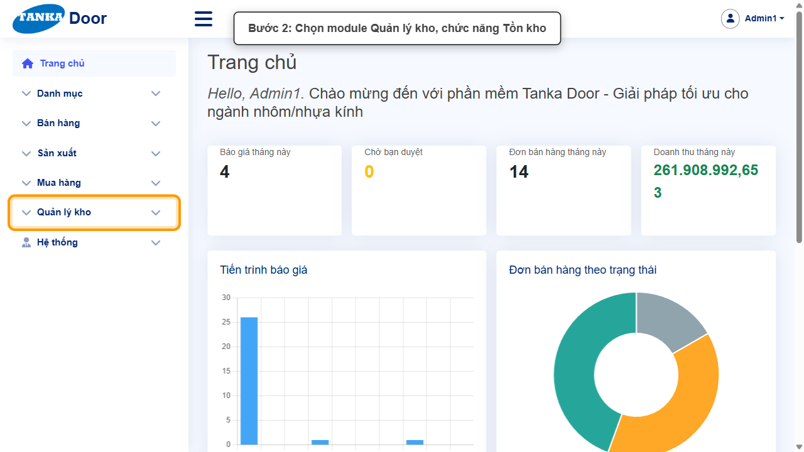
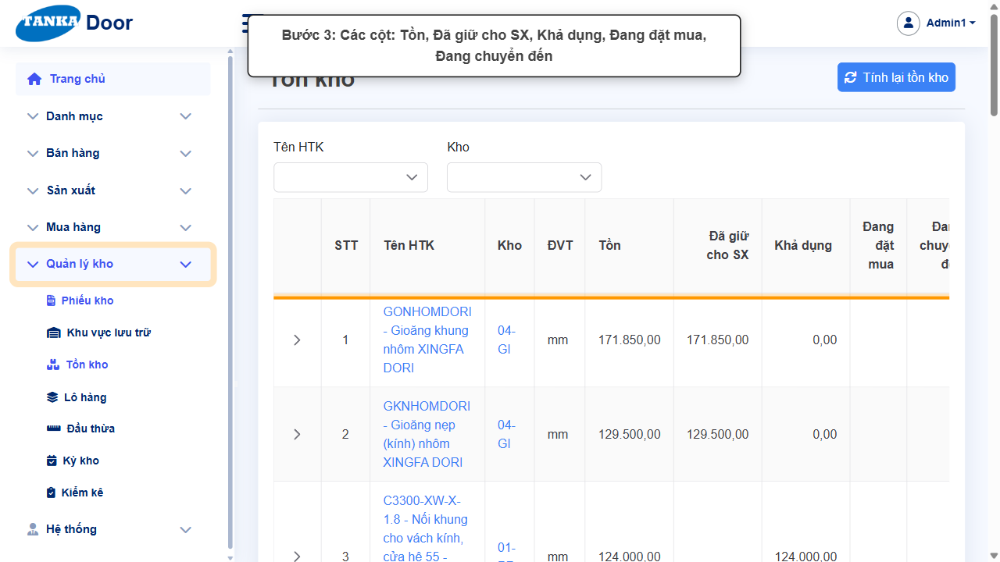
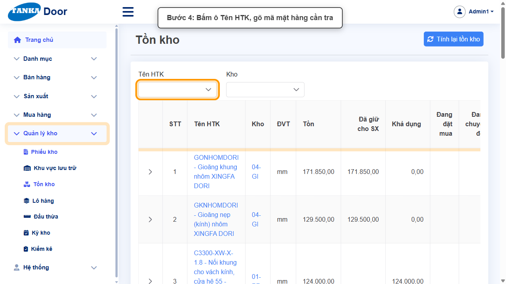
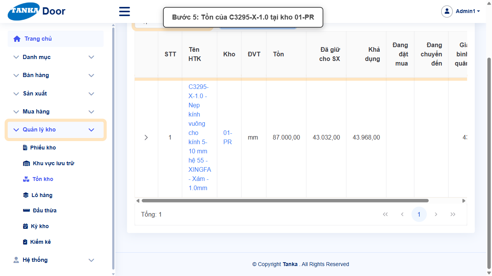
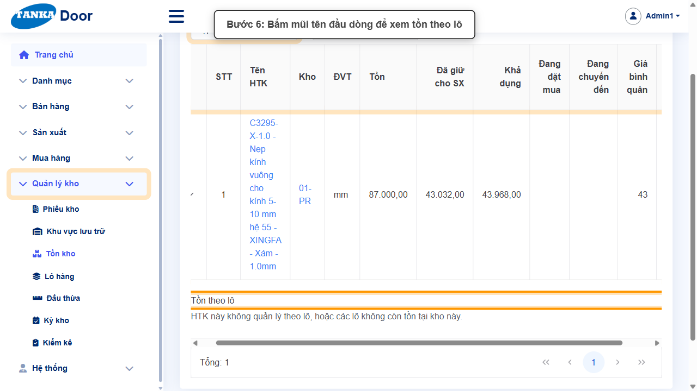
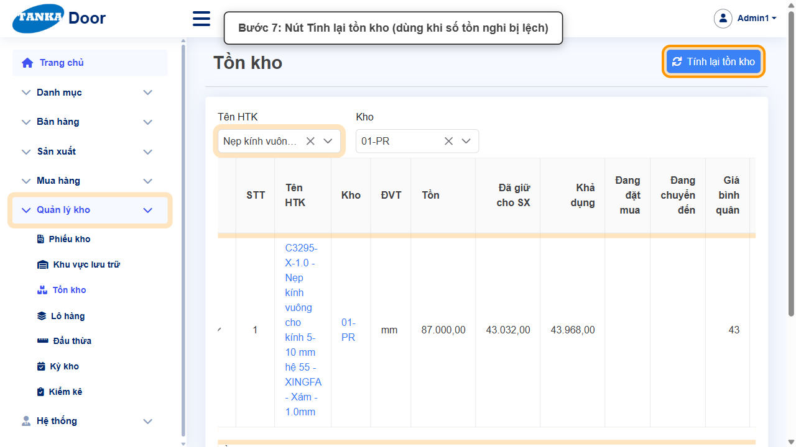

# HƯỚNG DẪN SỬ DỤNG — TRA CỨU TỒN KHO

**Đường dẫn:** Quản lý kho > Tồn kho  
**Mục tiêu:** Tra cứu số tồn của một mặt hàng theo kho và hiểu ý nghĩa các cột Tồn / Đã giữ cho SX / Khả dụng / Đang đặt mua / Đang chuyển đến.  
**Dành cho:** Người mới sử dụng TANKA Door

## Trước khi bắt đầu

**Cần có sẵn:**

- Không cần chuẩn bị — màn hình chỉ xem.

**Quyền cần có:** Tài khoản thuộc nhóm có quyền Xem/Tạo/Sửa module **Quản lý kho** (UG-063). Nếu không thấy menu hoặc nút như trong ảnh, liên hệ quản trị hệ thống.

> Ảnh minh họa được chụp bằng tài khoản quản trị trên hệ thống thử nghiệm. Thuật ngữ viết tắt (HTK, NVL, BH, SX, YCMH...) và thứ tự các nghiệp vụ: xem **UG-000 Tổng quan**.

## 1. Ý nghĩa các cột

| Cột | Ý nghĩa |
| --- | --- |
| Tồn | Số lượng thực có trong kho theo sổ sách. |
| Đã giữ cho SX | Phần đã giữ cho các lệnh SX từ "Đã kế hoạch" trở đi. |
| **Khả dụng** | = Tồn − Đã giữ. Lệnh SX mới chỉ lấy được phần khả dụng. |
| Đang đặt mua | Số lượng trên các đơn mua hàng chưa nhận về. |
| Đang chuyển đến | Hàng chuyển kho đang trên đường tới kho này (UG-071). |
| Giá bình quân / Giá nhập gần nhất | Dùng để tính giá trị xuất kho và đối chiếu giá. |

> Khi lệnh SX báo _"... đang giữ cho lệnh sản xuất — chỉ được lấy 0"_, hãy xem cột **Khả dụng** của mặt hàng đó ở màn hình này.

## 2. Ví dụ dữ liệu nhập

Ví dụ dưới đây giúp bạn hình dung cách nhập. Hãy nhập dữ liệu thật của công ty bạn; tên/mã có hậu tố số trong ảnh là dữ liệu thử nghiệm, mã chứng từ (BG_, BH_, SX_, MH_...) do hệ thống tự sinh nên của bạn sẽ khác.

| Trường | Giá trị |
| --- | --- |
| Mặt hàng | C3295-X-1.0 (Nẹp kính vuông hệ 55 - Xingfa - Xám) |
| Kho | 01-PR |

## 3. Quy trình thao tác từng bước

### Bước 1. Mở trang chủ Tanka Door

**Kết quả mong đợi:** menu chức năng hiện ở bên trái màn hình.

*Hình 1: Trang chủ sau khi đăng nhập.*

<video src="videos/UG-073-ton-kho/01.webm" controls muted width="100%"></video>

### Bước 2. Mở Quản lý kho > Tồn kho

**Kết quả mong đợi:** màn hình **Tồn kho** hiện ra với danh sách dữ liệu và các ô lọc.

*Hình 2: Mở Quản lý kho > Tồn kho.*

<video src="videos/UG-073-ton-kho/02.webm" controls muted width="100%"></video>

### Bước 3. Xem các cột của bảng

Mỗi dòng là một mặt hàng tại một kho. Đọc các cột theo bảng ở mục 1: **Khả dụng = Tồn − Đã giữ cho SX** là số lượng còn dùng được cho lệnh sản xuất mới.

*Hình 3: Các cột Tồn, Đã giữ cho SX, Khả dụng, Đang đặt mua, Đang chuyển đến.*

<video src="videos/UG-073-ton-kho/03.webm" controls muted width="100%"></video>

### Bước 4. Lọc theo mặt hàng

Bấm ô **Tên HTK**, **gõ mã** mặt hàng (hệ thống tìm khi gõ từng ký tự) và chọn. Bảng chỉ còn các dòng của mặt hàng đó — mỗi kho có hàng một dòng.

*Hình 4: Bấm ô Tên HTK, gõ mã mặt hàng.*

<video src="videos/UG-073-ton-kho/04.webm" controls muted width="100%"></video>

### Bước 5. Lọc thêm theo kho

Chọn **Kho** (ví dụ 01-PR) để xem số tồn tại một kho. Đọc các cột: ví dụ trong ảnh: Tồn 81.200, Đã giữ cho SX 43.032 → **Khả dụng 38.168** mm.

*Hình 5: Tồn của C3295-X-1.0 tại kho 01-PR.*

<video src="videos/UG-073-ton-kho/05.webm" controls muted width="100%"></video>

### Bước 6. Xem tồn theo lô

Bấm mũi tên ở đầu dòng để mở mục **Tồn theo lô**. Với mặt hàng không quản lý lô, hệ thống hiện _"HTK này không quản lý theo lô..."_; với mặt hàng theo lô sẽ liệt kê Số lô, Số lô NCC, Hạn dùng, Tồn (xem UG-074).

*Hình 6: Mở dòng để xem tồn theo lô.*

<video src="videos/UG-073-ton-kho/06.webm" controls muted width="100%"></video>

### Bước 7. Nút Tính lại tồn kho

Nút **Tính lại tồn kho** ở góc phải dùng để hệ thống tính lại số tồn từ toàn bộ chứng từ khi nghi ngờ số liệu bị lệch. Thao tác này ảnh hưởng toàn hệ thống — chỉ người phụ trách kho mới nên dùng.

*Hình 7: Nút Tính lại tồn kho.*

<video src="videos/UG-073-ton-kho/07.webm" controls muted width="100%"></video>

## 4. Khi không thao tác được

| Hiện tượng | Cách xử lý ngay |
| --- | --- |
| Gõ mã không ra mặt hàng | Gõ từng ký tự và chờ danh sách gợi ý tải. |
| Không thấy dòng của kho cần xem | Mặt hàng chưa từng có giao dịch ở kho đó. |
| Khả dụng âm | Lượng đã giữ cho SX vượt tồn — cần nhập thêm hàng hoặc xử lý lệnh SX dở dang. |

## 5. Checklist dành cho người mới

- [ ] Phân biệt Tồn và Khả dụng.
- [ ] Biết lọc theo mặt hàng và kho.
- [ ] Biết mở xem tồn theo lô.

---

_Tài liệu này được biên soạn dựa trên thao tác thực tế trên hệ thống door-v1.test.tankasoft.com. Ảnh minh họa có thể thay đổi theo phiên bản giao diện._
