# HƯỚNG DẪN SỬ DỤNG — LÔ HÀNG

**Đường dẫn:** Danh mục > Hàng tồn kho; Mua hàng > Phiếu nhận hàng; Quản lý kho > Lô hàng  
**Mục tiêu:** Bật theo dõi lô cho một vật liệu, nhận hàng có **Số lô / Hạn dùng**, rồi tra cứu lô ở màn hình Lô hàng và tồn theo lô.  
**Dành cho:** Người mới sử dụng TANKA Door

> Màn hình **Lô hàng** chỉ hiển thị lô của các mặt hàng đã bật **Theo dõi lô/serial**. Lô được tạo khi **ghi sổ phiếu nhận hàng** có nhập Số lô.

## Trước khi bắt đầu

**Cần có sẵn:**

- Mặt hàng đã bật **Theo dõi lô** (khai báo trong Danh mục > Hàng tồn kho).
- Có Nhà cung cấp và Kho nhận.

**Nên đọc trước:** UG-010, UG-041.

**Quyền cần có:** Tài khoản thuộc nhóm có quyền Xem/Tạo/Sửa module **Danh mục** (UG-063). Nếu không thấy menu hoặc nút như trong ảnh, liên hệ quản trị hệ thống.

> Ảnh minh họa được chụp bằng tài khoản quản trị trên hệ thống thử nghiệm. Thuật ngữ viết tắt (HTK, NVL, BH, SX, YCMH...) và thứ tự các nghiệp vụ: xem **UG-000 Tổng quan**.

## 1. Cài đặt lô trên vật liệu

| Trường (tab Thông tin chung) | Lựa chọn |
| --- | --- |
| Theo dõi lô/serial | Không theo dõi / **Theo lô** / Theo serial |
| Cách chọn lô khi xuất | Chọn tay / FIFO (nhập trước xuất trước) / **FEFO** (hết hạn trước xuất trước) |
| Gán lô/serial khi | **Khi nhập kho** / Khi xuất kho |
| Hạn dùng (ngày) | Số ngày sử dụng mặc định |

> Không nên bật theo dõi lô cho vật tư đang dùng trong các lệnh sản xuất dở dang — cách xuất vật tư của chúng sẽ thay đổi. Nên bật theo dõi lô ngay khi tạo mặt hàng mới.

## 2. Ví dụ dữ liệu nhập

Ví dụ dưới đây giúp bạn hình dung cách nhập. Hãy nhập dữ liệu thật của công ty bạn; tên/mã có hậu tố số trong ảnh là dữ liệu thử nghiệm, mã chứng từ (BG_, BH_, SX_, MH_...) do hệ thống tự sinh nên của bạn sẽ khác.

| Trường | Giá trị |
| --- | --- |
| Vật liệu | KEO-SOUDAL — Keo dán theo lô, ĐVT mm, Theo lô, FEFO, hạn 180 ngày |
| Phiếu nhận | NH_202610_0055 — NCC Soudal VN, kho 03-VTP, 5.000 mm, 250.000 đ |
| Lô | LO-061691, Lô NSX NSX-2026-10, Hạn dùng ngày 15 tháng sau |

## 3. Sơ đồ quy trình tóm tắt

**A.** Danh mục > Hàng tồn kho > Tạo mới → Mã, Tên, Nhóm, ĐVT → **Theo dõi lô = Theo lô**, Cách chọn lô, Hạn dùng → Lưu

**B.** Mua hàng > Phiếu nhận hàng > Tạo mới → NCC, Kho nhận, Ghi chú → Thêm mặt hàng khác → SL, Thành tiền, **Số lô, Lô NSX, Hạn dùng** → Lưu → Ghi sổ

**C.** Quản lý kho > Lô hàng → tìm số lô → mở chi tiết lô → Tồn kho: xem tồn theo lô

## 4. Quy trình thao tác từng bước

### Bước 1. Mở trang chủ Tanka Door

**Kết quả mong đợi:** menu chức năng hiện ở bên trái màn hình.

*Hình 1: Trang chủ sau khi đăng nhập.*

<video src="videos/UG-074-lo-hang/01.webm" controls muted width="100%"></video>

### Phần A — Vật liệu có theo dõi lô

#### Bước 2. Mở Danh mục > Hàng tồn kho, bấm Tạo mới

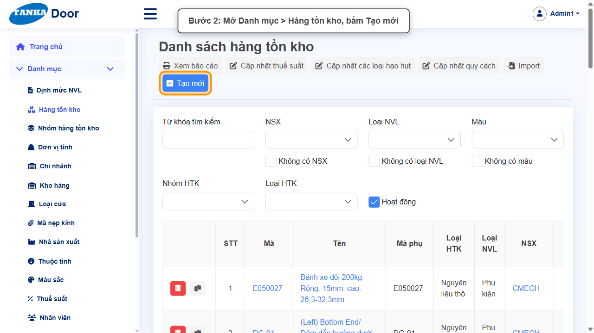

*Hình 2: Mở Danh mục > Hàng tồn kho, bấm Tạo mới.*

<video src="videos/UG-074-lo-hang/02.webm" controls muted width="100%"></video>

#### Bước 3. Nhập Mã, Tên, chọn Nhóm HTK và ĐVT lưu kho

Như hướng dẫn UG-010. Chọn ĐVT lưu kho trùng ĐVT bán/mua (mm) để tránh lỗi quy đổi.

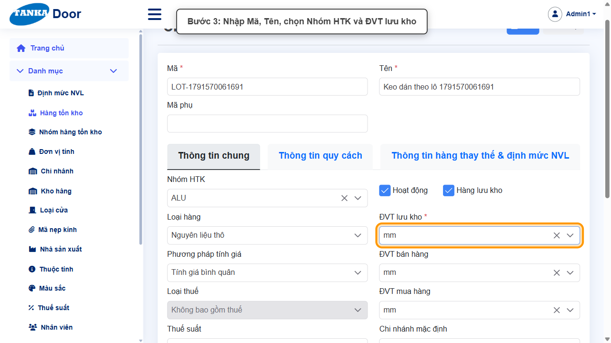

*Hình 3: Nhập Mã, Tên, chọn Nhóm HTK và ĐVT lưu kho.*

<video src="videos/UG-074-lo-hang/03.webm" controls muted width="100%"></video>

#### Bước 4. Bật theo dõi lô

Chọn **Theo dõi lô/serial = Theo lô** — ô **Cách chọn lô khi xuất** mở ra; chọn **FEFO** (lô hết hạn trước được xuất trước). Nhập **Hạn dùng (ngày)**.

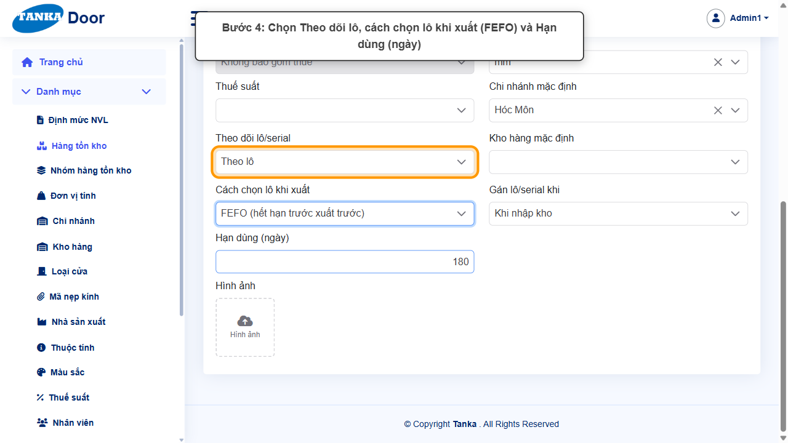

*Hình 4: Chọn Theo dõi lô, cách chọn lô khi xuất và hạn dùng.*

<video src="videos/UG-074-lo-hang/04.webm" controls muted width="100%"></video>

#### Bước 5. Lưu vật liệu

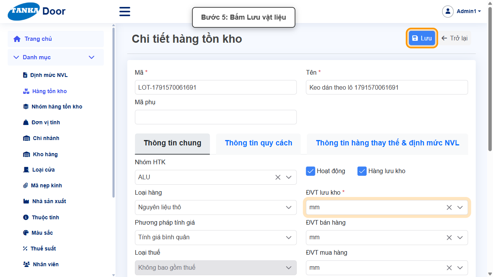

*Hình 5: Bấm Lưu vật liệu.*

<video src="videos/UG-074-lo-hang/05.webm" controls muted width="100%"></video>

### Phần B — Nhận hàng có số lô

#### Bước 6. Mở Mua hàng > Phiếu nhận hàng, bấm Tạo mới

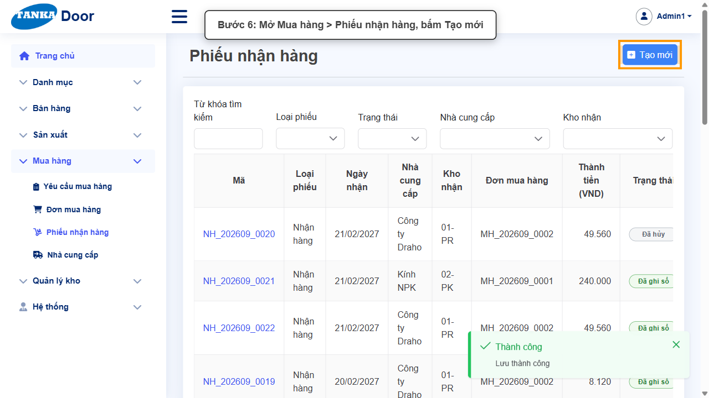

*Hình 6: Mở Phiếu nhận hàng, bấm Tạo mới.*

<video src="videos/UG-074-lo-hang/06.webm" controls muted width="100%"></video>

#### Bước 7. Chọn nhà cung cấp, kho nhận và nhập Ghi chú

Phiếu có dòng **ngoài đơn** thì ô **Ghi chú là bắt buộc**.

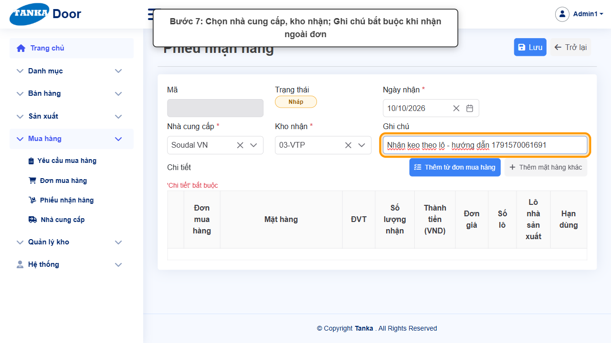

*Hình 7: Chọn nhà cung cấp, kho nhận, nhập ghi chú.*

<video src="videos/UG-074-lo-hang/07.webm" controls muted width="100%"></video>

#### Bước 8. Thêm hàng và nhập thông tin lô

Bấm **+ Thêm mặt hàng khác**, chọn vật liệu vừa tạo, nhập Số lượng, Thành tiền. Với mặt hàng theo lô, dòng có thêm 3 ô:

- **Số lô** — số lô nội bộ (ví dụ LO-061691).
- **Lô nhà sản xuất** — số lô in trên bao bì của NSX.
- **Hạn dùng** — chọn ngày trên lịch.

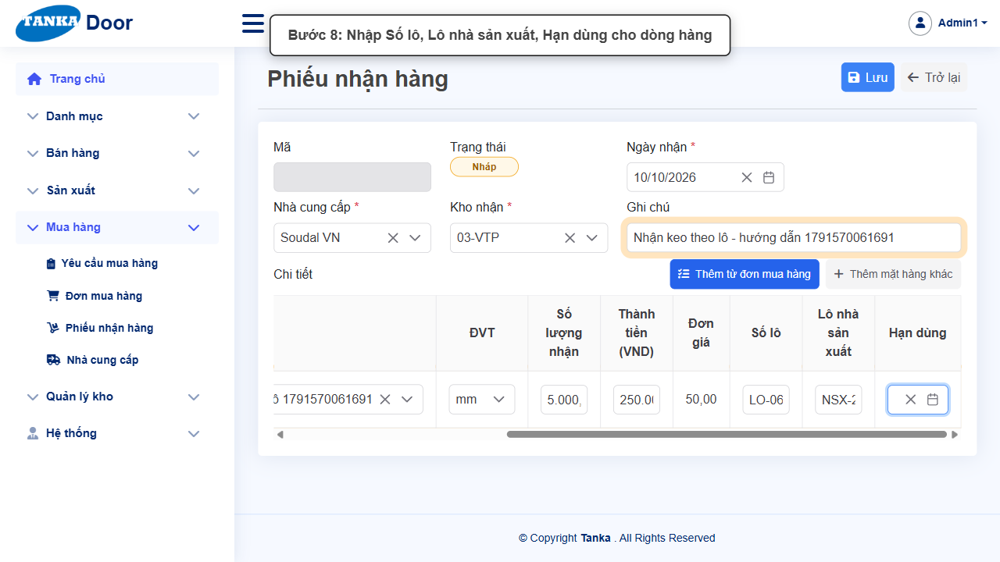

*Hình 8: Nhập Số lô, Lô nhà sản xuất, Hạn dùng.*

<video src="videos/UG-074-lo-hang/08.webm" controls muted width="100%"></video>

#### Bước 9. Lưu và Ghi sổ

Bấm **Lưu**, rồi **Ghi sổ** → **Đồng ý**. Ghi sổ nhập hàng vào kho và **tạo lô**.

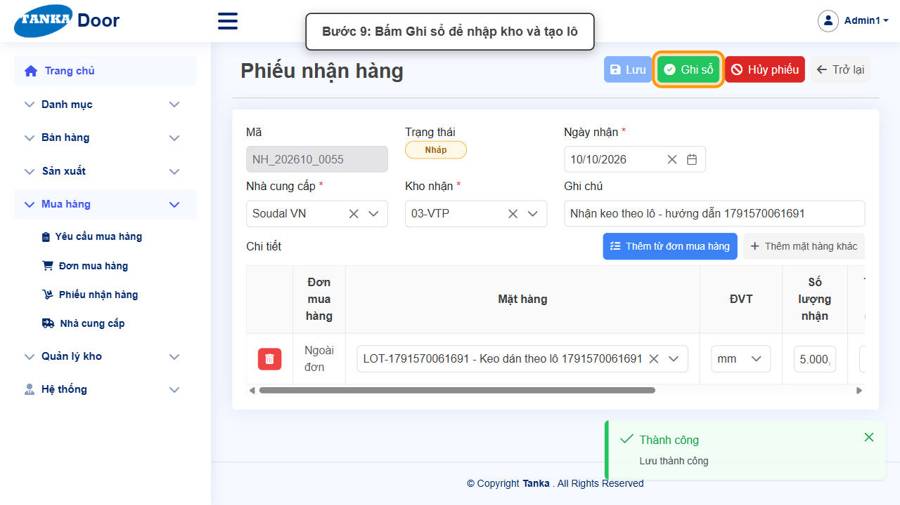

*Hình 9: Bấm Ghi sổ để nhập kho và tạo lô.*

<video src="videos/UG-074-lo-hang/09.webm" controls muted width="100%"></video>

### Phần C — Tra cứu lô hàng

#### Bước 10. Mở Quản lý kho > Lô hàng

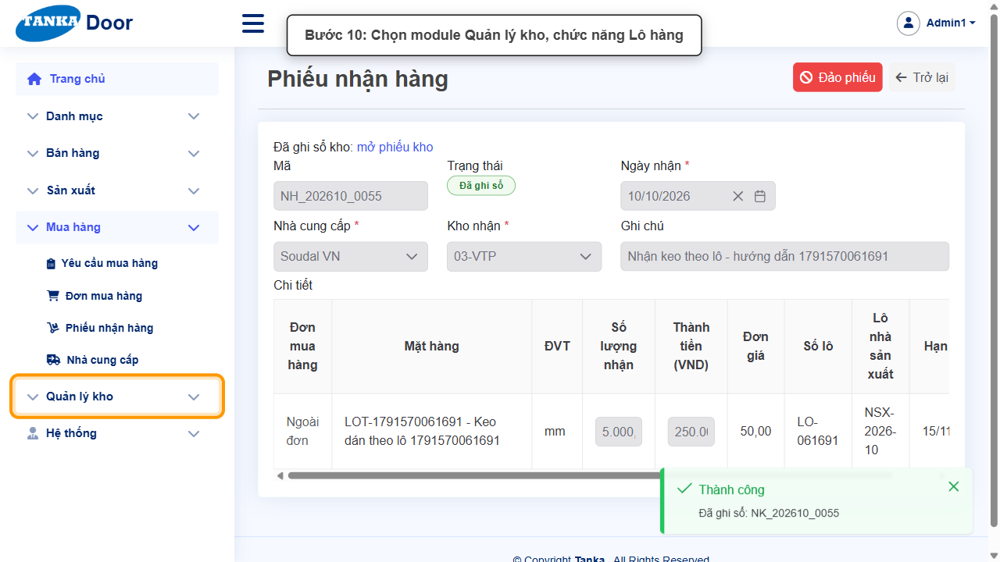

*Hình 10: Mở Quản lý kho > Lô hàng.*

<video src="videos/UG-074-lo-hang/10.webm" controls muted width="100%"></video>

#### Bước 11. Tìm lô

Nhập số lô vào **Từ khóa tìm kiếm** (hoặc lọc theo **Tên HTK**). Mỗi dòng: Số lô, Số lô NCC, Tên HTK, Ngày nhập, **Hạn dùng**, Đơn giá nhập.

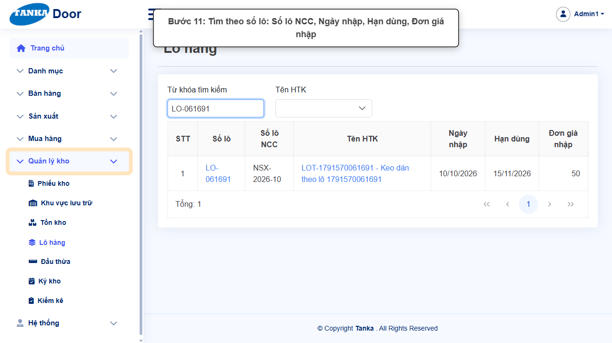

*Hình 11: Tìm theo số lô.*

<video src="videos/UG-074-lo-hang/11.webm" controls muted width="100%"></video>

#### Bước 12. Mở chi tiết lô

Bấm vào số lô. Ở chi tiết lô có thể sửa **Số lô NCC** và **Hạn dùng** (bấm Lưu), hoặc dùng nút **Đổi số lô** khi cần đổi mã lô.

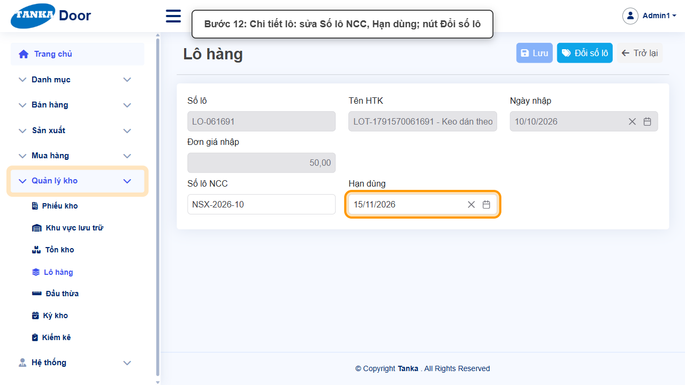

*Hình 12: Chi tiết lô.*

<video src="videos/UG-074-lo-hang/12.webm" controls muted width="100%"></video>

#### Bước 13. Xem tồn theo lô ở Tồn kho

Mở **Quản lý kho > Tồn kho**, lọc mặt hàng, bấm mũi tên đầu dòng: mục **Tồn theo lô** liệt kê Số lô, Số lô NCC, Hạn dùng và số tồn từng lô.

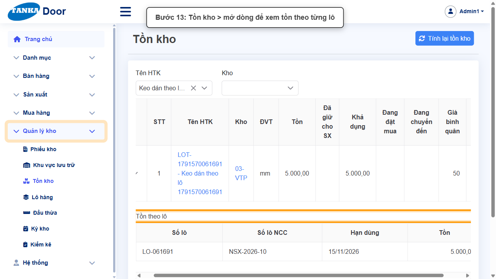

*Hình 13: Tồn kho — tồn theo từng lô.*

<video src="videos/UG-074-lo-hang/13.webm" controls muted width="100%"></video>

## 5. Khi không thao tác được

| Hiện tượng | Cách xử lý ngay |
| --- | --- |
| Danh sách Lô hàng trống | Chưa có mặt hàng theo lô nào được nhận vào kho. |
| Dòng nhận hàng không có ô Số lô | Mặt hàng chưa bật Theo dõi lô/serial. |
| Ô Cách chọn lô khi xuất bị khoá | Chọn Theo dõi lô/serial khác "Không theo dõi" trước. |
| Lưu phiếu nhận báo "Ghi chú bắt buộc" | Phiếu có dòng ngoài đơn — nhập Ghi chú. |

## 6. Checklist dành cho người mới

- [ ] Bật Theo dõi lô và chọn cách chọn lô khi xuất (FIFO/FEFO) phù hợp.
- [ ] Nhập Số lô, Lô NSX, Hạn dùng khi nhận hàng.
- [ ] Tra cứu được lô và tồn theo lô.

---

_Tài liệu này được biên soạn dựa trên thao tác thực tế trên hệ thống door-v1.test.tankasoft.com. Ảnh minh họa có thể thay đổi theo phiên bản giao diện._
