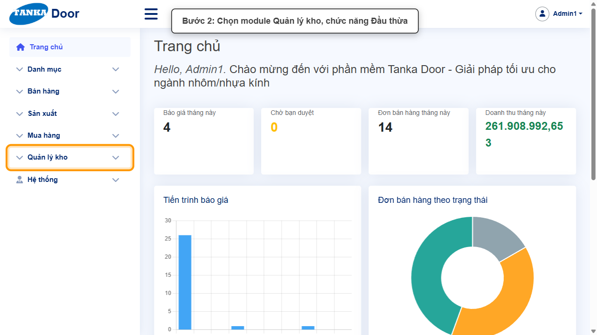
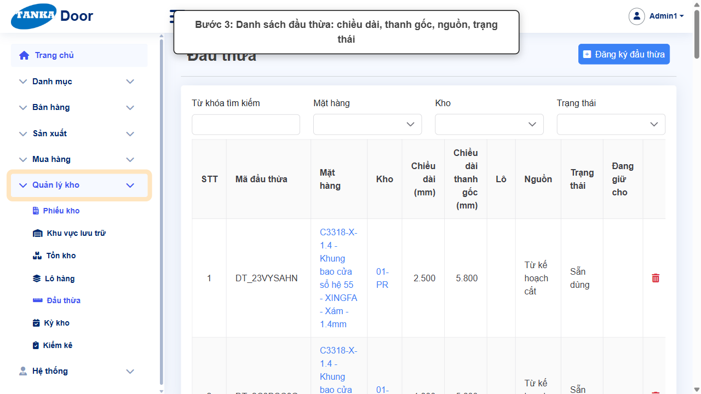
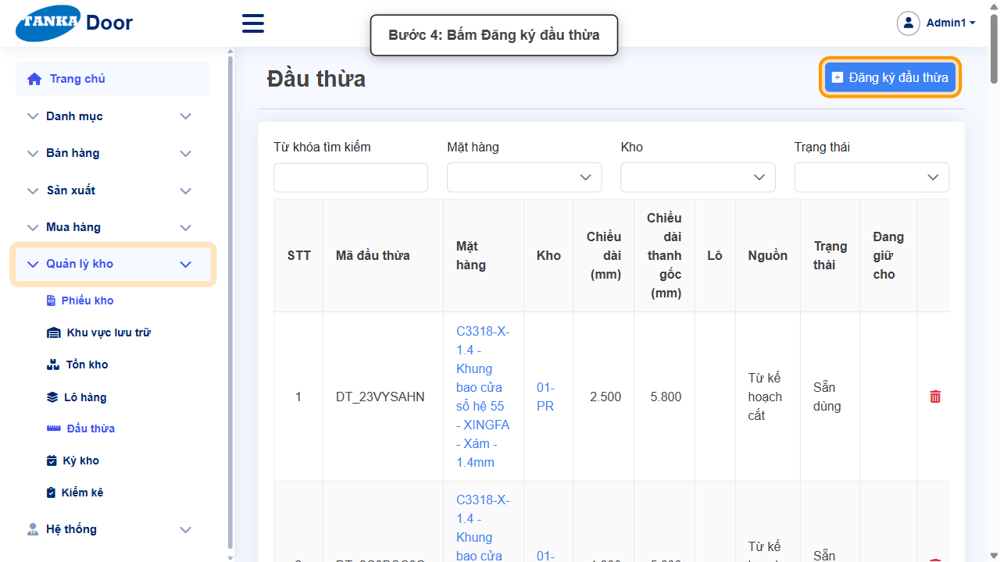
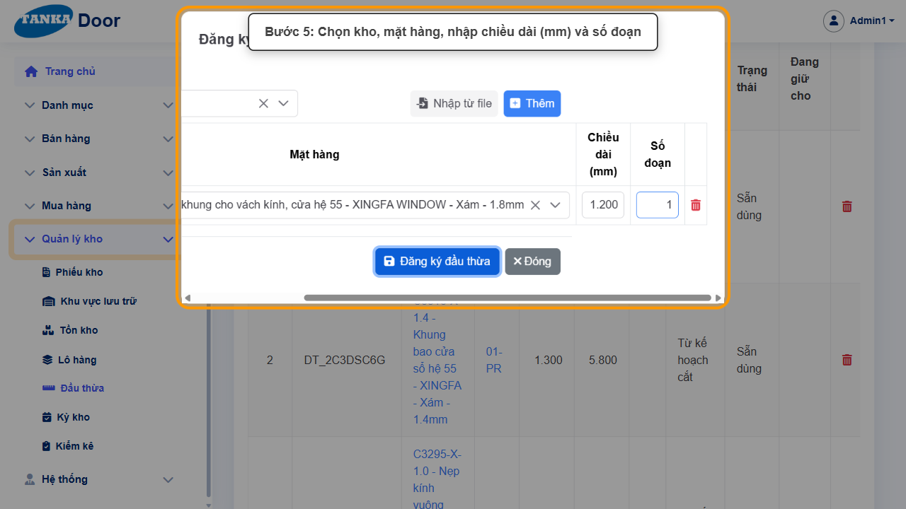
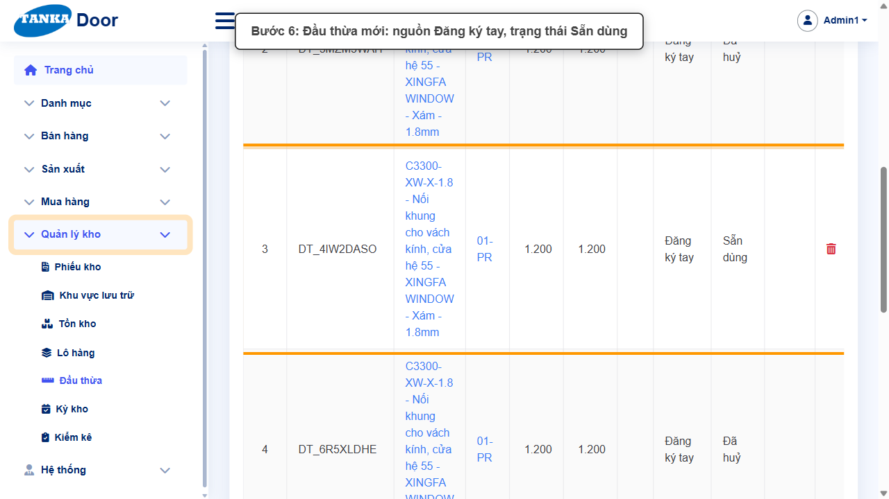
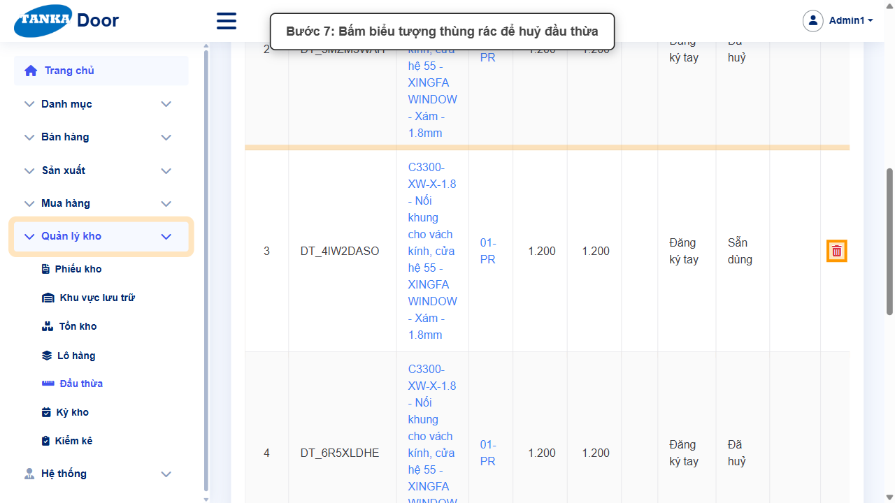
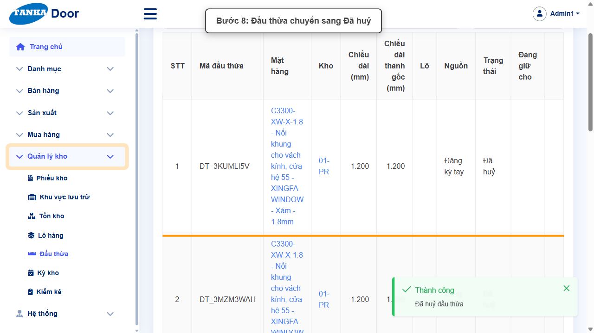

# HƯỚNG DẪN SỬ DỤNG — ĐẦU THỪA

**Đường dẫn:** Quản lý kho > Đầu thừa  
**Mục tiêu:** Hiểu cách hệ thống quản lý các đoạn profile thừa sau khi cắt, đăng ký tay đầu thừa, tra cứu và huỷ đầu thừa đăng ký nhầm.  
**Dành cho:** Người mới sử dụng TANKA Door

## Trước khi bắt đầu

**Cần có sẵn:**

- Mặt hàng dạng thanh (profile) có tồn trong kho.

**Nên đọc trước:** UG-073.

**Quyền cần có:** Tài khoản thuộc nhóm có quyền Xem/Tạo/Sửa module **Quản lý kho** (UG-063). Nếu không thấy menu hoặc nút như trong ảnh, liên hệ quản trị hệ thống.

> Ảnh minh họa được chụp bằng tài khoản quản trị trên hệ thống thử nghiệm. Thuật ngữ viết tắt (HTK, NVL, BH, SX, YCMH...) và thứ tự các nghiệp vụ: xem **UG-000 Tổng quan**.

## 1. Đầu thừa là gì

Khi cắt thanh profile (thanh gốc 5.800 mm) theo kế hoạch cắt ở bước **Tính tối ưu** của lệnh SX (UG-032), các đoạn còn lại đủ dài được lưu thành **đầu thừa** để dùng lại cho lần cắt sau (cột "Lấy từ thanh tồn" trên yêu cầu mua hàng).

| Cột | Ý nghĩa |
| --- | --- |
| Mã đầu thừa | DT_... |
| Chiều dài (mm) / Chiều dài thanh gốc | Độ dài đoạn thừa / thanh gốc ban đầu |
| Nguồn | **Từ kế hoạch cắt** (tự động) hoặc **Đăng ký tay** |
| Trạng thái | **Sẵn dùng** / **Đã dùng hết** / **Đã huỷ** |
| Đang giữ cho | Lệnh SX đang giữ đoạn này (nếu có) |

> Đăng ký đầu thừa **không làm thay đổi số tồn** — chỉ đánh dấu một phần tồn hiện có là các đoạn lẻ. Huỷ đầu thừa cũng không trừ tồn.

## 2. Ví dụ dữ liệu nhập

Ví dụ dưới đây giúp bạn hình dung cách nhập. Hãy nhập dữ liệu thật của công ty bạn; tên/mã có hậu tố số trong ảnh là dữ liệu thử nghiệm, mã chứng từ (BG_, BH_, SX_, MH_...) do hệ thống tự sinh nên của bạn sẽ khác.

| Trường | Giá trị |
| --- | --- |
| Kho | 01-PR |
| Mặt hàng | C3300-XW-X-1.8 (Nối khung vách kính hệ 55 - Xám) |
| Chiều dài / Số đoạn | 1.200 mm / 1 đoạn |

## 3. Quy trình thao tác từng bước

### Bước 1. Mở trang chủ Tanka Door

**Kết quả mong đợi:** menu chức năng hiện ở bên trái màn hình.

*Hình 1: Trang chủ sau khi đăng nhập.*

<video src="videos/UG-075-dau-thua/01.webm" controls muted width="100%"></video>

### Bước 2. Mở Quản lý kho > Đầu thừa

**Kết quả mong đợi:** màn hình **Đầu thừa** hiện ra với danh sách dữ liệu và các ô lọc.

*Hình 2: Mở Quản lý kho > Đầu thừa.*

<video src="videos/UG-075-dau-thua/02.webm" controls muted width="100%"></video>

### Bước 3. Xem danh sách đầu thừa

Lọc theo Từ khóa, Mặt hàng, Kho, Trạng thái.

*Hình 3: Danh sách đầu thừa.*

<video src="videos/UG-075-dau-thua/03.webm" controls muted width="100%"></video>

### Bước 4. Bấm Đăng ký đầu thừa

Dùng khi kiểm kho thực tế thấy có đoạn thừa chưa được ghi nhận (ví dụ cắt tay ngoài kế hoạch).

*Hình 4: Bấm Đăng ký đầu thừa.*

<video src="videos/UG-075-dau-thua/04.webm" controls muted width="100%"></video>

### Bước 5. Chọn kho, mặt hàng, nhập chiều dài và số đoạn

Trong hộp thoại: chọn **Kho ***, rồi trên mỗi dòng chọn **Mặt hàng** (gõ mã để tìm), nhập **Chiều dài (mm)** và **Số đoạn**. Bấm **Thêm** để thêm nhiều dòng, hoặc **Nhập từ file** khi có danh sách dài. Bấm **Đăng ký đầu thừa** — thông báo _"Đã đăng ký N đầu thừa"_.

*Hình 5: Chọn kho, mặt hàng, nhập chiều dài và số đoạn.*

<video src="videos/UG-075-dau-thua/05.webm" controls muted width="100%"></video>

### Bước 6. Lọc theo mặt hàng để kiểm tra

Đầu thừa mới có Nguồn **Đăng ký tay**, trạng thái **Sẵn dùng**.

*Hình 6: Đầu thừa mới — Đăng ký tay, Sẵn dùng.*

<video src="videos/UG-075-dau-thua/06.webm" controls muted width="100%"></video>

### Bước 7. Huỷ đầu thừa đăng ký nhầm

Bấm biểu tượng **thùng rác** ở cuối dòng. Hộp thoại **"Huỷ đầu thừa DT_..."** yêu cầu nhập **Lý do**, bấm **Huỷ**. Đầu thừa chuyển sang **Đã huỷ** và không còn được dùng cho kế hoạch cắt.

*Hình 7: Bấm biểu tượng thùng rác.*

<video src="videos/UG-075-dau-thua/07.webm" controls muted width="100%"></video>

*Hình 8: Đầu thừa chuyển sang Đã huỷ.*

<video src="videos/UG-075-dau-thua/08.webm" controls muted width="100%"></video>

## 4. Khi không thao tác được

| Hiện tượng | Cách xử lý ngay |
| --- | --- |
| Nút Đăng ký đầu thừa trong hộp thoại bị mờ | Chưa chọn Kho hoặc dòng chưa có Mặt hàng / Chiều dài. |
| Không huỷ được đầu thừa | Đầu thừa đang được giữ cho lệnh SX hoặc đã dùng hết. |
| Gõ mã không ra mặt hàng | Gõ từng ký tự và chờ danh sách tải. |

## 5. Checklist dành cho người mới

- [ ] Phân biệt đầu thừa "Từ kế hoạch cắt" và "Đăng ký tay".
- [ ] Đăng ký đúng kho, mặt hàng, chiều dài.
- [ ] Huỷ đầu thừa đăng ký nhầm kèm lý do.

---

_Tài liệu này được biên soạn dựa trên thao tác thực tế trên hệ thống door-v1.test.tankasoft.com. Ảnh minh họa có thể thay đổi theo phiên bản giao diện._
