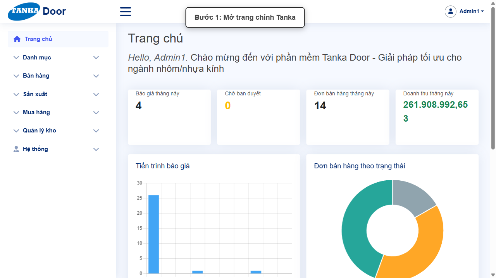
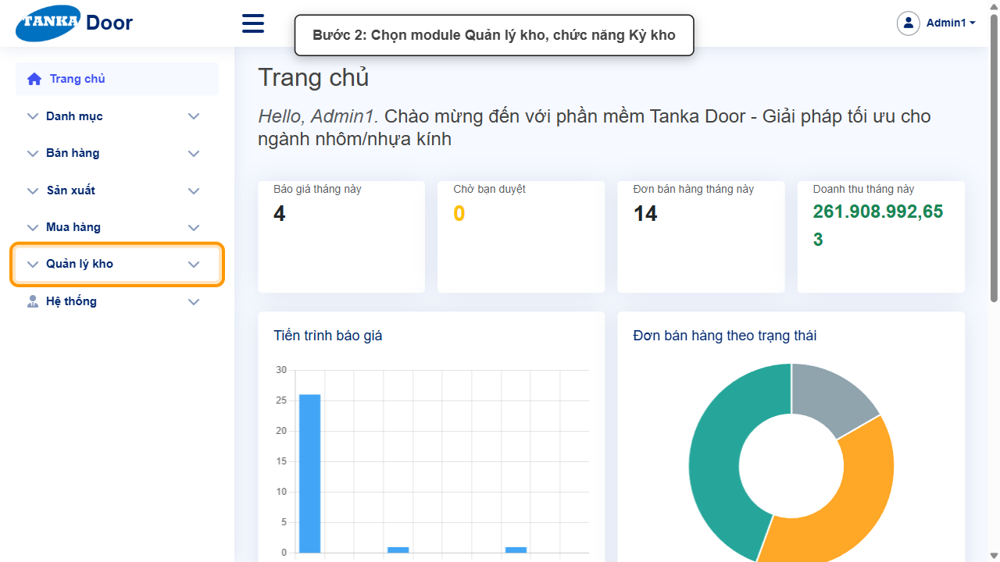
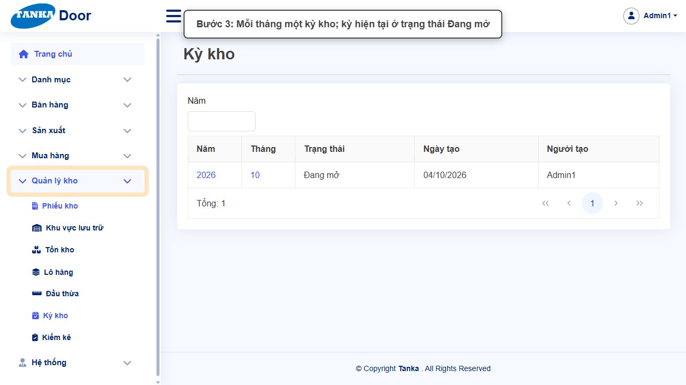
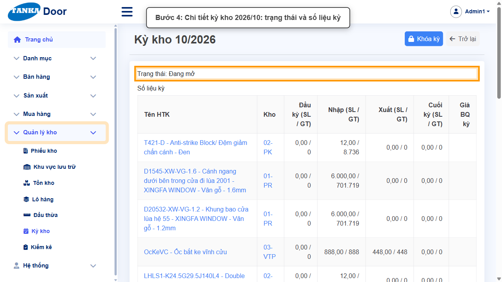
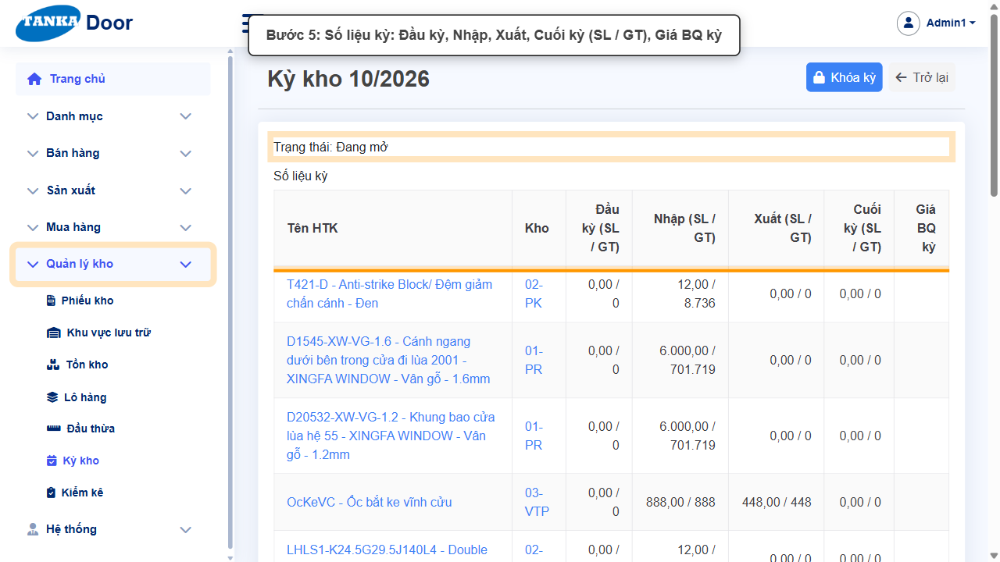
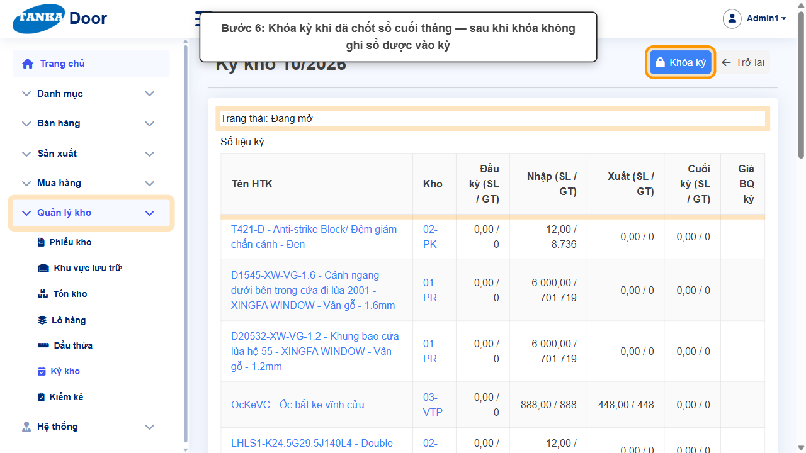

# HƯỚNG DẪN SỬ DỤNG — KỲ KHO

**Đường dẫn:** Quản lý kho > Kỳ kho  
**Mục tiêu:** Xem kỳ kho theo tháng và bảng số liệu nhập – xuất – tồn trong kỳ; hiểu ý nghĩa nút Khóa kỳ.  
**Dành cho:** Người phụ trách kho / kế toán kho

## Trước khi bắt đầu

**Cần có sẵn:**

- Đã ghi sổ hết các phiếu kho trong kỳ; đã kiểm kê nếu cần (UG-077).

**Nên đọc trước:** UG-077.

**Quyền cần có:** Người phụ trách kho / kế toán (quyền quản lý kỳ kho). Nếu không thấy menu hoặc nút như trong ảnh, liên hệ quản trị hệ thống.

> Ảnh minh họa được chụp bằng tài khoản quản trị trên hệ thống thử nghiệm. Thuật ngữ viết tắt (HTK, NVL, BH, SX, YCMH...) và thứ tự các nghiệp vụ: xem **UG-000 Tổng quan**.

## 1. Kỳ kho là gì

Mỗi tháng là một **kỳ kho**. Kỳ đang dùng ở trạng thái **Đang mở** — mọi phiếu kho có ngày trong tháng được ghi sổ vào kỳ này. Cuối tháng, sau khi đối chiếu xong, người phụ trách bấm **Khóa kỳ** để chốt số liệu.

> **Cảnh báo:** Khóa kỳ hiện tại sẽ chặn ghi sổ mọi chứng từ kho có ngày trong kỳ (nhận hàng, xuất vật tư cho sản xuất, giao hàng...). Chỉ khóa kỳ khi đã chốt sổ cuối tháng. Hướng dẫn này chỉ giới thiệu nút, không bấm.

## 2. Quy trình thao tác từng bước

### Bước 1. Mở trang chủ Tanka Door

**Kết quả mong đợi:** menu chức năng hiện ở bên trái màn hình.

*Hình 1: Trang chủ sau khi đăng nhập.*

<video src="videos/UG-076-ky-kho/01.webm" controls muted width="100%"></video>

### Bước 2. Mở Quản lý kho > Kỳ kho

**Kết quả mong đợi:** màn hình **Kỳ kho** hiện ra với danh sách dữ liệu và các ô lọc.

*Hình 2: Mở Quản lý kho > Kỳ kho.*

<video src="videos/UG-076-ky-kho/02.webm" controls muted width="100%"></video>

### Bước 3. Xem danh sách kỳ kho

Danh sách gồm Năm, Tháng, Trạng thái, Ngày tạo, Người tạo; lọc theo **Năm**. Kỳ của tháng hiện tại ở trạng thái **Đang mở**.

*Hình 3: Kỳ hiện tại ở trạng thái Đang mở.*

<video src="videos/UG-076-ky-kho/03.webm" controls muted width="100%"></video>

### Bước 4. Mở chi tiết kỳ kho

Bấm vào Năm hoặc Tháng để mở **Kỳ kho MM/YYYY**: dòng **Trạng thái** và bảng **Số liệu kỳ**.

*Hình 4: Chi tiết kỳ kho.*

<video src="videos/UG-076-ky-kho/04.webm" controls muted width="100%"></video>

### Bước 5. Đọc bảng Số liệu kỳ

Mỗi dòng là một mặt hàng tại một kho:

- **Đầu kỳ (SL / GT)** — số lượng và giá trị đầu tháng.
- **Nhập (SL / GT)**, **Xuất (SL / GT)** — tổng nhập, tổng xuất trong kỳ.
- **Cuối kỳ (SL / GT)**, **Giá BQ kỳ** — khi kỳ còn đang mở, các cột này chưa có số liệu (hiện 0 / trống); nhiều khả năng được chốt khi khóa kỳ.

*Hình 5: Bảng Số liệu kỳ.*

<video src="videos/UG-076-ky-kho/05.webm" controls muted width="100%"></video>

### Bước 6. Nút Khóa kỳ

Nút **Khóa kỳ** ở góc phải dùng để chốt sổ kỳ. Chỉ bấm khi đã hoàn tất mọi chứng từ của tháng và đã kiểm kê đối chiếu (UG-077).

*Hình 6: Nút Khóa kỳ.*

<video src="videos/UG-076-ky-kho/06.webm" controls muted width="100%"></video>

## 3. Checklist trước khi khóa kỳ (dành cho người phụ trách)

- [ ] Không còn phiếu kho, phiếu nhận hàng, phiếu giao hàng ở trạng thái Nháp trong tháng.
- [ ] Hàng chuyển kho "đang đi đường" đã được nhận.
- [ ] Đã kiểm kê và đối chiếu chênh lệch.
- [ ] Đã thống nhất với kế toán trước khi khóa.

---

_Tài liệu này được biên soạn dựa trên thao tác thực tế trên hệ thống door-v1.test.tankasoft.com. Ảnh minh họa có thể thay đổi theo phiên bản giao diện._
