# HƯỚNG DẪN SỬ DỤNG — KIỂM KÊ KHO

**Đường dẫn:** Quản lý kho > Kiểm kê  
**Mục tiêu:** Kiểm kê từng phần một mặt hàng: tạo phiếu, khoá sổ và đếm thực tế, duyệt chênh lệch, đối chiếu để hệ thống tự tạo phiếu điều chỉnh.  
**Dành cho:** Người mới sử dụng TANKA Door

## Trước khi bắt đầu

**Cần có sẵn:**

- Đã ghi sổ hết các phiếu đang dở của mặt hàng/kho cần kiểm kê.
- Sắp xếp thời gian đếm liền mạch — trong lúc kiểm kê mặt hàng bị khoá nhập xuất.

**Nên đọc trước:** UG-073.

**Quyền cần có:** Tài khoản thuộc nhóm có quyền Xem/Tạo/Sửa module **Quản lý kho** (UG-063). Nếu không thấy menu hoặc nút như trong ảnh, liên hệ quản trị hệ thống.

> Ảnh minh họa được chụp bằng tài khoản quản trị trên hệ thống thử nghiệm. Thuật ngữ viết tắt (HTK, NVL, BH, SX, YCMH...) và thứ tự các nghiệp vụ: xem **UG-000 Tổng quan**.

## 1. Quy trình trạng thái

```
Nháp ──Bắt đầu kiểm kê──> Đang đếm ──Chuyển duyệt──> Đang duyệt ──Đối chiếu & điều chỉnh──> Đã đối chiếu
                                       ^                 │
                                       └────Đếm lại──────┘          (Huỷ phiếu ở bất kỳ bước nào trước đối chiếu)
```

- **Loại kiểm kê:** **Toàn kho** hoặc **Từng phần** (giới hạn phạm vi theo Mặt hàng, Nhóm hàng, Loại HTK, Loại vật tư, "Chưa kiểm trong N ngày", "Chỉ hàng tồn âm").
- **Bắt đầu kiểm kê sẽ KHOÁ SỔ** các mặt hàng trong phạm vi: mọi phiếu nhập/xuất trên chúng bị từ chối đến khi đối chiếu hoặc huỷ phiếu. Hãy đếm và đối chiếu nhanh.
- Khi đếm, hệ thống **không hiện SL sổ sách** (đếm mù) để số đếm khách quan.

## 2. Ví dụ dữ liệu nhập

Ví dụ dưới đây giúp bạn hình dung cách nhập. Hãy nhập dữ liệu thật của công ty bạn; tên/mã có hậu tố số trong ảnh là dữ liệu thử nghiệm, mã chứng từ (BG_, BH_, SX_, MH_...) do hệ thống tự sinh nên của bạn sẽ khác.

| Trường | Giá trị |
| --- | --- |
| Loại kiểm kê / Kho | Từng phần / 01-PR |
| Phạm vi | Mặt hàng C3300-XW-X-1.8 |
| Kết quả | SL sổ sách 124.000 mm, SL đếm 125.000 mm, chênh lệch +1.000 mm (74.798 đ) |
| Phiếu kiểm kê / Phiếu điều chỉnh | KK_202610_0006 / DC_202610_0013 |

## 3. Quy trình thao tác từng bước

### Bước 1. Mở trang chủ Tanka Door

**Kết quả mong đợi:** menu chức năng hiện ở bên trái màn hình.


*Hình 1: Trang chủ sau khi đăng nhập.*

<video src="videos/UG-077-kiem-ke/01.webm" controls muted width="100%"></video>

### Bước 2. Mở Quản lý kho > Kiểm kê

Danh sách gồm Số phiếu, Kho, Loại kiểm kê, Ngày, Trạng thái, **Giá trị chênh lệch**, **Phiếu điều chỉnh**.

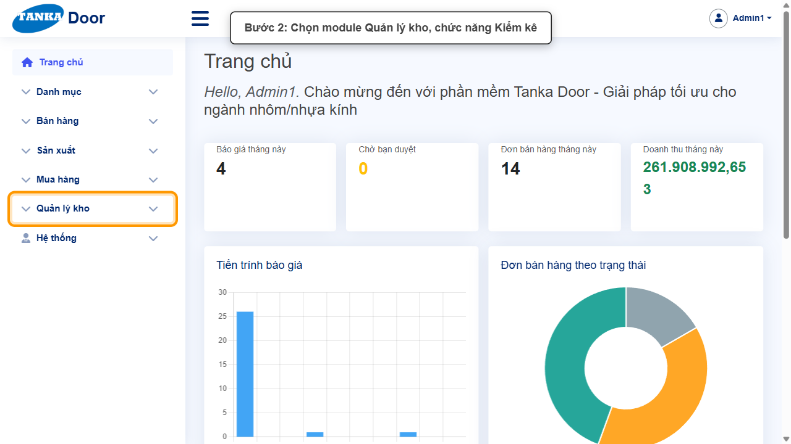

*Hình 2: Mở Quản lý kho > Kiểm kê.*

<video src="videos/UG-077-kiem-ke/02.webm" controls muted width="100%"></video>

### Bước 3. Bấm Tạo mới

**Kết quả mong đợi:** form nhập mới mở ra; các ô có dấu * là bắt buộc.

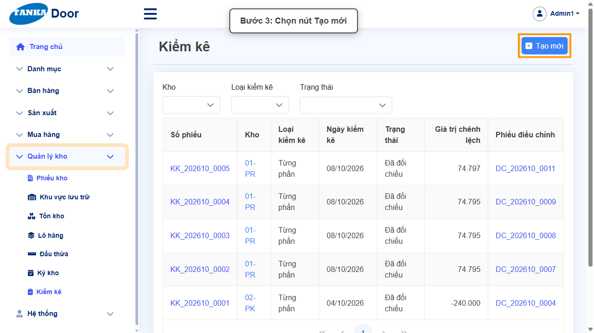

*Hình 3: Bấm Tạo mới.*

<video src="videos/UG-077-kiem-ke/03.webm" controls muted width="100%"></video>

### Bước 4. Chọn loại kiểm kê, kho và ghi chú

Loại kiểm kê mặc định **Từng phần**; chọn **Kho ***, kiểm tra **Ngày kiểm kê**, nhập **Ghi chú**.

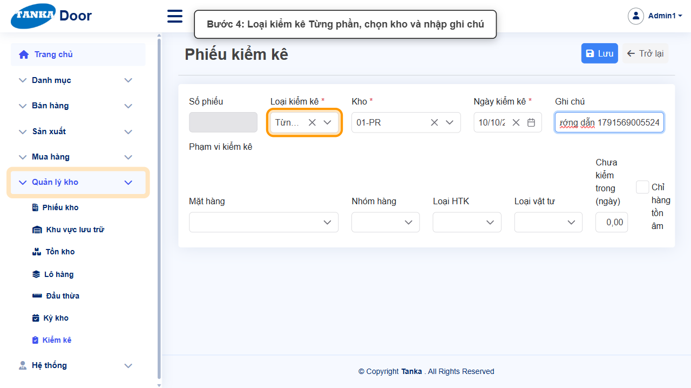

*Hình 4: Loại kiểm kê, kho, ghi chú.*

<video src="videos/UG-077-kiem-ke/04.webm" controls muted width="100%"></video>

### Bước 5. Chọn phạm vi kiểm kê

Ở **Phạm vi kiểm kê**, bấm ô **Mặt hàng** (chọn nhiều), bấm vào ô tìm kiếm, gõ mã và tích các mặt hàng cần đếm. Có thể thu hẹp thêm theo Nhóm hàng, Loại HTK, Loại vật tư.

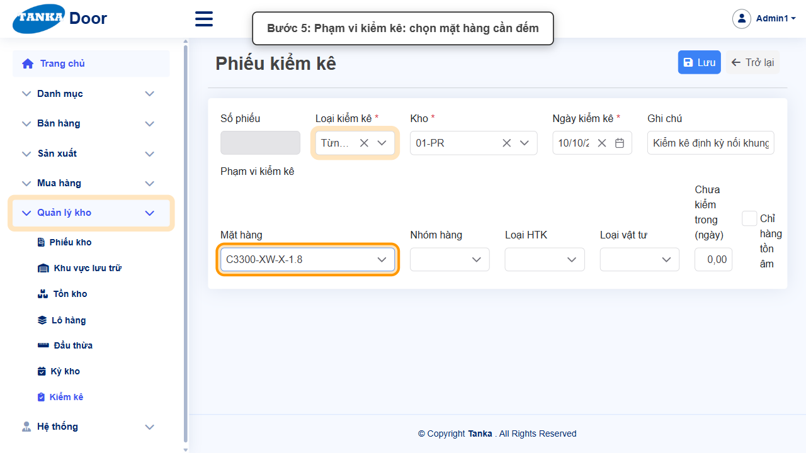

*Hình 5: Chọn mặt hàng cần đếm.*

<video src="videos/UG-077-kiem-ke/05.webm" controls muted width="100%"></video>

### Bước 6. Bấm Lưu

Phiếu được lưu ở trạng thái **Nháp** (mã KK_YYYYMM_xxxx); có các nút **Bắt đầu kiểm kê** và **Huỷ phiếu**.

**Kết quả mong đợi:** thông báo xanh **"Lưu thành công"** hiện ở góc phải, nút **Lưu** mờ lại.

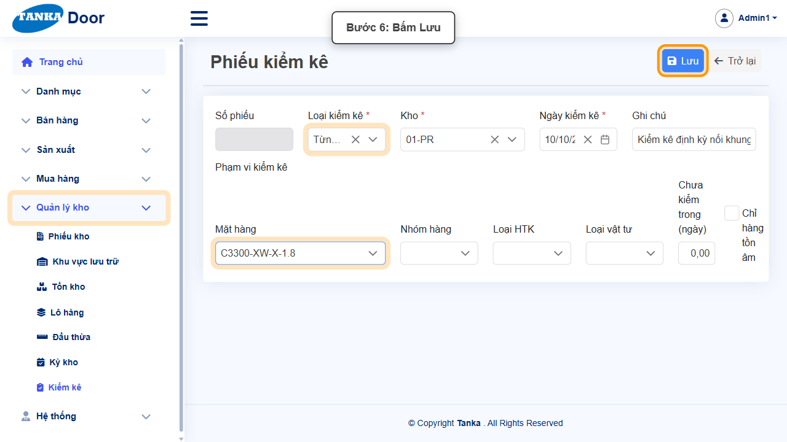

*Hình 6: Bấm Lưu.*

<video src="videos/UG-077-kiem-ke/06.webm" controls muted width="100%"></video>

### Bước 7. Bắt đầu kiểm kê

Bấm **Bắt đầu kiểm kê** → **Đồng ý** ở popup _"Sổ sách các mặt hàng được chọn sẽ bị khoá: mọi phiếu nhập/xuất trên chúng bị từ chối đến khi đối chiếu hoặc huỷ."_ Hệ thống tạo **thẻ kiểm kê** cho từng mặt hàng (thông báo _"Đã tạo N thẻ kiểm kê"_).

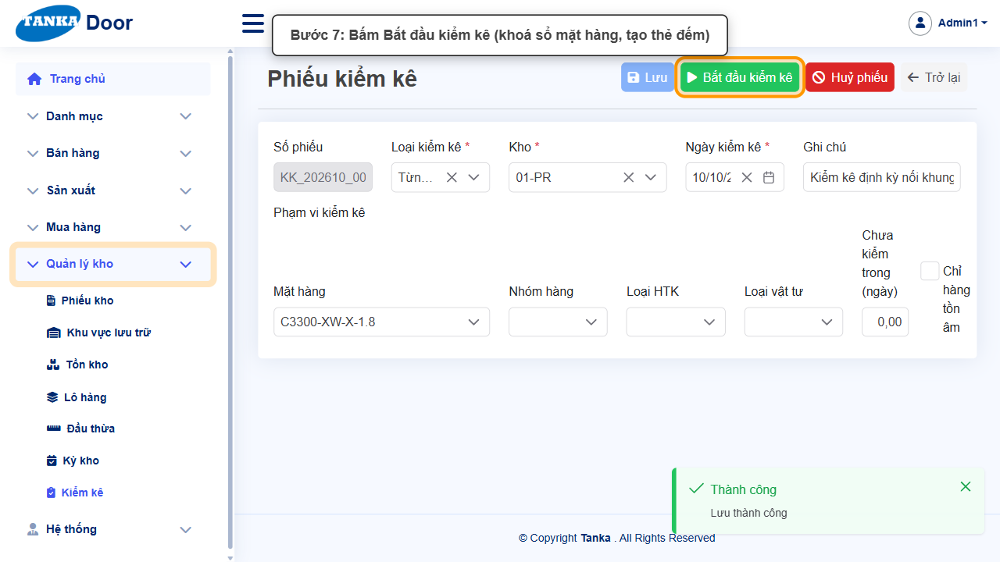

*Hình 7: Bấm Bắt đầu kiểm kê.*

<video src="videos/UG-077-kiem-ke/07.webm" controls muted width="100%"></video>

### Bước 8. Nhập số lượng đếm thực tế

Ở bảng thẻ, nhập **SL đếm** cho từng thẻ (có thể ghi chú). Nút **Đặt 0 cho thẻ chưa đếm** điền 0 cho các thẻ bỏ trống; **+ Thêm thẻ** thêm mặt hàng phát hiện thêm khi đếm.

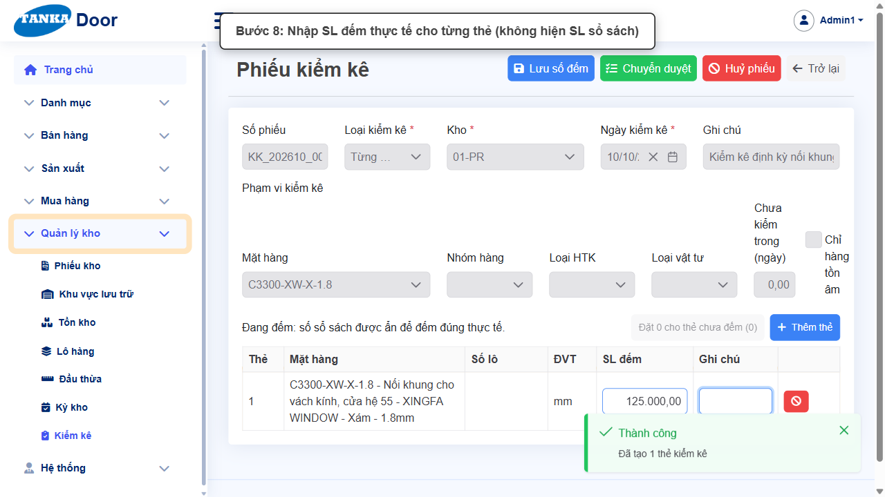

*Hình 8: Nhập SL đếm thực tế.*

<video src="videos/UG-077-kiem-ke/08.webm" controls muted width="100%"></video>

### Bước 9. Lưu số đếm

Bấm **Lưu số đếm** (có thể lưu nhiều lần trong khi đếm).

**Kết quả mong đợi:** thông báo xanh **"Lưu thành công"** hiện ở góc phải, nút **Lưu** mờ lại.

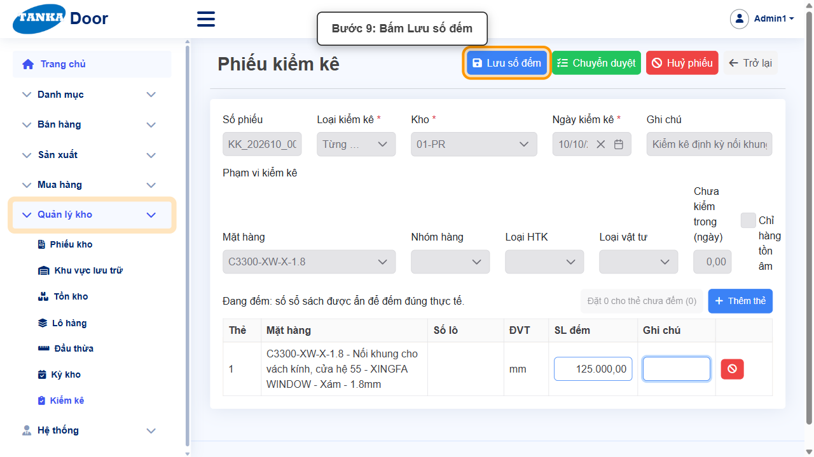

*Hình 9: Bấm Lưu số đếm.*

<video src="videos/UG-077-kiem-ke/09.webm" controls muted width="100%"></video>

### Bước 10. Chuyển duyệt

Đếm xong, bấm **Chuyển duyệt**. Màn hình duyệt hiện **SL sổ sách**, **SL đếm**, **Chênh lệch**, **Giá trị chênh lệch** và tổng giá trị chênh lệch; có thể tích **Chỉ chênh lệch lớn** để lọc.

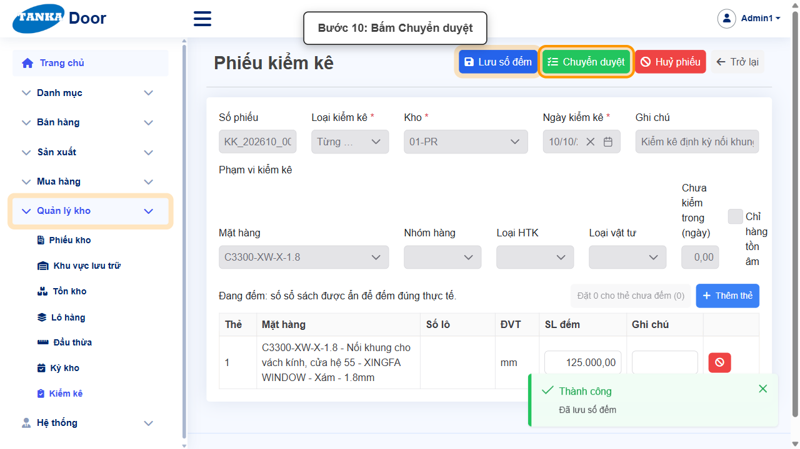

*Hình 10: Bấm Chuyển duyệt.*

<video src="videos/UG-077-kiem-ke/10.webm" controls muted width="100%"></video>

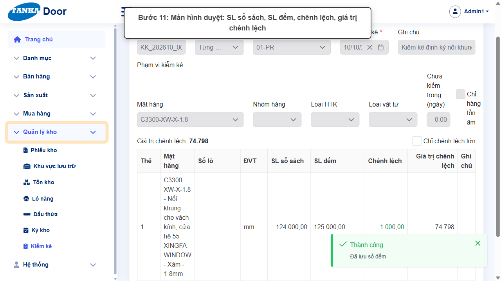

*Hình 11: Màn hình duyệt chênh lệch.*

<video src="videos/UG-077-kiem-ke/11.webm" controls muted width="100%"></video>

### Bước 11. Đối chiếu và điều chỉnh

Nếu chênh lệch bất thường, bấm **Đếm lại** để quay về bước đếm. Nếu chênh lệch đúng, bấm **Đối chiếu & điều chỉnh** → **Đồng ý** ở popup _"Đối chiếu sẽ ghi sổ một phiếu điều chỉnh cho mọi chênh lệch và mở khoá sổ sách. Không thể hoàn tác."_ Hệ thống tạo phiếu **Điều chỉnh DC_...** (lý do "Điều chỉnh kiểm kê"), phiếu kiểm kê chuyển **Đã đối chiếu** và có link tới phiếu điều chỉnh.

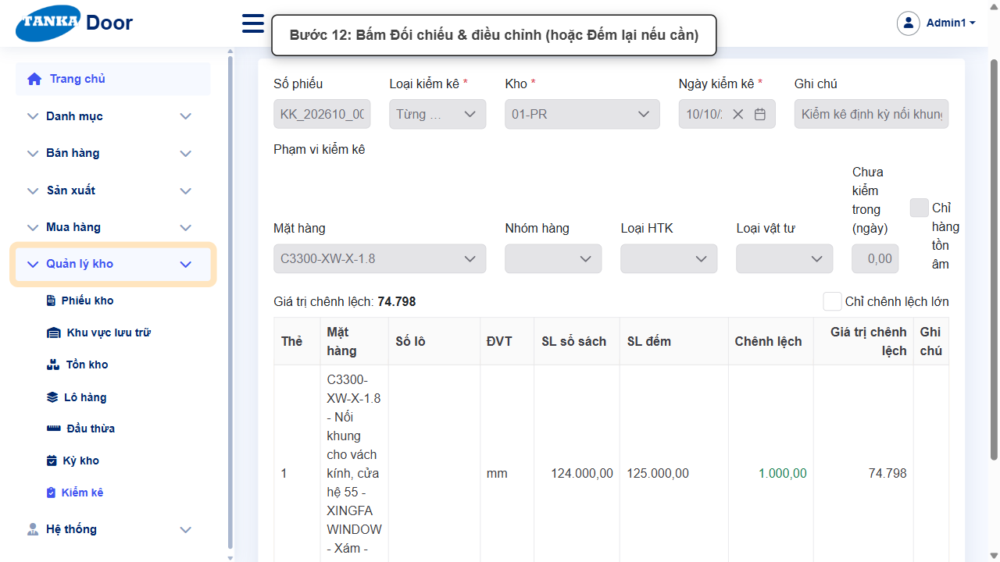

*Hình 12: Bấm Đối chiếu & điều chỉnh.*

<video src="videos/UG-077-kiem-ke/12.webm" controls muted width="100%"></video>

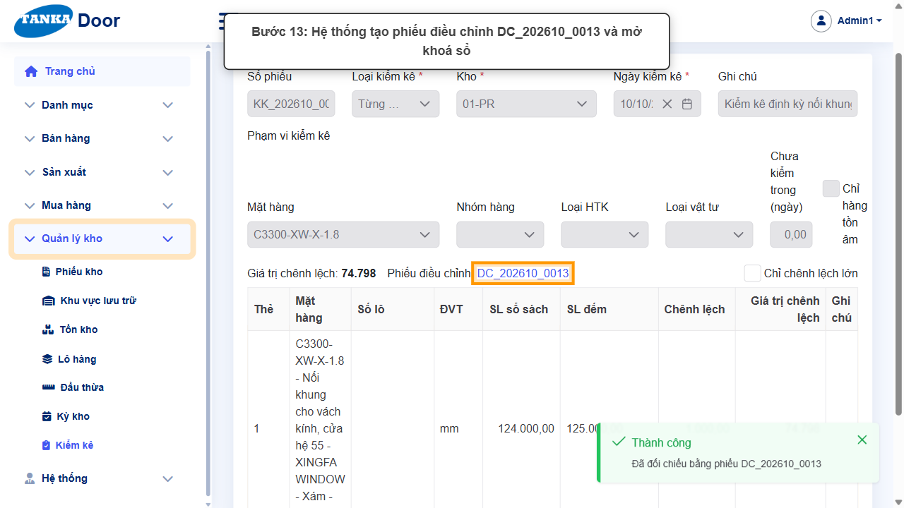

*Hình 13: Hệ thống tạo phiếu điều chỉnh và mở khoá sổ.*

<video src="videos/UG-077-kiem-ke/13.webm" controls muted width="100%"></video>

## 4. Khi không thao tác được

| Hiện tượng | Cách xử lý ngay |
| --- | --- |
| Ô tìm mặt hàng trong phạm vi không lọc | Bấm vào ô tìm kiếm rồi gõ chậm, chờ danh sách tải. |
| Phiếu nhập/xuất khác bị từ chối | Mặt hàng đang bị khoá bởi phiếu kiểm kê chưa đối chiếu — hoàn tất đối chiếu hoặc Huỷ phiếu kiểm kê. |
| Chênh lệch quá lớn | Bấm **Đếm lại**, kiểm tra lại thẻ trước khi đối chiếu. |
| Muốn bỏ đợt kiểm kê | Bấm **Huỷ phiếu** (mở khoá sổ, không tạo điều chỉnh). |

## 5. Dấu hiệu hoàn thành

- Phiếu kiểm kê ở trạng thái "Đã đối chiếu", có Giá trị chênh lệch và link phiếu điều chỉnh.
- Phiếu điều chỉnh DC_... đã ghi sổ; tồn kho bằng số đếm thực tế.

## 6. Checklist dành cho người mới

- [ ] Chọn đúng kho và phạm vi trước khi bắt đầu (bắt đầu sẽ khoá sổ).
- [ ] Đếm và nhập đủ SL cho mọi thẻ, Lưu số đếm.
- [ ] Duyệt chênh lệch, đếm lại nếu bất thường.
- [ ] Đối chiếu để mở khoá sổ và tạo phiếu điều chỉnh.

---

_Tài liệu này được biên soạn dựa trên thao tác thực tế trên hệ thống door-v1.test.tankasoft.com. Ảnh minh họa có thể thay đổi theo phiên bản giao diện._
