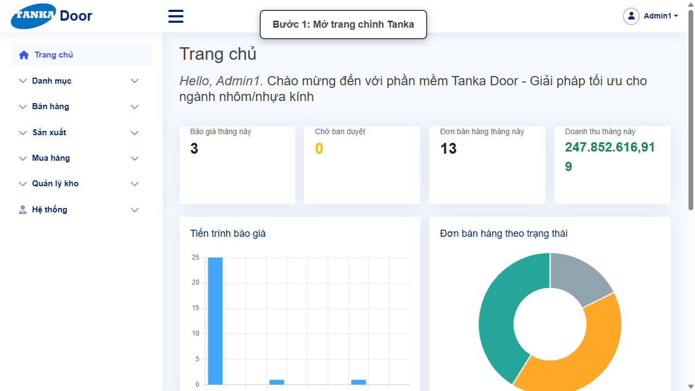
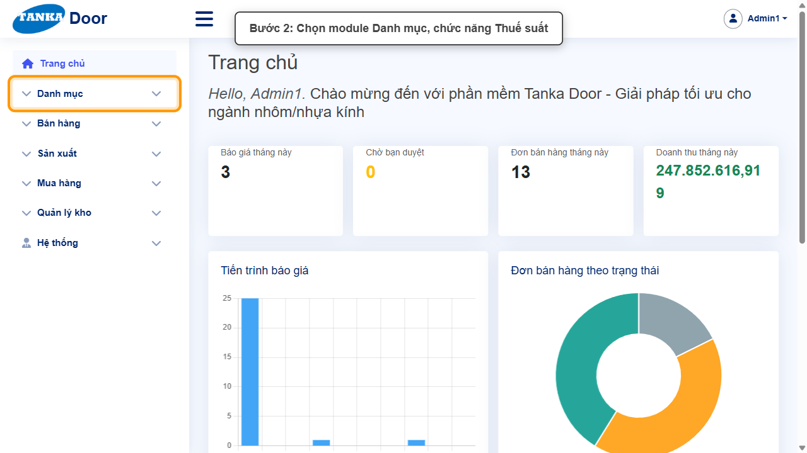
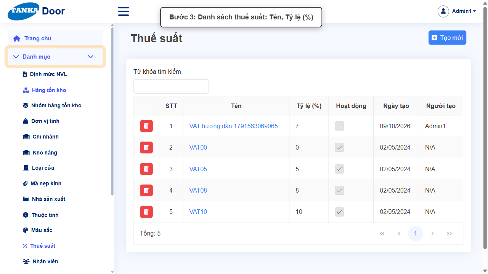
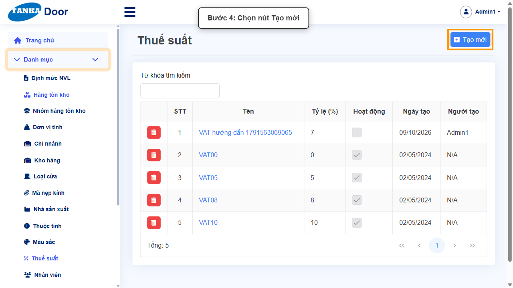
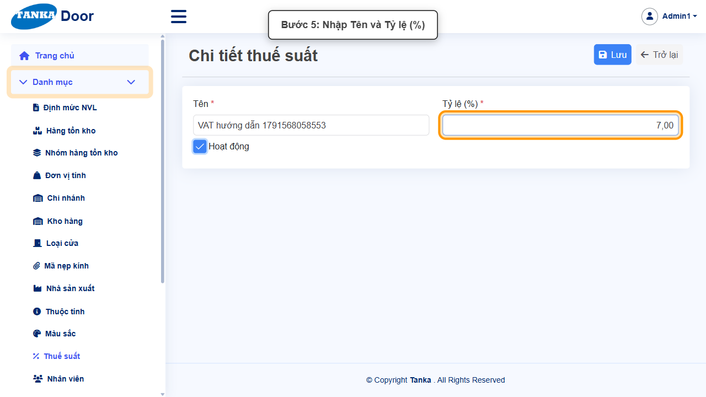
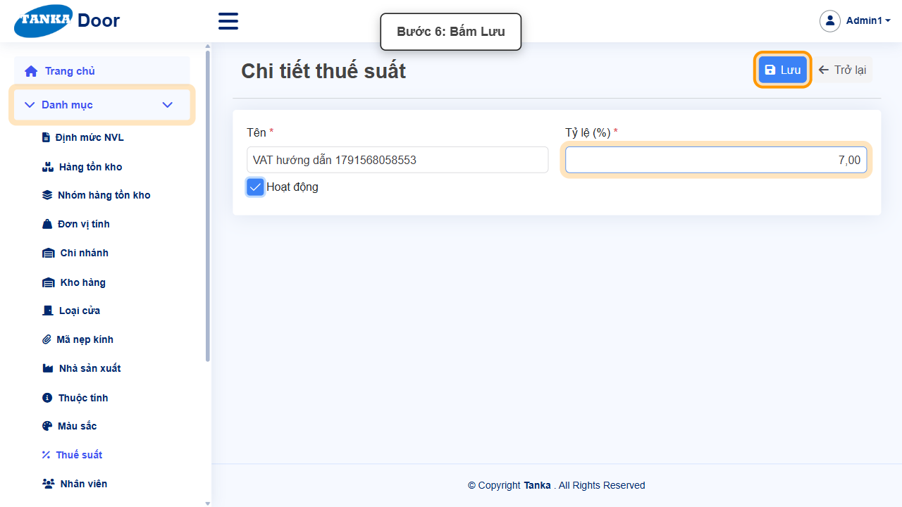
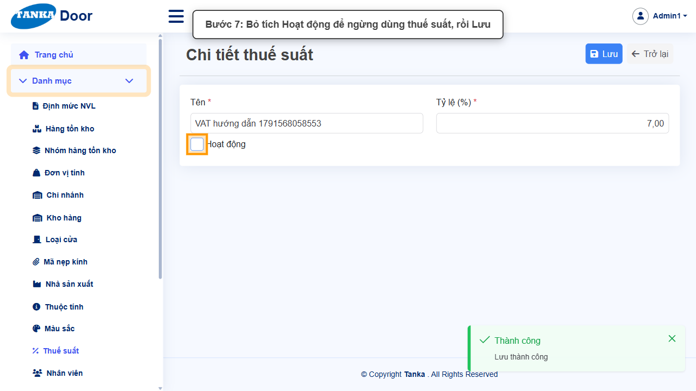
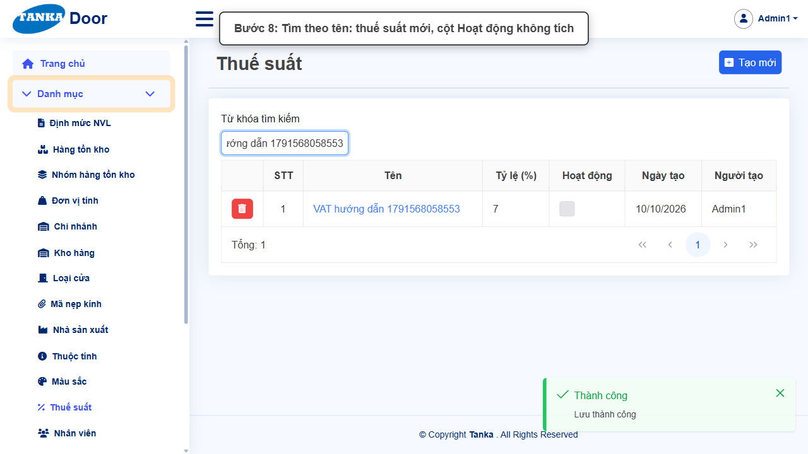

# HƯỚNG DẪN SỬ DỤNG — THUẾ SUẤT

**Đường dẫn:** Danh mục > Thuế suất  
**Mục tiêu:** Tạo thuế suất (tên, tỷ lệ %) dùng cho mặt hàng và chứng từ.  
**Dành cho:** Người mới sử dụng TANKA Door

## Trước khi bắt đầu

**Cần có sẵn:**

- Mức thuế suất theo quy định hiện hành.

**Quyền cần có:** Tài khoản thuộc nhóm có quyền Xem/Tạo/Sửa module **Danh mục** (UG-063). Nếu không thấy menu hoặc nút như trong ảnh, liên hệ quản trị hệ thống.

> Ảnh minh họa được chụp bằng tài khoản quản trị trên hệ thống thử nghiệm. Thuật ngữ viết tắt (HTK, NVL, BH, SX, YCMH...) và thứ tự các nghiệp vụ: xem **UG-000 Tổng quan**.

## 1. Khái niệm

Hệ thống có sẵn VAT00, VAT05, VAT08, VAT10. Thuế suất gắn trên mặt hàng (tab Thông tin chung) và trên báo giá / đơn BH (ô Thuế suất). Để đổi thuế suất cho nhiều mặt hàng cùng lúc, dùng **Cập nhật thuế suất** ở danh sách Hàng tồn kho (UG-084).

## 2. Ví dụ dữ liệu nhập

Ví dụ dưới đây giúp bạn hình dung cách nhập. Hãy nhập dữ liệu thật của công ty bạn; tên/mã có hậu tố số trong ảnh là dữ liệu thử nghiệm, mã chứng từ (BG_, BH_, SX_, MH_...) do hệ thống tự sinh nên của bạn sẽ khác.

| Trường | Giá trị |
| --- | --- |
| Tên | VAT 7% |
| Tỷ lệ (%) | 7 |

> **Không xoá danh mục đã dùng.** Khi không dùng nữa, bỏ tích **Hoạt động** rồi **Lưu**: bản ghi không còn hiện trong ô chọn khi lập chứng từ mới nhưng vẫn giữ nguyên trên chứng từ cũ. Ảnh minh họa có bước bỏ tích này ở cuối — bạn chỉ làm bước đó khi thật sự ngừng sử dụng.

## 3. Quy trình thao tác từng bước

### Bước 1. Mở trang chủ Tanka Door

**Kết quả mong đợi:** menu chức năng hiện ở bên trái màn hình.

*Hình 1: Mở trang chủ Tanka Door.*

<video src="videos/UG-081-thue-suat/01.webm" controls muted width="100%"></video>

### Bước 2. Mở Danh mục > Thuế suất

**Kết quả mong đợi:** màn hình **Thuế suất** hiện ra với danh sách dữ liệu và các ô lọc.

*Hình 2: Mở Danh mục > Thuế suất.*

<video src="videos/UG-081-thue-suat/02.webm" controls muted width="100%"></video>

### Bước 3. Xem danh sách

Danh sách hiển thị Tên, Tỷ lệ (%) và trạng thái Hoạt động của các thuế suất. Kiểm tra mức thuế cần tạo chưa có sẵn.

*Hình 3: Xem danh sách.*

<video src="videos/UG-081-thue-suat/03.webm" controls muted width="100%"></video>

### Bước 4. Bấm Tạo mới

**Kết quả mong đợi:** form nhập mới mở ra; các ô có dấu * là bắt buộc.

*Hình 4: Bấm Tạo mới.*

<video src="videos/UG-081-thue-suat/04.webm" controls muted width="100%"></video>

### Bước 5. Nhập tên và tỷ lệ

Nhập **Tên *** và **Tỷ lệ (%) ***.

*Hình 5: Nhập tên và tỷ lệ.*

<video src="videos/UG-081-thue-suat/05.webm" controls muted width="100%"></video>

### Bước 6. Bấm Lưu

**Kết quả mong đợi:** thông báo xanh **"Lưu thành công"** hiện ở góc phải, nút **Lưu** mờ lại.

*Hình 6: Bấm Lưu.*

<video src="videos/UG-081-thue-suat/06.webm" controls muted width="100%"></video>

### Bước 7. Ngừng sử dụng (khi cần)

Bỏ tích **Hoạt động** rồi **Lưu** khi mức thuế không còn áp dụng.

*Hình 7: Ngừng sử dụng (khi cần).*

<video src="videos/UG-081-thue-suat/07.webm" controls muted width="100%"></video>

### Bước 8. Kiểm tra trong danh sách

Cột **Hoạt động** không tích.

*Hình 8: Kiểm tra trong danh sách.*

<video src="videos/UG-081-thue-suat/08.webm" controls muted width="100%"></video>

## 4. Khi không thao tác được

| Hiện tượng | Cách xử lý ngay |
| --- | --- |
| Nút Lưu đang mờ | Còn ô có dấu * chưa nhập/chọn, hoặc form chưa có thay đổi nào. |
| Bấm Lưu nhưng không thấy phản hồi | Không bấm thêm; chờ thông báo rồi tìm lại bản ghi trong danh sách. |
| Muốn bỏ một danh mục không dùng nữa | Bỏ tích **Hoạt động** rồi Lưu (khuyến nghị) thay vì xoá — bản ghi cũ vẫn giữ trên các chứng từ đã lập, nhưng không còn được chọn khi lập chứng từ mới. |

## 5. Checklist dành cho người mới

- [ ] Đã nhập đủ các ô có dấu *.
- [ ] Đã bấm Lưu và thấy thông báo "Lưu thành công".
- [ ] Đã tìm lại được bản ghi trong danh sách.
- [ ] Dùng bỏ tích Hoạt động thay vì xoá khi không dùng nữa.

---

_Tài liệu này được biên soạn dựa trên thao tác thực tế trên hệ thống door-v1.test.tankasoft.com. Ảnh minh họa có thể thay đổi theo phiên bản giao diện._
