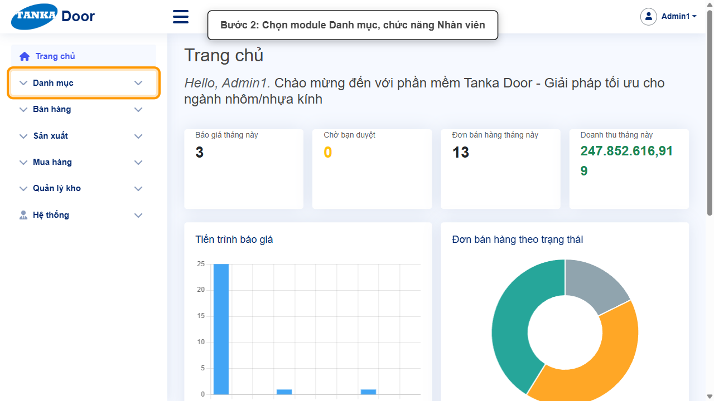
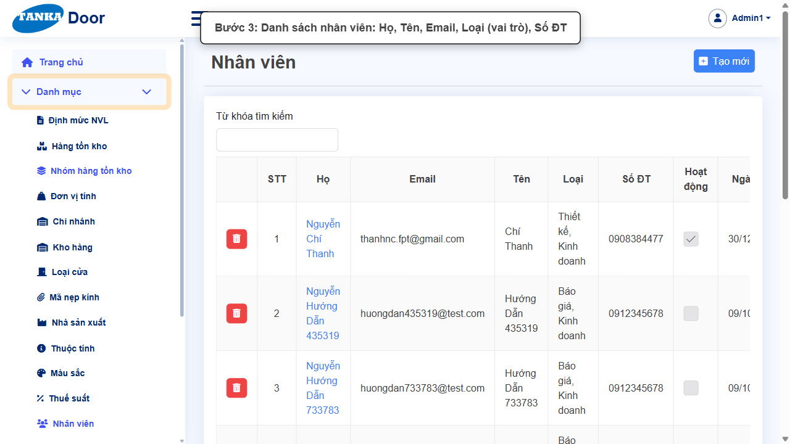
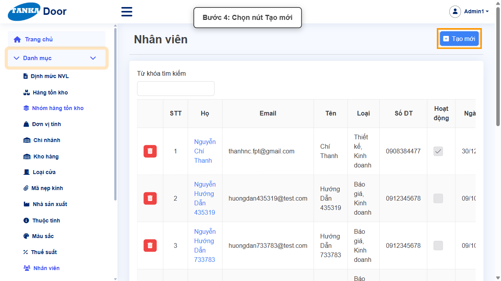
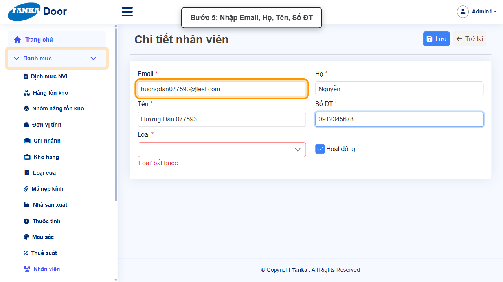
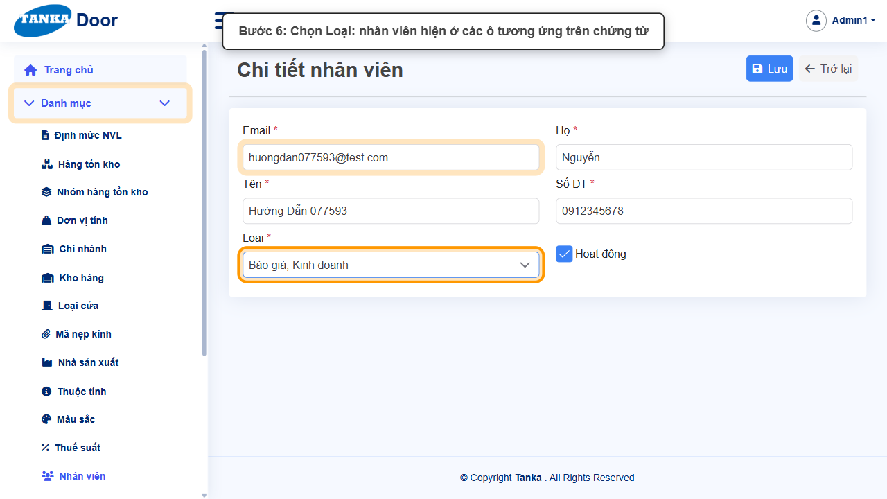
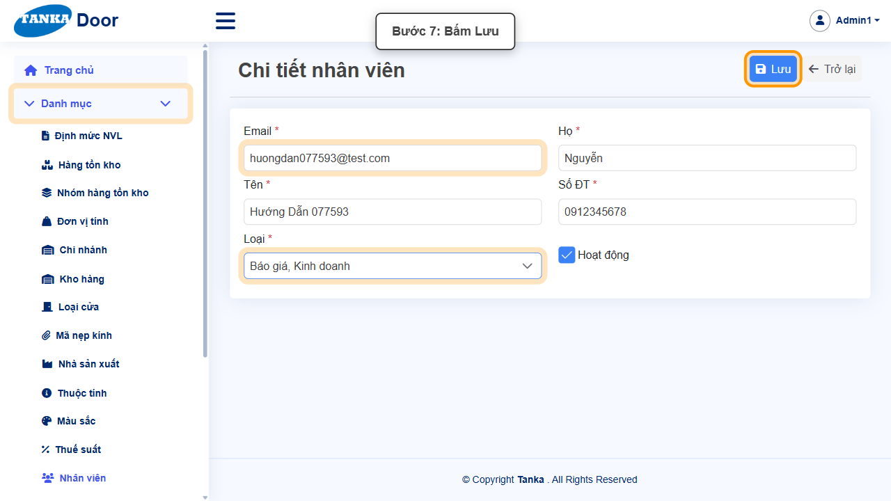
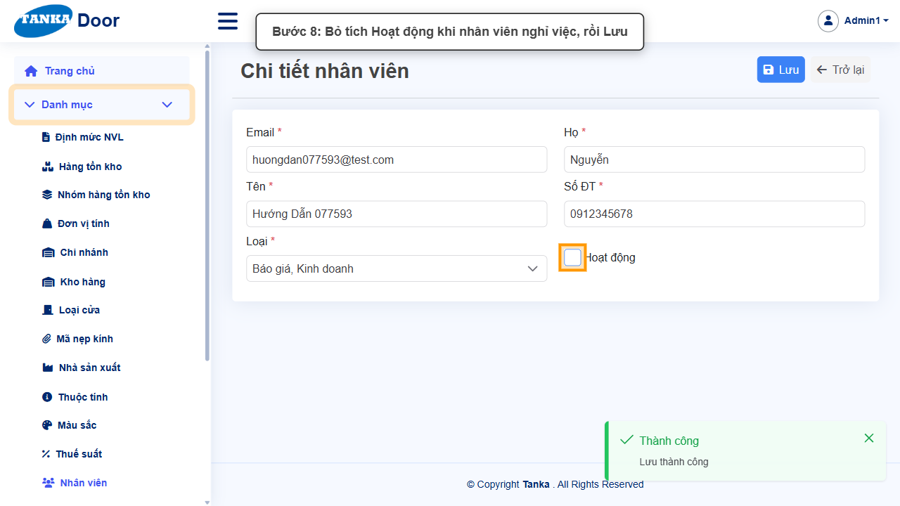
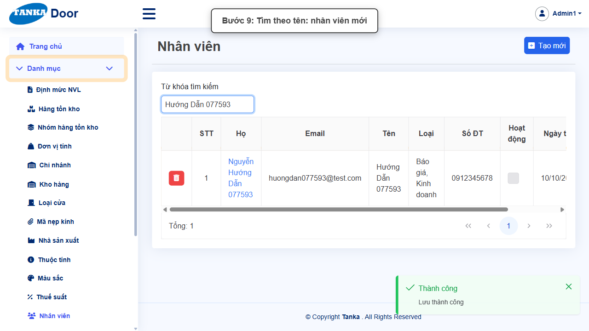

# HƯỚNG DẪN SỬ DỤNG — NHÂN VIÊN

**Đường dẫn:** Danh mục > Nhân viên  
**Mục tiêu:** Tạo nhân viên và phân vai trò để chọn được trên báo giá, đơn bán hàng và giám sát sản xuất.  
**Dành cho:** Người mới sử dụng TANKA Door

## Trước khi bắt đầu

**Cần có sẵn:**

- Thông tin nhân viên: họ tên, email, số điện thoại, vai trò (báo giá, kinh doanh, thiết kế...).

**Quyền cần có:** Tài khoản thuộc nhóm có quyền Xem/Tạo/Sửa module **Danh mục** (UG-063). Nếu không thấy menu hoặc nút như trong ảnh, liên hệ quản trị hệ thống.

> Ảnh minh họa được chụp bằng tài khoản quản trị trên hệ thống thử nghiệm. Thuật ngữ viết tắt (HTK, NVL, BH, SX, YCMH...) và thứ tự các nghiệp vụ: xem **UG-000 Tổng quan**.

## 1. Khái niệm

**Loại** (vai trò, chọn nhiều): Báo giá, Thiết kế, Kinh doanh, Kế hoạch, Sản xuất, Lắp đặt, Vệ sinh. Nhân viên chỉ hiện ở ô tương ứng trên chứng từ khi có vai trò đó — ví dụ ô **Nhân viên BG** chỉ liệt kê nhân viên có Loại "Báo giá". Danh mục này khác với **Hệ thống > Users** (tài khoản đăng nhập).

## 2. Ví dụ dữ liệu nhập

Ví dụ dưới đây giúp bạn hình dung cách nhập. Hãy nhập dữ liệu thật của công ty bạn; tên/mã có hậu tố số trong ảnh là dữ liệu thử nghiệm, mã chứng từ (BG_, BH_, SX_, MH_...) do hệ thống tự sinh nên của bạn sẽ khác.

| Trường | Giá trị |
| --- | --- |
| Email / Họ / Tên | tranthib@congty.vn / Trần / Thị B |
| Số ĐT | 0912345678 |
| Loại | Báo giá, Kinh doanh |

> **Không xoá danh mục đã dùng.** Khi không dùng nữa, bỏ tích **Hoạt động** rồi **Lưu**: bản ghi không còn hiện trong ô chọn khi lập chứng từ mới nhưng vẫn giữ nguyên trên chứng từ cũ. Ảnh minh họa có bước bỏ tích này ở cuối — bạn chỉ làm bước đó khi thật sự ngừng sử dụng.

## 3. Quy trình thao tác từng bước

### Bước 1. Mở trang chủ Tanka Door

**Kết quả mong đợi:** menu chức năng hiện ở bên trái màn hình.

*Hình 1: Mở trang chủ Tanka Door.*

<video src="videos/UG-082-nhan-vien/01.webm" controls muted width="100%"></video>

### Bước 2. Mở Danh mục > Nhân viên

**Kết quả mong đợi:** màn hình **Nhân viên** hiện ra với danh sách dữ liệu và các ô lọc.

*Hình 2: Mở Danh mục > Nhân viên.*

<video src="videos/UG-082-nhan-vien/02.webm" controls muted width="100%"></video>

### Bước 3. Xem danh sách

Danh sách hiển thị Họ tên, Email, Loại (vai trò), Số ĐT. Kiểm tra nhân viên chưa có trong danh sách để tránh trùng.

*Hình 3: Xem danh sách.*

<video src="videos/UG-082-nhan-vien/03.webm" controls muted width="100%"></video>

### Bước 4. Bấm Tạo mới

**Kết quả mong đợi:** form nhập mới mở ra; các ô có dấu * là bắt buộc.

*Hình 4: Bấm Tạo mới.*

<video src="videos/UG-082-nhan-vien/04.webm" controls muted width="100%"></video>

### Bước 5. Nhập thông tin nhân viên

Nhập **Email ***, **Họ ***, **Tên ***, **Số ĐT ***.

*Hình 5: Nhập thông tin nhân viên.*

<video src="videos/UG-082-nhan-vien/05.webm" controls muted width="100%"></video>

### Bước 6. Chọn vai trò

Chọn **Loại *** (một hoặc nhiều vai trò).

*Hình 6: Chọn vai trò.*

<video src="videos/UG-082-nhan-vien/06.webm" controls muted width="100%"></video>

### Bước 7. Bấm Lưu

**Kết quả mong đợi:** thông báo xanh **"Lưu thành công"** hiện ở góc phải, nút **Lưu** mờ lại.

*Hình 7: Bấm Lưu.*

<video src="videos/UG-082-nhan-vien/07.webm" controls muted width="100%"></video>

### Bước 8. Nhân viên nghỉ việc

Bỏ tích **Hoạt động** rồi **Lưu** — nhân viên không còn được chọn trên chứng từ mới, chứng từ cũ vẫn giữ tên.

*Hình 8: Nhân viên nghỉ việc.*

<video src="videos/UG-082-nhan-vien/08.webm" controls muted width="100%"></video>

### Bước 9. Kiểm tra trong danh sách

Ô Từ khóa tìm theo **tên** (không tìm theo email).

*Hình 9: Kiểm tra trong danh sách.*

<video src="videos/UG-082-nhan-vien/09.webm" controls muted width="100%"></video>

### Video tổng hợp toàn bộ thao tác

Video dưới đây ghép liền toàn bộ các bước ở trên, từ lúc mở chức năng đến khi hoàn thành — xem lại một lượt trước khi tự thao tác.

<video src="videos/UG-082-nhan-vien/full.webm" controls muted width="100%"></video>

## 4. Khi không thao tác được

| Hiện tượng | Cách xử lý ngay |
| --- | --- |
| Không thấy nhân viên ở ô Nhân viên BG/KD/thiết kế | Thiếu vai trò tương ứng trong ô Loại, hoặc nhân viên đã bỏ Hoạt động. |
| Nút Lưu đang mờ | Còn ô có dấu * chưa nhập/chọn, hoặc form chưa có thay đổi nào. |
| Bấm Lưu nhưng không thấy phản hồi | Không bấm thêm; chờ thông báo rồi tìm lại bản ghi trong danh sách. |
| Muốn bỏ một danh mục không dùng nữa | Bỏ tích **Hoạt động** rồi Lưu (khuyến nghị) thay vì xoá — bản ghi cũ vẫn giữ trên các chứng từ đã lập, nhưng không còn được chọn khi lập chứng từ mới. |

## 5. Checklist dành cho người mới

- [ ] Đã nhập đủ các ô có dấu *.
- [ ] Đã bấm Lưu và thấy thông báo "Lưu thành công".
- [ ] Đã tìm lại được bản ghi trong danh sách.
- [ ] Dùng bỏ tích Hoạt động thay vì xoá khi không dùng nữa.

---

_Tài liệu này được biên soạn dựa trên thao tác thực tế trên hệ thống door-v1.test.tankasoft.com. Ảnh minh họa có thể thay đổi theo phiên bản giao diện._
