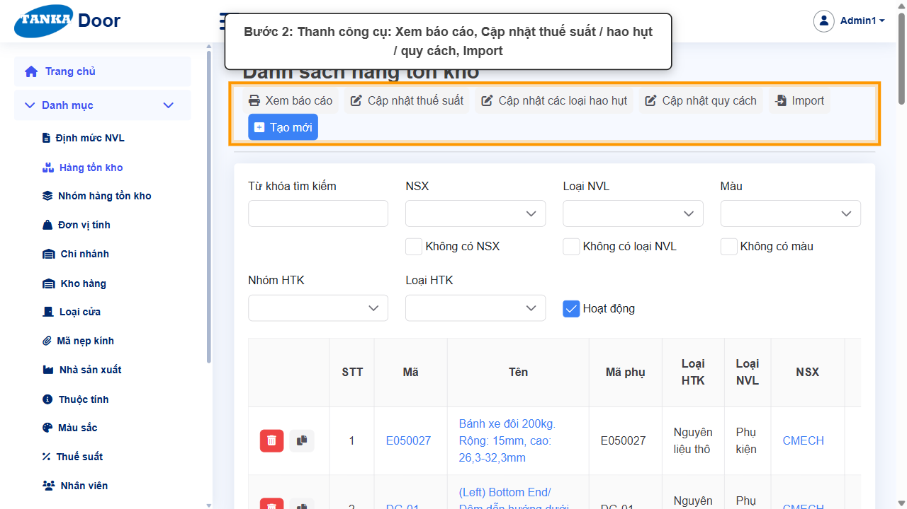
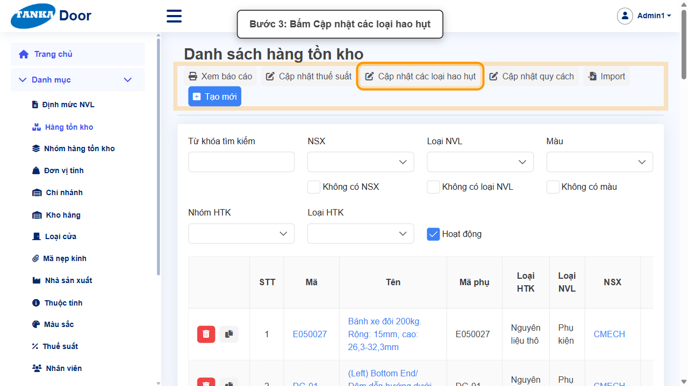
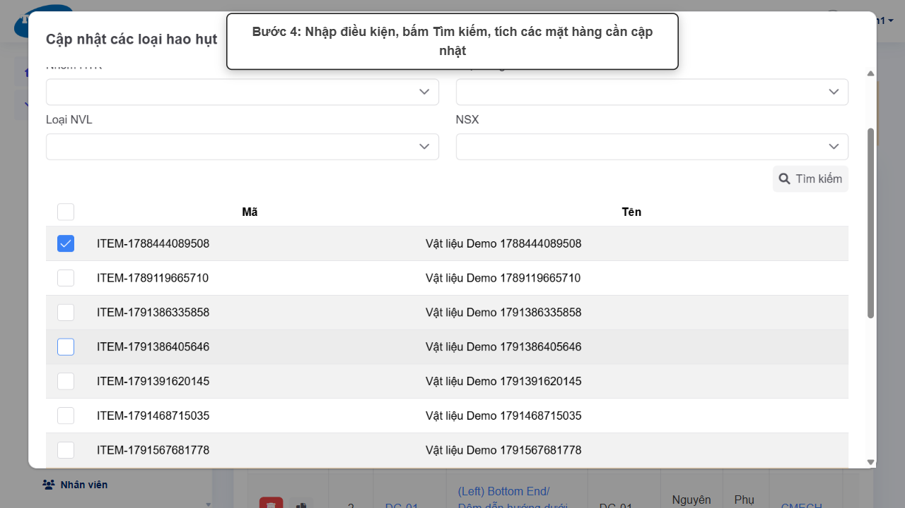
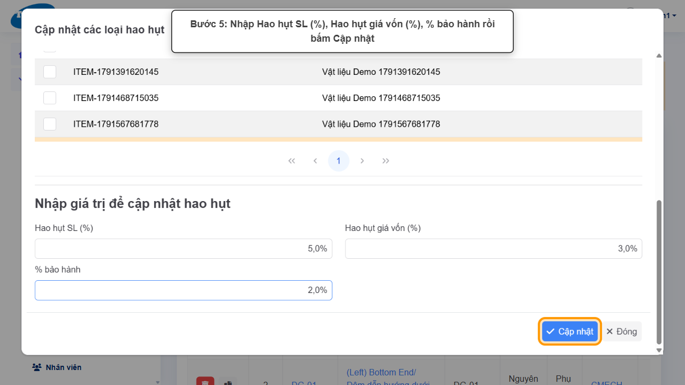
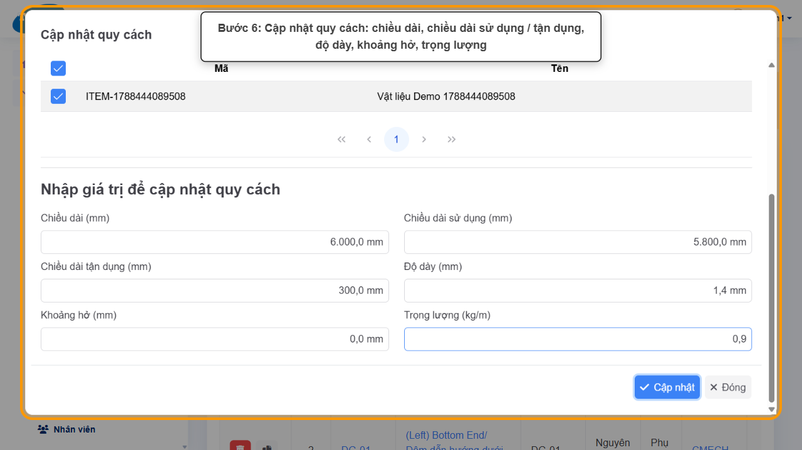
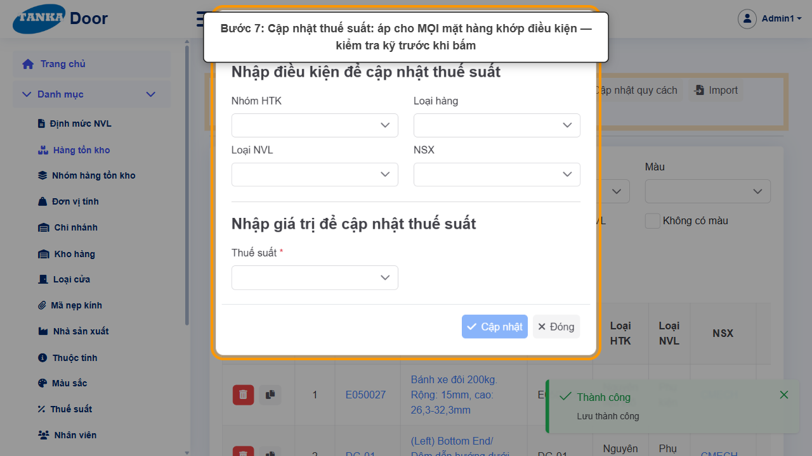
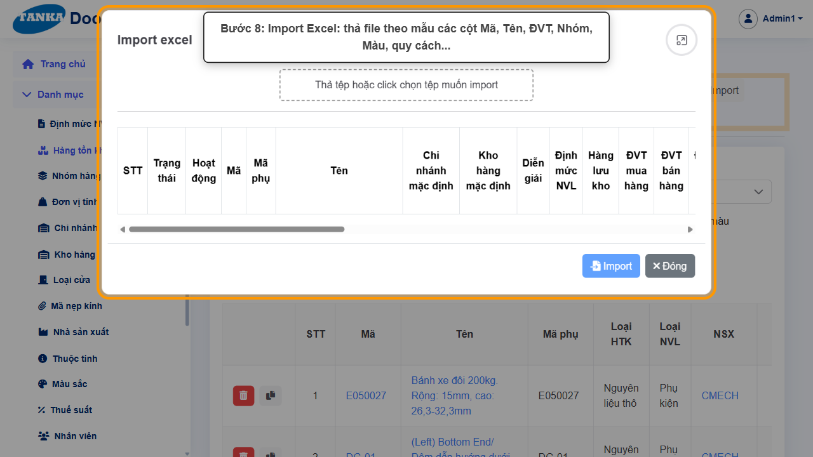
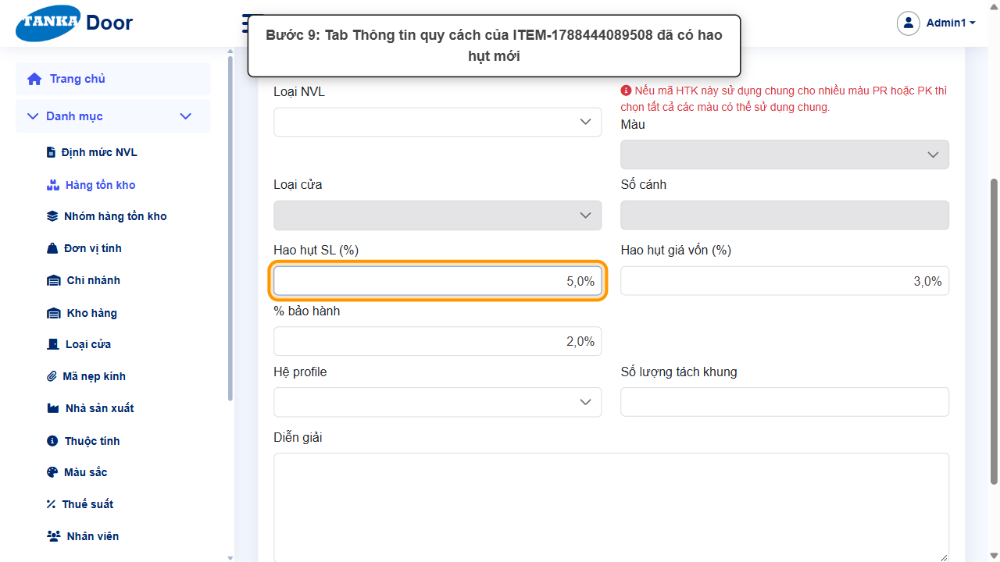

# HƯỚNG DẪN SỬ DỤNG — HÀNG TỒN KHO: CẬP NHẬT HÀNG LOẠT

**Đường dẫn:** Danh mục > Hàng tồn kho (thanh công cụ của danh sách)  
**Mục tiêu:** Cập nhật hao hụt, quy cách cho nhiều mặt hàng cùng lúc; hiểu công cụ Cập nhật thuế suất và Import Excel.  
**Dành cho:** Người phụ trách danh mục vật tư

## Trước khi bắt đầu

**Cần có sẵn:**

- Đã có các mặt hàng cần cập nhật (UG-010) và biết giá trị mới (hao hụt, quy cách...).

**Nên đọc trước:** UG-010.

**Quyền cần có:** Tài khoản thuộc nhóm có quyền Xem/Tạo/Sửa module **Danh mục** (UG-063). Nếu không thấy menu hoặc nút như trong ảnh, liên hệ quản trị hệ thống.

> Ảnh minh họa được chụp bằng tài khoản quản trị trên hệ thống thử nghiệm. Thuật ngữ viết tắt (HTK, NVL, BH, SX, YCMH...) và thứ tự các nghiệp vụ: xem **UG-000 Tổng quan**.

## 1. Các công cụ trên thanh công cụ

| Nút | Tác dụng | Cách chọn mặt hàng |
| --- | --- | --- |
| Cập nhật các loại hao hụt | Đặt **Hao hụt SL (%)**, **Hao hụt giá vốn (%)**, **% bảo hành** | Nhập điều kiện → **Tìm kiếm** → **tích** từng mặt hàng |
| Cập nhật quy cách | Đặt **Chiều dài**, **Chiều dài sử dụng**, **Chiều dài tận dụng**, **Độ dày**, **Khoảng hở** (mm), **Trọng lượng** (kg/m) | Nhập điều kiện → **Tìm kiếm** → **tích** từng mặt hàng |
| Cập nhật thuế suất | Đặt **Thuế suất** | **Không có bước tích** — áp cho **mọi** mặt hàng khớp điều kiện (Nhóm HTK, Loại hàng, Loại NVL, NSX) |
| Import | Nhập / cập nhật mặt hàng từ file Excel (~30 cột: Mã, Tên, Chi nhánh, Kho mặc định, ĐVT, Thuế, Nhóm HTK, Màu, quy cách...) | Theo file |

> **Cẩn thận:** các thay đổi hàng loạt không có bước xác nhận và không hoàn tác được. Với hao hụt/quy cách chỉ những dòng được **tích** mới bị cập nhật; với thuế suất, hãy lọc thật chặt trước khi bấm Cập nhật.

> Ô số dùng **dấu phẩy thập phân**: gõ `1,4` cho 1,4 mm (gõ `1.4` sẽ thành 14).

## 2. Ví dụ dữ liệu nhập

Ví dụ dưới đây giúp bạn hình dung cách nhập. Hãy nhập dữ liệu thật của công ty bạn; tên/mã có hậu tố số trong ảnh là dữ liệu thử nghiệm, mã chứng từ (BG_, BH_, SX_, MH_...) do hệ thống tự sinh nên của bạn sẽ khác.

| Trường | Giá trị |
| --- | --- |
| Mặt hàng | Thanh profile cần cập nhật (ví dụ mặt hàng tạo ở UG-010) |
| Hao hụt SL / giá vốn / bảo hành | 5% / 3% / 2% |
| Quy cách | Chiều dài 6.000, sử dụng 5.800, tận dụng 300, độ dày 1,4, khoảng hở 0 (mm); trọng lượng 0,9 kg/m |

## 3. Quy trình thao tác từng bước

### Bước 1. Mở trang chủ Tanka Door

**Kết quả mong đợi:** menu chức năng hiện ở bên trái màn hình.

*Hình 1: Trang chủ.*

<video src="videos/UG-084-cap-nhat-hang-loat-htk/01.webm" controls muted width="100%"></video>

### Bước 2. Mở Danh mục > Hàng tồn kho

Thanh công cụ phía trên danh sách: **Xem báo cáo**, **Cập nhật thuế suất**, **Cập nhật các loại hao hụt**, **Cập nhật quy cách**, **Import**, **Tạo mới**.

*Hình 2: Thanh công cụ của danh sách Hàng tồn kho.*

<video src="videos/UG-084-cap-nhat-hang-loat-htk/02.webm" controls muted width="100%"></video>

### Bước 3. Mở Cập nhật các loại hao hụt

Trên thanh công cụ của danh sách Hàng tồn kho, bấm **Cập nhật các loại hao hụt**.

**Kết quả mong đợi:** hộp thoại cập nhật mở ra với phần **Nhập điều kiện** để tìm mặt hàng.

*Hình 3: Bấm Cập nhật các loại hao hụt.*

<video src="videos/UG-084-cap-nhat-hang-loat-htk/03.webm" controls muted width="100%"></video>

### Bước 4. Tìm và tích chọn mặt hàng

Ở **Nhập điều kiện**: nhập Từ khóa (mã/tên) và/hoặc chọn Nhóm HTK, Loại hàng, Loại NVL, NSX → bấm **Tìm kiếm**. Bảng kết quả hiện ra; **tích** các mặt hàng cần cập nhật (ô ở tiêu đề để tích tất cả). Các ô giá trị chỉ mở khi đã tích ít nhất một dòng.

*Hình 4: Tìm kiếm và tích mặt hàng.*

<video src="videos/UG-084-cap-nhat-hang-loat-htk/04.webm" controls muted width="100%"></video>

### Bước 5. Nhập hao hụt và bấm Cập nhật

Nhập **Hao hụt SL (%)**, **Hao hụt giá vốn (%)**, **% bảo hành** → **Cập nhật**. Thông báo "Lưu thành công", hộp thoại tự đóng.

*Hình 5: Nhập hao hụt và bấm Cập nhật.*

<video src="videos/UG-084-cap-nhat-hang-loat-htk/05.webm" controls muted width="100%"></video>

### Bước 6. Cập nhật quy cách

Mở **Cập nhật quy cách**, tìm và tích mặt hàng như bước 4, nhập **Chiều dài**, **Chiều dài sử dụng**, **Chiều dài tận dụng**, **Độ dày**, **Khoảng hở** (mm), **Trọng lượng (kg/m)** → **Cập nhật**. Chiều dài sử dụng / tận dụng ảnh hưởng tới tính tối ưu cắt thanh và đầu thừa (UG-032, UG-075).

*Hình 6: Cập nhật quy cách.*

<video src="videos/UG-084-cap-nhat-hang-loat-htk/06.webm" controls muted width="100%"></video>

### Bước 7. Cập nhật thuế suất (chỉ giới thiệu)

Hộp thoại chỉ có điều kiện (Nhóm HTK, Loại hàng, Loại NVL, NSX) và **Thuế suất ***, không có bước tìm và tích — bấm Cập nhật sẽ áp cho **mọi** mặt hàng khớp điều kiện. Chỉ dùng khi chắc chắn về phạm vi (ví dụ đổi VAT cho cả một nhóm hàng).

*Hình 7: Hộp thoại Cập nhật thuế suất.*

<video src="videos/UG-084-cap-nhat-hang-loat-htk/07.webm" controls muted width="100%"></video>

### Bước 8. Import Excel (chỉ giới thiệu)

Kéo thả file Excel theo đúng các cột mẫu hiển thị trong hộp thoại để tạo/cập nhật nhiều mặt hàng một lần.

*Hình 8: Hộp thoại Import Excel.*

<video src="videos/UG-084-cap-nhat-hang-loat-htk/08.webm" controls muted width="100%"></video>

### Bước 9. Kiểm tra trên mặt hàng

Mở mặt hàng, tab **Thông tin quy cách**: Hao hụt SL, Hao hụt giá vốn, % bảo hành đã có giá trị mới.

*Hình 9: Hao hụt mới trên tab Thông tin quy cách.*

<video src="videos/UG-084-cap-nhat-hang-loat-htk/09.webm" controls muted width="100%"></video>

### Video tổng hợp toàn bộ thao tác

Video dưới đây ghép liền toàn bộ các bước ở trên, từ lúc mở chức năng đến khi hoàn thành — xem lại một lượt trước khi tự thao tác.

<video src="videos/UG-084-cap-nhat-hang-loat-htk/full.webm" controls muted width="100%"></video>

## 4. Khi không thao tác được

| Hiện tượng | Cách xử lý ngay |
| --- | --- |
| Ô giá trị và nút Cập nhật bị mờ | Chưa tích mặt hàng nào sau khi Tìm kiếm. |
| Nút Tìm kiếm bị mờ | Chưa nhập điều kiện nào. |
| Giá trị thập phân bị sai (1.4 thành 14) | Dùng dấu phẩy thập phân: 1,4. |
| Lỡ cập nhật sai | Không hoàn tác được — cập nhật lại giá trị đúng cho các mặt hàng đó. |

## 5. Checklist

- [ ] Lọc và tích đúng mặt hàng trước khi cập nhật hao hụt / quy cách.
- [ ] Với thuế suất, kiểm tra kỹ điều kiện lọc vì không có bước tích chọn.
- [ ] Kiểm tra lại trên một mặt hàng sau khi cập nhật.

---

_Tài liệu này được biên soạn dựa trên thao tác thực tế trên hệ thống door-v1.test.tankasoft.com. Ảnh minh họa có thể thay đổi theo phiên bản giao diện._
